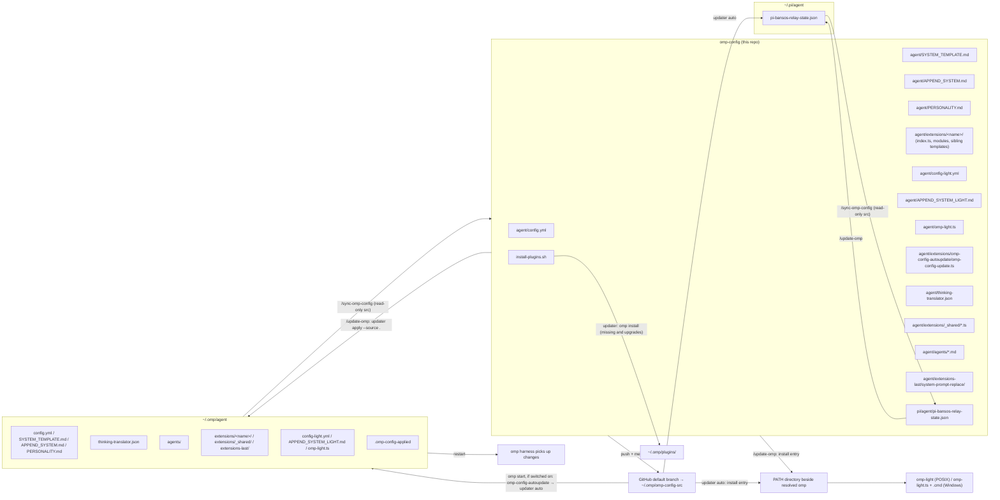

# Repository Guidelines

## Project Overview

`omp-config` is the auditable, version-controlled slice of the user's Oh My Pi
(`omp`) coding-harness configuration — **not** a full `~/.omp` backup
(`README.md`). It holds only reviewable inputs: harness config, the vendored
Handlebars base system-prompt template, full and light system-prompt appendices,
light-mode config and launcher source, custom subagent definitions, local
TypeScript extensions (one directory each, with the extension's templates beside its code (its settings are sections of the unified `omomp.yml`)), the agent-root
`thinking-translator.json` for `omp-thinking-translator`, the `pi-bansos`
plugin state (`pi/agent/pi-bansos-relay-state.json`), the plugin install
list, the repo → machine updater (`agent/extensions/omp-config-autoupdate/omp-config-update.ts`) with its
startup hook, the maintenance commands that move state between this repo
and a machine's live `~/.omp/agent` (plus `~/.pi/agent` for the `pi-bansos`
state) and install its PATH launcher, the configuration check (CI) that
runs the config in a real omp session (`ci/`), and the dev tooling that
formats, lints and type-checks the TypeScript (`package.json`, `biome.json`,
`tsconfig.json`). Runtime state (databases, sessions, caches, credentials)
is deliberately excluded.

The repo is consumed by `omp` in two directions:
- **repo → machine**: `/update-omp` runs `omp-config-update.ts apply` against the
  working checkout. Opt-in per machine (`/omp-config-autoupdate on`, off by
  default), `extensions/omp-config-autoupdate/` runs `omp-config-update.ts auto`
  at every `omp` start, which fetches the GitHub default branch into its own
  clone (`~/.omp/omp-config-src`) and applies it when the commit differs from
  the one recorded in `<agent dir>/.omp-config-applied`; when it does not, it
  still reruns `omp install` on the unpinned GitHub plugins, so they follow
  their default branch without a config commit.
- **machine → repo**: `/sync-omp-config` captures eligible local state back here.

## Architecture & Data Flow



- **Config vs behavior are separated.** `SYSTEM_TEMPLATE.md` supplies the native
  workflow; `PERSONALITY.md` supplies the speaking-style block (the prompt's
  `{{personality}}` value, rendered under the template's `# Personality`
  heading); `APPEND_SYSTEM.md` adds local reply, document and advisor policy.
  Agent responsibilities live in `agent/agents/*.md`, while model bindings live
  only in `agent/config.yml` under `task.agentModelOverrides`.
- **Extensions are loaded per session** from native discovery and the
  `config.yml` `extensions` paths. Each extension is a directory
  `extensions/<name>/` whose `index.ts` default-exports the factory that
  registers tools/commands or subscribes to lifecycle events on the
  `ExtensionAPI` (`pi`); the directory name is the extension id
  (`extension-module:<name>`). Native discovery looks one level deep: a direct
  `*.ts`, `<dir>/index.ts`, or `<dir>/package.json#omp.extensions`, so the
  other modules of a directory and `_shared/` (no `index.ts`) are never loaded
  as extensions.
- **Load order is hook order.** `before_agent_start` handlers run extension by
  extension in load order, each receiving the system prompt the previous one
  returned (not every event is serial: `session_shutdown` handlers run
  concurrently). Order: native discovery (`~/.omp/agent/extensions/`, plus the
  TS/JS module entries of a legacy `settings.json` `extensions` list, loaded whether
  or not `config.yml` exists; only its extension-pack roots are ignored when
  `config.yml` exists) → hooks → plugin extensions → `-e` paths →
  `config.yml` `extensions` in list order → OMP's inline factories
  (SDK-supplied extensions, autoresearch, the custom-tools wrapper); a path loads
  once, at its first occurrence. `extensions-last/system-prompt-replace/` must
  therefore stay the last `config.yml` `extensions` entry and outside
  `extensions/`, which makes it last among path-loaded extensions; inline
  factories still run after it (autoresearch rewrites the prompt only in
  autoresearch mode). Within `extensions/` the order is whatever the native
  `glob` walk returns — no sort, not filename order — so filename prefixes
  cannot order extensions.
- **Two one-way syncs, never one "sync".** `/sync-omp-config` never writes the
  machine; its sync range includes the root `SYSTEM_TEMPLATE.md` and
  `PERSONALITY.md`, the three light assets, the agent-root
  `thinking-translator.json`, the extension modules (the
  updater script included) and shipped templates, the structured `omomp.yml` (extension sections), `thinking-translator.json`, and `~/.pi/agent/pi-bansos-relay-state.json`, but excludes installed
  PATH launchers, `.omp-config-applied`, and every host-owned file inside an extension
  directory. It stops on a machine still on the flat extension layout and asks for
  `/update-omp` first. Repo → machine is the updater
  (`agent/extensions/omp-config-autoupdate/omp-config-update.ts`; its header is the contract): automatically at
  start, or via `/update-omp`. It writes the machine and installs `omp-light`
  beside the resolved `omp` executable. Its managed set (`managedPlain`,
  `STRUCTURED`) must match the sync range in `.omp/commands/sync-omp-config.md`.
- **Inside an extension directory, only modules and shipped templates are the
  repo's.** `managedPlain` takes `extensions[-last]/<name>/*.ts`,
  `extensions/user-prompt-inject/PROMPT-INJECT-*.md`,
  `extensions/turn-judge/TURN-JUDGE-*.md` and
  `extensions/tool-policy-nag/INTENT-*.md`; extension settings are not in the extension directory: they are sections of `omomp.yml`. Any other file there (`APPEND_SYSTEM_MODEL.md`, the machine's own `WATCHDOG-*.md` and templates) belongs to the host and is never written, deleted or synced back.
- **The repo wins on managed items; everything else is the host's.** The updater
  overwrites managed files and managed keys, host edits included (in `auto`
  mode only when the fetched commit differs from the applied one; `/update-omp`
  applies the working tree whenever run). It never touches host-only files,
  host-only keys (unless the repo turns their parent map into a non-map),
  `config.yml`'s machine-local fields (`LOCAL_CONFIG_FIELDS` in the updater,
  also used by `/sync-omp-config`; their ancestors are never replaced by a
  non-map), machine entries of `config.yml` `extensions` (`MACHINE_LIST_FIELDS`:
  entries the repo's list does not have, kept ahead of the repo's entries and
  never synced back, e.g. `~/.claude`), app-managed files, unparsable host
  structured files, or runtime state. General deletions use git's applied-to-new
  diff (managed files, structured keys and `extensions` entries; a whole dropped
  structured file leaves the live file alone). Both modes also run relocations
  and the finite Todo and ctx retirements after the independent plugin is ready.
  `/update-omp` has no git-derived deletion baseline.
- **Relocations from the flat layout run in both modes** (updater header,
  RELOCATIONS): a flat `extensions/<name>.ts` superseded by a shipped
  `<name>/index.ts` is deleted (two modules with one id would both load), and
  so is the agent-root `omp-config-update.ts` the updater replaced;
  the extension settings an earlier layout kept in standalone JSON files (`extensions/<name>/<name>.json`, flat `extensions/<name>.json`, the root `system-prompt-replace.json`, `extensions/doc-polish/doc-polish.json`, `omp-config-autoupdate.json`) are imported once as sections of `omomp.yml` and the old file deleted (`OMOMP_LEGACY_SECTIONS`; a section the machine already has leaves its old file in place); agent-root data (`APPEND_SYSTEM_MODEL.md`, `WATCHDOG-*.md`, the machine's own `PROMPT-INJECT-*` / `TURN-JUDGE-*`) is renamed into its extension directory when the new path is free; the retired `config.yml`
  `extensions` entry `…/extensions-last/system-prompt-replace.ts` is dropped.
  Machines whose installed updater predates the move fetch from the old
  `agent/omp-config-update.ts` path, fail with "has no agent/omp-config-update.ts",
  and need one `/update-omp` to install the updater at its new path.
- **Todo is an installed plugin, not local configuration source.** `install-plugins.sh`
  declares `oh-my-omp/omp-todo-more`; normal plugin discovery supplies full/light
  `todo` with native Todo still explicitly disabled. The updater preflights all
  source/file operations, runs `omp install` for every declared plugin before writes
  (missing ones installed, installed ones upgraded), then requests
  OMP's npm catalog to confirm `omp-todo-more` is enabled, its manifest declares
  `./index.ts`, and that entry exists. Missing/disallowed installation, failed
  initialization, disabled/bad entry or retirement ownership conflicts stop
  the cutover. Both modes unlink only these eight known Todo leaves:
  `extensions/todo-more/{index,tool,render,reminders,planning}.ts`,
  `extensions/_shared/todo-more.ts`, `extensions/subagent-todo.ts` and
  `extensions/subagent-todo/index.ts`. Once the ready plugin also ships `src/ctx`, they unlink the five ctx leaves too: `extensions/ctx-tool/{index,inventory,post-compact-hint}.ts`, `extensions/ctx-tasklog/index.ts` and `extensions/_shared/task-log.ts`. No directory, host neighbor, app-managed
  file or link backing is removed; parent links/unexpected leaf objects reject.
  Reverse sync excludes the same paths. During Todo cutover, any preceding
  move/write error prevents all deletes. Partial IO failure is not completion:
  report actual changes and forbid restart on every failed retry, even with no
  new successful mutation; repair and rerun. Only error-free auto writes the
  applied marker, while manual apply never does.
- **Structured configs are compared field by field.** `config.yml`, the
  agent-root `thinking-translator.json`,
  `omomp.yml` (the repo-owned sections), and `pi-bansos-relay-state.json` are regular
  items of both directions. `/sync-omp-config` reads both files, diffs fields,
  and edits only the differing repo lines — never a whole-file overwrite or
  re-serialization. The updater overlays repo keys onto the host mapping and
  writes only when the parsed result differs: the repo file verbatim when the
  result equals it, otherwise a re-serialized file (key order kept). Agent
  definitions and their `config.yml` model bindings land in the same apply.
  Every structured source must parse (`Bun.YAML.parse` / `JSON.parse`) to a
  mapping before any write. This is **not** like the machine-local `doc-polish` section (prompt-overridable) or `commandcode-models.json`
  (machine-generated, never migrated).
- **Plugins are runtime state**, installed via `omp install` into
  `~/.omp/plugins/` and never copied into this repo (`README.md`).

## Key Directories

| Path | Purpose |
| --- | --- |
| `agent/` | Managed harness config. Only listed items are portable; the whole dir is **not**. |
| `agent/PERSONALITY.md` | The speaking-style block: OMP's `personality: default` preset text verbatim, then this repo's `# Writing` register for research and analysis prose. OMP renders it as the `{{personality}}` value under the template's `# Personality` heading, so `personality: none` renders no block and subagent sessions (always `none`) never receive it. Portable regular item in both directions. |
| `agent/extensions/` | Local TypeScript extensions (the code core), one directory per extension: `<name>/index.ts` is the entry, other `*.ts` there are its private modules, and the extension's templates sit beside them, read via `import.meta.dir` (its settings are sections of `omomp.yml`). `_shared/` holds the helpers used by two or more extensions (`errors`, `messages`, `omomp` (`loadOmompSection`, `defineOmompSection`, `writeOmompSection`), `models` (`Model`, `ThinkingLevel` types), `roles` (`roleModels`), `helper-session` (`runHelperPrompt`), `judge` (`openJudge`), `spec-files` (`discoverSpecFiles`, `parseFrontmatter`), `settings` (`sessionSettings`)); it has no `index.ts`, so omp never loads it as an extension. Extensions include `omp-config-autoupdate/`, which, when switched on with `/omp-config-autoupdate on` (off by default), runs `omp-config-update.ts auto` as a child process once per process from the root session's `session_start` and reports the result; `input-polish/`, which polishes the input-box draft with the OMP model role `@input-polish` on the configured chord (default Ctrl+Enter) and shows the result in an overlay over the input box, where Enter sends it and Esc discards it; `watchdog-agent/`; `user-prompt-inject/`, which renders the root session's user prompts into `PROMPT-INJECT-*.md` templates and prepends them, request-only, to every model call of the targeted subagents (mentor and discussants by default); `turn-judge/`, which, after every turn the model ended itself (`stopReason: "stop"`) in a session a `TURN-JUDGE-*.md` file applies to (its `target`, default `main`, covers the session, its optional `model`/`provider` regexes match the turn's model, and the turn called none of its `skipTools`), asks OMP's JUDGE role chain that file's question about the turn (a timeline from the last human prompt: that prompt, later reminders, and the model's thinking, text and tool calls with their intents, in the order they happened) and either types the option's prompt once its probability reaches the option's threshold or reports the verdict (one info notification per main-session turn; subagents only log); in a subagent it awaits the verdicts inside `message_end`, so a triggered prompt's turn replaces the report the parent receives; `tool-policy-nag/`, which watches main-session shell commands and eval code as configured in the `tool-policy-nag` section of `omomp.yml`, with nothing preset in code (no valid section, no lane): `detector` picks how tool-routing violations are caught — `heuristic` runs the `form` lane, the command parser, which counts hits and, once they exceed `form.afterHits`, steers the configured `form.prompt` (at most `form.maxNags` per context), makes no JUDGE request, and overrides OMP's `bashInterceptor.enabled` off for the main session at runtime (subagents read it through) whatever `config.yml` says; `jev` runs the `intent` lane, which asks OMP's JUDGE role chain one `choice` question per call (which built-in tool should have done this call's work) built from the `INTENT-*.md` spec beside it (`INTENT-policy.md` ships; each option carries the rubric the judge reads plus the intent title and required tool the reminder names) and reminds once per offending call when the picked option's probability reaches `threshold`, uncapped, leaves the interceptor to config, and sends an optional `form` block's prompt only while the intent lane cannot run (spec missing, invalid or disabled, or no JUDGE candidate at all); the independent `risk` lane is deterministic and judge-free, flagging a shell call that is long, runs many programs and writes something, whose outcome cannot be read off the call. `risk: null` or a missing `risk` is off, and a spec that does not parse leaves the intent lane silent; `repo-rules/`, which injects the `.claude`/`.agents`/`.pi` rule files OMP does not load (cwd up to the git root, plus `~/.claude/rules`) and gives every rule source, OMP's native ones included, Claude Code's `paths` frontmatter: a path-scoped rule arrives as `tool_result` `additionalContext` only after a matching file is read, written, edited or `cat`ed, once per context; `append-system-model/`, which appends the `APPEND_SYSTEM_MODEL.md` blocks whose `model`/`provider` regexes match the session's model to the system prompt on every `before_agent_start`; `fork-task/`, which seeds native `task` children with a copy of the caller's conversation, or of the registered agent an item's `from` names; `task-split-check/`, which asks the OMP model role `@task-split-check` (then the `fallbackRole` of its `omomp.yml` section) and blocks main-agent `task` items for `task:low`/`task:mid`/`task:free` that cover more than one topic, and any `task`/`fork_task` call that caps a `task:*` worker's report length; `task-completion-judge/`, which asks the OMP model role `@task-completion-judge` (then the `fallbackRole` of its `omomp.yml` section), consumes the independent Todo plugin's synchronous read projection and bounces a `task:low`/`task:mid`/`task:free` worker's first final `yield` once when a model judges the slice unfinished, and once more when it is finished but its freshly read list still has open items; `harness-restart/`, which exposes the human `/restart` to the main TUI agent as `harness_restart`; `antigravity-wire-profiles/`, which, at the root session's `session_start` (awaited), fetches Antigravity's `fetchAvailableModels` list for the session's credential and every stored account and writes each served wire id's `maxOutputTokens` and `model_enum` into OMP's exported `ANTIGRAVITY_MODEL_WIRE_PROFILES` table (`@oh-my-pi/pi-catalog/wire/gemini-headers`) in place, adding or overwriting but never deleting, so every Antigravity request, compaction included, follows the backend list instead of the hand-captured table; and `wt-tool/`, which gives the main agent of the interactive TUI two queued session-move tools: `wt` runs the human-only `/wt` through the TUI's own slash-command dispatcher on the live InteractiveMode once the turn has ended and the session is idle (when the session is already in a linked worktree, it first returns that worktree's details and a `confirm` value and creates only on a second call with it), and `wt_remove` first checks (read-only report plus a state-bound `confirm` value) and, when called again with that value, runs the human `/move` to the main checkout and force-removes the linked worktree it left, keeping the branch. Extension settings are sections of `omomp.yml`: `judge` (the `_shared/judge.ts` fallback role), `input-polish`, `lang-nag`, `tool-policy-nag`, `task-completion-judge`, `task-split-check`, `child-memory-warning` and `system-prompt-replace` are synced both ways; the `doc-polish`, `model-compaction` and `omp-config-autoupdate` sections are machine-local (see Important Files). The `ctx` tool, its post-compact hint and the task log are no longer in this directory: they ship in the `omp-todo-more` plugin (`src/ctx/`). |
| `agent/extensions-last/` | Extensions that must run after every other path-loaded extension, loaded as the last `config.yml` `extensions` entry (`~/.omp/agent/extensions-last/system-prompt-replace/index.ts`). Its English/Chinese READMEs are repo-only. The `system-prompt-replace` section of `omomp.yml` rewrites dynamically injected built-in/plugin tool descriptions, including the unified read protocol, task dispatch policy and the whole `bash` description (an exact-literal rule, so upstream wording changes surface as a drift warning), on every `before_agent_start` in main and sub sessions. Custom tools edit their own descriptions. The JSON is field-synced both ways and read per prompt; missing main-session targets warn once per rule per process. Light mode excludes it with an empty `extensions` override; `omp-light` passes other machine entries back with `-e`. |
| `agent/agents/` | Custom subagent definitions (`*.md`) + `README.txt` authoring pitfalls (Chinese translation `README.zh-CN.txt`; both synced with the rest of `agents/`). |
| `agent/thinking-translator.json` | Agent-root translator config for `omp-thinking-translator` (the plugin fixes its path). Portable regular item: `/sync-omp-config` carries machine → repo, the updater carries repo → machine. |
| `agent/extensions/user-prompt-inject/PROMPT-INJECT-*.md` | User-level templates for `user-prompt-inject` (frontmatter `target`/`name`/`enabled`, body with `{{user_prompt[i]}}` / `{{user_prompt[a:e]}}`). Shipped ones are repo-managed and copied whole; the machine's own templates in that directory are host-owned and never deleted. |
| `agent/extensions/turn-judge/TURN-JUDGE-*.md` | User-level judge configs for `turn-judge` (frontmatter `name`/`enabled`/`target`/`model`/`provider`/`skipTools`/`maxChars`/`option.<label>[.prompt\|.threshold]`, body = the question). `target` (watchdog grammar, default `main`) picks the sessions, the `model`/`provider` regexes pick the models whose turns a file judges, and `skipTools` names tools whose call in the turn skips it; the judging model follows OMP's JUDGE role, not per-file settings. The repo ships `TURN-JUDGE-gpt-talk-only.md` (main agent, any GPT model: types a keep-working prompt when the turn ends in words while the assigned work is unfinished; threshold 0.8 calibrated under `futureppo-jev/decision-model-preview`), repo-managed and copied whole; a file the machine writes itself is host-owned. With no applying file in range the extension stays silent (no JUDGE request, no notification). Re-read at every turn end, so edits apply to the next turn without restart. |
| `agent/extensions/append-system-model/APPEND_SYSTEM_MODEL.md` | Per-model system-prompt appendix for `append-system-model` (`---`-fenced YAML headers with `model`/`provider` regexes, each followed by its body). Host-owned: the repo ships none, and the updater and `/sync-omp-config` leave it alone. Read per prompt, so edits apply without restart. |
| `pi/agent/pi-bansos-relay-state.json` | `pi-bansos` plugin state (relay on/off, relay URL, saved relays, `statusBar`), read by the plugin from `~/.pi/agent/`, not `~/.omp/agent`. Written by the plugin's `/bansos` command; no credentials. Portable regular item in both directions. |
| `.omp/commands/` | Project-level slash-command definitions run from repo root. |
| repo root | `install-plugins.sh`, `plugin-audit.sh`, `README.md` (English, the default) with its section-for-section Simplified Chinese translation `README.zh-CN.md` — change both together — and the dev tooling `package.json` / `biome.json` / `tsconfig.json` (`bun run check`). |
| `ci/`, `.github/workflows/config-check.yml` | The configuration check (CI): `ci/check.ts` installs the latest omp in a throwaway HOME, applies the repo with its own updater (plugins included), runs one real RPC session per mode (full, `omp-light`) on a keyless free model, and collects updater and session diagnostics (every session stderr line, `extension_error`) and omp log warn/error; install output is collected only when a step fails. The report groups them into findings keyed by a SHA-256 of kind + normalized text, so one fault appears once with its per-phase counts and keeps its id across runs while kind and normalized text stay the same. `ci/README.md` holds its design, criteria, and coverage boundary. |
| `agent/config-light.yml`, `agent/APPEND_SYSTEM_LIGHT.md`, `agent/omp-light.ts` | Light-mode assets are included in both sync directions; the updater copies them to `~/.omp/agent` and installs the PATH entry beside the resolved `omp`. Generated `omp-light` / `omp-light.cmd` entries are not repo files. |
| `agent/extensions/omp-config-autoupdate/omp-config-update.ts` | The repo → machine updater: a standalone Bun script that sits beside the extension that spawns it (not an extension module; only `index.ts` is loaded), copied like the extension's other modules. `auto` mode runs at every start when the machine's auto-update switch is on; `apply --source <dir> [--check]` backs `/update-omp`. Its header documents what it touches, deletes, and never touches. |

## Development Commands

Slash commands run inside `omp` started at the repo root:

```
/update-omp [check]           # working checkout -> machine via the updater's `apply --source .`; asks about plugin uninstall candidates and missing machine-local init files
/sync-omp-config [check]      # machine -> repo (repo write only); syncs light assets, never installed PATH entries. Full mode commits+pushes
/migrate-omp-keys <target>    # SSH-copy auth_credentials to a remote omp host (not a snapshot path)
/omp-config-autoupdate [status|on|off|run]   # machine-local switch for startup auto-update (off by default; applies from next start); run = update from GitHub now, full report in the transcript
```

Shell scripts and dev tooling run from repo root:

```bash
./plugin-audit.sh             # read-only: diff install-plugins.sh (history from base 5974c4fa) vs `omp plugin list`
./install-plugins.sh          # `omp install` each declared plugin into ~/.omp/plugins (network required)
bun agent/extensions/omp-config-autoupdate/omp-config-update.ts apply --source . [--check] [--no-plugins] [--agent-dir DIR]   # what /update-omp runs
bun ~/.omp/agent/extensions/omp-config-autoupdate/omp-config-update.ts auto [--branch NAME]                                   # what the startup hook runs
bun install                   # dev dependencies (Biome, TypeScript, omp host packages for types); node_modules/ and bun.lock are not committed
bun run check                 # biome check . && tsc --noEmit: format, lint and type-check agent/**/*.ts and ci/**/*.ts
bun run format                # biome check --write .: apply formatting and safe fixes
```

Post-change / verification:

```bash
omp config list --json        # confirm applied config values
omp plugin list --json        # confirm plugin names/versions/enabled
git status --short            # confirm no runtime/db/cache files leaked into the repo
```

There is no build or unit-test command. `bun run check` must pass before a
change lands; CI runs it as the `code` job. The configuration check runs locally with
`bun ci/check.ts` (writes a throwaway temp root plus the report on stdout, and `$GITHUB_STEP_SUMMARY` when set; exit 0 clean, 1 diagnostics, 2 free model
unavailable) and in GitHub Actions on push to `main`, pull requests, daily, and on
dispatch (see Testing & QA).

## Code Conventions & Common Patterns

### Extensions (`agent/extensions/<name>/`)

Enforced by `bun run check` (Biome + `tsc --noEmit`; CI job `code`). A change is
done only when `bun run check` passes and the touched extension has been
exercised in a real omp session.

- **Layout:** one directory per extension, kebab-case, named after the
  extension id. `index.ts` begins with a header comment (what the extension
  does; the events, tools and commands it registers; the files it reads and
  writes; main or sub scope; failure policy) and default-exports a camelCase
  factory named after the directory (`ctxTool`, `toolPolicyNag`): a
  `(pi: ExtensionAPI) => void` (or async) function that registers and/or
  subscribes. Other `*.ts` files in the directory are the extension's private
  modules, one level only. Nothing directly under `extensions/` or
  `extensions-last/` is a `.ts` file. Only the default export, unless another
  file of the same extension imports a name; no test seams. The one
  exception is `omp-config-autoupdate/omp-config-update.ts`, the updater: a
  standalone script whose exports (`applySnapshot`, `LOCAL_CONFIG_FIELDS`, …)
  are its contract with older updaters and the sync command.
- **No cross-extension imports.** Code used by two or more extensions lives in
  `extensions/_shared/` and is imported by relative path with the `.ts`
  extension (`../_shared/omomp.ts`). `_shared` provides mechanics, not policy:
  retries, timeouts, throttling, user-visible wording and failure-to-null rules
  stay in the caller.
  - Extension config: `defineOmompSection(import.meta.dir, schema)` once (a `_shared` module that owns a section: `defineSharedOmompSection(import.meta.path, schema)`, section id = file name), then `loadOmompSection(section, cwd)` (`cwd` `null` = agent dir only). The first `omomp.*` copy that holds the section wins, project `.omp/` before the agent dir; invalid copies are reported in `skipped`. Writes go through `writeOmompSection`.
  - Extension models: an extension that picks its own model takes it from the
    OMP model role `@<extension>` (several models: `@<extension>.<part>`) via
    `roleModels(ctx, [role, fallbackRole])` from `_shared/roles.ts`, resolved
    per call so a `/model` change applies at once, and walks that chain on
    provider failure; `fallbackRole` is an optional field of its `omomp.yml`
    section. `agent/config.yml` `modelTags` lists each such role so `/model`
    shows it before it is assigned; `modelRoles` itself is machine-local.
    WATCHDOG files keep their own `model` field.
  - One-shot model calls in a helper session: `runHelperPrompt` (never throws;
    `taskDepth: 1`, in-memory, no tools, MCP, LSP or extensions unless asked).
    Every other `createAgentSession` an extension builds for its own model
    calls (`fork-task`'s shake) also sets `taskDepth: 1`: without it the SDK
    classifies the helper as a main session, and its `dispose()` tears down
    the global `AgentLifecycleManager`, releasing every idle subagent (they
    become `Unknown agent` and can no longer be messaged).
  - Judges: `openJudge(ctx, purpose)` hands every judgment to OMP's
    judge-role chain (`resolveJudge`: `modelRoles.judge`, then
    `retry.fallbackChains.judge` or OMP's built-in defaults; never the
    session model), which owns candidate fallback, credential cooldown, the
    usage ledger and the answer cache. When that chain fails (not on abort or
    timeout) or resolves nothing, the role named by `fallbackRole` in the
    `judge` section of `omomp.yml` answers: the chat models of that role's own
    chain, as prompted judges (`TextJudge`, one-hot probabilities), billing
    each attempt once through the same ledger. No section, no fallback. That
    role is the only LLM fallback: extensions add none of their own.
    Inactive only when neither resolves a model. Explicit feature off
    switches still win; model changes apply at the next trigger.
  - `*-<label>.md` spec files: `discoverSpecFiles` (extension directory, then
    cwd up to the git root and each `.omp/`), `parseFrontmatter`, `unquote`.
  - Message text: `textOf`, `lastAssistantText`; errors: `errorText`.
  - Plugin read wire: the completion review parses the synchronous `omp-todo-more:read` response and never imports the plugin's reader.
- **Code copied from OMP** is wrapped in `// @upstream <verbatim|adapted>
  <package>@<version> <src path>#<symbol>` … `// @upstream-end` (`verbatim` =
  character-for-character upstream; `adapted` = changed; `#*` = a whole prompt
  file). Annotation only, no checker; after an OMP upgrade, compare marked
  blocks with the new source and bump the version.
- **Files an extension owns sit beside it** and are read via `import.meta.dir`,
  never via `getAgentDir()` or the agent root. Only files whose path is fixed by
  someone else stay where they are (`thinking-translator.json` by its plugin,
  `commandcode-models.json` by the commandcode plugin, omp's own files).
- **Format:** Biome only (tabs, double quotes, semicolons, trailing commas,
  width 140). Run `bun run format`; never hand-format.
- **Types:** strict `tsc` with `noUncheckedIndexedAccess`; no `any`. An `as`
  cast only where no runtime check is possible (a host type the runtime value
  cannot be checked against), with a one-line reason; never on external
  input. External input — JSON files, tool parameters, session entries,
  `unknown` event payloads, child-process output — is parsed once at the
  boundary with `z` from `@oh-my-pi/pi-coding-agent` (the omptype subset:
  string/number/boolean/literal/enum/union/array/object/record/unknown with
  optional/nullable/default/refine/transform/min/max) or a type guard;
  inside, only typed values.
- **State:** variants are a discriminated union on `kind` handled by an
  exhaustive `switch` with a `never` default arm. Independent facts stay
  independent fields; booleans never encode mutually exclusive states.
- **Errors:** expected failures are result unions; exceptions are for
  programmer errors. A hook or tool never throws into omp: catch at the
  handler boundary and `pi.logger.warn(message, { error: errorText(error) })`.
  An empty `catch {}` carries a comment naming the expected failure.
- **Main vs sub session:** `ctx.agent.kind` (`"main" | "sub"`), never the
  session-file name.
- **Injected user-role messages carry `attribution: "agent"`:** every
  `pi.sendUserMessage` an extension sends on its own behalf (`watchdog-agent`,
  `turn-judge`, `tool-policy-nag`, `doc-polish`) passes it.
  The default is `user`, and `user-prompt-inject` treats `user`-attributed
  messages as the human's own prompts.
- **Imports:** omp host package roots (`pi-agent-core`, `pi-ai`, `pi-catalog`,
  `pi-coding-agent`, `pi-natives`, `pi-tui`, `pi-utils`), Node/Bun built-ins, and
  relative paths. Platform-specific native bindings load only after a platform guard.
  Other `@oh-my-pi/*` packages fail to load, and so do host
  subpaths the omp binary does not map (`@oh-my-pi/pi-tui/thinking` fails); a
  subpath is used only when an extension already loads it in a real omp
  session. Dev type-checks resolve these packages from `node_modules/`, which
  proves nothing about runtime loading; load-check from a path with no
  `node_modules` above it (as `~/.omp/agent` has none).
- **Size:** a function over ~150 lines (typically a default export with inline
  handlers) is split into named module-level functions.
- **Two idioms:** tool/command registration (`pi.registerTool`,
  `pi.registerCommand`, `pi.setLabel`) vs pure hooks (`pi.on(event, handler)`).
  Hook-only extensions register nothing (e.g. `repo-rules`,
  `tool-policy-nag`, `user-prompt-inject`).
- **Lifecycle events used:** `session_start`, `before_agent_start`, `input`,
  `context`, `turn_start`, `tool_call`, `tool_result`, `message_end`, `agent_start`,
  `agent_end`, `session_compact`, `auto_compaction_end`, `before_subagent_spawn`,
  `session_shutdown`, `session_switch/branch/tree`. Only `context` fires on every model call,
  including IRC wakes of idle/parked subagents; `before_agent_start` does not.
- **State storage:** in the extension closure or module-level caches; durable
  state goes through session custom entries (e.g. `tool-policy-nag`'s form lane persists
  `mouriya.omp.tool-policy-nag.state` and rebuilds it on restore) or, for
  the task-log hook of `omp-todo-more` (`src/ctx/tasklog.ts`: append-only files under the local root, `task-log/<agent-id>.md`). The independently
  installed `omp-todo-more` owns rich branch snapshots; task log records only
  successful tool events and is not the current Todo projection.

### Subagent definitions (`agent/agents/*.md`)

- YAML frontmatter: `name`, `description`, and optionally `spawns` (comma list) or
  `tools` (discussants `tools: read, grep, glob`, mentor `tools: []`). **No `model`
  field** — model binding lives in `config.yml`.
- Prefer an explicit `spawns` allowlist over `"*"`; the **first** listed name is
  the silent default for an omitted `agent`. `task-high.md` is the only worker
  that spawns `task:*` and lists `task:mid` (the default worker tier) first; `task-free.md`,
  `task-low.md`, and `task-mid.md` spawn only `mentor:default`
  (`agent/agents/README.txt:25-37`).
- Read `agent/agents/README.txt` before editing — it documents hard traps:
  `task.disabledAgents` (`task`, `scout`, `sonic`, `reviewer`,
  `security-reviewer`) fail even if allowlisted; recursion depth caps at 2
  (grandchildren cannot spawn); a `yield`-only agent can lose its answer; edits
  apply on next spawn (no hot reload); a broken definition is skipped with a log
  warning, not a call-site error.
- **Keep non-agent notes as `.txt`** — every `.md` here is parsed as an agent
  candidate and a plain note becomes permanent per-dispatch log noise
  (`agent/agents/README.txt:133-142`).

## Important Files

- `agent/config.yml` — harness + UI config. Key sections: `extensions` (only
  `~/.omp/agent/extensions-last/system-prompt-replace/index.ts`, which must stay last; a
  machine adds its own entries such as `~/.claude` in its live copy, and the updater
  keeps them ahead of the repo's entries),
  `task.agentModelOverrides` (model/fallback chains per tier), `modelTags` (names the
  extension model roles `input-polish`, `task-completion-judge`, `task-split-check`,
  `doc-polish.split`, `doc-polish.polish`, `doc-polish.check`, so `/model` lists them before
  a machine assigns them in its local `modelRoles`),
  `task.disabledAgents`, `disabledProviders: [vscode]` (omp's VS Code MCP discovery
  warns `Failed to read <cwd>/.vscode/mcp.json` in every directory without that file;
  no project here uses it), `task.isolation` (`enabled: true`, `merge: branch`: an isolated
  worker's commits are cherry-picked onto the parent branch with their messages,
  todo-more `Model` trailers included, instead of being flattened into one uncommitted
  patch), `compaction.methodOrder` (`compaction.thresholdTokens`, `thresholdPercent` and
  `idleThresholdTokens` are machine-local), `compaction.asyncEnabled: false` (OMP requests
  the background summary up to 32k tokens before the trigger, then holds the finished
  result until the trigger and never regenerates an Anthropic one, so every request in
  between still carries the full history; compaction now runs at the trigger), `extendedContext: true` (models with an
  extended context tier use it), `codexResets.autoRedeem` / `claudeResets.autoRedeem: "no"`,
  feature toggles (`astGrep.enabled: true`, `github.enabled: true`,
  `fetch.enabled: true`, `browser.enabled: false`, `launch.enabled: false` (`bash` has
  no service-launch mode), `todo.enabled: false` (native todo is off; the installed
  `omp-todo-more` plugin provides `todo`)), and `bashInterceptor` (enabled: `bash`
  commands that redo `read`/`grep`/`glob`/`edit`/`write` work are refused before
  they run; OMP's rules minus piped `cat <<` heredocs, `tail -f` and the
  service-mode rules `launch.enabled: false` makes dead ends; `tool-policy-nag`
  overrides it off at runtime under `detector: heuristic` and skips `bash` while it is on).
- `agent/SYSTEM_TEMPLATE.md` — locally maintained Handlebars base template derived
  from `packages/coding-agent/src/prompts/system/system-prompt.md`. It owns workflow,
  explains delegation by ownership/parallelism/independent evidence, and renders live
  tools, skills, rules and runtime values. It does not reprint tool instructions.
  `SYSTEM.md` is plain text, not a substitute. Compare the upstream template after
  OMP upgrades and deliberately merge relevant changes.
- `agent/PERSONALITY.md` — the speaking-style block, rendered as the
  `{{personality}}` value under `SYSTEM_TEMPLATE.md`'s `# Personality` heading.
  It carries OMP's `personality: default` preset text verbatim, then this repo's
  `# Writing` register for research and analysis prose. A user-level file at the
  agent root replaces the selected preset, so a machine on `personality: none`
  renders no block; subagent sessions always run with `none`, so this reaches
  main sessions only. Compare the preset text with the bundled one after OMP
  upgrades, as with `SYSTEM_TEMPLATE.md`.
- `agent/APPEND_SYSTEM.md` — local user precedence, final-reply register, no-token-saving,
  full design-document reads and mandatory mentor/two-discussant support. Children do
  not receive this appendix; worker-specific rules live in their definitions.
- `agent/omomp.yml`, section `system-prompt-replace` — injected
  tool-description revisions. Read explains source + view/query, single-stream `.gz` members,
  snapshots, recovery and `omp://tools/read.md`; task owns cost/trust tier choice, explicit agent/effort and
  isolation. Native child workflow skips checks unless explicitly assigned; the existing
  developer notice from `fork_task` explicitly requires relevant scoped checks and runtime
  verification before handoff. The main agent owns final verification, directly or through
  an independent verifier. Every worker still requires Todo; mentor/discussant gates remain.
  `inlineToolDescriptors: "on"` is required for built-in description rewrites.
- `agent/extensions/child-memory-warning/` — Darwin-only descendant physical-footprint
  warnings, enabled in full/light mode. `native.ts` reads the LP64 libproc/sysctl ABI
  through Bun FFI, `tracker.ts` owns live PID/start-time and anchored PGID observations,
  and `index.ts` owns the first main runner's managed timer, the threshold read and
  UI/agent delivery. The threshold is `thresholdGiB` (shipped `4`, any positive number)
  in the `child-memory-warning` section of `omomp.yml`; the main session cwd's
  `.omp/omomp.*` copy wins over the agent-dir copy, re-read every 2 s scan, so edits
  apply without restart. Without a valid section tracking continues but alerts pause,
  and each new config problem warns once (log + main UI). Managed in both directions
  with the rest of `omomp.yml` (field-level diff and edit; validate with `Bun.YAML.parse`).
  No sampling subprocesses or automatic kills; owned orphans remain
  tracked until exit, while processes entirely born and orphaned between scans
  without a known surviving group anchor cannot be attributed retroactively.
  Main session switches retain tracking; only
  the owning main's shutdown clears its timer and closes libproc.
- `agent/config-light.yml` — declarative light-mode config overlay: disables ten
  optional behavior extensions (`doc-polish`, `fork-task`, `isolation-nudge`, `lang-nag`, `task-completion-judge`, `task-split-check`, `tool-policy-nag`, `turn-judge`, `user-prompt-inject`, `watchdog-agent`) and sets `task.eager` to `default` (`config.yml` has `preferred`); unfiltered local extensions (`append-system-model`, `model-compaction`,
  `input-polish`, `repo-rules`,
  `child-memory-warning`, `omp-config-autoupdate`, `harness-restart`, `wt-tool`, and the
  `commandcode-model-spec` and `antigravity-wire-profiles` compatibility fixes) stay loaded. The independent Todo
  plugin stays loaded through ordinary plugin discovery; no launcher or `-e`
  change is needed. `omp-light` also auto-updates when the switch is on.
  It overrides `extensions` to `[]` to drop `system-prompt-replace`:
  `disabledExtensions` filters discovered `extension-module:<name>` entries, so it
  cannot drop an extension listed as a file path (in `extensions` or `-e`); modules
  found inside a listed directory are still filtered by name. `omp-light.ts` then passes each live
  `config.yml` `extensions` entry outside `extensions-last/` (the machine's own,
  such as `~/.claude`) with `-e`, a load lane the override does not reach, so
  only `extensions-last/` stays full-mode-only.
- `agent/APPEND_SYSTEM_LIGHT.md` — system-prompt appendix used only by
  `omp-light` (currently empty); the normal `APPEND_SYSTEM.md` remains the full-mode prompt.
- `agent/omp-light.ts` — portable `#!/usr/bin/env bun` launcher source. The updater
  (auto-update and `/update-omp`) installs it as executable `omp-light` on POSIX/macOS/Linux, or as
  `omp-light.ts` plus a generated `omp-light.cmd` on Windows, beside the resolved
  `omp`; generated entries are not part of the repo copy set.
- `agent/extensions/omp-config-autoupdate/` (`index.ts` + `omp-config-update.ts`) —
  the updater and its startup hook. The hook is off by default:
  `/omp-config-autoupdate` (`status` reads; `on`/`off` write) manages the machine-local switch: the `omp-config-autoupdate` section of the agent dir's `omomp.*` (`{"enabled": bool}`; missing or invalid = off), which neither the updater nor `/sync-omp-config` carries, and
  which the hook reads once per start. When on, the hook spawns the updater beside it with
  `bun` from a managed `ctx.setTimeout` (an in-process fault must not take OMP
  down); only a run that changed something shows a 5 s widget listing each
  update with its old and new version (up to date, busy and offline only log;
  failures warn); `/omp-config-autoupdate run`
  spawns the same child on demand, whatever the switch says, and posts the full
  report of that run only as a display-only transcript message. `auto` takes
  the lock dir `~/.omp/omp-config-update.lock`, fetches into
  `~/.omp/omp-config-src` (a failed fetch, first clone included, applies
  nothing and returns `offline`). On an unchanged commit it runs `omp install`
  on every unpinned GitHub entry of `install-plugins.sh` (required, and optional
  ones already installed) and returns `up-to-date` with the installed, upgraded
  and failed plugins; a failure warns and never touches the marker. On a new
  commit it imports `applySnapshot` from the fetched clone's copy of the updater, so a
  commit is applied by its own rules; keep `applySnapshot(options)`
  backward-compatible. It parses the child's JSON result with a schema
  (`moved` included). The marker `<agent dir>/.omp-config-applied` is written
  only after an error-free apply. Plugin URLs are normally matched with `#ref`
  stripped; Todo readiness is additionally confirmed by OMP catalog identity
  and actual entry, so a different installed URL/ref spelling does not trigger
  an upgrade. Never put the Otty
  marker literal in the updater: the marker check matches anywhere in a file
  and the updater is itself a managed file.
- `agent/thinking-translator.json` — agent-root config read by
  `omp-thinking-translator` at `~/.omp/agent`. Managed regular item in both
  directions (field-level diff and edit; validate with `bun -e` + `JSON.parse`). Unlike the machine-local `doc-polish` section below, it is portable, not machine-local.
- `agent/extensions/user-prompt-inject/PROMPT-INJECT-user-goal.md` — the shipped `user-prompt-inject` template:
  targets `mentor:default`, `discuss:steady`, `discuss:divergent`, injects every
  root user prompt (`{{user_prompt[0:e]}}`), and tells them to judge their
  advisee against those requests rather than its restatement. Templates are read
  at subagent session start, so edits apply on the next spawn without restart.
- `agent/omomp.yml` section `tool-policy-nag` — detector and lane settings for `tool-policy-nag`
  (`{"detector": "heuristic" | "jev", "form": {"prompt": "<non-empty>", "afterHits": <n ≥ 0>, "maxNags": <n ≥ 1>},
  "intent": {"threshold": <(0, 1]>}, "risk": {"minCommands": <n>, "minChars": <n>, "minPrograms": <n>}}`;
  shipped: `detector: heuristic`, `form.prompt` `你为什么不遵守system prompt，反思自己以后继续。`,
  `form.afterHits` / `form.maxNags` `3` / `3`, `0.5`, `4` / `600` / `3`). Nothing is preset in code: without a valid section no lane runs.
  `heuristic` requires `form`, ignores `intent`, makes no JUDGE request and overrides OMP's
  `bashInterceptor.enabled` off for the main session at runtime (subagents read it through),
  cleared when the detector changes and at `session_shutdown`. `jev` requires `intent`, which
  follows OMP's JUDGE role chain (then the `judge` fallback role), leaves the interceptor to config, and sends an optional `form`
  prompt only while the intent lane cannot run. `risk` is deterministic, independent of
  `detector`, and off when missing or `null`. The pre-`detector` lane shapes no longer parse; a
  project copy still in them is skipped with a warning.
  The project's `.omp/omomp.*` copy wins over the agent-dir copy; re-read at every watched call, so edits apply without restart. Managed in both directions with the rest of `omomp.yml` (field-level diff and edit; validate with `Bun.YAML.parse`).
- `agent/extensions/tool-policy-nag/INTENT-policy.md` — the intent lane's question:
  `---`-fenced YAML (`name`, `enabled`, `options.<label>.{title,tool,rubric}`) with
  the judge's instructions as the body. `rubric` is what the judge reads, `title`
  and `tool` are what the reminder says. Read per watched call; a file that does
  not parse leaves the lane silent with one warning per process. Repo-managed
  template (`INTENT-*.md`), synced both ways.
- `agent/omomp.yml` section `judge` — the LLM fallback of `_shared/judge.ts` (`{"fallbackRole": "<OMP role name, e.g. tiny or @tiny>"}`; shipped `tiny`). When the judge role chain fails or resolves nothing, that role's chat models answer every `openJudge` consumer (`turn-judge`, `tool-policy-nag` intent lane, `watchdog-agent` option watchdogs, `lang-nag`); without the section there is no fallback. The project's `.omp/omomp.*` copy wins over the agent-dir copy; re-read at every fallback, so edits apply without restart. Managed in both directions with the rest of `omomp.yml` (field-level diff and edit; validate with `Bun.YAML.parse`).
- `agent/omomp.yml` section `task-completion-judge` — `{"fallbackRole": "<OMP role, e.g. smol>"}` (shipped `smol`). The judge model itself is the OMP model role `@task-completion-judge` (machine-local `modelRoles`, set in `/model`; a `:level` suffix sets the effort, otherwise low); the fallback role's models follow it, and without a model in either the yield passes unjudged. The project's `.omp/omomp.*` copy wins over the agent-dir copy; re-read at every judgment, so edits apply to the next judged `yield` without restart. Managed in both directions with the rest of `omomp.yml` (field-level diff and edit; validate with `Bun.YAML.parse`).
- `agent/omomp.yml` section `task-split-check` — `{"fallbackRole": "<OMP role, e.g. smol>"}` (shipped `smol`). The model itself is the OMP model role `@task-split-check` (machine-local `modelRoles`, set in `/model`; a `:level` suffix sets the effort, otherwise medium); the fallback role's models follow it. The project's `.omp/omomp.*` copy wins over the agent-dir copy; re-read at every request, so edits apply without restart. Managed in both directions with the rest of `omomp.yml` (field-level diff and edit; validate with `Bun.YAML.parse`).
- `pi/agent/pi-bansos-relay-state.json` — state file of the `pi-bansos` plugin
  (`{enabled, url, relays, statusBar}`), which the plugin reads from and writes
  to `~/.pi/agent/pi-bansos-relay-state.json` via `/bansos`. The status bar
  `relay: ON/OFF` is shown by default; `statusBar: "hidden"` lives only in
  this file, so a machine without it shows the entry again. Managed regular
  item in both directions (field-level diff and edit; validate with `JSON.parse`).
- `doc-polish` section of `omomp.*` (machine-local, never in the repo) — optional `fallbackRole` and `concurrency`. The stage models are the OMP model roles `@doc-polish.split`, `@doc-polish.polish` and `@doc-polish.check` (the last falls back to the split chain), set in `/model`. The updater never writes or creates the section; `/update-omp` asks before creating a missing one. A project's `.omp/omomp.*` copy wins over the agent-dir copy. **Distinct** from `ctx` `.md`/`.json` sidecar artifacts.
- `install-plugins.sh` — declared plugin list: `pi-commandcode-provider`,
  `pi-package-search`, `pi-pretty-codeblocks`, and
  the GitHub URLs `mouriya-s-lab/pi-bansos` (our fork of npm `pi-bansos`, carrying
  fixes also submitted upstream to `mannnrachman/pi-bansos`), `oh-my-omp/omp-unified-exec`
  (our fork of `iamwrm/pi-unified-exec`, renamed, which skips the Pi-only compact codemode
  fix whose `createCodemodeExtension` import fails to link on OMP, uses Bun's native `Terminal`
  on macOS, Linux, and Windows under Bun, and loads `@homebridge/node-pty-prebuilt-multiarch`
  only under Node.js; its `fork-features/README.md` records the customizations and sync policy),
  `oh-my-omp/omp-thinking-translator`
  (its runtime config is the portable agent-root `thinking-translator.json` above),
  `oh-my-omp/omp-codex-image-gen`, and `oh-my-omp/omp-todo-more`
  (independent rich Todo, reminders/planning, read projection and native editing,
  with awaited Tern owner asset initialization). All unpinned: `omp install` resolves npm versions,
  and GitHub URLs track the default branch. The updater reruns `omp install` for every entry on each apply, and `auto` with an unchanged config commit reruns it for the unpinned GitHub entries (required and installed optional), which upgrades installed plugins too (`omp plugin upgrade` is not used: it leaves GitHub-sourced plugins on their locked commit). An existing
  npm `pi-bansos` install must be removed with `omp plugin uninstall pi-bansos` before installing the fork URL,
  and an existing `pi-unified-exec` with `omp plugin uninstall pi-unified-exec` (both register the same tools).
  `oh-my-omp/omp-remote-build` and `oh-my-omp/omp-playbooks` are listed commented out
  and unquoted as optional plugins: not everyone needs remote build environments, and
  `omp-remote-build` depends on `omp-unified-exec`, Mutagen, the km CLI, Komodo
  Core/Periphery and an SSH-reachable build host; `omp-playbooks` fails its install
  validation without Tern's `tern` command on `PATH`, and a failed plugin install stops
  the whole updater apply before any write (which is what broke the CI configuration
  check). `/sync-omp-config` keeps commented entries commented even when the plugin is
  installed locally.
- `plugin-audit.sh` — drift report; base commit `5974c4fa`; requires `omp` and `bun` on
  PATH and a git worktree. Single-quoted entries on uncommented lines inside
  `plugins=( … )` are required plugins; a comment line holding only a source is a
  HEAD optional plugin, never reported missing or as an uninstall candidate, and an
  installed one reports as `[保留]`. A Git/URL entry is keyed by the package name
  recorded for that source (`#ref` and `.git` stripped) in the `dependencies` of
  `~/.omp/plugins/package.json`, the name `omp plugin list` shows; not installed, it
  falls back to the URL basename.
- `.omp/commands/{update-omp,sync-omp-config,migrate-omp-keys}.md` — the command
  contracts; read these for exact copy/exclusion/validation rules. `update-omp.md`
  only wraps the updater, whose header and code are the repo → machine rules.

Direct-migration copy set (never copy the whole `agent/`; `README.md`):

```bash
mkdir -p "$HOME/.omp/agent"
cp agent/config.yml agent/SYSTEM_TEMPLATE.md agent/APPEND_SYSTEM.md \
  agent/PERSONALITY.md agent/omomp.yml agent/thinking-translator.json agent/config-light.yml \
  agent/APPEND_SYSTEM_LIGHT.md agent/omp-light.ts \
  "$HOME/.omp/agent/"
cp -a agent/agents agent/extensions agent/extensions-last "$HOME/.omp/agent/"
mkdir -p "$HOME/.pi/agent"
cp pi/agent/pi-bansos-relay-state.json "$HOME/.pi/agent/"
./install-plugins.sh
```

The copy set overwrites whole files: the target's machine-local `config.yml`
fields (e.g. `compaction.thresholdTokens`) and its machine `extensions` entries
(e.g. `~/.claude`) are replaced, `omomp.yml` overwrites the machine's copy whole (its local sections included), and the repo-only `extensions-last/README.md` and `README.zh-CN.md` come along;
it does not relocate flat-layout files or retire old local Todo modules. On a
machine with existing config use `/update-omp`; direct copy plus plugin install
can otherwise leave both Todo implementations loaded.
The installed `omp-light` / `omp-light.cmd` entries are generated outputs, not
copy-set files. Copying the three light assets alone does not make `omp-light`
resolvable: run `/update-omp` on the target, or `/omp-config-autoupdate on` and
restart, whose first automatic apply (no `.omp-config-applied` yet) installs
`omp-light` beside the resolved `omp` and any missing plugins.

## Runtime/Tooling Preferences

- **Harness/runtime is Bun-based** (`omp`). Extensions run under it; validation
  one-liners use `bun -e` (e.g. `Bun.YAML.parse`, `JSON.parse`). Most extensions
  use Node built-ins + Web APIs; `append-system-model` uses `Bun.YAML.parse`
  for its headers, and the updater `omp-config-update.ts` uses `Bun.YAML`,
  `Bun.which`, `Bun.deepEquals`, and `import.meta.main`; its startup hook needs
  `bun` on `PATH` to spawn it. `omp-unified-exec` owns its PTY backend: Bun's native
  `Terminal` on macOS, Linux, and Windows, and
  `@homebridge/node-pty-prebuilt-multiarch` only under Node.js.
- **Dev tooling:** `bun install` fetches Biome, TypeScript and the omp host
  packages (for types only; at runtime extensions get the copies bundled in
  the omp binary). Every dev dependency is `latest`; `bun.lock` is not
  committed, so `bun install` always resolves current versions.
- **Plugins:** installed with `omp install` (network) into `~/.omp/plugins/`
  (`package.json`, `bun.lock`, `node_modules/`, `omp-plugins.lock.json`). These are
  machine state, not repo content.
- **Agent dir:** `~/.omp/agent`. The updater's clone (`~/.omp/omp-config-src`) and
  lock dir (`~/.omp/omp-config-update.lock`) sit one level above it.
- The installed `omp-light` entry is not stored in `~/.omp/agent`: it is
  placed beside the resolved `omp` executable so the existing `PATH` finds it.
- **Restart required:** `SYSTEM_TEMPLATE.md`, `APPEND_SYSTEM.md`, `PERSONALITY.md`, extension code, new extensions,
  and plugins take effect on the next `omp` start (`.omp/commands/update-omp.md`, 生效时机);
  `config.yml`
  hot-reloads, so `extensions` / `disabledExtensions` changes suspend or resume
  already-loaded extensions live, and agent `*.md` edits apply on next spawn
  without restart. An automatic update lands during the
  session that started it, so that session can run new data under old
  extension code until restart.
- **Never commit** (`.gitignore` covers `agent/{agent,history,models}.db*`,
  `agent/*.lock`, `agent/models.yml` and `models.yml.bak-*`,
  `agent/commandcode-models.json`, `agent/last-changelog-version`,
  `agent/{sessions,terminal-sessions,blobs,cache}/`, `plugins/node_modules/`,
  `node_modules/`, `bun.lock`, `**/*.db`, `**/*.db-*`, `**/logs/`): runtime state and anything
  credential-bearing, including files the patterns miss.
- **Do not overwrite app-managed files:** files marked
  `// @orca-managed-pi-extension` or `marker: _otty` (e.g. `orca-*.ts`,
  `otty-integration.ts`) are maintained by their apps — presence of the marker,
  not the filename, controls exclusion.

## Testing & QA

- **No unit-test suite and no git hooks** (no `*.test.*`/`*.spec.*`). Static
  checks are `bun run check`: Biome (format + lint, `biome.json`) and
  `tsc --noEmit` (`tsconfig.json`, strict, `noUncheckedIndexedAccess`) over
  `agent/**/*.ts` and `ci/**/*.ts`, run in CI as the `code` job. Type-checking
  resolves host packages from `node_modules/`, so it cannot prove an import
  loads inside omp.
- **The configuration check (`ci/check.ts`, workflow `config-check`)** proves the
  repo config installs and loads on the latest omp: updater apply with all plugins,
  then one real prompt per mode on a free model, failing on any session stderr line,
  `extension_error`, failed reply, or omp log warn/error outside the listed host
  noise. It reports only; whether it blocks a merge depends on GitHub branch
  protection. Its prompt asks for no tools or subagents but does not disable or
  assert them, so it does not prove tool, subagent, or TUI behavior (`ci/README.md`,
  Coverage boundary).
- **`plugin-audit.sh` validates the plugin *list*, not extension code** — it
  cannot prove anything about a `.ts` edit.
- **How to validate a change here:**
  1. `bun run check`, and a `bun -e` parse check for any changed YAML/JSON (`config.yml`, `*.json`) — including `agent/omomp.yml`, `agent/thinking-translator.json`, and `pi/agent/pi-bansos-relay-state.json` via `JSON.parse` on both sync and update paths.
  2. For an extension change, the only real proof is runtime: apply via
     `/update-omp` (or the `cp` set), **restart `omp`**, and exercise the actual
     tool/command/hook (e.g. run `ctx list`, `/polish-doc <file>`, trigger the
     targeted hook) — then verify observed output/side effects. A `bun -e` parse
     or `cmp` is necessary but **not** sufficient.
  3. `omp config list --json`, `omp plugin list --json`, `git status --short` to
     confirm applied state and that no runtime/credential files leaked.
- If runtime verification isn't possible, say so explicitly — parse-clean +
  `cmp`-identical does not mean correct.
- **Credential safety:** `/migrate-omp-keys` copies only the `auth_credentials`
  table (and clears the remote `auth_credential_blocks` and
  `auth_credential_refresh_leases`), backs up the remote DB with SQLite `.backup`,
  requires confirmation, and never prints credential data. Never route secrets through the repo snapshot.
