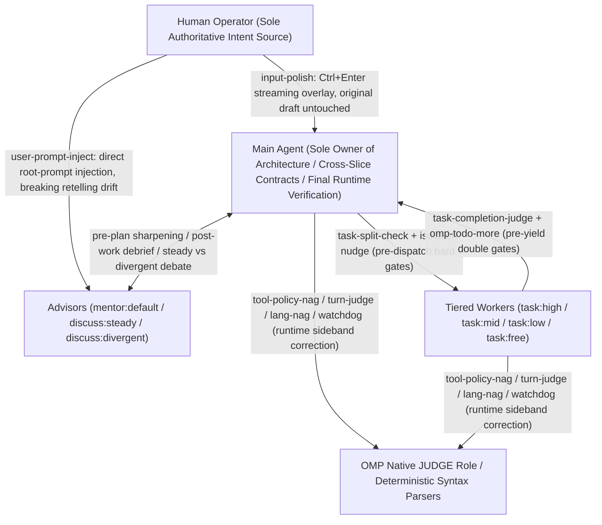
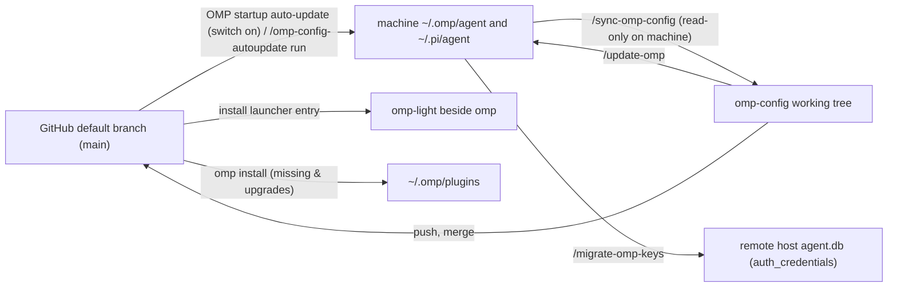

# omp-config

English | [简体中文](README.zh-CN.md)

`omp-config` is the Oh My Pi (`omp`) runtime configuration and extension repository that turns frontier LLMs from unreliable free-form chat generators into a governed, multi-tier engineering state machine. It tracks only reviewable, deterministically replayable policy, prompts, subagent definitions and local TypeScript extensions; databases (`*.db*`), session transcripts, model caches, logs, lock files, installed plugin packages (`~/.omp/plugins/`) and provider credentials never enter the repository.

- [1. System Thesis and Control Architecture](#1-system-thesis-and-control-architecture)
- [2. Four-Layer Prompt Architecture and Context Economics](#2-four-layer-prompt-architecture-and-context-economics)
- [3. Multi-Agent Topology, Anti-Echo-Chamber Advisors and Cost-Trust Tiers](#3-multi-agent-topology-anti-echo-chamber-advisors-and-cost-trust-tiers)
- [4. Runtime Gates, Sideband Judges and Interactive Tools](#4-runtime-gates-sideband-judges-and-interactive-tools)
- [5. Plugin Ecosystem and External Capabilities](#5-plugin-ecosystem-and-external-capabilities)
- [6. Dual Runtime Modes: Full Mode vs omp-light](#6-dual-runtime-modes-full-mode-vs-omp-light)
- [7. Authority Boundaries, Two One-Way Syncs and Multi-Machine Operations](#7-authority-boundaries-two-one-way-syncs-and-multi-machine-operations)
- [8. Extension Engineering, CI Verification and Upgrade Checklist](#8-extension-engineering-ci-verification-and-upgrade-checklist)

---

## 1. System Thesis and Control Architecture

This configuration is not an `ultracode`-style black-box task solver; it is a **closed-loop runtime control system** built around OMP's native execution flow. The entire architecture rests on four empirically verified premises:

1. **Models do not follow the system prompt reliably (broken-windows premise)**: frontier models led by Claude and GPT follow prompt rules selectively. Once a model starts bypassing built-in tool conventions (for example shelling out to `cat`/`sed -i`/`rg` or `python -c` instead of `read`/`edit`/`grep`), its attention has drifted from the system contract, and `CLAUDE.md` and domain rules soon fail with it. Writing harsher prompt prose does not stop drift; the runtime must bind file writes to observed snapshots, detect tool bypasses in flight, and inject sideband reminders before drift spreads.
2. **Context is aligned human intent state, not a mere file cache**: in a long-horizon task, the context holds requirements, ruled-out paths, architectural trade-offs and tacit consensus aligned with the operator. Every compaction — and every lossy shortcut such as grepping instead of reading in full, piping output through `head`/`tail`, or chaining many steps into one opaque bash command — destroys aligned intent.
3. **Code-generation skill $\neq$ planning judgment or rule compliance**: low-cost and free models are unsuitable for a human to drive directly, yet make highly efficient workers on bounded slices once architecture, domain types, cross-slice contracts and final verification stay with the parent agent and independent model gates check both dispatch (preventing multi-topic stuffing) and delivery (preventing premature handoff).
4. **Occasional over-continuation is far cheaper than constant operator interruption**: stateful Todo lifecycle reminders and low-latency native judgment models (OMP's `JUDGE` role) push the agent to self-correct through minor setbacks, reserving human attention for genuine architectural trade-offs and external blockers.



### Failure-Mode and Runtime Countermeasure Matrix

Every one of the repository's **21 local extensions**, **10+1 external plugins** and core config settings counters a specific model failure mode or harness gap:

| Control loop | Model failure mode / harness gap | Interception / trigger hook | Countermeasure carrier | Runtime control action | Light mode |
|---|---|---|---|---|---|
| **Write safety & plan loop** | Model edits files blindly from memory, overwrites unread lines or drifts on line numbers | `read` / `edit` call | `config.yml` (`edit.mode: hashline`) | Requires a non-`:raw` `read` with a 4-hex snapshot tag before any anchored `edit` | Yes |
| **Write safety & plan loop** | Model edits files without a plan, or stops early to ask the user after a minor setback | Pre-`edit` / turn end / `DONE` | Plugin [omp-todo-more](#todo-more) (`todo`) | Blocks `edit` when Todo is empty; auto-reminds to continue while open items remain (unless asking the user); requires a git commit clause on `DONE` when uncommitted changes exist | Yes |
| **In-turn drift telemetry & correction** | Model bypasses built-in tools via shell/eval (broken-window signal) or chains opaque multi-program write pipelines | Main-session `tool_call` | [tool-policy-nag](#tool-policy-nag) + `omomp.yml` (`INTENT-policy.md` under `jev`) | Never blocks calls; `detector: heuristic` counts with the `form` parser and steers the configured `form.prompt` (OMP's bash interceptor overridden off), `detector: jev` asks native JUDGE which built-in tool owns the call; `risk` lane synchronously warns on long multi-program write commands | No |
| **In-turn drift telemetry & correction** | Model drifts from verification rules, substitutes an easier problem, or claims completion unverified | Every $N$ actions / turn end | [watchdog-agent](#watchdog-agent) + [turn-judge](#turn-judge) | `watchdog-agent` reviews the branch per `target` and injects `<watchdog>`; `turn-judge` scores each turn via native JUDGE and types a preset correction prompt past threshold | No |
| **In-turn drift telemetry & correction** | Model loses its Chinese reply constraint after server-side or local compaction | Main `agent_end` → next `input` | [lang-nag](#lang-nag) | Classifies the first 200 chars of the reply's final paragraph; on mismatch, silently prepends `说中文` to the user's next real input with zero extra turn cost | No |
| **Anti-echo-chamber & subagent gates** | `mentor` and `discuss` see only the spawning agent's selective retelling and become echo amplifiers | Every subagent `context` (IRC wakes included) | [user-prompt-inject](#user-prompt-inject) + `PROMPT-INJECT-user-goal.md` | Walks `parentId` to the root session, extracts all human user prompts and prepends them to every advisor call to audit the advisee's plan against the user's verbatim words | No |
| **Anti-echo-chamber & subagent gates** | Main agent stuffs multiple unrelated topics into one worker or caps report length, truncating evidence | `task` / `fork_task` `tool_call` | [task-split-check](#task-split-check) | Concurrent `gpt-6-1-sol` check: blocks multi-topic items once (unchanged redispatch passes) and permanently blocks report-length caps | No |
| **Anti-echo-chamber & subagent gates** | Multiple concurrent writing workers share one working tree and clobber each other's files | `task` `tool_call` | [isolation-nudge](#isolation-nudge) | Blocks once per prompt hash when $\ge 2$ un-isolated writers would share the directory, asking for `isolated: true` | No |
| **Anti-echo-chamber & subagent gates** | Low-tier worker (`task:low/mid/free`) calls `yield` before finishing the work or updating Todo | Subagent `yield` `tool_call` | [task-completion-judge](#task-completion-judge) | Audits assignment, tool calls and submission with `gpt-6-1-sol`: bounces once for `NOT_DONE` and once for open Todo items via `omp-todo-more:read`, attaching `completion_judge` on pass | No |
| **Context economics & anti-amnesia** | 1.5M+ chars of design material or nuanced human alignment cannot be compressed into a short `task` `context` string | Subagent dispatch | [fork-task](#fork-task) (`fork_task`) | Clones the caller's (or a `from` agent's) conversation history as the child's starting transcript, with optional `shake: true` elision of older tool outputs | No |
| **Context economics & anti-amnesia** | Main session loses completed task history and subagent topology after compaction | On `todo` change / post-compact | Plugin `omp-todo-more`'s [ctx](#ctx) + [Task log](#task-log) | Appends every successful `todo` mutation to `task-log/<agent-id>.md`; automatically injects `ctx list` and the replayed timeline after main-session compaction | Yes |
| **Prompt layering & model variance** | Built-in tool protocols are duplicated across templates or contradict local dispatch/read rules | Every `before_agent_start` (runs last) | [system-prompt-replace](#system-prompt-replace) | Rewrites rendered built-in and plugin tool descriptions in place with `inlineToolDescriptors: "on"` | No |
| **Prompt layering & model variance** | OMP native prompts and compaction thresholds cannot target model families by regex | Every `before_agent_start` | [append-system-model](#append-system-model) + [model-compaction](#model-compaction) | Appends per-model prompt blocks and writes `"provider/id": "f<N>"` runtime compaction triggers matched by `model`/`provider` regex | Yes |
| **Host environment & ops patches** | OMP does not scan `.claude/rules` or `.pi/rules`, drops rule files that have neither `alwaysApply` nor `description`, and ignores Claude Code's `paths` frontmatter | `session_start` / `before_agent_start` / `tool_result` | [repo-rules](#repo-rules) | Injects rules from `.claude/rules`, `.agents/rules`, `.pi/rules` (cwd up to the git root) and `~/.claude/rules`; loads every `paths`-scoped rule, OMP's native ones included, only after a matching file is read, written, edited or `cat`ed | Yes |
| **Host environment & ops patches** | Only a human can type `/wt`, `/move` or `/restart` in the TUI; the main agent cannot manage its own session worktree or restart | Main TUI session when idle | [wt-tool](#wt-tool) (`wt`/`wt_remove`) + [harness-restart](#harness-restart) | Queues and runs TUI slash-command dispatchers after the turn ends for worktree creation, two-phase verified removal and session-resuming restart | Yes |
| **Host environment & ops patches** | Runaway descendant processes (including reparented orphans) exhaust host RAM | macOS every 2 s | [child-memory-warning](#child-memory-warning) | Samples descendant `phys_footprint` via Bun FFI `libproc` and alerts the main UI and agent past `omomp.yml#child-memory-warning.thresholdGiB` (repository value 4 GiB) | Yes |
| **Host environment & ops patches** | `--model` with a `commandcode` model fails auth due to `models.db` cache shadowing or built-in provider name collision | `session_start` | [commandcode-model-spec](#commandcode-model-spec) | Detects catalog models in `commandcode-models.json` running with `api !== "commandcode-custom"` and rebinds them to the live plugin model | Yes |
| **Host environment & ops patches** | OMP's hand-captured Antigravity wire table lacks newer wire ids (`gemini-4-argon-*`), so small caller budgets such as compaction's 512-token short summary go out unchanged and Gemini spends them all on thinking | Root `session_start` | [antigravity-wire-profiles](#antigravity-wire-profiles) | Fetches `fetchAvailableModels` for every Antigravity account and writes each served wire id's `maxOutputTokens` / `model_enum` into the provider's table in place | Yes |
| **Human-agent UX & fleet sync** | Operator drafts need motivating polish, long docs need meaning-preserving restructuring, and multi-machine configs need atomic sync | Chord / command / startup | [input-polish](#input-polish) + [doc-polish](#doc-polish) + [omp-config-autoupdate](#omp-config-autoupdate) | `Ctrl+Enter` streams a draft rewrite in an overlay; 3-agent pipeline writes `/tmp/doc-polish` reviews; child process auto-applies default-branch commits at startup | `doc-polish`: No; others: Yes |

---

## 2. Four-Layer Prompt Architecture and Context Economics

### Four-Layer Prompt Separation

To prevent prompt bloat and conflicting instructions, the system prompt is split into four orthogonal layers:

| Layer | Authoritative file / extension | Scope | Responsibility and boundary |
|---|---|---|---|
| **1. Base workflow layer** | `agent/SYSTEM_TEMPLATE.md` | Main + Subagents | Vendored Handlebars template derived from OMP's `packages/coding-agent/src/prompts/system/system-prompt.md` (plain-text `SYSTEM.md` cannot compile expressions). Owns general engineering discipline, renders live tools/skills/rules, and switches Step 4 between parent `Verify` and subagent `Hand-off` via `{{#if subagent}}`. Never reprints individual tool instructions. |
| **2. Speaking & writing register layer** | `agent/PERSONALITY.md` | Main session only (subagents run with `personality: none`) | Fills the template's `{{personality}}` slot. The first half copies OMP's `personality: default` (`Evidence-first terse engineer`) verbatim; the second half defines the `# Writing` high-density register for research and analysis prose: open with the finding, number or mechanism; carry time, actor, action, scale and source in one sentence; put multiple objects or metrics in one table without row-by-row prose restatement; cut process narration, repeated explanations, stacked disclaimers and summary recaps (delete any paragraph whose removal leaves the reader's grasp of facts, numbers, mechanism, conditions and conclusions unchanged). |
| **3. Main-session local policy layer** | `agent/APPEND_SYSTEM.md` (empty `APPEND_SYSTEM_LIGHT.md` in light mode) + [repo-rules](#repo-rules) | `APPEND_SYSTEM.md`: Main only; `repo-rules`: Main + Sub | `APPEND_SYSTEM.md` adds four local rules: ① explicit user instructions override all defaults; ② the final reply is the sole deliverable (complete sentences with explicit subjects, identify objects on first mention, put `path:line` or observed output beside every conclusion, no analogies); ③ never trade quality for token savings (read design documents and related docs in full before editing); ④ consult both `discuss:steady` and `discuss:divergent` on consequential decisions, and pair long investigations with `mentor:default`. |
| **4. Dynamic tool surgery & model deltas** | [system-prompt-replace](#system-prompt-replace) + [append-system-model](#append-system-model) | Main + Subagents | `system-prompt-replace` runs last among path-loaded extensions to rewrite rendered built-in/plugin tool descriptions in place; `append-system-model` appends model-specific blocks matched by `model`/`provider` regex so corrections for one model family never pollute others. |

#### system-prompt-replace

Located at `agent/extensions-last/system-prompt-replace/` and registered as the final entry of `agent/config.yml`'s `extensions` list. Because `before_agent_start` handlers run serially in extension load order (native discovery `~/.omp/agent/extensions/` and `settings.json` modules → hooks → plugin extensions → `-e` arguments → `config.yml` `extensions` list → OMP's built-in inline factories), placing it in `extensions-last/` outside `extensions/` as the last `config.yml` entry guarantees it sees the prompt after every other path-loaded extension (placing it inside `extensions/` would load it early in step 1 and drop the `config.yml` entry as a duplicate path).

Re-reads the `system-prompt-replace` section of the agent directory's `omomp.*` on every `before_agent_start` (project `.omp/` copies are not read; requires `inlineToolDescriptors: "on"` in `config.yml` so full tool descriptions are rendered into the system prompt):

```yaml
system-prompt-replace:
  replacements:
    - literal: "exact original text"
      replace: "replacement text"
    - regex: "JavaScript regex source"
      replace: "replacement text, $1 and $& supported"
```

- **The repository's 10 active replacement rules**: ① expands `read` into OMP's unified `<source><:selector>` / `<source>?<query>` retrieval and hashline snapshot protocol, including how a single-stream `.gz` exposes its one member (linking `omp://tools/read.md`); ② replaces `task`'s `"Use most specific agent."` with cost-and-trust tier selection (`task:mid` default, `task:low` for cost/validation of `task:free`); ③ removes the native child wrapper's `"Every task MUST skip build/lint/tests..."` and `"No TODO tracking, no progress updates."` sentences so they cannot conflict with mandatory worker Todo or `fork_task` verification; ④ requires `isolated: true` for concurrent writers while keeping research-only agents shared and reachable; ⑤ requires explicit `agent` selection and forbids unrequested `effort` overrides; ⑥ clarifies not rerunning checks to doubt user-reported errors while still reproducing to locate causes and confirm fixes; ⑦ adds the missing `add` to the compiled-code allocation rule; ⑧ forbids reading, listing or searching local files through `eval`; ⑨ states that `xd://<tool>` devices are invoked only by writing JSON to `xd://<tool>`, never by inventing `xd__<tool>` function names; ⑩ replaces the whole native `bash` description (exact literal, so any upstream wording change triggers the drift warning) with one matching `omp://tools/bash.md` and the three-entry division shared with `agent/extensions/tool-policy-nag/INTENT-policy.md`: `bash` is the synchronous default shell (embedded brush, no shell switching inside a call, isolated shells for overlapping calls, ordinary pipes/`$(…)`/redirection of program output, `timeout` sized to the command, auto-backgrounded results delivered once without polling); `xd://exec_command` takes programs that run long, wait on an outside condition, need a terminal or need another shell, with waiting done as one silent loop plus a condition-less `xd://monitor` that wakes once when it ends; `eval` takes language computation.
- **Drift warning**: when a rule's target is absent from the main session's system prompt (for example after an OMP upgrade alters built-in tool wording), warns once per rule per process via UI notification (stderr in headless mode) and log without blocking the prompt; subagents are not checked because their prompts legitimately omit tools such as `task`.

#### append-system-model

Re-reads `~/.omp/agent/extensions/append-system-model/APPEND_SYSTEM_MODEL.md` (machine-owned; repository ships none; edits and `/model` switches apply on the next prompt without restart) on every `before_agent_start`, matching the main session and each subagent against its own current model. The file consists of `---`-fenced YAML headers declaring `model` (matched against model id, e.g. `claude-opus-5-5`) and/or `provider` (matched against provider id, e.g. `^anthropic$`) JavaScript regexes followed by a body running to the next `---` line (use `***` rather than `---` for dividers inside a body). All matching blocks are joined in file order and appended as one extra system-prompt block; a missing file is silently ignored, and format errors log a line-numbered warning once without blocking the prompt.

#### repo-rules

OMP scans `.omp/rules`, `.agent(s)/rules`, `.cursor/rules`, `.windsurf/rules`, `.clinerules` and `.github/instructions` by default, but ignores `.claude/rules` and `.pi/rules`, drops a rule file that has neither `alwaysApply` nor `description`, and does not read Claude Code's `paths` frontmatter.

- **Unscoped rules:** this extension scans non-hidden `.md` / `.mdc` files under `.claude/rules`, `.agents/rules` and `.pi/rules` from `cwd` up to the git root (only `cwd` outside a repository; nearer `cwd` wins; within a level, `.claude` → `.agents` → `.pi`), plus the user-level `~/.claude/rules` in every session, and appends a `<repo-level-rules>` block on every `before_agent_start`. A rule without frontmatter, with frontmatter that does not parse, or with `alwaysApply: true` injects its full body; other frontmatter rules list only name, `description` and path. A file OMP already places itself (alwaysApply, rulebook entry or TTSR) is skipped, as is a body already in the incoming system prompt after whitespace normalization and a listing whose `rule://<filename>` is already there.
- **Path-scoped rules (Claude Code `paths`):** a rule whose frontmatter has `paths` (a YAML list or a comma-separated string of globs; braces and `[…]` classes supported) is loaded only when a matching file is touched: a successful `read`, `write` or `edit`, or a `bash` command that is a plain `cat`/`head`/`tail` of one file (pipes, chains and multi-file commands do not count). Sources are the scanned files above and every rule OMP discovers (project and user `.omp`/`.agents` rules, cursor/windsurf/cline/GitHub rules, plugin and extension-root `rules/` such as `~/.claude/rules` via the `~/.claude` extension entry). Patterns are relative to `cwd` for user-level rules, to the directory holding the rule's dot directory for project rules, and to the plugin or extension root for its `rules/`. A native rule with `paths` is taken over wherever OMP would put it: its `alwaysApply` body is removed from `<generic-rules>`, its rulebook line from `<domain-rules>`, and it still obeys `ttsr.disabledRules` and its `agents` scope. TTSR rules (`condition`, `astCondition`, `question`) and OMP's bundled rules keep OMP's own triggering. A matching rule arrives as `tool_result` `additionalContext` (a developer message after the tool batch) once per context: it is not repeated while its `<path-scoped-rule path="…">` marker is in the context OMP would send (so compaction that drops the marker, resume and branch moves are honoured).
- **Absolute patterns (beyond Claude Code):** a `paths` pattern starting with `/` or `~/` is matched against the touched file's absolute path (`~` = home directory) instead of a path relative to the base, so a user-level rule can follow a directory name wherever the session runs, e.g. `/**/{omp,.omp,omp-*,*-omp,*-omp-*}/**` for every omp repository. Claude Code itself treats such a pattern as relative and never matches it.

---

### Context Economics

Context management balances **preserving aligned task intent against shedding high-noise execution traces**:

1. **Ordinary `task` (discard execution trace) vs `fork_task` (clone full aligned background)**:
   - When background is short or an independent view is desired, use `task`: the worker's file searches, dead ends and tool outputs stay in its disposable branch, and only the final `yield` payload returns to the main session.
   - When the main session has loaded 1.5M+ characters of design material or completed multi-turn alignment with the human that cannot be summarized losslessly into a short `context` string, use `fork_task` so the worker starts with the full conversation memory while focusing on one local slice.
2. **Deferring lossy compaction (`compaction.methodOrder` + `model-compaction`)**:
   - `agent/config.yml` orders compaction methods from least to most lossy (`remote → soft → snapcompact → handoff → shake`), while `model-compaction` sets high fixed token triggers per model family.
   - `compaction.asyncEnabled: false` makes compaction summarize at the trigger. With it on, OMP requests the summary in the background up to 32k tokens earlier, then holds the finished result until the trigger and never regenerates an Anthropic one, so every request in between still carries the full history.
3. **Deterministic post-compaction state recovery (`omp-todo-more`'s `todo` + `Task log` + `ctx`)**:
   - When the main session eventually compacts, the model's self-summary cannot be trusted alone. `omp-todo-more` logs every successful `todo` mutation to an append-only `Task log` on disk and automatically injects the subagent context tree (`ctx list`) and replayed task timeline (`ctx show`) into the freshly compacted session.

#### fork-task

Registers the `fork_task` tool (top-level `context` plus `tasks[]` without `solutionSpace`; requires `async.enabled: true`). It spawns native `task` subagents (with their own agent definition, model, tools, Agent Hub row, `agent://`/`history://` and isolation merge-back), except that each child's starting transcript is a copy of the caller's current conversation, or of the registered agent named by an item's `from: "<agent-id>"`:

- **Key behavioral differences**:
  - `isolated` defaults to `true` (pass `isolated: false` explicitly for research-only; plan mode forces shared directories; isolated subagents cannot be continued after completion).
  - Optional `shake: true` runs `session.shake("elide")` on the cloned transcript — protecting the newest ~4,000 tokens plus `skill://` and `local://PLAN.md` reads while replacing older text tool results, $\ge 400$-token fenced code blocks and top-level lowercase XML elements with `[shaken ~N tokens — recover: artifact://<id> (region K)]` in the shared artifact store so the child can `read` originals back on demand.
  - Optional `from: "<agent-id>"` (resolved like `agent://<id>`, covering running, idle or parked agents) copies that agent's persisted transcript instead of the caller's. Items with `from` must specify `agent` explicitly (model and role are not inherited from `from`), and the child's working directory still comes from the caller's checkout rather than the `from` agent's isolated worktree.
  - **Mandatory runtime verification notice**: appends `<system-notice cause="fork_task">` marking inherited history as background only and **requiring the forked worker to complete scoped build/lint/test checks and real runtime smoke verification before handoff**.
- **Four-step staging pipeline**: ① clones the source session into `$TMPDIR/omp-fork-task/<uuid>/` (zeroing inherited cost, pairing dangling in-flight tool calls with synthetic aborted results, clearing source Todo, and appending the fork notice); ② strips source runtime entries (`session_init`, `model_change`, `thinking_level_change`, `service_tier_change` and shake's `session_exit`) while re-parenting their children; ③ sets the caller's `cwd` for shared children or blanks `cwd` for isolated children so the executor binds them to the worktree; ④ inside `before_subagent_spawn` (after the async task tool pre-allocates the child id), moves the staged file to `<parent session file without .jsonl>/<child id>.jsonl` right before the executor opens it.

#### model-compaction

Re-reads the machine-local `model-compaction` section of `omomp.*` in the agent directory on every main-session `before_agent_start` (project `.omp/` copies are not read), overcoming OMP's native `compaction.modelThresholds` limitation to exact `provider/id` or `*`-prefix keys:

```yaml
model-compaction:
  rules:
    - provider: "^anthropic$"
      model: "opus"
      thresholdTokens: 150000
    - model: "[gG][pP][tT]"
      thresholdTokens: 650000
```

- **Matching and runtime injection**: each rule specifies `model`, `provider` or both as non-empty JS regexes (no implicit catch-all; use `"model": ".*"` to match all models). For each model in `ctx.models.list()`, the first matching rule in file order writes `"<provider>/<id>": "f<thresholdTokens>"` into the main session's runtime settings layer for `compaction.modelThresholds` (never touching `config.yml`; `/model` switches, retry fallbacks and subagents reading the main session's live settings automatically use their own model's trigger).
- **Context-window tier protection**: a native `f<N>` entry can switch a model that supports an extended context window onto that tier. This extension **never changes a model's context-window tier**: any rule whose `thresholdTokens` would flip a model between its standard and extended window tier is refused for that model with a warning. Pre-existing runtime entries from other sources are preserved and restored when no rules match or on `session_shutdown`; if another writer modifies the runtime map mid-session, the extension warns once and stops managing it.

#### ctx

Read-only tool registered by the [omp-todo-more](#todo-more) plugin (`src/ctx/inventory.ts`) that stitches the current session, subagent registry, transcripts, compaction summaries, `.md`/`.json` sidecars and the task log into one context tree without mutating any session or file:

- **`ctx list [<id>] [all=true]`**: depth-first view printing one context per line with status, one-line summary and task counts (`done/total` plus `blocked` when a block has a reason). By default shows only the main session and `task` / `task:*` subagents (hiding `mentor`, `discuss` and `trace` while promoting their visible descendants one level up with the hidden count), folding non-root nodes with more than 8 descendants into one line (expand via `ctx list <id>`); `all=true` shows all nodes except the advisor.
- **`ctx show <id>`**: outputs ① the handoff (latest compaction summary for the current session; adjacent `.md` sidecar full text or 120-char `.json` sidecar summary for other contexts), ② the last valid `## Goal` in the task log (Objective / Measure / Done when), and ③ a `## Tasks` timeline replayed from the task log (`Completed` and `Open` sections ordered by the local time of the last accepted operation).
- **Approximation boundary**: counts and timelines are rebuilt from the append-only operation log and approximate `TodoTracker`'s live state (`init`/`append` log counts rather than task names, so tasks never operated on individually after creation count toward `ctx list` totals without appearing in the timeline; once a task name is completed or removed, later `start`/`block`/`unblock` calls do not revive it; a task literally named `all tasks` is treated as a batch selector).

#### Task log

After every state-changing `todo` or native `goal` tool call succeeds, `src/ctx/tasklog.ts` in `omp-todo-more` appends the local time, tool name, operation and target to `<local root>/task-log/<agent-id>.md` (a successful `todo` call carrying a goal also appends `todo-more set: <goal JSON>`; read-only `todo view` / `goal get` calls and failed calls are not logged). This binds the work record to verified tool executions rather than model claims.

#### After-compact injection

Handled by `src/ctx/post-compact-hint.ts` in `omp-todo-more`. Listening to main-session `session_compact` and non-aborted `auto_compaction_end` events (debounced to at most one attempt per 5-second window; subagents are never injected), it steers a `<post-compact-ctx>` block containing `## List` (`ctx list`) and `## Current session` (`ctx show` for the main session), immediately restoring the subagent tree and replayed task timeline in the post-compaction context.

---

## 3. Multi-Agent Topology, Anti-Echo-Chamber Advisors and Cost-Trust Tiers

`agent/config.yml` disables all 5 bundled subagents (`task`, `scout`, `sonic`, `reviewer`, `security-reviewer`) in `task.disabledAgents` (they fail preflight even if listed in `spawns`). All delegation runs through the 7 custom subagents defined in `agent/agents/*.md` (authoring pitfalls are documented in `agent/agents/README.txt` and `README.zh-CN.txt`; keep notes in that directory as `.txt` so OMP never parses them as broken agent definitions).

### The Seven Custom Subagents and Model Binding Matrix

Agent responsibilities and tool/spawn boundaries live in `agent/agents/<name>.md`, while concrete model chains live in `agent/config.yml` under `task.agentModelOverrides` (when changing a model binding alters a tier's class or cost, update its `description` and this table together):

| Subagent name | Tier and blended cost in `description` (per 1M tokens) | Actual model chain in `config.yml` | Allowed `spawns` / `tools` | Role contract and trust boundary |
|---|---|---|---|---|
| `task:high` | Claude Opus 5.5, ~$0.45 | `anthropic/claude-opus-5-5:high` | `spawns: task:mid, task:low, task:free, task:high, discuss:steady, discuss:divergent, mentor:default` | **Forbidden without explicit user permission in the current conversation**; the only worker allowed to own architecture/core design and fan out one more level (depth 1 → depth 2), owning contracts, acceptance and integration for its batch (`task:mid` is listed first as the default spawn) |
| `task:mid` | Opus class, ~$0.30 | `openai-codex/gpt-6-1-sol:high` | `spawns: mentor:default` | **Default worker tier**: handles all delegated implementation, investigation, debugging and verification outside design/core work, and adjudicates disagreements between cheaper tiers |
| `task:low` | Opus class, ~$0.01 | `openai-codex/gpt-5.6-luna:max` | `spawns: mentor:default` | Cost-first deliverable work (bulk mechanical edits, lookups, routine checks) and independent reproduction/validation of `task:free` outputs |
| `task:free` | Opus class, $0.00, high concurrency | `bansos/muse-spark-1.3-contributor:xhigh, opencode-go/muse-spark-1.3-contributor:xhigh, openai-codex/gpt-6-luna:max` | `spawns: mentor:default` | **Zero-trust probe tier**: candidate search and exploratory probes only; any consequential result requires independent validation by the parent or `task:low+`, and agreement among `task:free` workers is never validation |
| `discuss:divergent` | — | `anthropic/claude-opus-5-5:medium, openai-codex/gpt-5.6-luna:max` | `tools: read, grep, glob` | **Read-only expansive discussant**: questions the problem framing and inherited constraints, raising materially different alternatives (deleting the feature, changing state ownership, solving the class) with `path:line` grounding and costs |
| `discuss:steady` | — | `openai-codex/gpt-5.6-sol:medium` | `tools: read, grep, glob` | **Read-only conservative discussant**: stress-tests proposals against actual code with `path:line` citations, surfacing hidden assumptions, unhandled states, migration blast radius and boring alternatives |
| `mentor:default` | — | `openai-codex/gpt-5.6-sol:high, openai-codex/gpt-5.6-luna:max` | `tools: []` (`yield` only) | **Tool-less full-lifecycle mentor**: turns activity plans into decisive questions and minimal observations before work, and audits completed work against the agreed plan before delivery; must place its entire answer inside the `yield` payload |

### Breaking the Advisor Echo Chamber: `user-prompt-inject` and Dual-Stance Debate

In standard multi-agent setups, a `mentor` or `discuss` agent sees only what its spawning agent tells it; if the parent misframes the user's goal, the advisor merely amplifies the parent's bias. This configuration breaks the echo chamber through three mechanisms:

1. **Direct root-prompt injection ([user-prompt-inject](#user-prompt-inject))**: extracts the human operator's verbatim prompts from the root main session and prepends them to every model call of `mentor:default`, `discuss:steady` and `discuss:divergent`, instructing them to judge the advisee's plan against the user's words rather than the advisee's retelling.
2. **Physically separated adversarial discussants (`discuss:steady` vs `discuss:divergent`)**: consequential decisions must consult both stances rather than asking one reviewer to be both cautious and creative; follow-ups on the same topic reuse the existing agent via `write agent://<id>`.
3. **Tool-less mentor pre-check and debrief (`mentor:default`)**: stripping all file/search tools (`tools: []`) forces the advisee to write out the concrete paths, symbols, commands and observed outputs verbatim, exposing unverified assumptions in the act of explaining them.

#### user-prompt-inject

On every subagent model call (`context` event, including initial spawn, IRC `write agent://<id>` wakes and resuming from parked), follows `ctx.agent.parentId` up the process `AgentRegistry` to the root main session (including from depth-2 grandchildren spawned by `task:high`), reads all non-empty text messages on its current branch (`getBranch()`, pre-compaction history included) that have `role: "user"`, `attribution: "user"` and not `synthetic`, renders matching `PROMPT-INJECT-<label>.md` templates, and prepends a single request-only developer message (`<user-prompt-inject name=…>`) to the context without writing it to the session:

- **Template discovery and frontmatter**: scans `~/.omp/agent/extensions/user-prompt-inject/PROMPT-INJECT-*.md` and `<dir>/PROMPT-INJECT-*.md` / `<dir>/.omp/PROMPT-INJECT-*.md` from `cwd` up to the git root. The repository ships and syncs `PROMPT-INJECT-user-goal.md` (`target: mentor:default, discuss:steady, discuss:divergent`, `name: user-goal`, `enabled: true`, body injecting all user prompts via `{{user_prompt[0:e]}}`).
- **Placeholder syntax**: `{{user_prompt[0]}}` (first), `{{user_prompt[-1]}}` (latest), `{{user_prompt[a:e]}}` (half-open slice supporting negative bounds, rendering each item as `<user_prompt index="N">…</user_prompt>`); any other `{{user_prompt…}}` syntax skips the file with a warning.
- **Attribution hygiene**: because `pi.sendUserMessage` defaults to `attribution: "user"` when omitted, every extension in this repository that sends user-role messages (`watchdog-agent`, `turn-judge`, `tool-policy-nag`, `doc-polish`, `wt-tool`, `harness-restart`, `child-memory-warning`) explicitly sets `attribution: "agent"` so synthetic extension nudges are never mistaken for human prompts.

### Dispatch Economics and Parallel-Write Isolation

- **Choose tiers by cost and required trust, never by task difficulty**: dispatch `task:mid` by default; drop to `task:low` when cost outweighs extra judgment (bulk mechanical edits, lookups, validating `task:free` — a result that must be verified before use costs less from `task:low` once than from `task:free` plus a validator). Never assign architecture, domain types, cross-slice contracts, or doc/prompt/skill/agent-definition design to `task:free/low/mid`.
- **Recursion caps at depth 2**: the main agent is depth 0 and its workers are depth 1; only `task:high` can spawn depth-2 grandchildren, whose `task` tool is stripped by the host (so they cannot spawn `mentor:default` either) and which must receive directly executable leaf tasks.
- **Always specify `agent` explicitly and omit `effort`**: omitting `agent` falls to the first `spawns` entry or a disabled built-in agent; model and effort follow `config.yml` (`task.enableEffort: false` hides the native parameter). `config.yml` keeps model overrides for built-in `task` and `sonic` solely for Vibe mode's first-level dispatch.
- **Mandatory worker loop**: every `task:*` worker must read the actual code and review a written plan with `mentor:default` before editing (except at depth 2), and maintain `todo` across the entire assignment without yielding while open items remain or using `drop`/`rm` to narrow scope.
- **Worktree isolation for parallel writers (`isolated: true`)**: whenever $\ge 2$ writing workers operate on the same repository concurrently (in one batch, or while an earlier shared writer job is still running), every writer must set `isolated: true` (`fork_task` defaults to `true`; research-only spawns use `isolated: false` so they stay reachable via `write agent://<id>`; plan mode forces shared directories). Give isolated workers **repository-relative paths** (OMP enforces isolation via prompting, so absolute paths send commands back into the parent checkout). `task.isolation.merge: branch` cherry-picks each worker's own commits onto the parent branch, messages and todo-more `Model` trailers intact; confirm `Merged branch: <name>` (or `No changes to apply.`) in the result.

---

## 4. Runtime Gates, Sideband Judges and Interactive Tools

### 4.1 Pre-Dispatch and Pre-Yield Hard Gates

#### isolation-nudge

Checks `task` calls at `tool_call` in main and subagent sessions (`fork_task` is isolated by default and not checked): when a call would leave $\ge 2$ write-capable agents (`task:*`, built-in `task`, omitted `agent`, `m1`, etc., counting both the current batch and still-running shared writer jobs from this session) sharing the working directory with at least one item leaving `isolated` unset, blocks the call once per SHA-256 of the item's `task` text and asks for `isolated: true` on writers and an explicit `isolated: false` on research-only items; an unchanged redispatch passes.

#### task-split-check

At `tool_call`, queries `omomp.yml#task-split-check.model` (repository value `openai-codex/gpt-6-1-sol`, re-read per request, fixed `medium` reasoning effort, shared 25s abort deadline across the batch) to evaluate two yes/no checks per item of `task` / `fork_task` concurrently, blocking the entire call if any item fails:

| Check | Scope | Criterion | In-memory cache and redispatch policy |
|---|---|---|---|
| `split` | Items for `task:low`, `task:mid`, `task:free` in main-session `task` calls | Judges the item's `task` text alone (shared `context` is background only): does it stuff multiple unrelated topics into one agent (by topic, not file count) | Caches all conclusive verdicts (`pass-repeats`): if the main agent confirms it is a single topic and redispatches unchanged, the second call passes |
| `report-limit` | Items with `agent` set to `task:*` or omitted, in `task` and `fork_task` of any session | Judges both shared `context` and item `task`: does it cap the length of the worker's report (words, lines, paragraphs, tokens or "brief report"; length limits on deliverables written to files do not count) | Caches only clear verdicts (`skip-clear`): **the cap must be removed** (long reports can go to `local://<name>.md`); unchanged redispatches stay blocked |

Unavailable models, missing/invalid config, request errors or timeouts fail open; every judged call logs `task-split-check verdicts`.

#### task-completion-judge

Intercepts terminal structured `yield` calls inside `task:low`, `task:mid` and `task:free` subagent sessions (`task:high`, main sessions, error yields and incremental yields are not intercepted):

- **Evidence window (60k-token budget)**: extracts the assignment from the branch's last `session_init` (ignoring inherited `fork_task` history before it), combines the system prompt's shared background, the worker's own Todo `goal`, the submitted `yield` payload (capped at 6,000 chars), and the newest unbroken sequence of tool calls and results after `session_init` that fit the remaining budget (up to 800 chars per call argument and result, keeping 60% head + 40% tail with an omission line when truncated; token count estimated at 1 per ASCII char and 2 per non-ASCII char).
- **Judge model and standard**: calls `omomp.yml#task-completion-judge.model` (repository value `openai-codex/gpt-6-1-sol`, re-read per judgment, fixed `low` effort, 25s timeout) for `DONE` or `NOT_DONE`. The assignment is authoritative: if the worker's Todo `goal` narrows the assignment, its stated measure never appears in the tool calls, or it falls short of `doneWhen` (honestly reporting a blocker included), the verdict is `NOT_DONE`.
- **Double single-bounce gate and annotation**:
  1. The first `NOT_DONE` verdict blocks `yield` with the reason, requiring the worker to finish and verify.
  2. After a `DONE` verdict, it queries `omp-todo-more:read` fresh and blocks once more if any `pending` or `in_progress` items remain (`blocked` items do not trigger this), listing their explanations and requiring the worker to update its Todo list first.
  3. Each bounce occurs at most once per subagent session; once passed, later yields in that session pass unjudged. When `yield`'s data is an open object without a custom `outputSchema`, passing deliveries carry `data.completion_judge = { verdict, reason, bounced }` (`bounced` records only the `NOT_DONE` bounce). Any config, model or plugin-read failure logs a warning and fails open.

---

### 4.2 Runtime Sideband Correction and Shared Native JUDGE Role

`turn-judge`, the `intent` lane of `tool-policy-nag` (under `detector: jev`), the option backend of `watchdog-agent` and `lang-nag` share OMP's **JUDGE model role** through `openJudge` in `_shared/judge.ts`. Every judgment first goes to OMP's own judge-role chain: `modelRoles.judge`, then `retry.fallbackChains.judge`, or OMP's built-in judge defaults when that key is absent. The chain skips candidates without credentials, moves to the next candidate after a provider error (a 401/402/403 parks that candidate for 5 minutes) and stops at an abort or timeout; from its first native judgment API model on, OMP keeps only native candidates, and `openJudge` never adds the session model. When that chain fails for any reason but abort or timeout, or resolves no candidate, the role named by `fallbackRole` in the `judge` section of `omomp.yml` answers (repository value `fallbackRole: tiny`, i.e. `@tiny`): the chat models of that role's own chain (`modelRoles.tiny`, then `retry.fallbackChains.tiny`), in order, as prompted judges; on-device `local` models are skipped. Prompted answers are one-hot (the chosen option has probability 1), so option thresholds act as plain picks. Without a `judge` section there is no fallback. Attempts of both stages are recorded in the session's usage ledger, and exact native repeats are answered from OMP's shared judgment cache. Nothing runs only when neither the chain nor the fallback role resolves a model. Role config and the section are re-read on every trigger.

#### tool-policy-nag

Main session only. Inspects `bash`, `bash_bg`, `exec_command` (including JSON written to `xd://bash`, `xd://bash_bg`, `xd://exec_command`) and `eval` at `tool_call`; **it only reminds and never blocks a command**. Configured in the `tool-policy-nag` section of `omomp.yml` (re-read per watched call from project `.omp/omomp.*` then agent-dir `omomp.*`; nothing is preset in code, so without a valid section no lane runs). `detector` picks how tool-routing violations are caught, `heuristic` (the `form` lane) or `jev` (the `intent` lane); `risk` is an independent third lane, off when missing or `null`:

```yaml
tool-policy-nag:
  detector: heuristic
  form:
    prompt: 你为什么不遵守system prompt，反思自己以后继续。
    afterHits: 3
    maxNags: 3
  intent:
    threshold: 0.5
  risk:
    minCommands: 4
    minChars: 600
    minPrograms: 3
```

- **`detector: heuristic`** requires `form`; the `intent` block is ignored (kept only so switching back is one word), so no JUDGE request is made and `INTENT-policy.md` is not read. Before every watched call is inspected, the extension puts a runtime-only override `bashInterceptor.enabled = false` on the main session's live settings, whatever `agent/config.yml` (which turns it on) says; subagents read those settings through and lose the interceptor too. The override is cleared when the detector changes and at `session_shutdown`; nothing is written to disk.
- **`detector: jev`** requires `intent`; `bashInterceptor.enabled` follows config, and while it is on, `bash` calls are skipped by every lane because the interceptor already refuses routing violations before they run (`exec_command`, `bash_bg` and `eval` stay watched). An optional `form` block counts beside the intent lane and sends its `prompt` only while the intent lane cannot run (adjacent `INTENT-policy.md` missing, invalid or disabled, or neither the JUDGE role chain nor the fallback role resolves a model); a judgment failure (judge chain and fallback role both failed) or 90s timeout warns once per reason and never triggers a fallback `form` nudge.
- **`form` lane (heuristic parser and counter)**:
  - Parses pipes, `;`/`&&`/`||`, quotes, here-documents, `$(…)`/backtick substitutions and redirects (`>|` and `&>` included), and resolves every command to the program it runs through `NAME=value` prefixes, the reserved words `if`/`elif`/`while`/`until`/`do`/`then`/`else`/`!`/`{`, and wrappers with their own options (`timeout`, `env`, `nice`, `stdbuf`, `time`, `nohup`, `command`, `exec`, `builtin`, `xargs`); `sudo`/`doas`/`su`/`ssh` are skipped, and literal `bash|sh|zsh|dash -c '…'`, `eval '…'` and `find -exec … ;` bodies are analyzed in place. Counts six shell violation classes: listing (`ls`, `tree`, `fd`, `find` without actions, `rg --files`, `ag -g`), reading (`cat`/`bat`/`nl`/`head`/`tail`/`less`/`more`/`zcat`, `sed -n`, awk line ranges and `/start/,/end/` sections, `jq` over one JSON file, single read-only `sqlite3` queries and `.tables`/`.schema`, `tar -t`/`tar -xO`, `unzip -l`/`-p`), searching (`grep` with files or `-r`, `rg`/`ag`/`ack` — pathless means the working directory unless stdin is piped — awk `/re/`, `git grep` over the working tree), editing (`sed -i`, `perl -i`, `awk -i inplace`, `mv`), writing authored bytes (`echo`/`printf`/here-document `cat` redirected to a file or piped into `tee`), and inline scripts (`node`/`bun`/`deno`/`python`/`ruby` with `-e`/`-c`/`-p`/`--eval` before the script operand, or `-` stdin); plus `eval` file/directory calls (`Path.read_text`, `open`, `glob`, `os.listdir`, `readFileSync`, `Bun.file`, `readdir`, `Bun.Glob`). Listing, reading and searching whose output feeds the shell is not counted: a `$(…)` capture, a pipeline that passes only through stdin filters into `wc`/`uniq -c`/`grep -c`, `xargs` arguments, or `grep -q` as an `if`/`while` test. `/dev/*` targets exempt read/search/edit/write. Unlike OMP's interceptor, `tail -f`, `locate`, `find` with `-delete`/`-exec rm`, `git ls-files` and pathless `grep` on stdin are not hits.
  - Records the first `form.afterHits` (`3`) hits silently; past that, every hit steers the configured `form.prompt` (non-empty) with a UI warning, up to `form.maxNags` (`3`) times per context, then stays quiet until the next compaction, `/clear` or `branch_summary` (raising `maxNags` in config re-arms it at once). All three fields are required. State persists in session custom entry `mouriya.omp.tool-policy-nag.state` and rebuilds across branch switches.
- **`intent` lane (native JUDGE tool-routing classification)**:
  - Fires one non-blocking parallel JUDGE `choice` request per watched call using the question and 12 option rubrics in `INTENT-policy.md` (`list`, `read`, `search`, `edit`, `write`, `move`, `eval`, `ast`, `pty`, `shell`, `mixed`, `none`, with explicit counterexamples for `km ls actions`, `ssh host 'cat x'`, `npm test > log`, `curl -I`, stream filters, etc.).
  - When a shell call picks anything other than `none` (or an `eval` call picks anything other than `eval`/`none`) with probability $\ge$ `threshold` (`0.5`), inserts an `aside` reminder at the next step boundary naming the Chinese intent title, the required built-in tool and the call text, uncapped, and logs `Tool-policy intent verdict`.
- **`risk` lane (deterministic model-free risk check, shell only)**:
  - Runs synchronously inside `tool_call`, independent of the tool lanes. Triggers when all three hold: ① simple command segments $\ge$ `minCommands` (`4`) or total characters $\ge$ `minChars` (`600`); ② distinct external programs after stripping shell plumbing (`cd`/`echo`/`printf`/`export`/`source`/`test`/`mkdir`, etc.) $\ge$ `minPrograms` (`3`); ③ includes a write step (redirect/`tee`/in-place edit, a writing binary such as `rm`/`cp`/`mv`/`chmod`/`dd`/`tar -c|-x`/`rsync`/`scp`/`make`/`install`/`patch`, or a write subcommand such as `git add|commit|push|reset`, `gh … create|delete|download|upload`, `docker run|build|push|rm|exec`, `kubectl apply|delete|exec`, `orb push|create|delete`, `npm|pnpm|yarn|bun install|add`, `tofu|terraform apply|destroy|state|init`, `curl -o|-O|-T|-d|-X POST`, `wget -O` checked on the first two non-flag arguments).
  - Sends one reminder naming the segment count, character count, external programs and writing steps, shows a UI warning and logs `Tool-policy risk`.

#### watchdog-agent

Per-target runtime reviewer driven by `WATCHDOG-<label>.md` files (discovered in `~/.omp/agent/extensions/watchdog-agent/` and `<dir>/WATCHDOG-*.md` or `<dir>/.omp/WATCHDOG-*.md` from `cwd` up to the git root; machine-owned, never synced):

| Frontmatter field | Values and default | Behavior |
|---|---|---|
| `target` (required) | `main`, subagent name (e.g. `task:low`), `*`, `subagents` or CSV list | Selects which sessions run this watchdog |
| `name`, `enabled` | `name` defaults to file label; `enabled` defaults to `true` | Addressed by `name` in `/watchdog`; duplicate names across discovered files error |
| `delivery` | `aside` (default), `steer`, `nextTurn`, `followUp` | Delivery mode (`nextTurn` waits for the user's next real input or a subagent's next `before_agent_start`) |
| `every`, `scope` | `every` default `30`; `scope` `full` (default) or `window` | Each tool call and each non-empty text reply counts as 1 action; runs immediately at `every` and catches up on the remainder at terminal `agent_end`. `window` reads only messages after the cursor |
| `maxPerContext` | Positive integer, unlimited by default | Max reminders injected between two compactions; compaction resets the cap count without resetting action count or `window` cursor |
| `model`, `tools` | Chat reviewer backend (default) | Runs in an extension-less `taskDepth: 1` in-memory session; `model` falls back through `@advisor`, `advisor`, `@slow` to the session model; `tools` defaults to `[read, grep, glob]` (may grant `ast_grep, web_search, edit, write, bash, eval`). First line starting with `PASS`/`OK`/`LGTM`/`NONE` passes; anything else injects `<watchdog name=… severity=…>` |
| `instructions`, `option.<label>[.prompt\|.delivery]` | JUDGE backend (selected by declaring $\ge 2$ `option.*` keys) | Cannot be combined with `model`/`tools`/`note`; uses OMP's JUDGE role chain, then the `judge` section's fallback role, to pick one declared lowercase option against the body criteria and injects its `.prompt` (no `.prompt` = silent pass). Errors or 90s timeouts never fall back to the chat reviewer |

- **Cursor persistence and recovery**: each conclusive review writes its cursor to session custom entry `mouriya.omp.watchdog-agent.cursor`; session resume and branch switches rebuild the cursor, cap count since last compaction, and trailing action count from the branch.
- **Slash commands and 3-round authoring flow**:
  - `/watchdog [list]` inspects status; `/watchdog on|off <name> [session|global]` toggles the session override or rewrites `enabled` in the file; `/watchdog rm <name>` deletes after confirmation.
  - `/watchdog add <request>` and `/watchdog edit <name> [change]` write nothing themselves; they send an `attribution: "agent"` prompt to the active model (with full schema defaults, project/global paths, current default reviewer model and existing names) enforcing a 3-round flow without `ask`: **1. Draft (expected behavior, settings table, full file text and absolute path; no disk write) → 2. Revise → 3. Write only after explicit user confirmation**. Any `write`/`edit` touching `WATCHDOG-*.md` appends a live recognition status line (recognized / unrecognized with reason / valid but outside search path / deleted) to the tool result.

#### turn-judge

After every turn that the model ended itself (`stopReason: "stop"` with non-empty text) in a session a discovered `TURN-JUDGE-<label>.md` file targets, evaluates that file with one JUDGE request (the repository ships `TURN-JUDGE-gpt-talk-only.md`, below; files a machine writes itself stay machine-owned; silent when no file applies or neither the JUDGE role chain nor the fallback role resolves a model). With `task.structured` off (OMP's default), a subagent's final report and its replies to IRC wakes are such turns.

- **Scope**: `target` uses `watchdog-agent`'s grammar — a comma list of `main`, `subagents` (aliases `subagent`/`sub`/`subs`), `*` (aliases `all`/`any`) or a subagent definition name / registry id such as `task:mid` — and defaults to `main` when absent; `model` and `provider` are unanchored JavaScript regexes, as in `append-system-model`, tested against the judged message's own `model`/`provider`; `skipTools` is a comma list of tool names, and a turn that called any of them is not judged by the file (for `wt` and `harness_restart`, which only run after the turn ends). A file applies only when its target covers the session, every regex it sets matches and no skip tool was called; a file that does not apply makes no JUDGE request. An empty `target`, `skipTools` or regex, or an invalid regex, makes the file invalid (warned once per process).
- **Frontmatter and input state**: `name`, `enabled` (default `true`), `target`, `model`, `provider`, `skipTools`, `maxChars` (default `30000`), `option.<label>` ($\ge 2$ options; labels may be Chinese without `.` or whitespace), `option.<label>.prompt`, and required `option.<label>.threshold` $\in (0, 1]$ whenever `.prompt` is set; the body is the question. JUDGE receives `{ 时间线: [{ 类型, 内容 }], 本轮回复 }`. `时间线` covers only the work the judged turn belongs to: it starts at the last human prompt on the branch and lists, in the order things happened, `用户说` (that prompt: non-synthetic, in the main session `attribution: "user"`, in a subagent any, its assignment included), `提醒` (later non-human prompts such as harness reminders or a turn-judge prompt, first 400 characters each), `模型想` (thinking text: GPT's and Gemini's reasoning summaries, Claude's reasoning; redacted blocks are left out), `模型说` (assistant text), and `模型调用工具` (`name：intent`, the harness intent the call carries; arguments and results are left out). The judged message's own thinking closes the `时间线` and its text is `本轮回复`; past `maxChars` characters, the oldest entries after `用户说` are dropped whole. `skipTools` counts the tool calls after the model's previous `stop` ending, so a turn a nudge or reminder starts counts from zero.
- **Shipped `TURN-JUDGE-gpt-talk-only.md`**: `target: main`, `model: (^|/)[Gg][Pp][Tt]` (any GPT model), `skipTools: wt, harness_restart`; options `做完在汇报` / `只需文字` / `只说不做`, and `只说不做` at $\ge 0.8$ types a prompt telling the model to keep working with tools instead of announcing or apologising. It targets the GPT main-agent habit of ending a turn with words while the assigned work is unfinished; listing a plan, proposal or options for the user to confirm counts as legitimate text. Calibrated on the 329 GPT main-session turns from 2026-10-10 to 2026-10-25 that `skipTools` leaves, under the JUDGE role `futureppo-jev/decision-model-preview`: it catches endings that apologise or restate the requirement and stop (6 of 19 hand-labelled positives), flags none of 23 labelled negatives or 287 unlabelled turns, and misses mid-task status stops such as "正在进入示例运行验证"; the labels are the maintainer's own reading of the transcripts, not a held-out set, and the judge model is whatever the machine's JUDGE role is.
- **Main-session trigger and merged notification**: judgments run in the background. Among options carrying a `.prompt` whose probability reaches their `.threshold`, the highest-probability option sends its prompt with `attribution: "agent"` (turns caused by that prompt are judged too, uncapped); untriggered files merge their verdicts into a single UI info notification `turn-judge <name>：<chosen label>（<probabilities>）` once all judgments for the turn return. If the user types or switches sessions/branches before the verdict returns, only the info notification is shown.
- **Subagent trigger**: the `message_end` handler awaits the judgments under one 20 s budget (OMP stops waiting for an extension handler at 30 s), so the task executor does not collect the result before them. When files trigger in time and no newer message has entered the branch, it waits for the subagent to go idle, sends all triggered prompts as one `attribution: "agent"` message that starts a new turn, and returns once that turn is admitted. The reply to it replaces the judged report as the result the parent receives, so a subagent prompt should ask for the complete revised report; a file that keeps triggering keeps the subagent from returning. Late or stale verdicts are reported, not sent. Subagents have no UI, so their verdicts and warnings go to the OMP log only.

#### lang-nag

Main session only. At `agent_end`, takes the first 200 characters of the last paragraph of the last non-empty reply and asks the JUDGE role chain above one choice question: is it mainly in `language`? (repository values: `language: 中文`, `instruction: 说中文`, read at session start or switch; no judge candidate, or every candidate failing, means no nag). On a mismatch, prepends `"说中文\n\n"` to the user's next real input (slash commands clear the pending verdict; if detection is still running when the user sends a message, it is aborted and the message goes out unchanged).

---

### 4.3 Host Resource Guard, Interactive Tools and Session Control

#### child-memory-warning

macOS (Darwin) only, enabled in both full and light mode. The first main session's `session_start` opens system LP64 `libproc`/`sysctl` via Bun FFI and starts one process-wide 2 s sampling timer (main-session switches refresh the delivery context; main shutdown clears the timer before closing the native handle; non-Darwin platforms log one `未启用` info entry):

- **Physical footprint accounting and orphan tracking**: reads `ri_phys_footprint` from `proc_pid_rusage` (including compressed and swapped memory, not RSS) and identifies processes by `PID + kernel start time`. Validates the process table across two passes to track all descendants of the OMP process and process groups led by observed descendants; previously observed descendants remain owned after reparenting (`PPID === 1` orphans) until exit (only short-lived processes born and orphaned entirely between two scans without a surviving group anchor cannot be attributed).
- **Threshold configuration**: `omomp.yml#child-memory-warning.thresholdGiB` (repository value `4`, any positive number, fractions allowed). The main session cwd's `.omp/omomp.*` section wins over the agent-dir one; both are re-read every scan, so edits apply from the next 2 s sample without restart. Without a valid section, ownership tracking continues but alerts pause; each new config problem (missing or invalid section, skipped project copy) logs one warning and shows one main-UI warning.
- **Alert delivery**: when any owned descendant's `phys_footprint` exceeds the threshold, alerts once per process identity (one main-UI warning plus one `attribution: "agent"` message to the main agent with PID, PPID, orphan status, GiB/bytes, the threshold and 240-char command); **it only warns and never signals or kills processes**.

#### input-polish

Main interactive TUI only. Pressing the configured chord (default `Ctrl+Enter`, or `alt+enter` for terminals without Kitty keyboard protocol / `modifyOtherKeys`) intercepts the key in a raw terminal-input listener, calls `omomp.yml#input-polish` (repository values: `model: opencode-go/muse-spark-1.3-contributor:high`, `key: ctrl+enter`, `instruction: 在不改变原意的前提下，改写到听起来会让人更加想努力、能激动人心，但不要太夸张。`) in a tool-less `taskDepth: 1` in-memory helper session, and streams the rewrite into a read-only overlay over the input box while keeping the original draft in the editor:

- **Keys and placeholder fidelity**: swallows other keys during streaming and preview; pressing `Enter` after completion closes the overlay, replaces the editor text with the rewrite and lets that same `Enter` submit through the normal editor path; `Esc` / `Ctrl+C` aborts and closes the overlay leaving the editor untouched. Blank drafts and drafts starting with `/`, `!` or `$` are not polished. Any rewrite that alters the count or identity of `[Paste #N …]` or `[Image #N …]` placeholders is rejected and shown as an error in the overlay.

#### doc-polish

Registers the `polish_doc` tool and `/polish-doc <path…>` command to restructure and polish `.md` / `.txt` documents for engineer readability without changing their meaning. **It never modifies the source file**, writing its outputs under `/tmp/doc-polish/<timestamp>-<filename>/`: a copy of the original, the split index `split.json`, and the grouped before/after/comment review `review.md`:

- **Three-stage restricted in-memory subagent pipeline** (`taskDepth: 1`, extensions disabled to prevent recursion):
  1. **Split**: holds only `[read, write]`, reads the source file itself, and writes a block index with start/end lines plus a keyword glossary.
  2. **Polish**: tool-less; runs batches of $\le 5000$ code points (an overlong block runs alone, never truncated) with only the batch's relevant glossary terms in parallel, returning polished blocks and glossary-change records; union-find over `sourceIndices` then regroups merged paragraphs.
  3. **Check**: tool-less; verifies meaning preservation per regrouped block at the same concurrency limit.
- **Config precedence and machine-local example**: models resolve by **tool parameters > `doc-polish` section of `omomp.*` (project `.omp/omomp.*` before agent dir) > current session model** (comma fallback chains and `:effort` supported; `checkModel` defaults to `splitModel`; concurrency defaults to `6`). The `doc-polish` section is machine-local (not in the repo; `/update-omp` asks before creating a missing one); a typical machine configuration is:

```yaml
doc-polish:
  splitModel: opencode-go/muse-spark-1.3-contributor:xhigh
  polishModel: commandcode/google/gemini-3.7-flash:high
  checkModel: opencode-go/muse-spark-1.3-contributor:xhigh
  concurrency: 8
```

- **Failure policy and receiver contract**: preflights all three models against the available model list before doing any work (erroring immediately without writing `/tmp/doc-polish/` if any is missing); retries runtime model errors up to 3 times, and keeps original text for any batch whose polish output cannot be parsed. The returned tool result / prompt carries a hard requirement: the receiving main agent must handle the review personally and read every `review.md` in full without delegating, paging or truncating.

#### wt-tool

Enables `wt` and `wt_remove` in the interactive TUI's main session only (`defaultInactive`, activated on main `session_start`/`session_switch`). Because OMP's `/wt` and `/move` refuse to run while streaming and `ExtensionAPI` does not expose `InteractiveMode`, the extension swaps `InteractiveMode.prototype.setEditorComponent` during one synchronous `ctx.ui.setEditorComponent(undefined)` call to capture the live `InteractiveMode` instance, queues one request at a time, and tells the model to end its turn immediately; once the turn truly ends (`agent_end` without `willContinue`) and the session is idle, it invokes `executeBuiltinSlashCommand` on the live TUI instance (temporarily wrapping `showError`/`showWarning`/`showStatus`/`present` to capture output while suppressing `editor.addToHistory`, then sending the outcome back as an `attribution: "agent"` message that starts a new turn; pressing Esc cancels the queued request):

- **`wt` (create and move into a linked worktree)**: runs built-in `/wt [<branch>]`. When the session is already inside a linked worktree, the first call **creates nothing** and returns the current worktree path, branch, HEAD, uncommitted count, main checkout path, consequences of forcing a nested fork and a `confirm` hash; only a second call with that `confirm` value queues `/wt`.
- **`wt_remove` (move back to the main checkout and force-remove the linked worktree, keeping the branch)**: requires two calls:
  1. **Without `confirm` (read-only check)**: reports the worktree and main checkout paths, verdict (`SAFE` / `UNSAFE` / `BLOCKED`), files that removal would permanently delete (staged, unstaged, untracked and ignored, up to 50 per category with totals), branch commits unreachable from the main checkout's HEAD (kept on the branch), blockers (running background jobs, running task subagents, or live task subagents whose cwd is inside the worktree), and a deterministic `confirm` hash bound to the worktree fingerprint (HEAD, branch tip, porcelain status, changed-file size/mtime and ignored-entry list).
  2. **With `confirm` (execute)**: re-verifies the fingerprint and blockers before queueing; when idle, executes **re-check → `/move <main checkout>` → verify new cwd → re-check → `worktreeRemove(path, true)`**, stopping immediately and reporting the exact stage if anything changed or blocked.

#### harness-restart

Enables `harness_restart` in the interactive TUI's main session (retained in light mode). Uses the same queue and `InteractiveMode` capture pattern as `wt-tool`: the tool call queues the request and asks the model to end its turn; once idle, right before calling `InteractiveMode.restart()`, it appends a durable custom session entry `mouriya.omp.harness-restart.request` (`reason` and timestamp); when the restarted process resumes the session, `session_start` detects the marker and sends `"Harness restart completed (<time>). Reason was: <reason>. Continue what you were doing."` with `attribution: "agent"`.

#### commandcode-model-spec

Fixes two host auth failures when `--model` selects a `commandcode` model at startup: ① **cache shadowing** (`models.db` caches discovered commandcode models as `openai-completions`/`anthropic-messages`, so `--model` uses the host transport instead of the plugin's `commandcode-custom` and gets 401); ② **prefix collision** (ids like `google/gemini-3.5-flash-lite` resolve to a credential-less built-in `google` provider). At `session_start`, the extension reads `<agentDir>/commandcode-models.json` (or `COMMANDCODE_MODELS_CACHE`), and when the selected model belongs to the catalog with `api !== "commandcode-custom"` (and is not an available credentialed built-in model), calls `setModel` to rebind it to the live model registered by `pi-commandcode-provider`.

#### antigravity-wire-profiles

Makes every Antigravity (`google-antigravity`) request take `generationConfig.maxOutputTokens` and `labels.model_enum` from the backend model list instead of OMP's hand-captured `ANTIGRAVITY_MODEL_WIRE_PROFILES` table (`@oh-my-pi/pi-catalog/wire/gemini-headers`). The provider replaces the caller's `maxTokens` only for wire ids in that table; ids added after it was captured (`gemini-4-argon-*`) are missing, so compaction's short summary went out with 512 output tokens at high thinking and failed with `thought-only response without final output`. At the root session's `session_start` (awaited, 20 s budget; `before_agent_start` awaits the same load) the extension calls `POST <baseUrl>/v1internal:fetchAvailableModels` with the session's credential and every stored Antigravity account, unions the served rows (not internal or disabled, positive integer `maxOutputTokens`) and writes them into the exported table in place. It only adds or overwrites entries and never deletes one, because one account's roster does not prove another account lacks a model. The provider reads the table per request, so agent turns, compaction and in-process subagents all use the backend values, and a listed wire id ignores the caller's `maxTokens` (the table's existing contract). When no account yields a usable list, the table keeps its previous contents, a warning goes to the log and the main UI, and the next root session start retries.

### Local Extensions Index

| # | Extension directory | Section | Scope | Light mode | Config source (`omomp.yml` section or sibling file) |
|---|---|---|---|---|---|
| 1 | `system-prompt-replace` | [§2.1](#system-prompt-replace) | Main + Sub | No | `omomp.yml#system-prompt-replace` (repo-managed) |
| 2 | `append-system-model` | [§2.1](#append-system-model) | Main + Sub | Yes | `APPEND_SYSTEM_MODEL.md` (machine-owned) |
| 3 | `repo-rules` | [§2.1](#repo-rules) | Main + Sub | Yes | Scans `.claude/rules`, `.agents/rules`, `.pi/rules` (cwd up to the git root), `~/.claude/rules`, and OMP's native rules for `paths` |
| 4 | `fork-task` | [§2.2](#fork-task) | Main + Sub | No | No config file |
| 5 | `model-compaction` | [§2.2](#model-compaction) | Main writes / Sub reads | Yes | `omomp.yml#model-compaction` (machine-owned) |
| 6 | `user-prompt-inject` | [§3.2](#user-prompt-inject) | Subagents | No | `PROMPT-INJECT-*.md` (repo ships `user-goal.md`) |
| 7 | `isolation-nudge` | [§4.1](#isolation-nudge) | Main + Sub | No | No config file |
| 8 | `task-split-check` | [§4.1](#task-split-check) | Main (`split`) / Main+Sub (`report-limit`) | No | `omomp.yml#task-split-check` (repo-managed) |
| 9 | `task-completion-judge` | [§4.1](#task-completion-judge) | `task:low/mid/free` | No | `omomp.yml#task-completion-judge` (repo-managed) |
| 10 | `tool-policy-nag` | [§4.2](#tool-policy-nag) | Main | No | `omomp.yml#tool-policy-nag` + `INTENT-policy.md` (repo-managed) |
| 11 | `watchdog-agent` | [§4.2](#watchdog-agent) | Main + Sub | No | `WATCHDOG-*.md` (machine-owned) |
| 12 | `turn-judge` | [§4.2](#turn-judge) | Main + Sub (per file `target`) | No | `TURN-JUDGE-*.md` (`gpt-talk-only` repo-managed; others machine-authored) |
| 13 | `lang-nag` | [§4.2](#lang-nag) | Main | No | `omomp.yml#lang-nag` (repo-managed) |
| 14 | `child-memory-warning` | [§4.3](#child-memory-warning) | Main process-wide | Yes | `omomp.yml#child-memory-warning` (repo-managed) |
| 15 | `input-polish` | [§4.3](#input-polish) | Main TUI | Yes | `omomp.yml#input-polish` (repo-managed) |
| 16 | `doc-polish` | [§4.3](#doc-polish) | Main + Sub | No | `omomp.yml#doc-polish` (machine-owned) |
| 17 | `wt-tool` | [§4.3](#wt-tool) | Main TUI | Yes | No config file |
| 18 | `harness-restart` | [§4.3](#harness-restart) | Main TUI | Yes | No config file |
| 19 | `commandcode-model-spec` | [§4.3](#commandcode-model-spec) | Main + Sub | Yes | Reads machine-local `commandcode-models.json` |
| 20 | `antigravity-wire-profiles` | [§4.3](#antigravity-wire-profiles) | Root main (process-wide table) | Yes | Backend `fetchAvailableModels` list; no file |
| 21 | `omp-config-autoupdate` | [§7.2](#omp-config-autoupdate) | Root main | Yes | `omomp.yml#omp-config-autoupdate` (machine-owned) |

---

## 5. Plugin Ecosystem and External Capabilities

Lightweight policy and lifecycle hooks live in `agent/extensions/`, while stateful engines, provider transports, cross-platform PTY backends and Tern side-pane UIs are packaged as independent plugins installed into `~/.omp/plugins/` via `install-plugins.sh` (8 required + 2 commented-out optional, all unpinned; every updater apply runs `omp install` on each required entry to install missing plugins and upgrade installed ones, and an automatic update whose config commit is unchanged still runs it on every unpinned GitHub entry, required or installed optional, so those follow their default branch without a config commit). `plugin-audit.sh` keys each Git/URL entry by the package name `omp install` recorded for it in `~/.omp/plugins/package.json` (the second column), and reports an installed optional plugin as `[保留]` (keep), never as missing or an uninstall candidate:

| Declared source (`install-plugins.sh`) | `omp plugin list` package name | Category | Exposed tools / commands / skills / UI | Core mechanism and coupling with this config |
|---|---|---|---|---|
| `https://github.com/oh-my-omp/omp-todo-more` | `omp-todo-more` | Required (GitHub) | Tools: `todo`, `ctx`; command: `/todo-more`; event: `omp-todo-more:read`; Tern pane | Replaces native Todo disabled by `config.yml` (see [todo-more](#todo-more) below) |
| `https://github.com/oh-my-omp/omp-unified-exec` | `omp-unified-exec` | Required (GitHub fork) | `xd://` tools: `exec_command`, `write_stdin`, `set_on_exit`, `monitor`, `kill_session`, `list_sessions` | Maintained fork of `iamwrm/pi-unified-exec`: starts long-lived sessions with full output logged to `/tmp/pi-unified-exec-*.log`; skips Pi-only `createCodemodeExtension` and uses Bun's native `Bun.Terminal` for PTY on macOS, Linux and Windows under Bun 1.4+ (loading `@homebridge/node-pty-prebuilt-multiarch` only under Node.js). Uninstall `pi-unified-exec` first if present |
| `https://github.com/mouriya-s-lab/pi-bansos` | `pi-bansos` | Required (GitHub fork) | Provider: `bansos`; command: `/bansos` | Fork of `mannnrachman/pi-bansos`: runs a local proxy on `127.0.0.1:18080` with OpenCode Desktop client fingerprinting and KiloCode gateway routing to supply zero-cost models for `task:free`. State file `~/.pi/agent/pi-bansos-relay-state.json` is synced both ways; uninstall npm `pi-bansos` first if present |
| `pi-commandcode-provider` | `pi-commandcode-provider` | Required (npm) | Provider: `commandcode` (`api: "commandcode-custom"`); command: `/commandcode-quota` | Connects to the Command Code API and writes `~/.omp/agent/commandcode-models.json` for `thinking-translator.json` and `doc-polish`, paired with local extension `commandcode-model-spec` |
| `https://github.com/oh-my-omp/omp-thinking-translator` | `omp-thinking-translator` | Required (GitHub) | Live Chinese translation renderer for assistant thinking blocks + late-row notifications; command: `/thinking-translator` | Deduplicates and streams per-line translations using `~/.omp/agent/thinking-translator.json` (see [Thinking translation](#thinking-translation) below) |
| `https://github.com/oh-my-omp/omp-codex-image-gen` | `omp-codex-image-gen` | Required (GitHub) | `xd://` tool: `codex_generate_image`; skill: `imagegen` | Uses a local ChatGPT Plus/Pro Codex subscription to generate or edit PNGs from 1–5 local reference images via `gpt-image-2` |
| `pi-package-search` | `pi-package-search` | Required (npm) | `xd://` tools: `search_pi_packages`, `install_pi_package`; skill: `pi-package-search` | Searches npm for `pi-package` extensions and installs them when explicitly requested |
| `pi-pretty-codeblocks` | `pi-pretty-codeblocks` | Required (npm) | TUI `Markdown.prototype.render` patch | Hides Markdown code fences in the TUI and removes default 2-column code indentation while preserving source indentation and ANSI syntax highlighting |
| `# https://github.com/oh-my-omp/omp-remote-build` | `omp-remote-build` | Optional (commented out by default) | `xd://` tools: `container_exec`, `container_write_stdin`, `container_list_sessions`, `container_kill_session` | Per-worktree Mutagen replica and Komodo-managed build container on a remote Docker host (auto-flushing Mutagen after writing tool calls). Requires `omp-unified-exec`, Mutagen, km CLI and an SSH build host |
| `# https://github.com/oh-my-omp/omp-playbooks` | `omp-playbooks` | Optional (commented out by default) | `xd://` tools: `playbook_open`, `playbook_read`, `playbook_edit`, `playbook_compile`, `playbook_check`, `playbook_run`, `playbook_timeline`, `playbook_launch`; CLI: `omp-playbook` | Collaborative YAML Playbook service and Tern side-pane form cards: supports joint `task`/`design` block editing, external reference expansion, `eval` `judge` checks, Run timelines and frozen subagent Launches with live `block_changed` notices. Its install validation requires Tern's `tern` command on `PATH` (supplied by the Tern desktop app), and a failed install stops the whole updater apply, so it is opt-in: uncomment it on machines with Tern |

### todo-more

[omp-todo-more](https://github.com/oh-my-omp/omp-todo-more) loads through ordinary plugin discovery in both full and light mode while native Todo stays off (`todo.enabled: false`):

- **Authoritative snapshot vs host projections**: the `mouriya.omp.todo-more` custom entry on the current session branch is the sole authoritative record (storing `{objective, measure, doneWhen}` plus each item's `{title, explanation}`, minute budget and git commit SHA recorded on `DONE`); the host `TodoTracker`, `/todo` and historical cards are projections. Its `planning.ts` blocks `edit` when the list is empty, and `before_agent_start` re-attaches `todo` to `task:*` subagents from which the host executor stripped it.
- **Native `/todo-more` editor**: typing `/todo-more` in OMP/Tern edits the goal or item explanations directly (Enter inserts a newline, Tab/Shift+Tab switches fields, Ctrl+Enter saves, Esc discards), committing only the edited field on the current branch without altering status/order or starting a model turn.
- **Safe retirement of legacy local modules**: once the updater confirms `omp-todo-more` is enabled in OMP's catalog with `./index.ts` present, both modes unlink the 8 legacy Todo paths (`extensions/todo-more/{index,tool,render,reminders,planning}.ts`, `extensions/_shared/todo-more.ts`, `extensions/subagent-todo.ts`, `extensions/subagent-todo/index.ts`) and, when the plugin includes `src/ctx`, the 5 legacy ctx paths (`extensions/ctx-tool/{index,inventory,post-compact-hint}.ts`, `extensions/ctx-tasklog/index.ts`, `extensions/_shared/task-log.ts`). Only leaf files/links are unlinked; reverse sync excludes all 13 paths.

### Thinking translation

`omp-thinking-translator` reads its ordered candidate chain from `~/.omp/agent/thinking-translator.json`, starting every translation request at the first model and falling back to the next only on failure (re-reading the config at the start of the next message). The repository's 5-model chain is:

1. `futureppo-pool/deepseek-v4.1-flash` (`effort: "low"`)
2. `futureppo-pool/grok-4.7` (`effort: "minimal"`)
3. `commandcode/inclusionai/ling-3.1-flash:free` (`effort: "minimal"`)
4. `commandcode/poolside/laguna-s-2.1-free` (`effort: "minimal"`)
5. `commandcode/stealth/glyph-cluster:free` (`effort: "minimal"`)

Because auto-discovered compatibility metadata for `futureppo-pool` omits `reasoning_effort`, add per-model overrides under the existing provider in the machine's `~/.omp/agent/models.yml` (machine-local, never synced), then restart OMP and verify with `/thinking-translator status` and a live translation:

```yaml
providers:
  futureppo-pool:
    modelOverrides:
      deepseek-v4.1-flash:
        compat:
          supportsReasoningEffort: true
      grok-4.7:
        compat:
          supportsReasoningEffort: true
```

---

## 6. Dual Runtime Modes: Full Mode vs omp-light

Full mode (`omp`) runs the complete suite of dispatch gates, sideband judges and mandatory advisors for heavy engineering; quick questions and small edits do not need that ceremony tax. `omp-light` launches a trimmed process whose overrides apply only to that process without modifying any files on disk, partitioning all 21 local extensions into **10 disabled + 1 path-excluded + 10 retained**:

| Dimension | Full mode (`omp`) | Light mode (`omp-light`) |
|---|---|---|
| Appended system prompt | `agent/APPEND_SYSTEM.md` | `agent/APPEND_SYSTEM_LIGHT.md` (currently empty) |
| Proactive delegation (`task.eager`) | `preferred` | `default` (less proactive delegation; subagents remain available) |
| **10** local extensions disabled via `disabledExtensions` | All enabled | Disabled: `doc-polish`, `fork-task`, `isolation-nudge`, `lang-nag`, `task-completion-judge`, `task-split-check`, `tool-policy-nag`, `turn-judge`, `user-prompt-inject`, `watchdog-agent` |
| **1** trailing extension excluded via `extensions: []` | `system-prompt-replace` enabled | `config-light.yml` sets `extensions: []` to drop `extensions-last/system-prompt-replace` (`disabledExtensions` filters by module name and cannot reach file-path entries); `omp-light.ts` reads the machine's `config.yml` and passes every non-`/extensions-last/` entry (such as `~/.claude`) back via `-e` |
| **10** local extensions kept enabled | Enabled | Enabled: `antigravity-wire-profiles`, `append-system-model`, `child-memory-warning`, `commandcode-model-spec`, `harness-restart`, `input-polish`, `model-compaction`, `omp-config-autoupdate`, `repo-rules`, `wt-tool` |
| Installed plugins (`omp-todo-more`'s `todo` and `ctx` included) | All loaded | All loaded (`disabledExtensions` does not filter plugins) |
| Tool availability difference | Full toolset | Only `polish_doc` and `fork_task` disappear; `todo`, `ctx`, `wt`, `wt_remove` and `harness_restart` remain available |

**Cross-platform launcher installation:** automatic update and `/update-omp` install `agent/omp-light.ts` into the directory of `omp` on PATH (an executable `0755` `omp-light` on POSIX; `omp-light.ts` plus a generated `omp-light.cmd` on Windows). `omp-light` reads `config-light.yml` and `APPEND_SYSTEM_LIGHT.md` from `PI_CODING_AGENT_DIR` (or `~/.omp/agent` when unset), exits immediately if either file is missing, and forwards all trailing CLI arguments to `omp`.

---

## 7. Authority Boundaries, Two One-Way Syncs and Multi-Machine Operations



### 7.1 Repository and Machine Ownership Matrix

There is no bidirectional "sync" command; state moves through two strictly symmetric one-way channels defined by `agent/extensions/omp-config-autoupdate/omp-config-update.ts` (Repo → Machine) and `.omp/commands/sync-omp-config.md` (Machine → Repo):

| Asset path / category | Authoritative owner | Repo → Machine (updater) behavior | Machine → Repo (`/sync-omp-config`) behavior | When changes apply |
|---|---|---|---|---|
| `agent/SYSTEM_TEMPLATE.md`, `APPEND_SYSTEM.md`, `PERSONALITY.md`, `config-light.yml`, `APPEND_SYSTEM_LIGHT.md`, `omp-light.ts`, `agents/*` | Repo-owned whole files | Atomic temp-file + `rename` overwrite (writing through symlinks) | Read-only `cmp` against machine; copies differing files into repo | `agents/*` on next dispatch; others on next OMP start |
| `agent/extensions/<name>/*.ts`, `extensions/_shared/*.ts`, `extensions-last/<name>/*.ts` | Repo-owned whole files | Overwrites whole files; `auto` mode deletes `.ts` files removed in git diff (`extensions-last/README*.md` stay repo-only) | Compares each `.ts` and writes diffs into repo | Next OMP start |
| `PROMPT-INJECT-*.md`, `TURN-JUDGE-*.md`, `INTENT-*.md` | Repo-owned when shipped by repo; machine-owned when created on machine | Overwrites shipped templates; never touches or deletes machine-authored templates in the same directories | Syncs back only templates already tracked in the repo | Next dispatch / next turn / next call |
| `APPEND_SYSTEM_MODEL.md`, `WATCHDOG-*.md` | Machine-owned | Never written or deleted (only moved from agent root into extension dir during flat-layout relocation) | Never synced back into repo | Next prompt / re-read on write |
| `agent/config.yml` (structured file 1 of 4) | Repo + machine field-merged | Overlays repo keys; leaves **machine-local `LOCAL_CONFIG_FIELDS`** (`providers.webSearchOrder`, `modelRoles`, `defaultThinkingLevel`, `skills`, `symbolPreset`, `theme`, `colorBlindMode`, `hideThinkingBlock`, `statusLine`, `terminal`, `tui`, `display`, `worktree`, `compaction.thresholdTokens`, `compaction.thresholdPercent`, `compaction.idleThresholdTokens`) and host-only keys untouched; keeps machine-only entries of **`MACHINE_LIST_FIELDS` (`extensions`)** (such as `~/.claude`) **ahead** of repo entries | Reads both sides and uses `edit` on differing non-local lines only, never re-serializing the whole file; skips `LOCAL_CONFIG_FIELDS` and machine `extensions` entries | Hot-reloaded live by OMP |
| `agent/omomp.yml` (structured file 2 of 4) | 8 repo sections + 3 machine sections | Overwrites the 8 repo-owned sections (`judge`, `lang-nag`, `input-polish`, `tool-policy-nag`, `task-completion-judge`, `task-split-check`, `child-memory-warning`, `system-prompt-replace`); leaves the 3 machine-owned sections `LOCAL_OMOMP_SECTIONS` (`doc-polish`, `model-compaction`, `omp-config-autoupdate`) untouched | Edits only differing lines in the 8 repo-owned sections; never syncs back the 3 machine-owned sections | Per extension's read timing |
| `agent/thinking-translator.json` (structured file 3 of 4) | Repo + machine field-merged | Overlays repo keys, preserving extra host keys | Edits differing fields only | Start of the next message |
| `pi/agent/pi-bansos-relay-state.json` (structured file 4 of 4) | Repo + machine field-merged | Writes `~/.pi/agent/pi-bansos-relay-state.json` | Compares fields from `~/.pi/agent/` (if absent on machine, leaves repo file unchanged) | Next session start or `/bansos` |
| App-managed files (first line `// @orca-managed-pi-extension` or containing `marker: _otty`) | External app (Orca / Otty) | Checked before every overwrite and delete and skipped (recorded in `skipped`) | Skipped | — |
| Runtime state (`*.db*`, WAL, `*.lock`, `models.yml`, `commandcode-models.json`, `sessions/`, `blobs/`, `cache/`, `logs/`, `.omp-config-applied`, `settings.json`, installed `omp-light` entry) | Machine runtime state | Never touched (`.omp-config-applied` and the `omp-light` entry are maintained by the updater) | Never enters repo (verified via `git status --short` and credential scans) | — |

### 7.2 Quick Start and Operational Workflows

Run all maintenance slash commands after starting `omp` at the repository root:

1. **Setting up a new machine**:
   - Start `omp` at the repository root and run `/update-omp` (writes all managed configs, extensions and the updater, installs `omp-light`, and runs `omp install` for every declared plugin).
   - If the machine uses `~/.claude`, add `~/.claude` at the start of `extensions` in `~/.omp/agent/config.yml`; then restart `omp`.
   - To enable startup auto-update, run `/omp-config-autoupdate on` (effective from the next start).
   - Run `omp config list --json`, `omp plugin list --json` and `git status --short` to verify.
2. **Capturing machine changes back to the repository (`/sync-omp-config [check]`)**:
   - Run `/sync-omp-config check` to inspect differences, then `/sync-omp-config` to edit them into the repository, validate with `Bun.YAML.parse` / `JSON.parse` and `bun run check`, and commit and push (`chore: sync snapshot with local omp config`).
   - Stops immediately if the machine still has flat `extensions/<name>.ts` files (outside the 13 excluded retired Todo/`ctx` paths) and requires `/update-omp` first.
   - Rewrites `install-plugins.sh` when `~/.omp/plugins/package.json` dependencies differ (keeping Git/URL specs verbatim, stripping npm version ranges, and leaving commented optional plugins commented).
3. **Applying the working tree manually (`/update-omp [check]`)**:
   - Runs `bun agent/extensions/omp-config-autoupdate/omp-config-update.ts apply --source .` (`--check` reports read-only).
   - Differences from automatic update: ① no git baseline exists, so outside flat-layout `RELOCATIONS` and the 13 retired Todo/`ctx` paths no files or structured keys are deleted; ② `.omp-config-applied` is never modified; ③ runs `./plugin-audit.sh` to prompt before uninstalling `[卸载候选]` (uninstall candidates); ④ checks machine-local initialization items (`omomp.yml`'s `doc-polish` section and `commandcode-models.json`) and asks before creating missing ones.
4. **Migrating provider credentials over SSH (`/migrate-omp-keys <target>`)**:
   - Copies the `auth_credentials` table from `~/.omp/agent/agent.db` over SSH into the remote host's `~/.omp/agent/agent.db` (outside the git snapshot). Confirms the remote OMP is stopped, creates a timestamped SQLite `.backup` on the remote host, clears remote `auth_credential_blocks` and `auth_credential_refresh_leases`, and replaces `auth_credentials` in one transaction without ever printing credential data.
5. **Manual file copy (brand-new empty machine only)**:
   Machines with existing config must use `/update-omp` (plain `cp -a` leaves old local Todo modules in place and overwrites machine-local fields); on a completely empty target:
   ```bash
   mkdir -p "$HOME/.omp/agent"
   cp agent/config.yml agent/SYSTEM_TEMPLATE.md agent/APPEND_SYSTEM.md \
     agent/PERSONALITY.md agent/omomp.yml agent/thinking-translator.json agent/config-light.yml \
     agent/APPEND_SYSTEM_LIGHT.md agent/omp-light.ts \
     "$HOME/.omp/agent/"
   cp -a agent/agents agent/extensions agent/extensions-last "$HOME/.omp/agent/"
   mkdir -p "$HOME/.pi/agent"
   cp pi/agent/pi-bansos-relay-state.json "$HOME/.pi/agent/"
   ./install-plugins.sh
   ```
   Run `/update-omp` (or `/omp-config-autoupdate on` and restart) afterwards to install `omp-light` on PATH.

#### omp-config-autoupdate

Manages the machine-local startup auto-update switch (`omp-config-autoupdate: { enabled: true|false }` in the agent directory's `omomp.*`, off by default, read once at startup) and on-demand GitHub updates:

| Command | Action |
|---|---|
| `/omp-config-autoupdate` or `… status` | Shows current switch state and config file path |
| `/omp-config-autoupdate on\|off` | Turns the machine's startup auto-update switch on or off (effective from next OMP start) |
| `/omp-config-autoupdate run` | Ignores the switch, fetches and runs `auto` update from the GitHub default branch immediately, and posts the itemized report as a display-only transcript message once idle |

**Safety and cutover protocol of `omp-config-update.ts auto`**:
- Spawned asynchronously via `ctx.setTimeout` in the root main session's `session_start`, serialized by `~/.omp/omp-config-update.lock` (with dead-PID lock takeover).
- Fetches `main` from `https://github.com/oh-my-omp/omp-config.git` into `~/.omp/omp-config-src` (repointing legacy `mouriya-s-lab/omp-config.git` origins automatically; if the fetch fails offline, exits immediately without applying stale local clone state).
- When the fetched commit differs from `<agentDir>/.omp-config-applied`, dynamically imports `applySnapshot` from the fetched clone and runs: **full preflight parse & plan → `omp install` for every declared plugin → OMP catalog readiness check for `omp-todo-more` (`enabled: true` and `./index.ts` present) → flat-layout `RELOCATIONS` → atomic writes of plain and structured files → git-diff deletions and Todo/`ctx` leaf retirement**.
- When the fetched commit equals the marker, nothing is applied, but `omp install` still runs on every unpinned GitHub entry of `install-plugins.sh`: the required ones and the optional ones already installed. A plugin whose default branch moved is upgraded (judged by `~/.omp/plugins/bun.lock` or `omp-plugins.lock.json` changing) and a missing required one is installed; npm entries and `#ref`-pinned URLs wait for the next config commit. A failed install warns and is retried at the next start; the marker is left as it was.
- Any move or write error skips the entire deletion phase and reports `Cutover incomplete; do not restart OMP`; `.omp-config-applied` is written only after a zero-error run.
- Only a run that changed something shows anything: a widget above the editor, headed `omp-config updated` (plus `· restart OMP to load` when needed), lists each update on one aligned row with its old and new version (`omp-config 93d519e → e5a34bc (3 files)`, `omp-todo-more 0.1.10 → 0.1.12`, `omp-playbooks new 0.1.9`; plugin versions come from `~/.omp/plugins/omp-plugins.lock.json`) and disappears after 5 s. Up to date, a busy lock and an offline fetch only write the OMP log; failures raise a warning.

---

## 8. Extension Engineering, CI Verification and Upgrade Checklist

### 8.1 Extension Directory Layout and `_shared` Infrastructure

OMP discovers extensions one level deep under `~/.omp/agent/extensions/`: every extension in this repository uses `<dir>/index.ts` (the directory name is the extension id `extension-module:<name>`), while sibling `.ts` files are private modules (one level only); no `.ts` file sits directly under `extensions/` or `extensions-last/`. Extensions never import each other; code shared by two or more extensions lives in `agent/extensions/_shared/` (no `index.ts`, so never loaded as an extension):

| `_shared` module | Exported symbols and responsibility boundary |
|---|---|
| `errors.ts` | `errorText(error)`: safely formats any unknown exception as text |
| `messages.ts` | `textOf`, `lastAssistantText`: extracts plain-text blocks from messages |
| `omomp.ts` | `defineOmompSection`, `defineSharedOmompSection`, `loadOmompSection`, `writeOmompSection`: binds an extension directory name (`import.meta.dir`), or a `_shared` module's file name (`import.meta.path`, e.g. `judge`), to its section in `omomp.{yml,yaml,json,toml}` (project `<cwd>/.omp/omomp.*` wins over `<agentDir>/omomp.*`) |
| `models.ts` | `resolveModelChain`, `findModel`, `splitLevel`: resolves `provider/id[:effort]` and comma-separated fallback chains against the available model list without sending requests |
| `helper-session.ts` | `runHelperPrompt`: executes a one-shot prompt in a tool-less, extension-less in-memory helper session with **`taskDepth: 1` always set** and never throws |
| `judge.ts` | `openJudge`: builds OMP's judge-role chain (`resolveJudge` from `@oh-my-pi/pi-coding-agent/judgment`) for the calling session, with its usage ledger and answer cache and without the session model; when the chain fails or resolves nothing, asks the chat models of the `judge` section's `fallbackRole` as prompted judges (`TextJudge`); inactive only when neither resolves a model |
| `spec-files.ts` | `discoverSpecFiles`, `parseFrontmatter`, `unquote`: discovers and parses `*-<label>.md` files in the extension directory and from `cwd` up to the git root (`.omp/` included) |

**Mandatory engineering rules (enforced by `bun run check`, i.e. Biome + `tsc --noEmit`):**
1. **Formatting and strict types**: Biome only (tabs, double quotes, semicolons, trailing commas, width 140 via `bun run format`); `tsc` with `strict` and `noUncheckedIndexedAccess`, no `any`. Parse external input (config files, tool parameters, session entries, unknown event payloads, child-process output) once at the boundary with `z` from `@oh-my-pi/pi-coding-agent` or a type guard; use `as` only on host types that cannot be checked at runtime, with a one-line comment.
2. **ADTs and non-throwing hook boundaries**: model multi-state branches as discriminated unions on `kind` with an exhaustive `switch` and `never` arm, never boolean combinations. Catch all exceptions at hook and tool boundaries and log `pi.logger.warn(…, { error: errorText(error) })` without throwing into OMP.
3. **Helper sessions must set `taskDepth: 1`**: besides `runHelperPrompt`, any extension calling `createAgentSession` directly (such as `fork-task`'s shake) must pass `taskDepth: 1`. Omitting it causes the SDK to classify the helper as a main session and tear down the global `AgentLifecycleManager` on `dispose()`, turning every idle or parked subagent into `Unknown agent`.
4. **Host package imports and `node_modules`-free load verification**: import only OMP host package roots (`pi-agent-core`, `pi-ai`, `pi-catalog`, `pi-coding-agent`, `pi-natives`, `pi-tui`, `pi-utils`), Node/Bun built-ins and `.ts` relative paths (guard platform-specific native bindings behind a platform check). Because `bun run check` resolves types from `node_modules/`, it cannot prove a subpath is mapped inside the OMP binary (`@oh-my-pi/pi-tui/thinking` fails at runtime); always apply extension changes to `~/.omp/agent` (which has no `node_modules` above it), restart `omp`, and exercise the live hook/tool/command.

### 8.2 Keyless Real-Session Configuration Check (CI, `bun ci/check.ts`)

`.github/workflows/config-check.yml` runs two jobs on pushes to `main`, PRs, daily schedule and manual dispatch: `code` (`bun install && bun run check`) and `omp-session` (`bun ci/check.ts`; full design in `ci/README.md`):

- **Execution pipeline**: creates an isolated temporary `HOME` and `PI_CODING_AGENT_DIR` → installs the latest `@oh-my-pi/pi-coding-agent` → runs the repository updater's `apply` (installing all declared plugins) → writes `models.yml` (binding the main model and all `modelRoles` to Kilo's anonymous free model `nvidia/nemotron-3-ultra-550b-a55b:free`, and registering same-named Shadow Models for every referenced paid model pointing at a loopback proxy that forwards to Kilo) → runs one real RPC session each in full mode (`omp`) and light mode (`omp-light`).
- **Zero-tolerance criteria and deduplication**: outside the 3 known host-environment noise rules in `HOST_LOG_WARNINGS`, any non-empty stderr line, any `extension_error` event or any `warn`/`error` OMP log record fails the check, grouped into deduplicated findings keyed by the first 12 hex characters of `SHA-256(category + normalized text)` (exit `0` clean, `1` config/environment fault, `2` free-model provider failure only).

### 8.3 Maintenance and Post-Upgrade Checklist

- **Adding or removing a managed item requires updating three places together**: ① `managedPlain` / `STRUCTURED` in `agent/extensions/omp-config-autoupdate/omp-config-update.ts`; ② the sync range in `.omp/commands/sync-omp-config.md`; ③ `README.md` and `README.zh-CN.md`. Keep `applySnapshot(options)` and the relative updater path `extensions/omp-config-autoupdate/omp-config-update.ts` backward-compatible.
- **Never write the Otty marker literal inside `omp-config-update.ts`**: app-managed detection checks whether a file contains `marker:` + `_otty` anywhere; writing the literal in the updater source marks the updater itself as app-managed and skips all future updates to it.
- **Post-OMP-upgrade verification checklist**:
  1. Re-verify in a real TUI session the features that couple to OMP internals (`AgentRegistry`, child session file paths, hook ordering, runtime settings layers, `InteractiveMode` prototype and built-in slash-command dispatchers): [fork-task](#fork-task), the [todo-more](#todo-more) plugin (`ctx`, task log and post-compact injection included), [user-prompt-inject](#user-prompt-inject), [turn-judge](#turn-judge), [task-completion-judge](#task-completion-judge), [model-compaction](#model-compaction), [wt-tool](#wt-tool) and [harness-restart](#harness-restart).
  2. Diff `agent/SYSTEM_TEMPLATE.md` against OMP's bundled `packages/coding-agent/src/prompts/system/system-prompt.md` and the preset half of `agent/PERSONALITY.md` against OMP's `personality: default` preset, merging relevant upstream changes deliberately.
  3. If `system-prompt-replace: … found no target` warns at main-session `before_agent_start`, update the `system-prompt-replace` section of `agent/omomp.yml` to match the new upstream wording and confirm extension load order has not changed.
- **Bilingual parity contract**: `README.md` (English, default) and `README.zh-CN.md` (Simplified Chinese) must keep identical section structure, table rows and heading anchors (`#system-prompt-replace`, `#doc-polish`, `#todo-more`, `#ctx` and all 20 extension anchors included); update both together.
