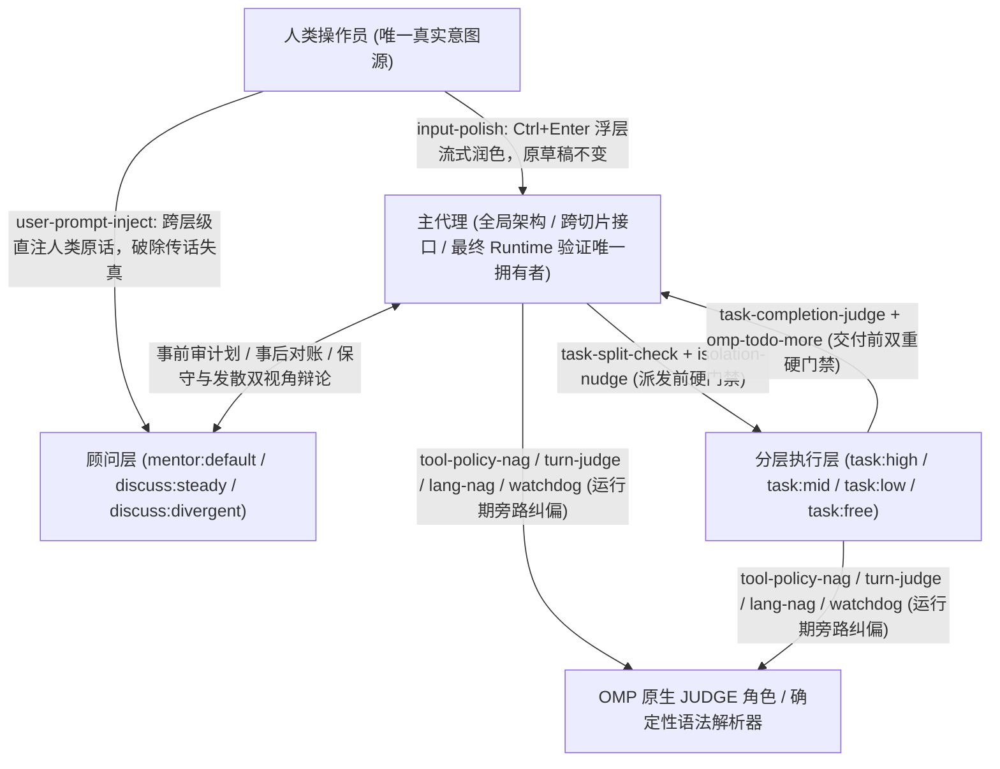
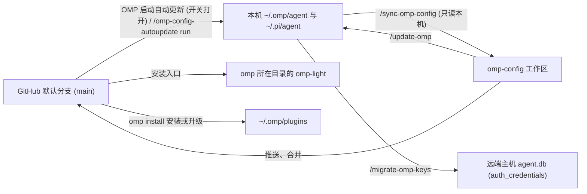

# omp-config

[English](README.md) | 简体中文

`omp-config` 是将前沿大语言模型从“不可靠的自由对话生成器”改造为“受控多级工程状态机”的 Oh My Pi（`omp`）运行时配置与扩展仓库。它只纳管可代码审查、可跨机器确定性重放的策略、提示词、子代理定义与本地 TypeScript 扩展；数据库（`*.db*`）、会话历史、模型缓存、日志、锁文件、插件安装包（`~/.omp/plugins/`）与供应商凭据严禁入库。

- [1. 系统定位与控制论架构](#1-系统定位与控制论架构)
- [2. 提示词四层解耦与上下文经济学](#2-提示词四层解耦与上下文经济学)
- [3. 多代理拓扑、防回声室顾问与成本信任分档](#3-多代理拓扑防回声室顾问与成本信任分档)
- [4. 运行期门禁、旁路判定器与交互工具](#4-运行期门禁旁路判定器与交互工具)
- [5. 插件生态与外部能力底座](#5-插件生态与外部能力底座)
- [6. 双轨运行模式：Full 模式与 omp-light](#6-双轨运行模式full-模式与-omp-light)
- [7. 权威边界、双单向同步与多机运维](#7-权威边界双单向同步与多机运维)
- [8. 扩展工程规范、CI 验证与升级维护](#8-扩展工程规范ci-验证与升级维护)

---

## 1. 系统定位与控制论架构

本配置不是 `ultracode` 式的黑盒全自动求解器，而是围绕 OMP 原生执行流构建的**闭环运行时控制系统**。整套架构建立在四条经长程实战检验的工程假设之上：

1. **模型不会稳定遵守 System Prompt（破窗效应假设）**：以 Claude 与 GPT 为代表的前沿模型会选择性无视提示词规则。一旦模型开始绕开内置工具规范（如用 `cat`/`sed -i`/`rg` 或 `python -c` 代替 `read`/`edit`/`grep`），说明其注意力已脱离系统契约，紧接着 `CLAUDE.md` 与业务规则也会一并失效。单靠把提示词写得更严厉无法解决偏离，必须在运行期把文件写入强绑定到已读快照、实时检测工具失范，并在偏离扩散前注入旁路纠偏。
2. **Context 是与人类对齐的“意图状态”，而非单纯的文件缓存**：长程任务的 Context 承载着需求边界、已排除路径、架构取舍及与操作员对齐过的隐含共识。任何形式的 Compaction（上下文压缩），或用 `grep` 代替通读、用 `head`/`tail` 截断输出、把多步操作塞进一条黑盒长 bash，都是高损耗的意图破坏。
3. **代码生成能力 $\neq$ 规划判断力与契约遵循力**：低价或免费模型不适合由人类直接对话驱动，但只要将全局架构、领域模型、跨切片接口与最终验证权锁死在父代理手中，并在派发前（防多主题杂糅）与交付前（防半途交差）设置独立模型门禁，它们就能在受限切片内充当极高性价比的执行工人。
4. **偶发多跑一轮的代价远低于频繁打断人类操作员**：通过有状态的 Todo 生命周期与低延迟原生判定模型（OMP `JUDGE` 角色）驱动代理在局部受挫后自愈续跑，把人类的注意力留给真正的架构决策与外部阻塞。



### 失效模式与运行时对策全景矩阵

仓库中的全部 **22 个本地扩展**、**10+1 个外部插件**与核心配置项均对应明确的模型失效模式或宿主能力缺口，不存在无归属的装饰性脚本：

| 控制环路 | 真实模型失效模式 / 宿主能力缺口 | 拦截 / 触发时机 | 对策载体 | 运行时控制动作 | 轻量模式 |
|---|---|---|---|---|---|
| **写入安全与计划闭环** | 模型凭记忆盲改文件、覆盖未读区域或行号错位 | `read` / `edit` 调用时 | `config.yml` (`edit.mode: hashline`) | 强制非 `:raw` `read` 获取 4 位十六进制快照标签后，才允许按锚点执行 `edit` | 启用 |
| **写入安全与计划闭环** | 模型未立计划就直接改代码，或遇小错提前停下反问用户 | `edit` 前 / 回合结束 / `DONE` 时 | 插件 [omp-todo-more](#todo-more) (`todo`) | Todo 为空时直接封锁 `edit`；仍有未完项且非向用户提问时自动催促继续；有未提交改动时强制 `DONE` 携带 git commit 子句 | 启用 |
| **运行期偏离遥测与纠偏** | 模型用 shell/eval 代替内置工具（破窗信号），或拼出不可预测的多程序长写管道 | 主会话 `tool_call` | [tool-policy-nag](#tool-policy-nag) + `omomp.yml`（`jev` 下另用 `INTENT-policy.md`） | 不阻断执行；`detector: heuristic` 用 `form` 解析器计数并发送配置的 `form.prompt`（OMP bash 拦截器被覆盖为关闭），`detector: jev` 调原生 JUDGE 点名应替用的内置工具；`risk` 通道同步警告长写管道 | 禁用 |
| **运行期偏离遥测与纠偏** | 模型在长任务中偏离验证要求、偷换问题，或未验证就宣布完成 | 每 $N$ 步动作 / 回合结束 | [watchdog-agent](#watchdog-agent) + [turn-judge](#turn-judge) | `watchdog-agent` 按 `target` 独立审阅分支并注入 `<watchdog>`；`turn-judge` 每轮后用原生 JUDGE 打分并在达阈值时直接输入纠偏 prompt | 禁用 |
| **运行期偏离遥测与纠偏** | 服务端或本地 Compaction 后模型丢失中文回复约束 | 主会话 `agent_end` → 下次 `input` | [lang-nag](#lang-nag) | 检测回复末段前 200 字符语言；不符时在用户下一条真实输入前静默拼接 `说中文`，零额外回合开销 | 禁用 |
| **防回声室与子代理门禁** | `mentor` 与 `discuss` 只看到派发方裁剪后的转述，沦为回声室放大器 | 子代理每次 `context`（含 IRC 唤醒） | [user-prompt-inject](#user-prompt-inject) + `PROMPT-INJECT-user-goal.md` | 沿 `parentId` 爬回根会话，提取全部人类原话注入顾问请求首部，令其拿人类原话审判咨询方的计划偏差 | 禁用 |
| **防回声室与子代理门禁** | 主代理把多个无关主题塞给一个 worker，或限制 worker 报告字数截断证据 | `task` / `fork_task` 的 `tool_call` | [task-split-check](#task-split-check) | 用 OMP 模型角色 `@task-split-check` 并发检查：多主题首次拦截（原样重派放行），限制报告长度永久拦截 | 禁用 |
| **防回声室与子代理门禁** | 多个并发写入 worker 共用同一工作目录互相踩踏文件 | `task` 的 `tool_call` | [isolation-nudge](#isolation-nudge) | 存在 $\ge 2$ 个未隔离写入者时按 prompt hash 首次拦截，要求改为 `isolated: true` | 禁用 |
| **防回声室与子代理门禁** | 低阶 worker（`task:low/mid/free`）在工作未做完或未更新 Todo 时提前 `yield` | 子代理 `yield` 的 `tool_call` | [task-completion-judge](#task-completion-judge) | 用 OMP 模型角色 `@task-completion-judge` 核对派工单、工具记录与提交内容：未做完退回一次，Todo 仍有未完项再退回一次，放行时附 `completion_judge` | 禁用 |
| **上下文经济学与防失忆** | 百万字级设计背景或复杂人类对齐意图无法浓缩进短 `task` `context` 字符串 | 子代理派发 | [fork-task](#fork-task) (`fork_task`) | 克隆调用方（或 `from` 指定代理）的对话历史作为子代理起点，支持 `shake: true` 压缩早期工具结果 | 禁用 |
| **上下文经济学与防失忆** | 主会话发生 Compaction 后丢失已完成任务账本与子代理拓扑 | `todo` 修改时 / 主会话 compact 后 | 插件 `omp-todo-more` 的 [ctx](#ctx) + [Task log](#task-log) | 每次成功 `todo` 修改追加写入 `task-log/<agent-id>.md`；compact 后自动把 `ctx list` 与重放时间线注入新上下文 | 启用 |
| **提示词分层与模型适配** | 内置工具协议在基础模板和附录里重复堆砌，或与自定义派发/检索规则冲突 | 每次 `before_agent_start`（最后执行） | [system-prompt-replace](#system-prompt-replace) | 在 `inlineToolDescriptors: "on"` 下原地改写渲染后的内置与插件工具描述 | 禁用 |
| **提示词分层与模型适配** | OMP 原生提示词与自动压缩阈值无法按模型家族正则差异化配置 | 每次 `before_agent_start` | [append-system-model](#append-system-model) + [model-compaction](#model-compaction) | 按 `model`/`provider` 正则追加模型专属提示词，并为匹配模型写入原生 `"provider/id": "f<N>"` 压缩水位 | 启用 |
| **宿主环境与运维补齐** | OMP 不扫描 `.claude/rules` 与 `.pi/rules`，丢弃既无 `alwaysApply` 也无 `description` 的规则文件，也不认 Claude Code 的 `paths` frontmatter | `session_start` / `before_agent_start` / `tool_result` | [repo-rules](#repo-rules) | 注入 `.claude/rules`、`.agents/rules`、`.pi/rules`（cwd 向上至 git 根）与 `~/.claude/rules` 的规则；所有带 `paths` 的规则（含 OMP 原生发现的）只在读、写、编辑或 `cat` 到匹配文件后加载 | 启用 |
| **宿主环境与运维补齐** | 仅人类能在 TUI 输入 `/wt`、`/move`、`/restart`，主代理无法自主切 worktree 或重启生效新配置 | 主 TUI 会话空闲时 | [wt-tool](#wt-tool) (`wt`/`wt_remove`) + [harness-restart](#harness-restart) | 排队并在回合真正结束后调用 TUI 原生命令分发器执行 worktree 切换、两阶段验证删除与带原因重启恢复 | 启用 |
| **宿主环境与运维补齐** | 子进程内存泄漏（含脱离父进程的孤儿进程）拖垮宿主机 | macOS 每 2 s | [child-memory-warning](#child-memory-warning) | 通过 Bun FFI 调 `libproc` 采样后代进程 `phys_footprint`，超过 `omomp.yml#child-memory-warning.thresholdGiB`（仓库配置 4 GiB）时告警主 UI 与主 agent | 启用 |
| **宿主环境与运维补齐** | `--model` 指定 `commandcode` 模型时因宿主缓存遮蔽或内置 provider 同名冲突报鉴权失败 | `session_start` | [commandcode-model-spec](#commandcode-model-spec) | 识别 `commandcode-models.json` 中的模型并在 `api !== "commandcode-custom"` 时重选回插件实时注册模型 | 启用 |
| **宿主环境与运维补齐** | OMP 手工抓包的 Antigravity wire 表缺少较新的 wire id（`gemini-4-argon-*`），调用方的小输出预算（如 compaction short summary 的 512 token）原样发出，被 Gemini 的 thinking 全部耗尽 | 根会话 `session_start` | [antigravity-wire-profiles](#antigravity-wire-profiles) | 按每个 Antigravity 账号拉取 `fetchAvailableModels`，把每个在服 wire id 的 `maxOutputTokens` / `model_enum` 原地写入 provider 读取的表 | 启用 |
| **人机协同与多机同步** | 人类草稿需激励性润色、长文档需无损重排审校、多机配置需原子同步 | 按键 / 命令 / 启动时 | [input-polish](#input-polish) + [doc-polish](#doc-polish) + [omp-config-autoupdate](#omp-config-autoupdate) | `Ctrl+Enter` 浮层流式润色输入；三代理流水线生成 `/tmp/doc-polish` 对照审校报告；启动时子进程拉取默认分支自动应用 | `doc-polish` 禁用，其余启用 |
| **人机协同与多机同步** | 扩展与插件的界面文字中英混杂；由扩展导出的语言又会晚于 OMP 在首帧前绑定的插件 | 模块加载 / 每条界面文字 | [omomp-lang](#omomp-lang) + `_shared/i18n.ts` + 各插件的 i18n 模块 | 把 `omomp.yml#omomp-lang.language` 导出为 `OMOMP_LANG`；每条面向人的文字在产生时按 `OMOMP_LANG` → 该配置段 → locale → 英文 解析 | 启用 |

---

## 2. 提示词四层解耦与上下文经济学

### 提示词四层解耦

为避免把所有指令塞进同一个文件导致提示词膨胀与规则互搏，系统提示词按职责拆分为四个正交层：

| 层级 | 权威文件 / 扩展 | 作用域 | 核心内容与边界 |
|---|---|---|---|
| **1. 基础工作流层** | `agent/SYSTEM_TEMPLATE.md` | 主会话 + 子代理 | 派生自 OMP 内置 `packages/coding-agent/src/prompts/system/system-prompt.md` 的 Handlebars 覆盖模板（纯文本 `SYSTEM.md` 无法编译表达式）。负责通用工程纪律、渲染实时工具/技能/规则清单，并通过 `{{#if subagent}}` 将第 4 步切换为主代理 `Verify` 或子代理 `Hand-off`。不重复印具体工具的使用说明。 |
| **2. 表达与写作风格层** | `agent/PERSONALITY.md` | 仅主会话（子代理固定 `personality: none`） | 填充模板的 `{{personality}}` 槽位。前半部分逐字保留 OMP `personality: default` 的 `Evidence-first terse engineer` 推理规范；后半部分定义 `# Writing` 研究与分析文体规范：结论/数字/机制直接开篇，一句话交代时间、主体、行为、规模与来源，多对象进单表且不在表后逐行复述，删除过程自述、重复解释、免责声明与总结段（删掉某段若不改变读者对事实、数字、机制、条件与结论的理解则必须删除）。 |
| **3. 主会话本地策略层** | `agent/APPEND_SYSTEM.md`（轻量模式为空文件 `APPEND_SYSTEM_LIGHT.md`）+ [repo-rules](#repo-rules) | `APPEND_SYSTEM.md` 仅主会话；`repo-rules` 主 + 子 | `APPEND_SYSTEM.md` 定义四项本地增量：① 用户显式指令高于一切默认规则；② 最终回复是唯一交付物（正文用带主语的完整句子、首现指认对象、结论旁附 `path:line` 或实测输出证据、禁类比）；③ 严禁为省 token 跳过必读内容或截断报告，修改设计文档前必须逐行通读全文及关联文档；④ 重大决策必问 `discuss:steady` 与 `discuss:divergent`，长调查必配 `mentor:default`。 |
| **4. 动态工具手术与模型差分层** | [system-prompt-replace](#system-prompt-replace) + [append-system-model](#append-system-model) | 主会话 + 子代理 | `system-prompt-replace` 在所有路径扩展最后执行，就地改写注入到 system prompt 中的内置/插件工具说明；`append-system-model` 按当前会话模型的 `model`/`provider` 正则动态追加模型专属补丁，使针对单一模型家族的纠偏不污染其他模型。 |

#### system-prompt-replace

位于 `agent/extensions-last/system-prompt-replace/`，写在 `agent/config.yml` `extensions` 列表的最后一项。由于 `before_agent_start` 钩子按扩展加载顺序串行执行（加载顺序：native 发现 `~/.omp/agent/extensions/` 与 `settings.json` 模块 → hooks → 插件扩展 → `-e` 参数 → `config.yml` `extensions` 列表 → OMP 内置 inline 扩展），将其放在 `extensions/` 目录之外的 `extensions-last/` 并排在 `config.yml` 末项，可确保它看到所有路径加载扩展完成后的 system prompt（若放进 `extensions/` 会在第 1 步提前加载，且 `config.yml` 中的同名路径会被当作重复项丢弃）。

扩展在每次 `before_agent_start` 重读 agent 目录 `omomp.*` 的 `system-prompt-replace` 段（不读项目 `.omp/` 副本；依赖 `config.yml` 开启 `inlineToolDescriptors: "on"` 将完整工具说明渲染进 system prompt）：

```yaml
system-prompt-replace:
  replacements:
    - literal: "原文"
      replace: "替换文字"
    - regex: "JavaScript 正则源码"
      replace: "替换文字，可用 $1、$&"
```

- **当前仓库的 10 条改写规则**：① 将 `read` 重定义为统一的 `<source><:selector>` / `<source>?<query>` 检索与 hashline 快照协议，并说明单流 `.gz` 如何暴露其唯一成员（指向 `omp://tools/read.md`）；② 将 `task` 的 `"Use most specific agent."` 改写为按成本与可信度选档（默认 `task:mid`、`task:low` 省成本与验证 `task:free`）；③ 移除原生子代理包装层的 `"Every task MUST skip build/lint/tests..."` 与 `"No TODO tracking, no progress updates."`；④ 要求并发写入强制 `isolated: true` 且共享只读调查代理以便续聊；⑤ 要求显式指定 `agent` 且不覆写 `effort`；⑥ 澄清对用户报错“不复跑去怀疑报告，但为定位原因的复现与修复后的确认仍照常执行”；⑦ 修正编译代码规则缺失的 `add`；⑧ 严禁通过 `eval` 读取、列举或搜索本地文件；⑨ 声明 `xd://<tool>` 设备只能通过 `write` JSON 调用、严禁编造 `xd__<tool>` 函数名；⑩ 用精确 literal 整段替换原生 `bash` 说明（上游措辞一变即触发漂移警告），新说明与 `omp://tools/bash.md` 一致，并与 `agent/extensions/tool-policy-nag/INTENT-policy.md` 采用同一套三入口分工：`bash` 是同步语义的默认 shell（内嵌 brush、不在调用内切换 shell、并发调用使用隔离 shell、管道 / `$(…)` / 程序输出重定向属正常用法、`timeout` 按命令设定、自动转后台的结果只投递一次且不得轮询）；`xd://exec_command` 负责长时间运行、等待外部条件、需要终端或需要其他 shell 的程序，等待时用一个静默循环加不带 `condition` 的 `xd://monitor`，结束时只唤醒一次；`eval` 负责需要语言语义的计算。
- **失效与漂移检测**：当某条规则在主会话 system prompt 中找不到目标文本时（例如升级 OMP 后上游改动了内置工具描述），每个进程每条规则弹一次 UI 警告（headless 写 stderr）并记日志，绝不阻塞 prompt；subagent 因本就可能不含 `task` 等工具说明而不做缺失检查。

#### append-system-model

在每次 `before_agent_start`（主会话与每个 subagent 各自按自身当前模型匹配）重读 `~/.omp/agent/extensions/append-system-model/APPEND_SYSTEM_MODEL.md`（本机独占文件，仓库不带，改文件或 `/model` 切换从下一条 prompt 即时生效）。文件由多个 `---` 分隔的块组成，每个块头部为声明 `model`（匹配如 `claude-opus-5-5`）和/或 `provider`（匹配如 `^anthropic$`）JS 正则的 YAML 头，正文延伸至下一个 `---` 行（正文内部如需分隔线请用 `***`）。所有匹配块按文件顺序拼接为一个额外 system prompt 块追加在末尾；文件缺失时静默跳过，格式错误时按行号记一次 warning 且不阻塞 prompt。

#### repo-rules

OMP 默认扫描 `.omp/rules`、`.agent(s)/rules`、`.cursor/rules`、`.windsurf/rules`、`.clinerules` 与 `.github/instructions`，但不扫描 `.claude/rules` 与 `.pi/rules`，会丢弃既无 `alwaysApply` 也无 `description` 的规则文件，也不读取 Claude Code 的 `paths` frontmatter。

- **无作用域规则：** 本扩展从 `cwd` 向上至 git 根目录（不在仓库中时只看 `cwd`）逐层递归扫描 `.claude/rules`、`.agents/rules`、`.pi/rules` 下的非隐藏 `.md` / `.mdc`（离 `cwd` 越近优先级越高，同层按 `.claude` → `.agents` → `.pi` 排序），并在每个会话额外扫描用户级 `~/.claude/rules`，在每次 `before_agent_start` 追加 `<repo-level-rules>` 块。无 frontmatter、frontmatter 无法解析或 `alwaysApply: true` 的规则注入全文；其余带 frontmatter 的规则仅列出名称、`description` 与路径。OMP 已自行放置（alwaysApply、rulebook 条目或 TTSR）的文件跳过；正文空白归一后已在本次收到的 system prompt 中、或列表项的 `rule://<文件名>` 已在其中的也跳过。
- **按路径作用的规则（Claude Code `paths`）：** frontmatter 含 `paths`（YAML 列表或逗号分隔的 glob 字符串，支持花括号与 `[…]` 字符类）的规则，只在触及匹配文件时加载：成功的 `read`、`write`、`edit`，或只读取单个文件的纯 `cat`/`head`/`tail` 的 `bash` 命令（管道、命令串联与多文件命令不算）。来源为上述扫描文件以及 OMP 原生发现的全部规则（项目与用户级 `.omp`/`.agents` 规则、cursor/windsurf/cline/GitHub 规则、插件与扩展根目录的 `rules/`，例如经 `~/.claude` 扩展条目加载的 `~/.claude/rules`）。glob 的基准目录：用户级规则为 `cwd`，项目规则为包含该规则所在点目录的目录，插件或扩展根下 `rules/` 的规则为该根目录。带 `paths` 的原生规则无论 OMP 原本放在哪里都由本扩展接管：`alwaysApply` 正文从 `<generic-rules>` 删除，rulebook 条目从 `<domain-rules>` 删除，并继续遵守 `ttsr.disabledRules` 与其 `agents` 作用域。TTSR 规则（`condition`、`astCondition`、`question`）与 OMP 内置规则仍由 OMP 自行触发。命中的规则以 `tool_result` 的 `additionalContext`（工具批次之后的 developer 消息）送达，每个上下文一次：只要其 `<path-scoped-rule path="…">` 标记仍在 OMP 将发送的上下文中就不重复（因此压缩丢掉标记、resume 与切分支都按实际上下文处理）。
- **绝对路径模式（Claude Code 之外的扩展）：** 以 `/` 或 `~/` 开头的 `paths` 模式匹配被触及文件的绝对路径（`~` 为家目录），而非相对基准目录的路径，因此用户级规则可以按目录名生效、与会话 cwd 无关，例如 `/**/{omp,.omp,omp-*,*-omp,*-omp-*}/**` 覆盖所有 omp 仓库。Claude Code 本身把这类模式当作相对路径，永远不会命中。

---

### 上下文经济学（Context Economics）

Context 管理的核心矛盾是**保留已对齐的任务意图，同时剥离高噪音的执行过程**：

1. **普通 `task`（抛弃执行过程）vs `fork_task`（克隆完整对齐背景）**：
   - 当背景简短或需要独立视角时，使用普通 `task`：子代理的探索、试错与工具输出留在其可丢弃的分支中，主会话只接收最终 `yield` 的结论与证据。
   - 当主会话已载入百万字级设计材料或与人类完成了多轮复杂对齐，无法靠几句话的 `context` 无损转述时，使用 `fork_task` 让子代理带着完整对话记忆聚焦局部切片。
2. **推迟有损压缩（`compaction.methodOrder` + `model-compaction`）**：
   - `agent/config.yml` 将压缩方式按损耗从低到高排为 `remote → soft → snapcompact → handoff → shake`，并通过 `model-compaction` 为大窗口模型设定精确的高水位触发点。
   - `compaction.asyncEnabled: false` 让压缩在触发点当场生成摘要。开启时，OMP 会提前最多 32k token 在后台请求摘要，拿到结果后一直存到触发点才换入，且 Anthropic 的摘要从不重新生成，期间每次请求仍带着完整历史。
3. **压缩后的确定性状态重建（`omp-todo-more` 的 `todo` + `Task log` + `ctx`）**：
   - 一旦主会话发生 Compaction，模型自行生成的摘要不可全信。`omp-todo-more` 插件通过旁路记录每次成功 `todo` 调用的 `Task log`，在压缩完成后自动将子代理上下文树（`ctx list`）与确定性重放的任务时间线（`ctx show`）注入新上下文。

#### fork-task

注册 `fork_task` 工具（顶层 `context` 加不含 `solutionSpace` 的 `tasks[]`，需 `async.enabled: true`）。派出的仍是原生 `task` 子代理（拥有独立 agent 定义、模型、工具、Agent Hub 行、`agent://`/`history://` 与隔离合并回写），唯一区别是其初始 transcript 复制自调用方当前对话，或某项 `from: "<agent-id>"` 指定的已注册代理对话：

- **关键行为差异**：
  - `isolated` 默认 `true`（仅只读调查时显式写 `isolated: false`；父会话处于 plan mode 时强制共享目录；隔离子代理结束后不可续聊）。
  - 支持 `shake: true`：对克隆副本执行与 `/shake` 相同的 `session.shake("elide")`——保护最近约 4,000 token 及 `skill://`、`local://PLAN.md` 读取，将更早的文本工具结果、$\ge 400$ token 的围栏代码块与顶层小写 XML 元素替换为 `[shaken ~N tokens — recover: artifact://<id> (region K)]` 写入整棵代理树共享的 artifact 目录，子代理可按需 `read` 恢复原文。
  - 支持 `from: "<agent-id>"`（匹配规则同 `agent://<id>`，含运行中、idle 或恢复会话中的 parked 代理）：复制该代理当前已落盘的对话而非调用方的。使用 `from` 时必填 `agent`（不继承来源的模型与角色），且子代理仍是调用方的子代，工作目录来自调用方的 checkout 而非 `from` 来源的隔离目录。
  - **强制 Runtime 验证契约**：克隆副本末尾自动追加 `<system-notice cause="fork_task">`，声明前置历史仅作背景，并明确要求 fork worker 在 handoff 前完成相关构建、测试与真实 runtime smoke 验证。
- **底层四步暂存机制**：① 将来源会话克隆至 `$TMPDIR/omp-fork-task/<uuid>/`（清零继承费用、为中断的工具调用补齐合成中止结果、清空源 Todo、追加 fork notice）；② 移除来源会话的运行时条目（`session_init`、`model_change`、`thinking_level_change`、`service_tier_change` 及 shake 辅助会话的 `session_exit`）并将子条目重挂到上一级；③ 共享子代理写入调用方 `cwd`，隔离子代理置空 `cwd` 交由执行器绑定 worktree；④ 在异步派发分配 ID 后触发的 `before_subagent_spawn` 钩子中，将暂存文件移至 `<父会话文件去掉 .jsonl>/<子代理 id>.jsonl` 供执行器直接打开。

#### model-compaction

仅在主会话每次 `before_agent_start` 重读 agent 目录 `omomp.*` 中的本机 `model-compaction` 段（不读项目 `.omp/` 副本），弥补 OMP 原生 `compaction.modelThresholds` 仅支持精确 `provider/id` 或 `*` 前缀的限制：

```yaml
model-compaction:
  rules:
    - provider: "^anthropic$"
      model: "opus"
      thresholdTokens: 150000
    - model: "[gG][pP][tT]"
      thresholdTokens: 650000
```

- **匹配与运行时注入**：每条规则至少写 `model` 或 `provider`（无隐式兜底，全匹配需写 `"model": ".*"`），按文件顺序取首条匹配规则，将 `ctx.models.list()` 中匹配的每个模型展开为原生固定触发条目 `"<provider>/<id>": "f<thresholdTokens>"` 写入主会话运行时设置层（不写 `config.yml`，`/model` 切换、重试回退与继承主会话设置的 subagent 自动按各自模型生效）。
- **上下文窗口档位保护**：原生 `f<N>` 条目可能改变支持 extended 上下文模型的窗口档位。本扩展**绝不改变任何模型的窗口档位**：若某条规则的 `thresholdTokens` 会在 standard 与 extended 窗口之间切换该模型当前所处的档位，则对该模型拒绝应用并记 warning。同时保留其他来源预设的运行时条目，在无匹配规则或 `session_shutdown` 时恢复原值；若发现外部修改了该运行时映射则警告一次并停止管理。

#### ctx

由 [omp-todo-more](#todo-more) 插件注册（`src/ctx/inventory.ts`）的只读工具，将当前会话、subagent registry、transcript、compaction 摘要、`.md`/`.json` sidecar 与 task log 组装为一棵上下文树，不修改任何会话或文件：

- **`ctx list [<id>] [all=true]`**：深度优先输出每行一个 context（含状态、单行摘要、`done/total` 任务计数及带原因的 `blocked`）。默认仅显示主会话与 `task` / `task:*` 子代理（隐藏 `mentor`、`discuss`、`trace` 并将其可见后代提升一级，附隐藏数量），非根节点后代超过 8 个时折叠为一行（用 `ctx list <id>` 展开）；`all=true` 显示除 advisor 外的全部节点。
- **`ctx show <id>`**：输出三部分：① handoff（当前会话取最新 compaction 摘要，其他 context 优先取相邻 `.md` sidecar 全文，次选 `.json` sidecar 的 120 字符摘要）；② task log 中最后一条有效的 `## Goal`（Objective / Measure / Done when）；③ 由 task log 重放生成的 `## Tasks` 时间线（分 `Completed` 与 `Open` 两段，按最后一次被采纳操作的本地时间排序）。
- **近似值边界**：计数与时间线是从追加日志重建的近似视图，不等同于 `TodoTracker` 的实时状态：`init`/`append` 只记数量不记任务名，因此创建后从未被单独按名操作的任务计入 `ctx list` 总数但不出现在时间线中；已完成或已移除的任务名后续 `start`/`block`/`unblock` 不再生效；名为 `all tasks` 的任务会被当成批量选择器。

#### Task log

`omp-todo-more` 插件的 `src/ctx/tasklog.ts` 在每次改变状态的 `todo` 或原生 `goal` 工具调用成功后，将本地时间、工具名、操作与详情追加到 `<local root>/task-log/<agent-id>.md`（带 goal 的成功 `todo` 调用紧接着再记一行 `todo-more set: <goal JSON>`；只读的 `todo view`、`goal get` 及失败调用不记）。这使行事记录严格锚定在已实际成功的工具调用上，而非模型声称做过什么。

#### compact 后注入

`omp-todo-more` 插件的 `src/ctx/post-compact-hint.ts` 监听主会话的 `session_compact` 与未中止的 `auto_compaction_end`（5 秒防抖窗口内最多触发一次，subagent 不注入），在压缩结束后自动以 steer 消息注入 `<post-compact-ctx>` 块（内含 `## List` 即 `ctx list`，以及主会话的 `## Current session` 即 `ctx show`），确保压缩后的新上下文第一时间拿到完整的子代理树与任务进度账本。

---

## 3. 多代理拓扑、防回声室顾问与成本信任分档

`agent/config.yml` 在 `task.disabledAgents` 中显式禁用了全部 5 个内置子代理（`task`、`scout`、`sonic`、`reviewer`、`security-reviewer`；即使写进 `spawns` allowlist 也会在 preflight 被拒），所有子代理委派统一由 `agent/agents/*.md` 中的 7 个自定义子代理承载（编写陷阱详见 `agent/agents/README.txt` 与 `README.zh-CN.txt`，目录内笔记必须用 `.txt` 后缀以免被当作 agent 定义解析产生永久日志噪声）。

### 七个自定义子代理与模型绑定矩阵

模型的职责与能力边界定义在 `agent/agents/<name>.md` 中，而具体绑定的模型与回退链集中在 `agent/config.yml` 的 `task.agentModelOverrides`（更换绑定模型时若改变了档次或成本量级，须同步更新 agent 文件的 `description` 与下表）：

| 子代理名称 | `description` 声明的档次与综合成本（每 1M token） | `config.yml` 当前实际绑定模型链 | 允许派生 (`spawns`) / 工具限制 (`tools`) | 角色契约与信任边界 |
|---|---|---|---|---|
| `task:high` | Claude Opus 5.5，约 $0.45 | `anthropic/claude-opus-5-5:high` | `spawns: task:mid, task:low, task:free, task:high, discuss:steady, discuss:divergent, mentor:default` | **未获用户在当前对话显式允许严禁调用**；唯一可承担架构/核心设计并向下二次展开一层（depth 1 → depth 2）的顶级 worker，负责所派子批次的契约、验收与集成（默认首项 `spawns` 为 `task:mid`） |
| `task:mid` | Opus 级，约 $0.30 | `openai-codex/gpt-6-1-sol:high` | `spawns: mentor:default` | **默认主力 worker**：处理除架构与核心设计外的一切实现、调查、调试与验证，并负责裁决低档次 worker 之间的分歧 |
| `task:low` | Opus 级，约 $0.01 | `openai-codex/gpt-5.6-luna:max` | `spawns: mentor:default` | 成本优先且结果可直接交付的工作（批量机械修改、查找、例行检查），以及对 `task:free` 产出做独立复现与核验 |
| `task:free` | Opus 级，零成本，高并发 | `bansos/muse-spark-1.3-contributor:xhigh, opencode-go/muse-spark-1.3-contributor:xhigh, openai-codex/gpt-6-luna:max` | `spawns: mentor:default` | **零信任探针层**：仅用于找候选代码/文档与低成本试探；任何实质性结论必须经父代理或 `task:low+` 独立验证，多个 `task:free` 达成一致绝不构成验证 |
| `discuss:divergent` | — | `anthropic/claude-opus-5-5:medium, openai-codex/gpt-5.6-luna:max` | `tools: read, grep, glob` | **只读发散派辩手**：质疑既有问题框架与假定约束，在存在真正不同解空间（删除特性、换状态拥有者、解决一整类问题）时给出带 `path:line` 证据与代价的替代方案 |
| `discuss:steady` | — | `openai-codex/gpt-5.6-sol:medium` | `tools: read, grep, glob` | **只读保守派辩手**：对方案做压力测试，以 `path:line` 举证排查隐含假设、未处理状态、迁移爆炸半径与更平庸安全的做法 |
| `mentor:default` | — | `openai-codex/gpt-5.6-sol:high, openai-codex/gpt-5.6-luna:max` | `tools: []`（仅 `yield`） | **无工具全周期导师**：调查前将活动型计划压成可判定的问题并找最廉价决定性观测点，交付前对照原计划逐项对账复盘；答案必须放入 `yield` 载荷防丢失 |

### 破除顾问回声室：`user-prompt-inject` 与双视角辩论

在传统多代理系统中，`mentor` 或 `discuss` 只知道派发它的代理告诉它的内容，一旦主代理理解偏了用户意图，顾问只会顺着错误转述给出合理化建议。本配置通过三项机制破除回声室：

1. **穿透式注入人类原话（[user-prompt-inject](#user-prompt-inject)）**：直接从根主会话抓取人类亲手输入的全部原始 Prompt，注入给 `mentor:default`、`discuss:steady`、`discuss:divergent` 的每一次模型请求，要求它们拿用户的原话去审判咨询方的计划。
2. **物理拆分的对抗性双辩手（`discuss:steady` vs `discuss:divergent`）**：重大决策必须同时咨询两者，避免单一审阅者给出折中废话；同一议题通过 `write agent://<id>` 多轮续聊，不重复建新会话。
3. **无工具导师的前置控轨与事后对账（`mentor:default`）**：刻意剥夺 `mentor:default` 的全部读写工具（`tools: []`），逼迫咨询方必须把具体路径、符号、命令与实测输出整理成文本发给它，在整理过程中自我暴露哪些是“已观测事实”、哪些只是“未验证假设”。

#### user-prompt-inject

在子代理每次模型调用（`context` 事件，涵盖首次派发、IRC `write agent://<id>` 唤醒与 parked 恢复）时，沿 `ctx.agent.parentId` 在进程 `AgentRegistry` 中向上找到根主会话（`task:high` 派出的孙代同样适用），读取其当前分支（`getBranch()`，含 compact 之前的历史）上所有 `role: "user"`、`attribution: "user"` 且非 `synthetic` 的非空文本消息，按 `PROMPT-INJECT-<label>.md` 模板渲染后作为一条不落盘的请求级 developer 消息（`<user-prompt-inject name=…>`）插在上下文最前面：

- **模板发现与 Frontmatter**：扫描 `~/.omp/agent/extensions/user-prompt-inject/PROMPT-INJECT-*.md` 及 `cwd` 至 git 根各层的 `<dir>/PROMPT-INJECT-*.md` 与 `<dir>/.omp/PROMPT-INJECT-*.md`。仓库自带并同步 `PROMPT-INJECT-user-goal.md`（配置 `target: mentor:default, discuss:steady, discuss:divergent`、`name: user-goal`、`enabled: true`，正文用 `{{user_prompt[0:e]}}` 注入全部用户原话）。
- **占位符语法**：`{{user_prompt[0]}}`（第一条）、`{{user_prompt[-1]}}`（最新一条）、`{{user_prompt[a:e]}}`（左闭右开切片，两端支持负数，每项渲染为 `<user_prompt index="N">…</user_prompt>`）；任何其他 `{{user_prompt…}}` 写法会让整个文件被跳过并记 warning。
- **消息归因隔离**：由于 `sendUserMessage` 不传 `attribution` 时默认为 `"user"`，本仓库所有主动发送用户角色消息的扩展（`watchdog-agent`、`turn-judge`、`tool-policy-nag`、`doc-polish`、`wt-tool`、`harness-restart`、`child-memory-warning`）一律显式设置 `attribution: "agent"`，防止扩展提醒被误当作人类原话注入顾问。

### 派发经济学与并行写入隔离契约

- **按成本与所需可信度选档，绝不按任务难度选档**：默认派 `task:mid`；当成本优先于额外判断力（批量机械改动、查找、核验 `task:free`）时降为 `task:low`（需要验证才能采信的任务，直接用 `task:low` 做一次比用 `task:free` 加验证者更便宜）。`task:free/low/mid` 严禁接手架构、领域类型、跨切片接口与文档/prompt/skill/agent 定义的设计。
- **递归深度上限为 2**：主代理在 depth 0，派出的 worker 在 depth 1；仅 `task:high` 能再派 depth 2 孙代，且 depth 2 的 `task` 工具会被宿主剥离（也无法派生自己的 `mentor:default`），因此交给 depth 2 的必须是可直接执行的叶子任务。
- **显式填 `agent`，禁覆写 `effort`**：每次调用必须显式指定 `agent`；模型与推理强度由 `config.yml` 绑定决定（`task.enableEffort: false` 隐藏了原生参数）。`config.yml` 中保留内置 `task` 与 `sonic` 的模型覆盖仅服务于 Vibe 模式的首层固定派发。
- **每个 `task:*` 切片的强制规程**：动手前先读代码写出计划交 `mentor:default` 审阅（depth 2 除外）；全程用 `todo` 初始化完整步骤并实时更新状态，还有未完项时严禁 `yield`，也严禁通过 `drop`/`rm` 缩小派工范围。
- **并行写入的 Worktree 隔离（`isolated: true`）**：同一仓库同时存在 $\ge 2$ 个写入 worker（同批派出，或前序共享写入 job 仍在运行）时，每个写入者必须设 `isolated: true`（`fork_task` 默认 `true`；只读调查设 `isolated: false` 以保持可续聊；plan mode 下强制共享）。给隔离 worker 的路径必须写**仓库相对路径**（OMP 的隔离靠提示词约束，写绝对路径会让命令跑回父工作区）。`task.isolation.merge: branch` 把 worker 自己的提交逐个 cherry-pick 到父分支，提交信息与 todo-more 的 `Model` trailer 原样保留；返回结果须确认 `Merged branch: <name>`（或 `No changes to apply.`）才算落盘。

---

## 4. 运行期门禁、旁路判定器与交互工具

### 4.1 派发前与交付前硬门禁（Pre-Dispatch & Pre-Yield Gates）

#### isolation-nudge

在主会话与子会话的 `tool_call` 阶段拦截 `task` 调用（不查默认隔离的 `fork_task`）：当调用会导致 $\ge 2$ 个可写代理（`task:*`、内置 `task`、省略 `agent` 的项、`m1` 等，计入本批及本会话仍在运行的共享写入异步 job）在未开启 `isolated: true` 的情况下共用当前目录，且存在未显式指定 `isolated` 的项时，按每项 `task` 文本的 SHA-256 首次拦截整次调用，提示为写入者加 `isolated: true`、只读调查显式写 `isolated: false`；同一 prompt 原样重派则直接放行。

#### task-split-check

在 `tool_call` 阶段询问 OMP 模型角色 `@task-split-check`（在 `/model` 中指定；`modelRoles` 属于本机，仓库不为它附带模型），再询问 `omomp.yml#task-split-check.fallbackRole` 所指的角色（仓库配置 `smol`），每次请求实时解析，角色条目不带 `:level` 后缀时用 `medium` 推理，整批共用 25s 超时信号，某个模型报 provider 错误时换角色链中的下一个，对 `task` / `fork_task` 的每个派发项并发执行两项是非检查，任一项命中即拦截整次调用：

| 检查项 | 适用范围 | 判定准则 | 进程内缓存与重派策略 |
|---|---|---|---|
| `split` | 主会话 `task` 调用中派给 `task:low`、`task:mid`、`task:free` 的项 | 仅看该项 `task` 文本（共享 `context` 仅作背景）：是否塞入了多个互不依赖的主题（按主题而非涉及的文件数判断） | 缓存全部确定结论（`pass-repeats`）：被拦后若主代理确认是单一主题，原样重派第二次直接放行 |
| `report-limit` | 任何会话 `task` 与 `fork_task` 中派给 `task:*` 或省略 `agent` 的项 | 同时看共享 `context` 与该项 `task`：是否限制了 worker 汇报的长度（字数、行数、段落、token 或“简短汇报”；给写入仓库文件的交付物定长不算） | 仅缓存无限制结论（`skip-clear`）：**必须删掉长度限制**（长报告可让 worker 写 `local://<name>.md` 并汇报路径），原样重派继续拦截 |

模型不可用、配置缺失或无效、请求失败或超时均 Fail-open 放行，每次判定记录一条 `task-split-check verdicts` info 日志。

#### task-completion-judge

在 `task:low`、`task:mid`、`task:free` 子代理会话内拦截结构化 `yield`（`task:high`、主会话、带错误的 `yield` 或增量提交不拦截）：

- **证据组装（60k token 窗口）**：提取当前分支最后一条 `session_init` 中的派工单（跳过 `fork_task` 开头继承的父会话历史），加上 system prompt 共享背景、worker 自身 Todo 的 `goal`、本次 `yield` 提交内容（最多保留 6,000 字符），以及从最新一条往前连续装入剩余预算的本轮工具调用与结果（单次调用参数与结果各最多保留 800 字符，超长按前 60% + 后 40% 加省略行截断；按 ASCII 字符 1 token、其他字符 2 token 估算）。
- **判定模型与标准**：询问 OMP 模型角色 `@task-completion-judge`，再询问 `omomp.yml#task-completion-judge.fallbackRole` 所指的角色（仓库配置 `smol`），每次判定实时解析，角色条目不带 `:level` 后缀时用 `low` 推理，25s 超时，某个模型报 provider 错误时换角色链中的下一个，回答 `DONE` 或 `NOT_DONE`。派工单是唯一权威标准：若 worker 的 Todo `goal` 窄化了派工单范围、`goal` 写的验证方式未在工具调用中出现、或未达 `doneWhen`（含如实报告 blocker），均判 `NOT_DONE`。
- **双重单次退回（Single-Bounce）与结果附注**：
  1. 首次判为 `NOT_DONE` 时拦截本次 `yield`，将原因退回给子代理要求继续做完并验证。
  2. 判为 `DONE` 后，立即通过同步事件 `omp-todo-more:read` 重新读取该子代理的最新 Todo 投影；若仍有 `pending` 或 `in_progress` 项（`blocked` 项不触发），再拦截一次并逐项列出解释，要求先把 Todo 更新到真实进度。
  3. 两类退回在每个子代理会话中各最多触发一次；一旦放行，同一会话后续 `yield` 不再拦截。当 `yield` 的数据结构为无自定义 `outputSchema` 的开放对象时，放行结果自动附上 `data.completion_judge = { verdict, reason, bounced }`（`bounced` 仅表示是否发生过 `NOT_DONE` 退回）。一切配置、模型或插件读取异常均记 warning 并 Fail-open 放行。

---

### 4.2 运行期旁路纠偏与原生 JUDGE 角色共享机制

`turn-judge`、`tool-policy-nag` 的 `intent` 通道（`detector: jev` 时）、`watchdog-agent` 的选项后端与 `lang-nag` 通过 `_shared/judge.ts` 的 `openJudge` 共用宿主的 **JUDGE 模型角色**。每次判定先交给 OMP 自己的 judge 角色链：先 `modelRoles.judge`，再 `retry.fallbackChains.judge`，未配置该键时用 OMP 内置的 judge 默认链。链会跳过没有凭据的候选，候选报 provider 错误时换下一个（401/402/403 让该候选冷却 5 分钟），遇到中止或超时即停止；从第一个原生判定 API 模型起 OMP 只保留原生候选，`openJudge` 也从不把会话模型加进链里。这条链因中止、超时以外的原因失败，或解析不出任何候选时，由 `omomp.yml` 中 `judge` 段的 `fallbackRole` 所指的角色作答（仓库配置 `fallbackRole: tiny`，即 `@tiny`）：按该角色自己的模型链（先 `modelRoles.tiny`，再 `retry.fallbackChains.tiny`）依次以提示式判定作答，跳过本地 `local` 模型。提示式答案是 one-hot（选中项概率为 1），所以选项阈值退化为“选中即生效”。没有 `judge` 段就没有回退。两个阶段的每次尝试都记入会话用量账本，完全相同的原生请求由 OMP 共享判定缓存作答。只有链和回退角色都解析不出模型时才不运行。角色设置与该段每次触发实时读取，热重载后下一次触发即生效。

#### tool-policy-nag

仅作用于主会话，在 `tool_call` 阶段检查 `bash`、`bash_bg`、`exec_command`（含经 `write` 写往 `xd://bash`、`xd://bash_bg`、`xd://exec_command` 的调用）与 `eval` 代码，**只提醒、不拦截命令**。由 `omomp.yml` 的 `tool-policy-nag` 段配置（按项目 `.omp/omomp.*` → agent 目录 `omomp.*` 每次调用重读；代码里不带任何预设，没有有效配置段时所有通道都不运行）。`detector` 选择工具路由违规的检测方式：`heuristic`（`form` 通道）或 `jev`（`intent` 通道）；`risk` 是独立的第三条通道，缺省或设为 `null` 即关闭：

```yaml
tool-policy-nag:
  detector: heuristic
  form:
    prompt: 你为什么不遵守system prompt，反思自己以后继续。
    afterHits: 3
    maxNags: 3
  intent:
    threshold: 0.5
  risk:
    minCommands: 4
    minChars: 600
    minPrograms: 3
```

- **`detector: heuristic`**：必须有 `form`；`intent` 段被忽略（保留它只为切回时改一个词），因此不发 JUDGE 请求、不读 `INTENT-policy.md`。每次检查被监视的调用之前，扩展在主会话实时设置上加一层仅运行期的覆盖 `bashInterceptor.enabled = false`，不论 `agent/config.yml`（已打开）怎么设；子代理透读这份设置，也一并失去拦截器。detector 改变时和 `session_shutdown` 时清除这层覆盖，不写任何磁盘文件。
- **`detector: jev`**：必须有 `intent`；`bashInterceptor.enabled` 按配置生效，为真时三条通道都跳过 `bash` 调用，因为拦截器已在执行前拒绝绕过内置工具的命令（`exec_command`、`bash_bg` 与 `eval` 照常检查）。可选的 `form` 段在 intent 通道旁照常计数，仅当 intent 通道无法运行（同目录 `INTENT-policy.md` 缺失、无效或停用，或 JUDGE 角色链与回退角色都解析不出模型）时才发送它的 `prompt`；判定失败（judge 链与回退角色都失败）或 90s 超时时记一次 warning，不补发 `form` 提醒。
- **`form` 通道（启发式语法解析与计数）**：
  - 解析管道、`;`/`&&`/`||`、引号、heredoc、`$(…)`/反引号命令替换与重定向（含 `>|`、`&>`），并把每条命令还原为实际运行的程序：跳过 `NAME=value` 前缀、保留字 `if`/`elif`/`while`/`until`/`do`/`then`/`else`/`!`/`{`，以及带自身选项的包装命令（`timeout`、`env`、`nice`、`stdbuf`、`time`、`nohup`、`command`、`exec`、`builtin`、`xargs`）；跳过 `sudo`/`doas`/`su`/`ssh`，字面量 `bash|sh|zsh|dash -c '…'`、`eval '…'` 与 `find -exec … ;` 的命令体就地分析。统计六类 shell 违规：列目录（`ls`、`tree`、`fd`、不带动作的 `find`、`rg --files`、`ag -g`）、读文件（`cat`/`bat`/`nl`/`head`/`tail`/`less`/`more`/`zcat`、`sed -n`、awk 行范围与 `/start/,/end/` 区段、对单个 JSON 文件的 `jq`、单条只读 `sqlite3` 查询与 `.tables`/`.schema`、`tar -t`/`tar -xO`、`unzip -l`/`-p`）、搜索（带文件或 `-r` 的 `grep`；`rg`/`ag`/`ack` 无路径时搜当前目录，stdin 来自管道时除外；awk `/re/`；工作树上的 `git grep`）、编辑（`sed -i`、`perl -i`、`awk -i inplace`、`mv`）、写入自拟内容（`echo`/`printf`/heredoc `cat` 重定向到文件或经管道交给 `tee`）、内联脚本（`node`/`bun`/`deno`/`python`/`ruby` 在脚本参数之前带 `-e`/`-c`/`-p`/`--eval`，或 `-` 读 stdin）；另加 `eval` 文件/目录操作（`Path.read_text`、`open`、`glob`、`os.listdir`、`readFileSync`、`Bun.file`、`readdir`、`Bun.Glob`）。输出交给 shell 的列目录/读/搜不计数：`$(…)` 捕获、只经 stdin 过滤器流入 `wc`/`uniq -c`/`grep -c` 的管道、`xargs` 的参数，以及作为 `if`/`while` 条件的 `grep -q`。`/dev/*` 豁免读/搜/改/写。与 OMP 拦截器不同，`tail -f`、`locate`、带 `-delete`/`-exec rm` 的 `find`、`git ls-files` 与读 stdin 的无路径 `grep` 不计违规。
  - 前 `form.afterHits`（`3`）次违规仅记录；超过后每次违规以 steer 发送配置的 `form.prompt`（不得为空）并弹 UI 警告，每个 context 最多发 `form.maxNags`（`3`）条，之后停止，直至下次 compaction、`/clear` 或 `branch_summary`（在配置里调高 `maxNags` 立即恢复）。三个字段均必填。状态存于会话条目 `mouriya.omp.tool-policy-nag.state`，随分支切换自动重建。
- **`intent` 通道（原生 JUDGE 工具路由分类）**：
  - 每次调用并行发起一次不阻塞命令的 JUDGE `choice` 请求，题目与 12 个选项判据定义在同目录 `INTENT-policy.md`（选项：`list`、`read`、`search`、`edit`、`write`、`move`、`eval`、`ast`、`pty`、`shell`、`mixed`、`none`，内含针对 `km ls actions`、`ssh host 'cat x'`、`npm test > log`、`curl -I`、管道过滤等真实误报类的反例）。
  - Shell 调用选中非 `none`、或 `eval` 调用选中非 `eval`/`none` 且概率 $\ge$ `threshold`（`0.5`）时，在下一个 step 边界以 `aside` 插入具体提醒（点名中文意图名、应替用的内置工具及调用原文），不计数、不封顶，并记 `Tool-policy intent verdict` info 日志。
- **`risk` 通道（无模型确定性风险检测，仅看 shell）**：
  - 在 `tool_call` 内同步完成，与工具路由完全独立。同时满足三项即触发：① 简单命令段数 $\ge$ `minCommands`（`4`）或总字符数 $\ge$ `minChars`（`600`）；② 去掉 shell 内建管道件（`cd`/`echo`/`printf`/`export`/`source`/`test`/`mkdir` 等）后涉及的不同外部程序数 $\ge$ `minPrograms`（`3`）；③ 含写入步骤（重定向/`tee`/就地编辑、`rm`/`cp`/`mv`/`chmod`/`dd`/`tar -c|-x`/`rsync`/`scp`/`make`/`install`/`patch` 等写程序，或 `git add|commit|push|reset`、`gh … create|delete|download|upload`、`docker run|build|push|rm|exec`、`kubectl apply|delete|exec`、`orb push|create|delete`、`npm|pnpm|yarn|bun install|add`、`tofu|terraform apply|destroy|state|init`、`curl -o|-O|-T|-d|-X POST`、`wget -O` 等写子命令，仅取前两个非 `-` 参数词）。
  - 命中即发送拆解提醒（列出段数、字符数、外部程序与写步骤），弹 UI 警告并记 `Tool-policy risk` info 日志。

#### watchdog-agent

按目标会话投放的独立运行时审阅器，由 `WATCHDOG-<label>.md` 驱动（扫描 `~/.omp/agent/extensions/watchdog-agent/` 及 `cwd` 向上至 git 根各层的 `<dir>/WATCHDOG-*.md` 与 `<dir>/.omp/WATCHDOG-*.md`，属于本机文件，不同步）：

| Frontmatter 字段 | 取值与默认值 | 行为说明 |
|---|---|---|
| `target`（必填） | `main`、子代理名（如 `task:low`）、`*`、`subagents` 或逗号列表 | 决定哪些会话运行该 watchdog |
| `name`、`enabled` | `name` 默认取文件名标签；`enabled` 默认 `true` | `/watchdog` 按 `name` 寻址；多个文件重名时命令报错并列出路径 |
| `delivery` | `aside`（默认）、`steer`、`nextTurn`、`followUp` | 提醒注入方式（`nextTurn` 等待用户下次真实输入或子代理下次 `before_agent_start`） |
| `every`、`scope` | `every` 默认 `30`；`scope` 为 `full`（默认）或 `window` | 每个工具调用与每条非空文字回复各计 1 步；满 `every` 立即后台审阅，回合结束（非 `willContinue`）对余数补跑一次。`window` 只看游标之后的新消息 |
| `maxPerContext` | 正整数，默认不限 | 两次 compaction 之间最多注入几条提醒；compaction 后清零封顶计数，不重置操作计数与 `window` 游标 |
| `model`、`tools` | 聊天 reviewer 后端（默认） | 在禁加载扩展、`taskDepth: 1` 的内存会话中运行；`model` 缺省依次试 `@advisor`、`advisor`、`@slow`、会话模型；`tools` 默认 `[read, grep, glob]`（可授 `ast_grep, web_search, edit, write, bash, eval`）。首行 `PASS`/`OK`/`LGTM`/`NONE` 为通过，其余作为 `<watchdog name=… severity=…>` 注入 |
| `instructions`、`option.<标签>[.prompt\|.delivery]` | JUDGE 后端（声明 $\ge 2$ 个 `option.*` 即启用） | 不可与 `model`/`tools`/`note` 同用；先经 OMP 的 JUDGE 角色链、再经 `judge` 段的回退角色，按正文准则从声明的小写标签选项中选一个，选中带 `.prompt` 的选项时注入该文本（无 `.prompt` 为静默通过）。失败或 90s 超时不回退聊天 reviewer |

- **游标持久化与恢复**：每次审阅得出结论后推进游标并写入会话条目 `mouriya.omp.watchdog-agent.cursor`，切换分支或恢复会话时从分支重建游标、封顶计数与未审操作数。
- **管理命令与三轮交互起草协议**：
  - `/watchdog [list]` 查看列表；`/watchdog on|off <name> [session|global]` 切换本会话覆盖或改写文件 `enabled`；`/watchdog rm <name>` 弹窗确认后删除。
  - `/watchdog add <需求>` 与 `/watchdog edit <name> [改动]` 自身不写文件，而是向当前模型发送一条 `attribution: "agent"` 消息（附完整字段说明、项目/全局路径、当前默认 reviewer 模型与已有名称），要求模型不使用 `ask`、严格按 **1. 起草（给预期行为、设置表、完整文件内容与绝对路径，本轮不写盘）→ 2. 按用户反馈修改 → 3. 用户显式确认后写盘** 三轮推进。任何触碰 `WATCHDOG-*.md` 的 `write`/`edit` 工具结果末尾都会自动附上一行即时重读识别状态（已识别 / 未识别及原因 / 合法但不在搜索路径 / 已删除）。

#### turn-judge

扫描扩展目录及 `cwd` 至 git 根各层的 `TURN-JUDGE-<label>.md`，在文件所指向的会话里，每轮正常结束（assistant 消息 `stopReason: "stop"` 且有非空文字）后，每个适用文件发一次 JUDGE 请求（仓库自带 `TURN-JUDGE-gpt-talk-only.md`，见下；本机自建的文件归本机；无适用文件，或 JUDGE 角色链与回退角色都解析不出模型时静默不运行）。`task.structured` 关闭时（OMP 默认），子代理的最终报告及其对 IRC 唤醒的回复都属于这种回合。

- **适用范围**：`target` 沿用 `watchdog-agent` 的写法——逗号分隔的 `main`、`subagents`（别名 `subagent`/`sub`/`subs`）、`*`（别名 `all`/`any`）或子代理定义名 / 注册 id（如 `task:mid`），不写时默认 `main`；`model` 与 `provider` 同 `append-system-model`，为不加锚点的 JavaScript 正则，匹配被判定消息自身的 `model`/`provider`；`skipTools` 是逗号分隔的工具名，这一轮调用过其中任何一个时，该文件不判定这一轮（用于 `wt`、`harness_restart` 这类回合结束后才执行的工具）。仅当 `target` 覆盖当前会话、所写正则全部匹配且没有调用跳过工具时文件才适用；不适用的文件不发 JUDGE 请求。`target`、`skipTools` 或正则为空，或正则非法时文件无效（每进程警告一次）。
- **配置字段与输入**：frontmatter 支持 `name`、`enabled`（默认 `true`）、`target`、`model`、`provider`、`skipTools`、`maxChars`（默认 `30000`）、`option.<标签>`（至少 2 个，禁含 `.` 或空白）、`option.<标签>.prompt` 与对应的必填 `option.<标签>.threshold` $\in (0, 1]$，正文为问题原文。JUDGE 接收 `{ 时间线: [{ 类型, 内容 }], 本轮回复 }`。`时间线` 只覆盖被判定回合所属的这件工作：从分支上最后一条人类输入开始，按发生顺序列出 `用户说`（那条人类输入：非 synthetic，主会话为 `attribution: "user"`，子代理不限归属、含派发任务）、`提醒`（之后的非人类 prompt，如 harness 提醒或 turn-judge 纠偏，每条只取前 400 字）、`模型想`（思考文字：GPT、Gemini 的推理摘要，Claude 的推理；redacted 块不收）、`模型说`（assistant 文字）、`模型调用工具`（`工具名：intent`，取调用携带的 harness intent；参数和结果不收）。被判定消息自身的思考排在 `时间线` 末尾，它的文字是 `本轮回复`；超 `maxChars` 字时，从 `用户说` 之后最早的条目整条丢弃。`skipTools` 只看模型上一次以 `stop` 结束之后的工具调用，所以由纠偏 prompt 或提醒开启的新一轮从零算起。
- **仓库自带的 `TURN-JUDGE-gpt-talk-only.md`**：`target: main`、`model: (^|/)[Gg][Pp][Tt]`（任意 GPT 模型）、`skipTools: wt, harness_restart`；选项为 `做完在汇报` / `只需文字` / `只说不做`，`只说不做` 概率 $\ge 0.8$ 时自动输入一条 prompt，要求模型别再宣布下一步或认错，直接用工具继续做。针对的是 GPT 当主 agent 时，交代的工作没做完就只用文字结束回合的习惯；列出计划、方案或选项等用户确认属于正当的纯文字。阈值用 2026-10-10 至 2026-10-25 经 `skipTools` 过滤后的 329 个 GPT 主会话回合、在 JUDGE 角色 `futureppo-jev/decision-model-preview` 下校准：能抓住道歉认错、复述要求后就停的回合（19 个人工标注正例中抓到 6 个），23 个标注反例和 287 个未标注回合都未误判，抓不到“正在进入示例运行验证”这类中途进度说明；标注是维护者自己对会话记录的判断，没有留出集；判定模型跟随本机 JUDGE 角色。
- **主会话触发与合并通知**：判定在后台运行。在所有带 `.prompt` 且概率 $\ge$ `.threshold` 的选项中，取概率最高者将其 prompt 以 `attribution: "agent"` 自动发出（引起的新一轮同样会被判定，无上限）；其余未触发文件等本轮全部判定返回后合并弹出一条 UI info 通知 `turn-judge <name>：<选中标签>（<各选项概率>）`。判定返回前若用户已输入或切换了会话/分支，则只弹 info 不再自动输入。
- **子代理触发**：`message_end` 处理器在 20 秒总时限内等待判定（OMP 等待扩展处理器的上限是 30 秒），因此 task 执行器不会先于判定收走结果。若有文件按时触发且被判定消息之后分支没有新消息，处理器等子代理空闲后，把全部触发的 prompt 合成一条 `attribution: "agent"` 消息发出、开启新回合，确认新回合已开始后返回。子代理对它的回复会替换原报告成为父代理收到的结果，所以面向子代理的 prompt 应要求给出完整修订报告；反复触发的文件会让子代理一直不返回。超时或过期的判定只记录、不发送。子代理没有 UI，判定与警告只写入 OMP 日志。

#### lang-nag

仅作用于主会话。在 `agent_end` 取最后一条有正文回复的最后一段（前 200 个字符），向上述 JUDGE 角色链发一道选择题，判断是否主要为 `language`（仓库配置：`language: 中文`、`instruction: 说中文`，会话开始或切换时读取；没有可用候选或全部候选失败时不提醒）。若判定为否，在用户下一条真实输入前拼接 `"说中文\n\n"`（斜杠命令清掉待用判定；若用户发送时判定尚未完成则中止判定并原样放行）。

---

### 4.3 宿主资源监控、交互工具与会话控制

#### child-memory-warning

macOS（Darwin）专属，完整模式与轻量模式均启用。首个主会话在 `session_start` 通过 Bun FFI 调用系统 LP64 `libproc`/`sysctl` ABI，启动每进程唯一的 2 s 采样定时器（主会话切换只刷新投递上下文，主会话关闭时先清定时器再关句柄；非 Darwin 平台仅记一条 `未启用` info 日志）：

- **物理内存口径与孤儿归属**：读取 `proc_pid_rusage` 的 `ri_phys_footprint`（含压缩与换出内存，非 RSS），以 `PID + 内核启动时间` 标识进程身份。经两遍进程表核对后追踪本 OMP 进程的全部后代及由后代组长创建的进程组；已被观测到的后代即使父进程退出变成孤儿（`PPID === 1`）仍保留归属直至进程结束（仅在两次采样间隔内出生并立即变成无存活组锚点孤儿的短命进程无法追溯）。
- **阈值配置**：`omomp.yml#child-memory-warning.thresholdGiB`（仓库配置 `4`，任意正数，可带小数）。主会话 cwd 下 `.omp/omomp.*` 的同名段优先于 agent 目录的段；每次采样都重读，改动从下一次 2 s 采样起生效，无需重启。没有有效配置段时继续追踪进程归属但暂停告警；每出现一个新的配置问题（配置段缺失或无效、项目副本被跳过）记一条 warning 日志并弹一次主 UI warning。
- **告警投递**：当任一归属后代的 `phys_footprint` 超过阈值时，每个进程身份告警一次（弹主 UI warning，并向主 agent 发送含 PID、PPID、是否孤儿、GiB/bytes 读数、阈值与 240 字符命令的 `attribution: "agent"` 消息），**只告警、不发信号杀进程**。

#### input-polish

仅作用于主会话交互式 TUI。在输入框按下配置组合键（默认 `Ctrl+Enter`；不支持 Kitty 键盘协议或 `modifyOtherKeys` 的终端可配为 `alt+enter`）时，通过 raw terminal-input 监听器拦截按键，用 OMP 模型角色 `@input-polish`（在 `/model` 中指定；思考强度取角色条目的 `:level`，否则关闭），再用 `fallbackRole` 所指的角色（`omomp.yml#input-polish` 仓库配置：`key: ctrl+enter`、`instruction: 在不改变原意的前提下，改写到听起来会让人更加想努力、能激动人心，但不要太夸张。`、`fallbackRole: smol`）在 `taskDepth: 1` 无工具内存辅助会话中流式润色草稿，并将改写流式显示在覆盖输入框的只读 overlay 浮层中（输入框始终保留原草稿）；某个模型失败时换角色链中的下一个模型，并先清空预览：

- **按键与占位符保真**：润色和预览期间吞掉其他按键；润色完成后按 `Enter` 关闭浮层、将润色稿写入输入框并放行同一次回车走原生提交流程，按 `Esc` / `Ctrl+C` 中止并关闭浮层且原草稿不变。空白草稿或以 `/`、`!`、`$` 开头的草稿不润色。若改写稿中 `[Paste #N …]` 或 `[Image #N …]` 占位符数量或内容与原文不一致，直接按失败处理并在浮层显示原因。

#### doc-polish

注册 `polish_doc` 工具与 `/polish-doc <path…>` 命令，在不改变原意的前提下重排、润色 `.md` / `.txt` 文档。**绝不修改源文件**，而是在 `/tmp/doc-polish/<时间戳>-<文件名>/` 下生成原文副本、切分索引 `split.json` 与逐组对照审校报告 `review.md`：

- **三阶段内存子代理流水线**（均传 `taskDepth: 1`、禁加载扩展防递归）：
  1. **拆分（Split）**：仅持 `[read, write]` 工具，自行读取原文并写出带起止行号的段落块索引与全文术语表。
  2. **润色（Polish）**：无工具，按每批正文 $\le 5000$ 码点（超长单段单独成批，不截断）及该批相关术语表并发重写，返回润色文本与术语变更；随后用并查集按 `sourceIndices` 识别跨段合并并重新编组。
  3. **校验（Check）**：无工具，按同一并发上限逐组判断改写是否保持原意。
- **模型与本机配置**：每个阶段从各自的 OMP 模型角色取模型，在 `/model` 中指定：`@doc-polish.split`、`@doc-polish.polish`、`@doc-polish.check`，各自之后再接 `omomp.*` 中 `doc-polish` 段 `fallbackRole` 所指的角色（项目 `.omp/omomp.*` 优先于 agent 目录）。角色条目的 `:level` 决定该阶段的思考强度；`@doc-polish.check` 没有自己的模型时使用拆分角色链；并发默认 `6`。`doc-polish` 段属于本机（仓库不带，`/update-omp` 在缺失时会询问是否创建），典型本机配置示例：

```yaml
doc-polish:
  fallbackRole: default
  concurrency: 8
```

- **失败处理与接收方硬约束**：开始处理前先解析拆分与润色两个角色，任一解析不出模型立即报错退出（不写 `/tmp/doc-polish/`，并列出需要指定的角色）；子代理请求所用模型失败时换该角色链中的下一个模型（每次尝试前先清掉切分索引），润色输出无法解析的批次保留原文并在报告中标出。`review.md` 记录每个阶段实际作答的模型。返回结果附有硬性指令：接收方（主 agent）必须亲自处理并完整通读每份 `review.md`，严禁转交子代理或只读摘要/分页截断。

#### wt-tool

仅在交互式 TUI 主会话中启用 `wt` 与 `wt_remove` 工具（默认 `defaultInactive`，主会话 `session_start`/`session_switch` 时激活）。由于 OMP 的 `/wt` 与 `/move` 在流式生成期间拒绝运行，且 `ExtensionAPI` 不暴露 `InteractiveMode` 实例，扩展在单次同步 `ctx.ui.setEditorComponent(undefined)` 调用中临时替换 `InteractiveMode.prototype.setEditorComponent` 捕获活体 `InteractiveMode` 实例，将请求排入单槽队列并要求模型立即结束本轮；待回合真正结束（非 `willContinue` 的 `agent_end`）且会话空闲时，调用 TUI 内置的 `executeBuiltinSlashCommand` 原样执行（期间临时包装 `showError`/`showWarning`/`showStatus`/`present` 捕获提示文字并屏蔽 `editor.addToHistory`，执行后以 `attribution: "agent"` 消息开启新一轮回传结果；若用户按 Esc 中断回合则取消请求）：

- **`wt`（创建并切入 linked worktree）**：调用内置 `/wt [<branch>]`。若当前会话已在某个 linked worktree 中，首次调用**什么都不建**，仅返回当前 worktree 路径、分支、HEAD、未提交项数、主 checkout、强行再建的后果及状态 `confirm` 哈希；确需再分叉时须带该 `confirm` 二次调用才入队。
- **`wt_remove`（移回主 checkout 并强制删除当前 linked worktree，保留分支）**：必须分两步调用：
  1. **不带 `confirm`（只读检查）**：报告 worktree 与主 checkout 路径、判定（`SAFE` / `UNSAFE` / `BLOCKED`）、删除将永久丢失的文件清单（staged、unstaged、untracked、ignored，每类最多列 50 条及总数）、主 checkout HEAD 不可达的分支提交（保留在分支上）、阻塞项（本会话运行中的后台任务、运行中或 cwd 在该 worktree 内的活跃 task subagent），以及绑定当前工作区指纹（HEAD、分支 tip、porcelain 状态、改动文件大小/mtime、ignore 清单）的确定性 `confirm` 哈希。
  2. **带 `confirm`（确认执行）**：再次核对指纹与阻塞项，一致才入队；空闲执行时按 **重检指纹 → 执行 `/move <主 checkout>` → 确认新 cwd → 再检指纹 → 调用宿主 `worktreeRemove(path, true)` 强制删除目录** 顺序执行，任何一步状态变化或出现阻塞即刻停下并如实回传停在哪一步。

#### harness-restart

仅在交互式 TUI 主会话中启用 `harness_restart` 工具（轻量模式同样保留）。采用与 `wt-tool` 相同的队列与 `InteractiveMode` 原型捕获机制：调用后登记请求并要求模型立即结束本轮；会话空闲后，在调用活体 `InteractiveMode.restart()` 前一刻向当前分支追加持久化自定义条目 `mouriya.omp.harness-restart.request`（记录 `reason` 与时间戳）；重启后的新进程恢复会话时，在 `session_start` 扫描到该标记并自动发送一条 `attribution: "agent"` 消息 `"Harness restart completed（<时间>）。Reason was: <原因>。Continue what you were doing."`。

#### commandcode-model-spec

修复通过 `--model` 启动参数指定 `commandcode` 模型时出现的两类宿主认证失败：① **缓存遮蔽**（`models.db` 将发现的 commandcode 模型缓存为 `openai-completions`/`anthropic-messages`，导致 `--model` 走宿主 transport 而非插件的 `commandcode-custom` 报 401）；② **前缀冲突**（如 `google/gemini-3.5-flash-lite` 被切分到无凭据的内置 `google` provider 报缺 API key）。扩展在 `session_start` 读取 `<agentDir>/commandcode-models.json`（可由 `COMMANDCODE_MODELS_CACHE` 覆盖），当所选模型在目录中且当前 `api !== "commandcode-custom"`（且非内置已授权可用模型）时，调用 `setModel` 将其重选回 `pi-commandcode-provider` 插件实时注册的模型。

#### antigravity-wire-profiles

让每个 Antigravity（`google-antigravity`）请求的 `generationConfig.maxOutputTokens` 与 `labels.model_enum` 以后端模型列表为准，而不是 OMP 手工抓包的 `ANTIGRAVITY_MODEL_WIRE_PROFILES` 表（`@oh-my-pi/pi-catalog/wire/gemini-headers`）。provider 只对表里有的 wire id 替换调用方的 `maxTokens`；抓包之后新增的 id（`gemini-4-argon-*`）不在表里，于是 compaction 的 short summary 以 512 输出 token、high thinking 发出，报 `thought-only response without final output`。扩展在根会话 `session_start`（同步等待，预算 20 s；`before_agent_start` 等待同一次加载）用本会话凭据和全部已存 Antigravity 账号调用 `POST <baseUrl>/v1internal:fetchAvailableModels`，合并在服的行（非 internal、非 disabled、`maxOutputTokens` 为正整数），原地写入导出的表。只新增或覆盖条目、从不删除，因为一个账号的列表不能证明别的账号没有该模型。provider 每次请求都读这张表，所以普通轮次、compaction 和同进程子代理都用后端值；表里有的 wire id 会忽略调用方的 `maxTokens`（这张表原有的约定）。所有账号都拿不到可用列表时，表保持原内容，日志与主 UI 各出一条警告，下次根会话启动时重试。

#### omomp-lang

决定本地扩展与 omp 插件所有面向人的文字使用的语言（`en` 或 `zh`）：通知、widget、状态栏条目、对话框、浮层、命令与快捷键说明、工具标签和渲染器。发给模型的文字（prompt、steer、工具描述、工具结果内容）、日志和用户数据保持原文。

- **配置**：`omomp.yml#omomp-lang.language`（仓库值 `zh`），只读 agent 目录的 `omomp.*`：语言属于整个进程，因此不读项目 `.omp/` 副本。修改从下次 OMP 启动起生效。
- **导出**：扩展在模块加载时把 `process.env.OMOMP_LANG` 设为该值，除非启动环境已指定语言（`OMOMP_LANG=en omp`，或 omp-playbooks 以自身语言启动的 Tern 面板）；显式的启动值优先。子进程继承该变量。第一个主会话把无效的 `omomp.*` 副本报告一次（日志 + 界面警告）。
- **解析**（`_shared/i18n.ts` 的 `tr(en, zh)`，在文字产生处调用）：`OMOMP_LANG` 为 `en`/`zh`（不分大小写）→ `omomp-lang` 配置段 → `LC_ALL`、`LC_MESSAGES`、`LANG` 中第一个非空值（以 `zh` 开头为中文）→ 英文。每个使用方除了读导出的变量，还会自己读配置段，因为 OMP 并发导入扩展模块，且在交互模式下把不注册 provider、快捷键、composer 形态或文件回退的扩展推迟到首帧之后才绑定（`startup-deferral.ts`）；`omomp-lang` 加载之前产生的文字同样遵循 `omomp.yml`。
- **插件**：只运行在 OMP 中的插件（`omp-todo-more`、`omp-playbooks`、`omp-thinking-translator`、`omp-codex-image-gen`、`omp-remote-build`）在各自的 i18n 模块中按同一条链解析。兼容 Pi 的插件（`omp-unified-exec`、`pi-bansos`）只读环境变量，因此它们在 `omomp-lang` 加载前注册的文字跟随 locale。omp-playbooks 把自身语言传给它启动的 Tern 面板（`env OMOMP_LANG=…`）。npm 插件 `pi-commandcode-provider` 与 `pi-package-search` 属于第三方，只显示英文。

### 本地扩展总览表

| 序号 | 扩展目录 | 所属章节 | 作用域 | 轻量模式 | 配置源（`omomp.yml` 段或同目录文件） |
|---|---|---|---|---|---|
| 1 | `system-prompt-replace` | [§2.1](#system-prompt-replace) | 主 + 子 | 否 | `omomp.yml#system-prompt-replace`（仓库托管） |
| 2 | `append-system-model` | [§2.1](#append-system-model) | 主 + 子 | 是 | `APPEND_SYSTEM_MODEL.md`（本机独占） |
| 3 | `repo-rules` | [§2.1](#repo-rules) | 主 + 子 | 是 | 扫描 `.claude/rules`、`.agents/rules`、`.pi/rules`（cwd 向上至 git 根）、`~/.claude/rules`，并读取 OMP 原生规则的 `paths` |
| 4 | `fork-task` | [§2.2](#fork-task) | 主 + 子 | 否 | 无配置文件 |
| 5 | `model-compaction` | [§2.2](#model-compaction) | 主写 / 子读 | 是 | `omomp.yml#model-compaction`（本机独占） |
| 6 | `user-prompt-inject` | [§3.2](#user-prompt-inject) | 子代理 | 否 | `PROMPT-INJECT-*.md`（仓库带 `user-goal.md`） |
| 7 | `isolation-nudge` | [§4.1](#isolation-nudge) | 主 + 子 | 否 | 无配置文件 |
| 8 | `task-split-check` | [§4.1](#task-split-check) | 主 (`split`) / 主+子 (`report-limit`) | 否 | `omomp.yml#task-split-check`（仓库托管） |
| 9 | `task-completion-judge` | [§4.1](#task-completion-judge) | `task:low/mid/free` | 否 | `omomp.yml#task-completion-judge`（仓库托管） |
| 10 | `tool-policy-nag` | [§4.2](#tool-policy-nag) | 主会话 | 否 | `omomp.yml#tool-policy-nag` + `INTENT-policy.md`（仓库托管） |
| 11 | `watchdog-agent` | [§4.2](#watchdog-agent) | 主 + 子 | 否 | `WATCHDOG-*.md`（本机独占） |
| 12 | `turn-judge` | [§4.2](#turn-judge) | 主 + 子（按文件 `target`） | 否 | `TURN-JUDGE-*.md`（`gpt-talk-only` 仓库托管；其余本机自建） |
| 13 | `lang-nag` | [§4.2](#lang-nag) | 主会话 | 否 | `omomp.yml#lang-nag`（仓库托管） |
| 14 | `child-memory-warning` | [§4.3](#child-memory-warning) | 主进程全局 | 是 | `omomp.yml#child-memory-warning`（仓库托管） |
| 15 | `input-polish` | [§4.3](#input-polish) | 主 TUI | 是 | `omomp.yml#input-polish`（仓库托管） |
| 16 | `doc-polish` | [§4.3](#doc-polish) | 主 + 子 | 否 | `omomp.yml#doc-polish`（本机独占） |
| 17 | `wt-tool` | [§4.3](#wt-tool) | 主 TUI | 是 | 无配置文件 |
| 18 | `harness-restart` | [§4.3](#harness-restart) | 主 TUI | 是 | 无配置文件 |
| 19 | `commandcode-model-spec` | [§4.3](#commandcode-model-spec) | 主 + 子 | 是 | 读取本机 `commandcode-models.json` |
| 20 | `antigravity-wire-profiles` | [§4.3](#antigravity-wire-profiles) | 根主会话（表为进程全局） | 是 | 后端 `fetchAvailableModels` 列表；无文件 |
| 21 | `omp-config-autoupdate` | [§7.2](#omp-config-autoupdate) | 根主会话 | 是 | `omomp.yml#omp-config-autoupdate`（本机独占） |
| 22 | `omomp-lang` | [§4.3](#omomp-lang) | 进程全局（模块加载） | 是 | `omomp.yml#omomp-lang`（仓库托管） |

---

## 5. 插件生态与外部能力底座

仓库将轻量级的“策略与生命周期钩子”留在 `agent/extensions/`，而把重状态的持久化引擎、模型网关协议适配层、跨平台 PTY 终端与 Tern 分屏 UI 面板下沉为通过 `install-plugins.sh` 安装到 `~/.omp/plugins/` 的独立插件（共 8 个必装 + 2 个注释态可选，均不钉版本；每次更新器运行都会对必装项执行 `omp install` 以安装缺失项并升级已装项；配置提交未变的自动更新仍会对每个不带 `#ref` 的 GitHub 条目（必装项与已装的可选项）执行 `omp install`，所以它们不等配置提交也会跟上各自的默认分支）。`plugin-audit.sh` 以 `omp install` 在 `~/.omp/plugins/package.json` 中为每个 Git/URL 条目记下的包名（第二列）作为对比键，已装的可选插件归入 `[保留]`，既不算缺失也不进卸载候选：

| 声明源（`install-plugins.sh`） | `omp plugin list` 包名 | 类别 | 暴露的工具 / 命令 / 技能 / 界面 | 核心机制及与本配置的耦合契约 |
|---|---|---|---|---|
| `https://github.com/oh-my-omp/omp-todo-more` | `omp-todo-more` | 必装（GitHub） | 工具：`todo`, `ctx`；命令：`/todo-more`；事件：`omp-todo-more:read`；Tern 面板 | 全面接管被 `config.yml` 关闭的原生 Todo（详见下方 [todo-more](#todo-more)） |
| `https://github.com/oh-my-omp/omp-unified-exec` | `omp-unified-exec` | 必装（GitHub fork） | `xd://` 工具：`exec_command`, `write_stdin`, `set_on_exit`, `monitor`, `kill_session`, `list_sessions` | `iamwrm/pi-unified-exec` 的自维护 fork：每次 `exec_command` 启动长生命周期会话并将全量输出落盘至 `/tmp/pi-unified-exec-*.log`；跳过 OMP 不支持的 `createCodemodeExtension`，并在 Bun 1.4+ 下统一使用原生 `Bun.Terminal` 实现 macOS/Linux/Windows PTY（仅 Node.js 下按需加载 `@homebridge/node-pty-prebuilt-multiarch`）。装前须先 `omp plugin uninstall pi-unified-exec` |
| `https://github.com/mouriya-s-lab/pi-bansos` | `pi-bansos` | 必装（GitHub fork） | Provider：`bansos`；命令：`/bansos` | `mannnrachman/pi-bansos` 的 fork：在本地 `127.0.0.1:18080` 启动代理，构造 OpenCode Desktop 客户端指纹与 KiloCode 网关路由，为 `task:free` 提供零成本模型。状态文件 `~/.pi/agent/pi-bansos-relay-state.json` 随仓库双向同步；装前须先卸载 npm 版 `pi-bansos` |
| `pi-commandcode-provider` | `pi-commandcode-provider` | 必装（npm） | Provider：`commandcode`（`api: "commandcode-custom"`）；命令：`/commandcode-quota` | 接入 Command Code API 并生成本机 `~/.omp/agent/commandcode-models.json`，为思考翻译与 `doc-polish` 提供免费/高速模型池，配合本地扩展 `commandcode-model-spec` 使用 |
| `https://github.com/oh-my-omp/omp-thinking-translator` | `omp-thinking-translator` | 必装（GitHub） | 助手 thinking 块实时中文翻译渲染器 + 迟到译文补发通知；命令：`/thinking-translator` | 按行去重并流式翻译思考块，读取受管配置 `~/.omp/agent/thinking-translator.json`（详见下方 [思考翻译](#思考翻译)） |
| `https://github.com/oh-my-omp/omp-codex-image-gen` | `omp-codex-image-gen` | 必装（GitHub） | `xd://` 工具：`codex_generate_image`；Skill：`imagegen` | 复用本机 ChatGPT Plus/Pro Codex 订阅凭据调用 `gpt-image-2` 生成或基于 1–5 张本地参考图编辑 PNG |
| `pi-package-search` | `pi-package-search` | 必装（npm） | `xd://` 工具：`search_pi_packages`, `install_pi_package`；Skill：`pi-package-search` | 在会话内检索 npm 上的 `pi-package` 扩展包，并在用户明确要求时调用安装 |
| `pi-pretty-codeblocks` | `pi-pretty-codeblocks` | 必装（npm） | TUI `Markdown.prototype.render` 补丁 | 隐藏 TUI Markdown 代码块的起止围栏行并移除默认 2 列缩进，保留源码内部缩进与 ANSI 语法高亮 |
| `# https://github.com/oh-my-omp/omp-remote-build` | `omp-remote-build` | 可选（默认注释不装） | `xd://` 工具：`container_exec`, `container_write_stdin`, `container_list_sessions`, `container_kill_session` | 为每个 git worktree 在远端 Docker 主机维护 Mutagen 实时同步副本与 Komodo 构建容器（写工具执行后自动触发 `Mutagen flush`）。依赖 `omp-unified-exec`、Mutagen、km CLI 与 SSH 构建主机 |
| `# https://github.com/oh-my-omp/omp-playbooks` | `omp-playbooks` | 可选（默认注释不装） | `xd://` 工具：`playbook_open`, `playbook_read`, `playbook_edit`, `playbook_compile`, `playbook_check`, `playbook_run`, `playbook_timeline`, `playbook_launch`；CLI：`omp-playbook` | 协同式 YAML Playbook 文档服务与 Tern 侧边栏表单卡片：支持 `task`/`design` 块共同编辑、外部引用展开、结合 `eval` `judge` 双重校验、Run 时间线及子代理 Launch 绑定（人类改块时实时推送 `block_changed`）。安装校验要求 PATH 上有 Tern 的 `tern` 命令（由 Tern 桌面应用提供），安装失败会让整次更新器 apply 中止，因此默认不装；装了 Tern 的机器取消注释即可 |

### todo-more

[omp-todo-more](https://github.com/oh-my-omp/omp-todo-more) 在完整模式与轻量模式下均由普通插件发现机制加载，原生 Todo 保持 `todo.enabled: false`：

- **权威状态与投影分离**：当前会话分支上的 `mouriya.omp.todo-more` 快照条目是唯一权威记录（包含 `{objective, measure, doneWhen}` 目标，以及每项 `{title, explanation}`、分钟级预算与 `DONE` 提交记录的 git commit SHA）；宿主 `TodoTracker`、`/todo` 与历史卡片仅是派生投影。插件的 `planning.ts` 在列表为空时拦截 `edit`，并在 `before_agent_start` 为被宿主剥离 `todo` 的 `task:*` 子代理重新挂回独立 `todo`。
- **原生 `/todo-more` 编辑器**：在 OMP/Tern 中输入 `/todo-more` 可直接编辑 goal 或各项 explanation（Enter 换行、Tab/Shift+Tab 切换、Ctrl+Enter 保存、Esc 丢弃），仅在当前分支提交目标字段，不改变任务状态/顺序，也不触发模型回合。
- **旧本地模块安全退休**：更新器在确认 `omp-todo-more` 已在宿主 catalog 启用且入口 `./index.ts` 存在后，自动 unlink 旧版 8 个 Todo 路径（`extensions/todo-more/{index,tool,render,reminders,planning}.ts`、`extensions/_shared/todo-more.ts`、`extensions/subagent-todo.ts`、`extensions/subagent-todo/index.ts`），并在插件含 `src/ctx` 时一并 unlink 旧版 5 个 ctx 路径（`extensions/ctx-tool/{index,inventory,post-compact-hint}.ts`、`extensions/ctx-tasklog/index.ts`、`extensions/_shared/task-log.ts`）。仅 unlink 已知叶文件/叶链接，不删目录或链接目标；逆向同步同样排除这 13 个路径。

### 思考翻译

`omp-thinking-translator` 从 `~/.omp/agent/thinking-translator.json` 读取有序翻译模型链，每行思考文本的每次请求均从第 1 项开始尝试，失败才换下一项（下一条消息开始时重读配置）。仓库当前配置的 5 级候选链依次为：

1. `futureppo-pool/deepseek-v4.1-flash`（`effort: "low"`）
2. `futureppo-pool/grok-4.7`（`effort: "minimal"`）
3. `commandcode/inclusionai/ling-3.1-flash:free`（`effort: "minimal"`）
4. `commandcode/poolside/laguna-s-2.1-free`（`effort: "minimal"`）
5. `commandcode/stealth/glyph-cluster:free`（`effort: "minimal"`）

由于 `futureppo-pool` 自动发现的模型兼容信息默认省略 `reasoning_effort`，使用前两项时需在本机 `~/.omp/agent/models.yml`（本机文件，不同步）的既有 provider 下补充逐模型覆盖，重启 OMP 后用 `/thinking-translator status` 与真实翻译请求验证：

```yaml
providers:
  futureppo-pool:
    modelOverrides:
      deepseek-v4.1-flash:
        compat:
          supportsReasoningEffort: true
      grok-4.7:
        compat:
          supportsReasoningEffort: true
```

---

## 6. 双轨运行模式：Full 模式与 omp-light

Full 模式（直接运行 `omp`）挂载了全套派发门禁、旁路判定器与强制顾问，适合重型长程工程；而日常简单问答或小修小补不需要承担这套流程税。`omp-light` 启动一个仅对当前进程生效、不改写任何磁盘文件的精简模式，将全部 22 个本地扩展精确划分为 **10 个禁用 + 1 个路径排除 + 11 个保留**：

| 维度 | Full 模式（`omp`） | 轻量模式（`omp-light`） |
|---|---|---|
| 追加系统提示词 | `agent/APPEND_SYSTEM.md` | `agent/APPEND_SYSTEM_LIGHT.md`（当前为空） |
| 主动委派倾向 (`task.eager`) | `preferred` | `default`（减弱主动派工，但不关闭 subagent） |
| 经 `disabledExtensions` 禁用的 **10** 个本地扩展 | 全部启用 | 禁用：`doc-polish`、`fork-task`、`isolation-nudge`、`lang-nag`、`task-completion-judge`、`task-split-check`、`tool-policy-nag`、`turn-judge`、`user-prompt-inject`、`watchdog-agent` |
| 经 `extensions: []` 排除的 **1** 个末尾扩展 | 启用 `system-prompt-replace` | `config-light.yml` 将 `extensions` 置空以排除 `extensions-last/system-prompt-replace`（`disabledExtensions` 按模块名过滤，管不到写成文件路径的条目）；启动器 `omp-light.ts` 读取本机 `config.yml`，将其余路径不含 `/extensions-last/` 的本机条目（如 `~/.claude`）通过 `-e` 补回 |
| 保留启用的 **11** 个本地扩展 | 启用 | 启用：`antigravity-wire-profiles`、`append-system-model`、`child-memory-warning`、`commandcode-model-spec`、`harness-restart`、`input-polish`、`model-compaction`、`omomp-lang`、`omp-config-autoupdate`、`repo-rules`、`wt-tool` |
| 已安装插件（含 `omp-todo-more` 的 `todo` 与 `ctx`） | 全部加载 | 全部加载（`disabledExtensions` 不作用于插件） |
| 工具差异 | 全量工具 | 仅 `polish_doc` 与 `fork_task` 消失；`todo`、`ctx`、`wt`、`wt_remove`、`harness_restart` 均照常可用 |

**跨平台入口安装：** 自动更新与 `/update-omp` 会将 `agent/omp-light.ts` 安装到 PATH 上 `omp` 所在目录（POSIX 为 `0755` 可执行文件 `omp-light`；Windows 为 `omp-light.ts` 加生成的 `omp-light.cmd`）。`omp-light` 从 `PI_CODING_AGENT_DIR`（未设则 `~/.omp/agent`）读取 `config-light.yml` 与 `APPEND_SYSTEM_LIGHT.md`，任一缺失即直接退出，后续命令行参数原样传给 `omp`。

---

## 7. 权威边界、双单向同步与多机运维



### 7.1 仓库与本机的所有权及合并矩阵

系统严禁使用笼统的双向 `sync`，而是通过 `agent/extensions/omp-config-autoupdate/omp-config-update.ts`（Repo → 本机）与 `.omp/commands/sync-omp-config.md`（本机 → Repo）两条严格对称的单向通道维护：

| 资产路径 / 类别 | 权威归属 | Repo → 本机（更新器）行为 | 本机 → Repo（`/sync-omp-config`）行为 | 生效时机 |
|---|---|---|---|---|
| `agent/SYSTEM_TEMPLATE.md`、`APPEND_SYSTEM.md`、`PERSONALITY.md`、`config-light.yml`、`APPEND_SYSTEM_LIGHT.md`、`omp-light.ts`、`agents/*` | 仓库全量托管 | 原子临时文件 + `rename` 整文件覆盖（保留 symlink） | 只读本机并 `cmp` 比对，有差异则整文件写回仓库 | `agents/*` 下次派发生效；其余下次启动生效 |
| `agent/extensions/<name>/*.ts`、`extensions/_shared/*.ts`、`extensions-last/<name>/*.ts` | 仓库全量托管 | 整文件覆盖；自动模式按 git diff 删除仓库已移除的 `.ts`（`extensions-last/README*.md` 仅留仓库，不写本机） | 逐个 `.ts` 比对并写回仓库 | 下次启动 OMP |
| `PROMPT-INJECT-*.md`、`TURN-JUDGE-*.md`、`INTENT-*.md` | 仓库带则归仓库；本机自建归本机 | 覆盖仓库自带模板；本机在同目录自建的模板文件绝不触碰或删除 | 仅收回仓库已有的同名模板 | 下次派发 / 下一轮 / 下次调用 |
| `APPEND_SYSTEM_MODEL.md`、`WATCHDOG-*.md` | 本机独占 | 绝不写入或删除（仅在旧平铺迁移时从根目录移入扩展目录） | 绝不收回仓库 | 下一条 prompt / 写入即刻重读 |
| `agent/config.yml`（4 个结构化文件之一） | 仓库 + 本机按字段合并 | 仓库键覆盖本机同名键；**本机字段 `LOCAL_CONFIG_FIELDS`**（`providers.webSearchOrder`、`modelRoles`、`defaultThinkingLevel`、`skills`、`symbolPreset`、`theme`、`colorBlindMode`、`hideThinkingBlock`、`statusLine`、`terminal`、`tui`、`display`、`worktree`、`compaction.thresholdTokens`、`compaction.thresholdPercent`、`compaction.idleThresholdTokens`）及本机独有键保留不动；**共享列表 `MACHINE_LIST_FIELDS`（`extensions`）** 将本机独有条目（如 `~/.claude`）保留在仓库条目**之前** | 先 `read` 两边，仅用 `edit` 修改非本机字段的差异行，绝不整文件重序列化；本机字段与 `extensions` 本机条目不写回仓库 | OMP 实时热重载 |
| `agent/omomp.yml`（4 个结构化文件之二） | 仓库 9 段 + 本机 3 段按段合并 | 覆盖仓库托管的 9 个段（`omomp-lang`、`judge`、`lang-nag`、`input-polish`、`tool-policy-nag`、`task-completion-judge`、`task-split-check`、`child-memory-warning`、`system-prompt-replace`）；保留本机独占的 3 个段 `LOCAL_OMOMP_SECTIONS`（`doc-polish`、`model-compaction`、`omp-config-autoupdate`） | 仅用 `edit` 修改仓库托管 9 个段的差异行；本机 3 个段不写回仓库 | 随各扩展读取时机生效 |
| `agent/thinking-translator.json`（4 个结构化文件之三） | 仓库 + 本机按字段合并 | 按字段合并覆盖仓库键，保留本机额外键 | 仅用 `edit` 修改差异字段 | 下一条消息开始时 |
| `pi/agent/pi-bansos-relay-state.json`（4 个结构化文件之四） | 仓库 + 本机按字段合并 | 写入 `~/.pi/agent/pi-bansos-relay-state.json` | 从 `~/.pi/agent/` 按字段比对写回（本机文件不存在时不视为删除，保持仓库原样） | 下次会话启动或 `/bansos` |
| 应用托管文件（首行 `// @orca-managed-pi-extension` 或含 `marker: _otty`） | 外部应用（Orca / Otty）独占 | 每次覆盖与删除前检查标记并跳过（记入 `skipped`） | 跳过不收回 | — |
| 运行时状态（`*.db*`、WAL、`*.lock`、`models.yml`、`commandcode-models.json`、`sessions/`、`blobs/`、`cache/`、`logs/`、`.omp-config-applied`、`settings.json`、已安装 `omp-light` 入口） | 本机运行时独占 | 绝不触碰（`.omp-config-applied` 与 `omp-light` 入口由更新器维护） | 严禁入库（同步后校验 `git status --short` 与明文凭据扫描） | — |

### 7.2 快速上手与日常维护工作流

所有斜杠维护命令均在仓库根目录启动 `omp` 后执行：

1. **新机器首次部署**：
   - 在仓库根目录启动 `omp` 执行 `/update-omp`（写入全部配置、扩展与更新器，安装 `omp-light` 入口，并对 `install-plugins.sh` 声明的插件逐项执行 `omp install`）。
   - 如本机装有 `~/.claude`，在 `~/.omp/agent/config.yml` 的 `extensions` 首项加上 `~/.claude`；随后重启 `omp`。
   - 如需开启启动时自动更新，执行 `/omp-config-autoupdate on`（从下次启动起生效）。
   - 运行 `omp config list --json`、`omp plugin list --json`、`git status --short` 核对状态。
2. **本机修改收回仓库（`/sync-omp-config [check]`）**：
   - 先跑 `/sync-omp-config check` 预览差异，再跑 `/sync-omp-config` 写回仓库、通过 `Bun.YAML.parse` / `JSON.parse` 与 `bun run check` 校验并自动提交推送（commit message：`chore: sync snapshot with local omp config`）。
   - 若本机仍处于旧平铺布局（`extensions/` 下直接有同名 `.ts`，已排除的 13 个退休 Todo/`ctx` 路径除外），命令会立即中止并要求先跑 `/update-omp`。
   - 当 `~/.omp/plugins/package.json` 的依赖与 `install-plugins.sh` 不一致时，自动重写脚本中的插件列表（Git/URL 原样保留，npm 去掉版本号，注释掉的可选插件保持注释）。
3. **手动应用当前工作区（`/update-omp [check]`）**：
   - 运行 `bun agent/extensions/omp-config-autoupdate/omp-config-update.ts apply --source .`（加 `check` 时只读不写）。
   - 与自动更新的差别：① 无 git 基准，因此除平铺迁移（`RELOCATIONS`）与 13 个 Todo/`ctx` 退休路径外不删文件或结构化键；② 不改写 `.omp-config-applied`；③ 运行 `./plugin-audit.sh` 找出 `[卸载候选]` 并在询问确认后卸载；④ 检查本机初始化项（`omomp.yml` 的 `doc-polish` 段与 `commandcode-models.json`），缺失时询问用户是否创建。
4. **跨主机迁移供应商凭据（`/migrate-omp-keys <target>`）**：
   - 将本机 `~/.omp/agent/agent.db` 的 `auth_credentials` 表经 SSH 覆盖到远端主机同路径 `agent.db`（与仓库快照无关）。写前确认远端 OMP 已关闭，先用 `sqlite3` `.backup` 做带时间戳的远端备份，再于单事务内清空远端 `auth_credential_blocks` 与 `auth_credential_refresh_leases` 并整表替换 `auth_credentials`，全程绝不打印凭据原文。
5. **无配置全新机器的纯手动复制（仅限空环境）**：
   已有配置的机器必须用 `/update-omp`（直接 `cp -a` 不会清理旧本地 Todo 模块，且会覆盖本机字段）；仅在完全空白的新机器上可执行：
   ```bash
   mkdir -p "$HOME/.omp/agent"
   cp agent/config.yml agent/SYSTEM_TEMPLATE.md agent/APPEND_SYSTEM.md \
     agent/PERSONALITY.md agent/omomp.yml agent/thinking-translator.json agent/config-light.yml \
     agent/APPEND_SYSTEM_LIGHT.md agent/omp-light.ts \
     "$HOME/.omp/agent/"
   cp -a agent/agents agent/extensions agent/extensions-last "$HOME/.omp/agent/"
   mkdir -p "$HOME/.pi/agent"
   cp pi/agent/pi-bansos-relay-state.json "$HOME/.pi/agent/"
   ./install-plugins.sh
   ```
   复制后仍需执行一次 `/update-omp`（或打开 `/omp-config-autoupdate on` 重启）以在 PATH 上安装 `omp-light`。

#### omp-config-autoupdate

管理启动时自动更新开关（本机 `~/.omp/agent/omomp.*` 的 `omp-config-autoupdate: { enabled: true|false }` 段，默认关闭，下次启动生效）与手动立即拉取更新：

| 命令 | 行为 |
|---|---|
| `/omp-config-autoupdate` 或 `… status` | 显示当前开关状态与配置文件路径 |
| `/omp-config-autoupdate on\|off` | 打开或关闭本机自动更新开关（下次启动 OMP 起生效） |
| `/omp-config-autoupdate run` | 无视开关状态，当场从 GitHub 默认分支拉取并执行一次 `auto` 更新，在会话空闲时将逐项明细报告作为只显示、不触发模型回合的消息写入对话 |

**`omp-config-update.ts auto` 的安全切换协议**：
- 在根主会话 `session_start` 通过 `ctx.setTimeout` 异步派生子进程运行，由锁目录 `~/.omp/omp-config-update.lock`（带死进程 PID 抢占）串行化。
- 拉取 `https://github.com/oh-my-omp/omp-config.git` 的 `main` 分支到 `~/.omp/omp-config-src`（自动修正旧 `mouriya-s-lab/omp-config.git` 地址；断网拉取失败时绝不用本地旧克隆代替，直接退出）。
- 当远端提交与 `<agentDir>/.omp-config-applied` 不同时，从新拉取的克隆中动态导入 `applySnapshot`，按 **全量解析预检（Preflight）→ `omp install` 安装/升级全部声明插件 → 向 OMP 宿主 catalog 校验 `omp-todo-more` 已启用且 `./index.ts` 存在 → 执行旧平铺布局迁移（`RELOCATIONS`）→ 写入普通文件与结构化配置 → 执行 git diff 删除与 Todo/`ctx` 旧模块退休** 顺序落地。
- 远端提交与 `.omp-config-applied` 相同时不应用任何文件，但仍对 `install-plugins.sh` 中每个不带 `#ref` 的 GitHub 条目执行 `omp install`：必装项，以及已经装上的可选项。默认分支有新提交的插件被升级（以 `~/.omp/plugins/bun.lock` 或 `omp-plugins.lock.json` 是否变化判定），缺失的必装项被装上；npm 条目和带 `#ref` 固定的 URL 等下一次配置提交。安装失败发警告，下次启动重试，不改动 `.omp-config-applied`。
- 移动或写入阶段只要出现任何错误，立即跳过整个删除阶段并报告 `Cutover incomplete; do not restart OMP`；仅当全程零错误时才更新 `.omp-config-applied`。
- 只有真的更新了才显示：编辑框上方出现一个小部件，标题 `omp-config updated`（需要重启时加 `· restart OMP to load`），每项更新对齐占一行，列出新旧版本（`omp-config 93d519e → e5a34bc (3 files)`、`omp-todo-more 0.1.10 → 0.1.12`、`omp-playbooks new 0.1.9`；插件版本取自 `~/.omp/plugins/omp-plugins.lock.json`），5 秒后自动消失。已是最新、锁被占用和离线拉取失败只写 OMP 日志；失败弹 warning。

---

## 8. 扩展工程规范、CI 验证与升级维护

### 8.1 扩展目录结构与 `_shared` 基础设施

OMP 从 `~/.omp/agent/extensions/` 只向下找一层：本仓库所有扩展均采用 `<目录>/index.ts` 结构（目录名即扩展 ID `extension-module:<name>`），同目录其他 `.ts` 为该扩展私有模块（仅一层）；`extensions/` 与 `extensions-last/` 下严禁直接散放 `.ts` 文件。扩展之间严禁互相 import，两个及以上扩展共用的机制统一放在 `agent/extensions/_shared/`（无 `index.ts`，不会被当作扩展加载）：

| `_shared` 模块 | 导出符号与职责边界 |
|---|---|
| `errors.ts` | `errorText(error)`：将任意异常安全格式化为字符串 |
| `messages.ts` | `textOf`、`lastAssistantText`：提取消息中的纯文本内容块 |
| `i18n.ts` | `tr`、`language`、`resolveLanguage`、`parseLanguage`、`configuredLanguage`、`omompLangSection`、`LANGUAGE_ENV`：面向人的文字使用的界面语言（`OMOMP_LANG` → agent 目录 `omomp-lang` 段 → locale → 英文），每次调用时解析；不得在模块顶层调用 `tr` |
| `omomp.ts` | `defineOmompSection`、`defineSharedOmompSection`、`loadOmompSection`、`writeOmompSection`：按 `import.meta.dir` 目录名，或 `_shared` 模块的文件名（`import.meta.path`，如 `judge`），读写 `omomp.{yml,yaml,json,toml}` 对应段（项目 `<cwd>/.omp/omomp.*` 优先于 `<agentDir>/omomp.*`） |
| `models.ts` | `Model`、`ThinkingLevel`：宿主模型类型与辅助会话思考强度类型 |
| `roles.ts` | `roleModels`、`roleName`、`modelLabel`：按角色链顺序取 OMP 模型角色的聊天模型（先 `modelRoles.<role>`，再 `retry.fallbackChains.<role>`，内置角色再用 OMP 默认链；未指定模型的自定义角色不贡献任何模型），每次调用都从当前会话的实时设置解析，`/model` 改动立即生效。扩展角色命名为 `<扩展名>` 或 `<扩展名>.<部分>`（用 `.` 是因为 `/` 会让 `retry.fallbackChains` 的键变成模型选择器，`:` 是思考强度后缀）；`agent/config.yml` 的 `modelTags` 列出这些角色，未指定模型前 `/model` 也能看到 |
| `helper-session.ts` | `runHelperPrompt`：在无工具、无扩展、空系统提示词的内存辅助会话中执行单次模型调用，**固定传 `taskDepth: 1`** 且永不抛异常 |
| `judge.ts` | `openJudge`：为当前会话构建 OMP 的 judge 角色链（`@oh-my-pi/pi-coding-agent/judgment` 的 `resolveJudge`），带用量账本与判定缓存，不加会话模型；链失败或解析不出候选时，以提示式判定（`TextJudge`）询问 `judge` 段 `fallbackRole` 角色的聊天模型；只有两者都解析不出模型时才不启用 |
| `spec-files.ts` | `discoverSpecFiles`、`parseFrontmatter`、`unquote`：扫描扩展目录及 `cwd` 至 git 根各层（含 `.omp/`）的 `*-<label>.md` 文件 |

**硬性代码规范（由 `bun run check` 即 Biome + `tsc --noEmit` 强制执行）：**
1. **格式与严格类型**：仅用 Biome（tab、双引号、分号、尾逗号、行宽 140，`bun run format`）；`tsc` 开启 `strict` 与 `noUncheckedIndexedAccess`，严禁 `any`。外部输入（配置文件、工具参数、会话条目、未知事件载荷、子进程输出）必须在边界用 `@oh-my-pi/pi-coding-agent` 导出的 `z` 或类型守卫解析一次；`as` 仅限运行时无法检查的宿主类型并附单行原因注释。
2. **代数数据类型（ADT）与不抛异常边界**：多状态分支一律用以 `kind` 区分的联合类型加带 `never` 分支的穷尽 `switch` 建模，严禁用多个布尔值拼凑互斥状态。钩子与工具入口必须捕获所有异常并记 `pi.logger.warn(…, { error: errorText(error) })`，绝不把异常抛入 OMP 宿主。
3. **辅助会话必须传 `taskDepth: 1`**：除 `runHelperPrompt` 外，任何自建 `createAgentSession` 的扩展（如 `fork-task` 的 shake）都必须传 `taskDepth: 1`。不传会导致 SDK 将辅助会话误判为主会话，在其 `dispose()` 时销毁全局 `AgentLifecycleManager`，导致所有空闲或 parked 的 subagent 变成 `Unknown agent` 而永久失联。
4. **宿主包导入与无 `node_modules` 真机验证**：只导入 OMP 宿主根包（`pi-agent-core`、`pi-ai`、`pi-catalog`、`pi-coding-agent`、`pi-natives`、`pi-tui`、`pi-utils`）、Node/Bun 内置模块与带 `.ts` 后缀的相对路径（平台专属 native binding 必须放在平台判断之后按需加载）。`bun run check` 读的是开发目录的 `node_modules`，不能证明某个子路径被 OMP 二进制映射（例如 `@oh-my-pi/pi-tui/thinking` 在真机加载即失败），因此任何扩展改动都必须经 `/update-omp` 安装到无 `node_modules` 祖先的 `~/.omp/agent` 中重启并实际触发验证。

### 8.2 零凭据真实会话配置检查（CI，`bun ci/check.ts`）

`.github/workflows/config-check.yml` 在每次推送到 `main`、PR、每日定时与手动触发时运行两个 Job：`code`（`bun install && bun run check`）与 `omp-session`（`bun ci/check.ts`，完整设计见 `ci/README.zh-CN.md`）：

- **执行流程**：在新建的临时根目录中隔离 `HOME` 与 `PI_CODING_AGENT_DIR` → 安装最新发布的 `@oh-my-pi/pi-coding-agent` → 运行本仓库更新器 `apply`（含安装全部声明插件）→ 写入 `models.yml`（将主模型与 `modelRoles` 绑到 Kilo 匿名免费模型 `nvidia/nemotron-3-ultra-550b-a55b:free`，并为配置引用的所有付费模型注册指向本地回环影子代理的同名 Shadow Model）→ 分别以 RPC 模式启动一轮完整模式（`omp`）与轻量模式（`omp-light`）真实会话并发送测试 prompt。
- **零容忍判据与去重**：除 `HOST_LOG_WARNINGS` 中明确列出的 3 类主机环境噪声外，任何一行非空 stderr、任何 `extension_error` 事件或任何 `warn`/`error` 级 OMP 日志均视为故障，按 `SHA-256(类别 + 归一化文本)` 前 12 位合并去重后输出报告（退出码 `0` 无故障，`1` 配置或环境故障，`2` 仅免费模型上游不可用）。

### 8.3 维护与宿主升级必查清单

- **增删受管项时必须三处同步修改**：① `agent/extensions/omp-config-autoupdate/omp-config-update.ts` 的 `managedPlain` / `STRUCTURED`；② `.omp/commands/sync-omp-config.md` 的同步范围；③ `README.md` 与 `README.zh-CN.md`。更新器的 `applySnapshot(options)` 签名与相对路径 `extensions/omp-config-autoupdate/omp-config-update.ts` 必须保持向后兼容。
- **严禁在 `omp-config-update.ts` 中写出 Otty 标记的完整字面量**：应用托管检查匹配文件任意位置的 `marker:` + `_otty`，一旦在更新器源码中写出完整字面量，更新器自身会被识别为应用托管文件而永久跳过后续更新。
- **升级 OMP 宿主版本后的回归核对**：
  1. 在真实 TUI 中验证依赖 OMP 内部实现（`AgentRegistry`、子会话文件路径、钩子顺序、运行时设置层、`InteractiveMode` 原型与内置斜杠命令分发器）的功能：[fork-task](#fork-task)、[todo-more](#todo-more) 插件（含 `ctx`、task log 与 compact 后注入）、[user-prompt-inject](#user-prompt-inject)、[turn-judge](#turn-judge)、[task-completion-judge](#task-completion-judge)、[model-compaction](#model-compaction)、[wt-tool](#wt-tool) 与 [harness-restart](#harness-restart)。
  2. 将 `agent/SYSTEM_TEMPLATE.md` 与 OMP 内置的 `packages/coding-agent/src/prompts/system/system-prompt.md` 对比，将 `agent/PERSONALITY.md` 前半部分与 OMP `personality: default` 预设对比，按需合并上游改动。
  3. 若主会话启动时弹出 `system-prompt-replace: … found no target` 警告，按上游最新模板文字更新 `agent/omomp.yml` 的 `system-prompt-replace` 段，并确认扩展加载顺序未变。
- **双语同步契约**：`README.md`（英文默认）与 `README.zh-CN.md`（简体中文）必须逐章、逐表、逐锚点（含 `#system-prompt-replace`、`#doc-polish`、`#todo-more`、`#ctx` 及全部 21 个扩展名锚点）保持一致，修改时同步更新。
