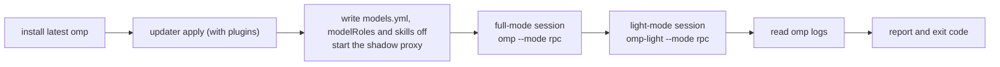
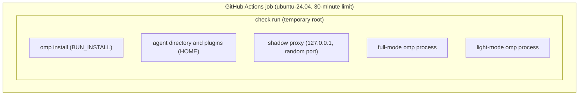

# Configuration check (CI)

English | [简体中文](README.zh-CN.md)

This node designs omp-config's configuration check: in a throwaway environment it installs the latest omp, applies the config with the repository's own updater, runs real sessions on a free model, and reports the faults and warnings that omp and the extensions print, deduplicated, one by one. The same workflow has another job, `code`, which runs `bun install`, `bun run check` (Biome formatting and lint, `tsc --noEmit`) and `bun run test` (the unit tests in `ci/`, such as `ci/session-urls-scanner.test.ts`); its rules are in the code conventions section of the repository's `AGENTS.md` and are not part of this node.

- **Owns**: the stages of a check run, the criteria and classification of diagnostics, how the free model and shadow models are wired in, and the workflow's trigger events and permissions.
- **Does not own**: the rules of the config items themselves (`README.md` and `docs/*.md`, Chinese version `README.zh-CN.md` and `docs/*.zh-CN.md`); what the updater writes and deletes (the header comment of `agent/extensions/omp-config-autoupdate/omp-config-update.ts`); the behavior of each extension (`docs/prompts-and-context.md`, `docs/agents.md`, and `docs/extensions.md`).
- **Non-goals**: having the model carry out tasks or call tools; verifying the verdicts of paid helpers (`task-split-check`, `task-completion-judge`); TUI-only behavior; blocking merges (no branch protection).
- **Inputs**: the repository working tree (the thing checked), `@oh-my-pi/pi-coding-agent` on npm, the plugins declared in `install-plugins.sh`, and the Kilo gateway's anonymous free model.

Implementation: `ci/check.ts` (the check run) and `.github/workflows/config-check.yml` (triggers; its `omp-session` job). A second node in this directory, the [delete-guard Windows acceptance](#delete-guard-windows-acceptance), has its own workflow and is described at the end.

## Problem

### Domain properties

The following properties come from measurements in an isolated HOME (omp 18.8.7, Linux amd64 and macOS arm64, 2026-10-10).

1. **omp does not report config faults through its exit code.** An extension import that throws, a `session_start` or `before_agent_start` that throws, or a system-prompt-replace rule that finds no target all exit the process with 0. Faults show up in only three places: stderr (such as `Failed to load extension …` or `system-prompt-replace: … found no target …`), RPC `extension_error` events, and `warn` / `error` records in `$HOME/.omp/logs/omp.<date>.<pid>.log`.
2. **Some faults appear only with a real model request.** `before_agent_start` runs only when a prompt is prepared, and omp checks model credentials before that; without a usable model, startup-only checks never reach these hooks.
3. **Every model the config references needs paid credentials.** `task.agentModelOverrides` and `thinking-translator.json` reference models of openai-codex, anthropic, opencode-go, bansos, futureppo-pool and commandcode; CI has none of these credentials. Extension model roles (`@input-polish`, `@task-completion-judge`, `@task-split-check`, `@doc-polish.*`) live in machine-local `modelRoles`, which CI leaves unassigned, so those extensions fall back to their `fallbackRole` (`smol`, bound to the free model) or report "no model" on their own.
4. **The Kilo gateway's `:free` models allow anonymous calls at no charge** (kilo.ai docs: 200 per IP per hour). `nvidia/nemotron-3-ultra-550b-a55b:free` handles the full config's system prompt (about 20k tokens). Measured at the same time: the free `bansos` Muse in the config and Zen big-pickle returned 429 `FreeUsageLimitError`; `opencode-go` charges by its official price list; Kilo `cohere/north-mini-code:free` returned 422 for the full config's request.
5. **The repository is public.** PR code from forks is untrusted, and workflows for fork PRs get no secrets.

### Requirements

- **R1**: run one check on every push to `main`, every PR, a daily schedule and manual dispatch.
- **R2**: when the config has any fault or warning the check is red, giving the original text and location of each distinct fault once; otherwise it is green.
- **R3**: when the free model is unavailable the check is also red, but the report says "config not verified", kept apart from config faults.
- **R4**: no secrets are used; `GITHUB_TOKEN` is read-only.
- **R5**: it only reports and does not block merges (operator decision, 2026-10-10).

## Definitions

- **Check run**: one execution of `bun ci/check.ts`. It creates HOME, `PI_CODING_AGENT_DIR=$HOME/.omp/agent`, `BUN_INSTALL` and `TMPDIR` inside a newly created temporary root and deletes the whole root at the end. It never reads or writes the runner's real `~/.omp`, `~/.pi` or `~/.claude`.
- **Diagnostic**: one fault or warning collected by a check run. Every diagnostic has a stage and a category:
  - `config`: caused by the config or extensions, or cannot be ruled out as caused by them;
  - `environment`: omp itself cannot be installed;
  - `provider`: the free model service failed (HTTP 408, 429, 5xx, or connection or DNS errors).
- **Finding**: one record combining all diagnostics with the same category and the same normalized text. Normalization replaces the HOME under the temporary root with `~`, other temporary paths with `<tmp>`, and removes the module cache parameter `?mtime=…`. A finding's id is the first 12 hex characters of the SHA-256 of "category + normalized text"; across runs and machines, the same category and normalized text give the same id, and the id changes when the fault text has other varying parts.
- **Free model**: the provider `ci-free` in `models.yml`, connected directly to the Kilo gateway with `auth: none`. It is the check's main model and every `modelRoles` entry.
- **Shadow model**: the same-named entry the check run registers in `models.yml` for every `provider/model` the config references (`auth: none`, `api: openai-completions`). Its requests go to a shadow proxy on the local loopback, which swaps the model name in the request for the free model and forwards it to Kilo. The config can therefore resolve and call the models it references, unmodified, on a machine without paid credentials.
- **Host noise**: log `warn`s caused by the CI host's own situation or by CI's own model settings, unrelated to the repository's config; each is listed in `HOST_LOG_WARNINGS` in `ci/check.ts` with the fact it corresponds to.

## Architecture

### Stages of a check run



|Stage|What it does|Diagnostics produced|
|---|---|---|
|install|`bun install -g @oh-my-pi/pi-coding-agent@${OMP_VERSION:-latest}`, `omp --version`|Failure is `environment`, and the check ends there|
|apply|`bun agent/extensions/omp-config-autoupdate/omp-config-update.ts apply --source <repository> --agent-dir … --json`|Every stderr line; the JSON report's `errors`; every `pluginsMissing` entry; a missing JSON report. A missing report or any `errors` entry ends the check there: the updater installs plugins before writing, so a failed apply has written no config to run a session on|
|models|Writes `models.yml` (free model + shadow models), sets `config.yml`'s `modelRoles` to the free model and `skills.enabled` to `false`|None|
|full session, light session|Start in RPC mode, send one prompt after `ready`, keep stdin open until `prompt_result`, then close and wait for the process to exit|See the criteria below|
|omp logs|Read the `warn` and `error` records in `$HOME/.omp/logs/*.log`|Every record that is not host noise|

`modelRoles` and `skills` are machine-local fields the updater does not write (`LOCAL_CONFIG_FIELDS`). The check run sets them the way a machine would, so the managed config being checked is not changed. Skills are off because the throwaway HOME has no skill description cache: with skills on, omp would have the free model compress every installed plugin skill's description in the background on every run.

### Diagnostic criteria

Each of the following in a session stage is a diagnostic:

- every non-empty stderr line;
- stdout lines that are not JSON (an extension printing directly breaks the RPC protocol);
- every `extension_error` event;
- a rejected prompt (`response.success: false`), or a `prompt_result.status` other than `completed`;
- an assistant reply with `stopReason` `error` or `aborted`: recorded as `provider` when it meets R3's condition, otherwise as `config`;
- a reply from a provider or model other than the free model;
- no assistant reply at all, or not finished within 300 seconds;
- a non-zero process exit code.

A free model failure brings other diagnostics with it, and those are recorded as `provider` too: when every failed reply in a session meets R3's condition, that session's unfinished `prompt_result` and non-zero exit; when the `error` or `errorMessage` field of an omp log record is a free model service failure (connection, DNS, timeout, rate limit, 5xx), that record. When the shadow proxy receives an upstream response of HTTP 400 or above, it records one `provider` diagnostic.

The same fault appears in several places: printed once each in full and light mode, and recorded once more in the omp log. The report does not list diagnostics one by one but by finding, each with its id, category, per-stage counts and normalized text. Two rules give different wordings of the same fault the same id:

- An omp log record whose context has only the two fields `path` and `error` is written in omp's stderr format, `<message> <path>: <error>`.
- omp truncates overlong stderr lines and ends them with `…`. When a truncated line, with `…` removed (and, when the cut falls inside an absolute path, with that path removed too), is exactly a prefix of one complete text, it merges into that finding; with several candidates it does not merge.

Host noise is merged by normalized text in the same way, with counts.

The check run's exit code follows the diagnostics' categories, unaffected by merging: 1 when there are `config` or `environment` diagnostics; 2 when there are only `provider` diagnostics; 0 when there are none. The report goes to stdout and `$GITHUB_STEP_SUMMARY`, and in GitHub Actions every finding also emits an `::error` annotation titled with the finding's id and category.

### Lifecycle



|Part|Starts|Ends|
|---|---|---|
|Check run|`bun ci/check.ts` starts and creates the root with `mkdtemp`|The root is deleted after the report is written (kept when `CI_KEEP_ROOT=1`)|
|Shadow proxy|Started before installation begins|Stopped in the check run's `finally`|
|omp session process|Spawned when the stage starts|After `prompt_result`, stdin is closed and the process exits; SIGKILL when not finished within 300 seconds|

### Decisions

- **GitHub-hosted runners, not GARM.** Because of domain property 5: fork PR code must not touch the homelab mesh. Every endpoint needed (npm, GitHub, Kilo) is on the public internet. Revisit when: the check needs to reach private services.
- **The free model is Kilo `nvidia/nemotron-3-ultra-550b-a55b:free`.** Because of domain property 4, the other candidates had exhausted quotas, charged, or rejected the full config's request. Cost: GitHub runners share egress IPs, so the 200-per-hour quota may already be used up by others, and the check then ends with exit code 2 (R3). Revisit when: the model is retired, or 429s become frequent. `CI_FREE_MODEL` and `CI_FREE_BASE_URL` switch models without code changes.
- **Shadow models rather than a config overlay.** The alternative is a `--config` overlay changing `task.agentModelOverrides` and the like to the free model. That would alter the config being checked, so the check would verify the overlay instead of the repository. Shadow models change only the machine-local `models.yml`, and the config runs as it is. Cost: `ci/check.ts` reads the shadow list from `config.yml` `task.agentModelOverrides` and `thinking-translator.json`, so a model written only in extension source would not be in the list. Models that helpers request only when tools such as `task` are called are not reached by the check's text-only prompt; when these helpers lack credentials they pass by their own rules, outside the coverage boundary.
- **Always install the latest omp.** Operator decision: machines follow the latest version through `omp update`, so the check does too. Cost: upstream changes can turn unrelated commits red; that red is a real compatibility problem, such as upstream deleting the target of a system-prompt-replace rule. `OMP_VERSION` reproduces a specific version locally.
- **Plugins are not pinned.** Consistent with `install-plugins.sh`: the check installs what a machine would install.
- **Every stderr line is a diagnostic; logs exclude only host noise.** Extension warnings have no allowlist, because an allowed warning is an accepted defect that should be fixed in the config or tracked in an issue. Host noise covers only facts unrelated to the config: no local model server; no D-Bus.

### Triggers and permissions

`.github/workflows/config-check.yml`:

- Events: `push` to `main`, `pull_request`, a daily `schedule` at 03:17 UTC, `workflow_dispatch`. `pull_request_target` is not used.
- Permissions: `contents: read`; checkout keeps no credentials (`persist-credentials: false`); no secrets are referenced.
- Concurrency: a new run for the same event and ref cancels the old one.
- Actions are pinned by commit SHA; Bun takes the latest version.

## Coverage boundary

The check covers: the repository config can be applied by the updater (structured files parse, plugins install); every local extension and plugin loads in full and light mode; hooks such as `session_start`, `before_agent_start` and `context` raise no errors during one real prompt; every system-prompt-replace rule finds its target; and the models the config references resolve under shadow models.

The check does not cover:

- tool calls and subagent dispatch paths (the behavior of tools such as `fork_task`, `todo-more`'s `todo` and its reminders, `isolation-nudge`, `task-split-check`, `task-completion-judge` and `ctx`);
- the availability and credentials of the paid models themselves;
- TUI-only behavior (`input-polish`'s keys and overlay, `omp-thinking-translator`'s rendering);
- the networked path of automatic update (`auto`, `/omp-config-autoupdate run`) and the maintenance commands (`/update-omp`, `/sync-omp-config`, `/migrate-omp-keys`);
- skills: the check runs with `skills.enabled: false`, so neither the skills plugins ship nor omp's skill description compression is exercised;
- `omp-light.cmd` on Windows.

## Local reproduction

```bash
bun ci/check.ts                      # the same check as CI; writes only temporary directories
OMP_VERSION=18.8.7 bun ci/check.ts   # a specific omp version
CI_KEEP_ROOT=1 bun ci/check.ts       # keep the temporary root for debugging
```

Needs Bun, git and public internet access.

## delete-guard Windows acceptance

This node checks `delete-guard` on Windows (issue #69) in real omp sessions: the nested PowerShell and cmd dialects, eval's cmd handoffs, the Recycle Bin backend and the Windows refusal set. Windows is the one platform its behavior cannot be observed on locally, because OrbStack has no Windows containers.

- **Implementation**: `ci/windows-guard.ts` (setup and sessions), `ci/windows-guard-steps.ts` (the steps and their checks), `.github/workflows/delete-guard-windows.yml` (job `windows` on `windows-latest`).
- **Setup**: `bun install -g @oh-my-pi/pi-coding-agent@latest`, the repository's updater `apply` into the runner's `~/.omp/agent`, and every `modelRoles` role bound to `opencode-go/deepseek-v4.1-flash` with `skills.enabled: false`. The runner is a throwaway VM, so it uses the runner account's real home and Recycle Bin.
- **Steps**: one RPC session per step (`--mode rpc --no-ui --no-session`, cwd `$RUNNER_TEMP\omp-dg-work`), each asking the model for exactly one tool call: seven nested PowerShell/cmd commands and `rm -rf` through `bash`, four eval cells (two `shell=True`/`os.system`, `child_process.execSync`, `Bun.$`), a `trash` and a `permanent` `delete`, and six `delete` calls that pair `C:\omp-dg\keep` with `C:\`, `C:`, `\`, `\\localhost\C$`, `USERPROFILE` and the session cwd. Before each step the probe (`C:\omp-dg\d\f`, `C:\omp-dg\p\f` or `C:\omp-dg\keep\f`) is created.
- **Pass criteria per step**: the first call of the requested tool exists (otherwise "model did not call <tool>"), carries the requested input unchanged, and has the expected result — a `delete-guard:` error for `bash`/`eval`, success for `delete`, an error naming the dangerous path for refusals — and the probe is as expected afterwards: `C:\omp-dg\d\f` or `C:\omp-dg\keep` still exists; after `trash` the directory is gone and the Recycle Bin (`Shell.Application` `NameSpace(10)`) lists it; after `permanent` it is gone and not listed. A runner account without a Recycle Bin fails with "no recycle bin on runner". The log prints every tool call, its result text, `Test-Path` and the Recycle Bin listing.
- **Exit code**: 0 when every step passes, 1 otherwise, including setup failures.
- **Triggers and permissions**: `workflow_dispatch`, and `pull_request` touching `agent/extensions/delete-guard/`, these scripts or the workflow, so a change is verified before it merges. Fork pull requests skip the job (they get no secrets). `contents: read`, `persist-credentials: false`, actions pinned by commit SHA; it reports only and does not block merges.
- **Secret**: unlike the configuration check (R4), this node uses one repository secret, `OPENCODE_API_KEY`, the operator's opencode-go key, passed only to the step that runs `bun ci/windows-guard.ts`. Operator decision, 2026-10-30: the free Kilo model was replaced by the same model the other delete-guard checks use, so a failure is the guard's and not a weaker model's. Cost: every run is billed to that key.
- **Not covered**: `exec_command` falling back to PowerShell; WSL; the model matrix of other low-tier models.

Local run: none; the node needs Windows. Run it with `gh workflow run delete-guard-windows.yml --ref <branch>` once the workflow is on `main`, or by pushing to a pull request that touches the paths above.
