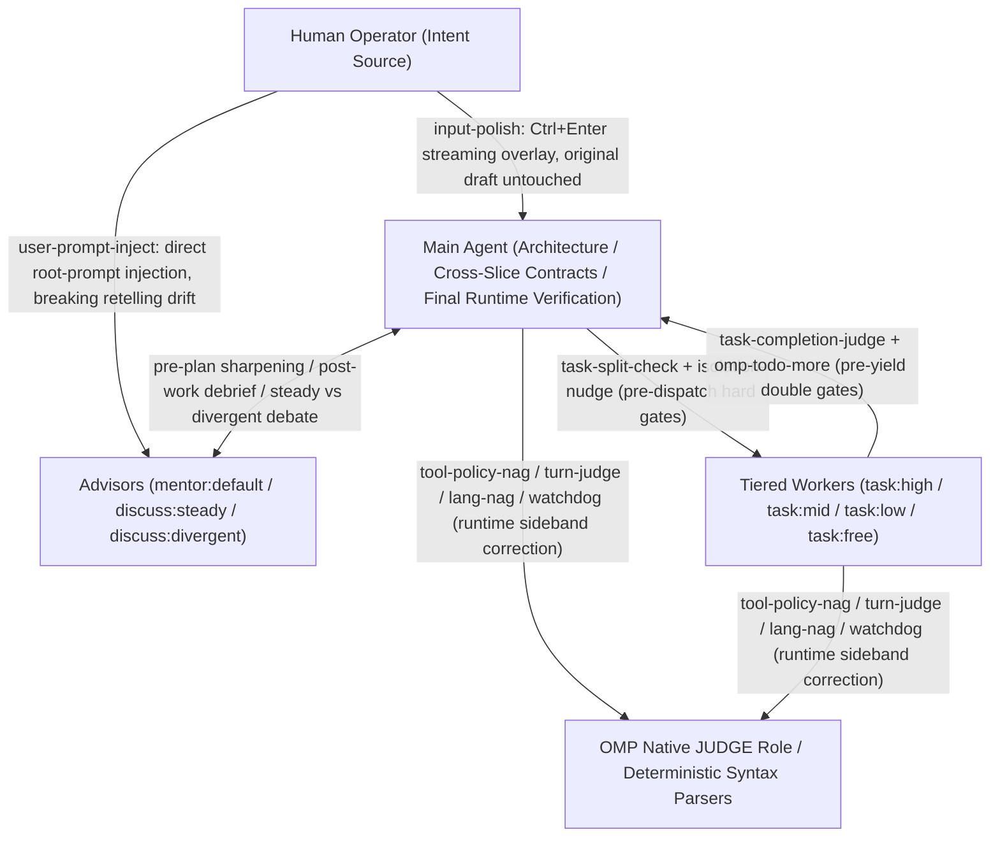

# System Thesis and Control Architecture

[Home](../README.md) · English | [简体中文](architecture.zh-CN.md)

This configuration is not an `ultracode`-style black-box task solver; it is a **closed-loop runtime control system** built around OMP's native execution flow. The entire architecture rests on four empirically verified premises:

1. **Models do not follow the system prompt reliably (broken-windows premise)**: frontier models led by Claude and GPT follow prompt rules selectively. Once a model starts bypassing built-in tool conventions (for example shelling out to `cat`/`sed -i`/`rg` or `python -c` instead of `read`/`edit`/`grep`), its attention has drifted from the system contract, and `CLAUDE.md` and domain rules soon fail with it. Writing harsher prompt prose does not stop drift; the runtime must bind file writes to observed snapshots, detect tool bypasses in flight, and inject sideband reminders before drift spreads.
2. **Context is aligned human intent state, not a mere file cache**: in a long-horizon task, the context holds requirements, ruled-out paths, architectural trade-offs and tacit consensus aligned with the operator. Every compaction — and every lossy shortcut such as grepping instead of reading in full, piping output through `head`/`tail`, or chaining many steps into one opaque bash command — destroys aligned intent.
3. **Code-generation skill $\neq$ planning judgment or rule compliance**: low-cost and free models are unsuitable for a human to drive directly, yet make highly efficient workers on bounded slices once architecture, domain types, cross-slice contracts and final verification stay with the parent agent and independent model gates check both dispatch (preventing multi-topic stuffing) and delivery (preventing premature handoff).
4. **Occasional over-continuation is far cheaper than constant operator interruption**: stateful Todo lifecycle reminders and low-latency native judgment models (OMP's `JUDGE` role) push the agent to self-correct through minor setbacks, reserving human attention for genuine architectural trade-offs and external blockers.

## Failure-Mode and Runtime Countermeasure Matrix

Every one of the repository's **22 local extensions**, **8+2 external plugins** and core config settings counters a specific model failure mode or harness gap:

| Control loop | Model failure mode / harness gap | Interception / trigger hook | Countermeasure carrier | Runtime control action | Light mode |
|---|---|---|---|---|---|
| **Write safety & plan loop** | Model edits files blindly from memory, overwrites unread lines or drifts on line numbers | `read` / `edit` call | `config.yml` (`edit.mode: hashline`) | Requires a non-`:raw` `read` with a 4-hex snapshot tag before any anchored `edit` | Yes |
| **Write safety & plan loop** | Model edits files without a plan, or stops early to ask the user after a minor setback | Pre-`edit` / turn end / `DONE` | Plugin [omp-todo-more](plugins-and-modes.md#todo-more) (`todo`) | Blocks `edit` when Todo is empty; auto-reminds to continue while open items remain (unless asking the user); requires a git commit clause on `DONE` when uncommitted changes exist | Yes |
| **In-turn drift telemetry & correction** | Model bypasses built-in tools via shell/eval (broken-window signal) or chains opaque multi-program write pipelines | Main-session `tool_call` | [tool-policy-nag](extensions.md#tool-policy-nag) + `omomp.yml` (`INTENT-policy.md` under `jev`) | Never blocks calls; `detector: heuristic` counts with the `form` parser and steers the configured `form.prompt` (OMP's bash interceptor overridden off), `detector: jev` asks native JUDGE which built-in tool owns the call; `risk` lane synchronously warns on long multi-program write commands | No |
| **In-turn drift telemetry & correction** | Model drifts from verification rules, substitutes an easier problem, or claims completion unverified | Every $N$ actions / turn end | [watchdog-agent](extensions.md#watchdog-agent) + [turn-judge](extensions.md#turn-judge) | `watchdog-agent` reviews the branch per `target` and injects `<watchdog>`; `turn-judge` scores each turn via native JUDGE and types a preset correction prompt past threshold | No |
| **In-turn drift telemetry & correction** | Model loses its Chinese reply constraint after server-side or local compaction | Main `agent_end` → next `input` | [lang-nag](extensions.md#lang-nag) | Classifies the first 200 chars of the reply's final paragraph; on mismatch, silently prepends `说中文` to the user's next real input with zero extra turn cost | No |
| **Anti-echo-chamber & subagent gates** | `mentor` and `discuss` see only the spawning agent's selective retelling and become echo amplifiers | Every subagent `context` (IRC wakes included) | [user-prompt-inject](agents.md#user-prompt-inject) + `PROMPT-INJECT-user-goal.md` | Walks `parentId` to the root session, extracts all human user prompts and prepends them to every advisor call to audit the advisee's plan against the user's verbatim words | No |
| **Anti-echo-chamber & subagent gates** | Main agent stuffs multiple unrelated topics into one worker or caps report length, truncating evidence | `task` / `fork_task` `tool_call` | [task-split-check](extensions.md#task-split-check) | Concurrent check by the OMP model role `@task-split-check`: blocks multi-topic items once (unchanged redispatch passes) and permanently blocks report-length caps | No |
| **Anti-echo-chamber & subagent gates** | Multiple concurrent writing workers share one working tree and clobber each other's files | `task` `tool_call` | [isolation-nudge](extensions.md#isolation-nudge) | Blocks once per prompt hash when $\ge 2$ un-isolated writers would share the directory, asking for `isolated: true` | No |
| **Anti-echo-chamber & subagent gates** | Low-tier worker (`task:low/mid/free`) calls `yield` before finishing the work or updating Todo | Subagent `yield` `tool_call` | [task-completion-judge](extensions.md#task-completion-judge) | Audits assignment, tool calls and submission with the OMP model role `@task-completion-judge`: bounces once for `NOT_DONE` and once for open Todo items via `omp-todo-more:read`, attaching `completion_judge` on pass | No |
| **Context economics & anti-amnesia** | 1.5M+ chars of design material or nuanced human alignment cannot be compressed into a short `task` `context` string | Subagent dispatch | [fork-task](prompts-and-context.md#fork-task) (`fork_task`) | Clones the caller's (or a `from` agent's) conversation history as the child's starting transcript, with optional `shake: true` elision of older tool outputs | No |
| **Context economics & anti-amnesia** | Main session loses completed task history and subagent topology after compaction | On `todo` change / post-compact | Plugin `omp-todo-more`'s [ctx](prompts-and-context.md#ctx) + [Task log](prompts-and-context.md#task-log) | Appends every successful `todo` mutation to `task-log/<agent-id>.md`; automatically injects `ctx list` and the replayed timeline after main-session compaction | Yes |
| **Prompt layering & model variance** | Built-in tool protocols are duplicated across templates or contradict local dispatch/read rules | Every `before_agent_start` (runs last) | [system-prompt-replace](prompts-and-context.md#system-prompt-replace) | Rewrites rendered built-in and plugin tool descriptions in place with `inlineToolDescriptors: "on"` | No |
| **Prompt layering & model variance** | OMP native prompts and compaction thresholds cannot target model families by regex | Every `before_agent_start` | [append-system-model](prompts-and-context.md#append-system-model) + [model-compaction](prompts-and-context.md#model-compaction) | Appends per-model prompt blocks and writes `"provider/id": "f<N>"` runtime compaction triggers matched by `model`/`provider` regex | Yes |
| **Host environment & ops patches** | OMP does not scan `.claude/rules` or `.pi/rules`, drops rule files that have neither `alwaysApply` nor `description`, and ignores Claude Code's `paths` frontmatter | `session_start` / `before_agent_start` / `tool_result` | [repo-rules](prompts-and-context.md#repo-rules) | Injects rules from `.claude/rules`, `.agents/rules`, `.pi/rules` (cwd up to the git root) and `~/.claude/rules`; loads every `paths`-scoped rule, OMP's native ones included, only after a matching file is read, written, edited or `cat`ed | Yes |
| **Host environment & ops patches** | Only a human can type `/wt`, `/move` or `/restart` in the TUI; the main agent cannot manage its own session worktree or restart | Main TUI session when idle | [wt-tool](extensions.md#wt-tool) (`wt`/`wt_remove`) + [harness-restart](extensions.md#harness-restart) | Queues and runs TUI slash-command dispatchers after the turn ends for worktree creation, two-phase verified removal and session-resuming restart | Yes |
| **Host environment & ops patches** | Runaway descendant processes (including reparented orphans) exhaust host RAM | macOS every 2 s | [child-memory-warning](extensions.md#child-memory-warning) | Samples descendant `phys_footprint` via Bun FFI `libproc` and alerts the main UI and agent past `omomp.yml#child-memory-warning.thresholdGiB` (repository value 4 GiB) | Yes |
| **Host environment & ops patches** | `--model` with a `commandcode` model fails auth due to `models.db` cache shadowing or built-in provider name collision | `session_start` | [commandcode-model-spec](extensions.md#commandcode-model-spec) | Detects catalog models in `commandcode-models.json` running with `api !== "commandcode-custom"` and rebinds them to the live plugin model | Yes |
| **Host environment & ops patches** | OMP's hand-captured Antigravity wire table lacks newer wire ids (`gemini-4-argon-*`), so small caller budgets such as compaction's 512-token short summary go out unchanged and Gemini spends them all on thinking | Root `session_start` | [antigravity-wire-profiles](extensions.md#antigravity-wire-profiles) | Fetches `fetchAvailableModels` for every Antigravity account and writes each served wire id's `maxOutputTokens` / `model_enum` into the provider's table in place | Yes |
| **Human-agent UX & fleet sync** | Operator drafts need motivating polish, long docs need meaning-preserving restructuring, and multi-machine configs need atomic sync | Chord / command / startup | [input-polish](extensions.md#input-polish) + [doc-polish](extensions.md#doc-polish) + [omp-config-autoupdate](operations.md#omp-config-autoupdate) | `Ctrl+Enter` streams a draft rewrite in an overlay; 3-agent pipeline writes `/tmp/doc-polish` reviews; child process auto-applies default-branch commits at startup | `doc-polish`: No; others: Yes |
| **Human-agent UX & fleet sync** | Extensions and plugins show UI text in mixed languages, and a language exported by an extension would arrive after the plugins OMP binds before the first frame | Module load / every UI string | [omomp-lang](extensions.md#omomp-lang) + `_shared/i18n.ts` + each plugin's i18n module | Exports `omomp.yml#omomp-lang.language` as `OMOMP_LANG`; every person-facing string resolves `OMOMP_LANG` → that section → locale → English when it is produced | Yes |
