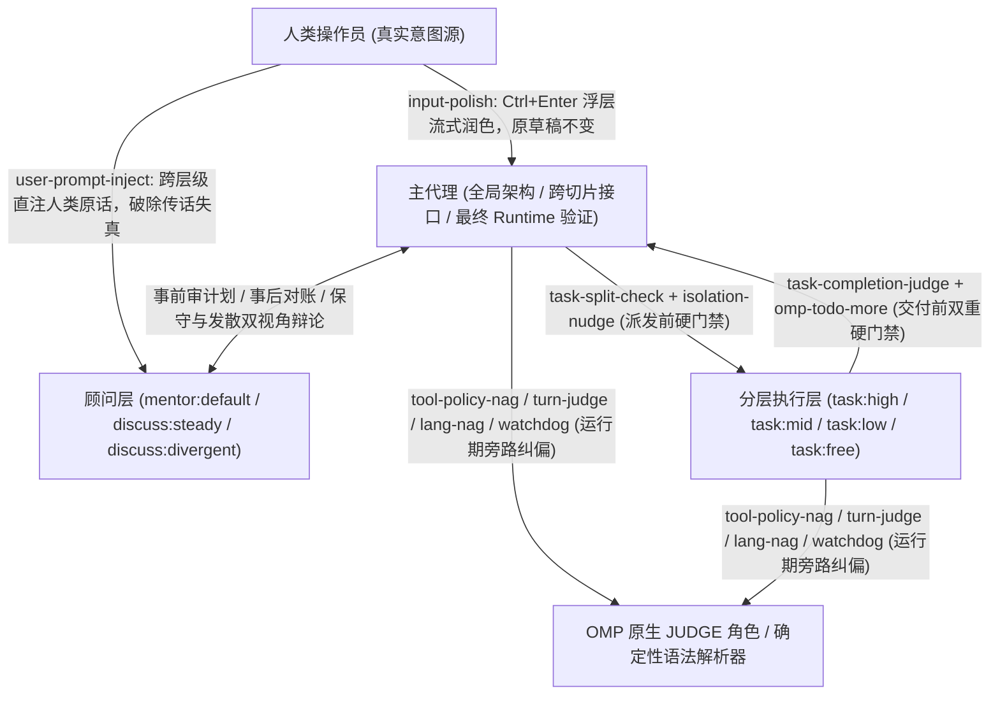

# 系统定位与控制论架构

[返回首页](../README.zh-CN.md) · [English](architecture.md) | 简体中文

本配置不是 `ultracode` 式的黑盒全自动求解器，而是围绕 OMP 原生执行流构建的**闭环运行时控制系统**。整套架构建立在四条经长程实战检验的工程假设之上：

1. **模型不会稳定遵守 System Prompt（破窗效应假设）**：以 Claude 与 GPT 为代表的前沿模型会选择性无视提示词规则。一旦模型开始绕开内置工具规范（如用 `cat`/`sed -i`/`rg` 或 `python -c` 代替 `read`/`edit`/`grep`），说明其注意力已脱离系统契约，紧接着 `CLAUDE.md` 与业务规则也会一并失效。单靠把提示词写得更严厉无法解决偏离，必须在运行期把文件写入强绑定到已读快照、实时检测工具失范，并在偏离扩散前注入旁路纠偏。
2. **Context 是与人类对齐的“意图状态”，而非单纯的文件缓存**：长程任务的 Context 承载着需求边界、已排除路径、架构取舍及与操作员对齐过的隐含共识。任何形式的 Compaction（上下文压缩），或用 `grep` 代替通读、用 `head`/`tail` 截断输出、把多步操作塞进一条黑盒长 bash，都是高损耗的意图破坏。
3. **代码生成能力 $\neq$ 规划判断力与契约遵循力**：低价或免费模型不适合由人类直接对话驱动，但只要将全局架构、领域模型、跨切片接口与最终验证权留在父代理手中，并在派发前（防多主题杂糅）与交付前（防半途交差）设置独立模型门禁，它们就能在受限切片内充当高性价比的执行工人。
4. **偶发多跑一轮的代价远低于频繁打断人类操作员**：通过有状态的 Todo 生命周期与低延迟原生判定模型（OMP `JUDGE` 角色）驱动代理在局部受挫后自愈续跑，把人类的注意力留给真正的架构决策与外部阻塞。

## 失效模式与运行时对策全景矩阵

仓库中的全部 **22 个本地扩展**、**8+2 个外部插件**与核心配置项均对应明确的模型失效模式或宿主能力缺口，不存在无归属的装饰性脚本：

| 控制环路 | 真实模型失效模式 / 宿主能力缺口 | 拦截 / 触发时机 | 对策载体 | 运行时控制动作 | 轻量模式 |
|---|---|---|---|---|---|
| **写入安全与计划闭环** | 模型凭记忆盲改文件、覆盖未读区域或行号错位 | `read` / `edit` 调用时 | `config.yml` (`edit.mode: hashline`) | 强制非 `:raw` `read` 获取 4 位十六进制快照标签后，才允许按锚点执行 `edit` | 启用 |
| **写入安全与计划闭环** | 模型未立计划就直接改代码，或遇小错提前停下反问用户 | `edit` 前 / 回合结束 / `DONE` 时 | 插件 [omp-todo-more](plugins-and-modes.zh-CN.md#todo-more) (`todo`) | Todo 为空时直接封锁 `edit`；仍有未完项且非向用户提问时自动催促继续；有未提交改动时强制 `DONE` 携带 git commit 子句 | 启用 |
| **运行期偏离遥测与纠偏** | 模型用 shell/eval 代替内置工具（破窗信号），或拼出不可预测的多程序长写管道 | 主会话 `tool_call` | [tool-policy-nag](extensions.zh-CN.md#tool-policy-nag) + `omomp.yml`（`jev` 下另用 `INTENT-policy.md`） | 不阻断执行；`detector: heuristic` 用 `form` 解析器计数并发送配置的 `form.prompt`（OMP bash 拦截器被覆盖为关闭），`detector: jev` 调原生 JUDGE 点名应替用的内置工具；`risk` 通道同步警告长写管道 | 禁用 |
| **运行期偏离遥测与纠偏** | 模型在长任务中偏离验证要求、偷换问题，或未验证就宣布完成 | 每 $N$ 步动作 / 回合结束 | [watchdog-agent](extensions.zh-CN.md#watchdog-agent) + [turn-judge](extensions.zh-CN.md#turn-judge) | `watchdog-agent` 按 `target` 独立审阅分支并注入 `<watchdog>`；`turn-judge` 每轮后用原生 JUDGE 打分并在达阈值时直接输入纠偏 prompt | 禁用 |
| **运行期偏离遥测与纠偏** | 服务端或本地 Compaction 后模型丢失中文回复约束 | 主会话 `agent_end` → 下次 `input` | [lang-nag](extensions.zh-CN.md#lang-nag) | 检测回复末段前 200 字符语言；不符时在用户下一条真实输入前静默拼接 `说中文`，零额外回合开销 | 禁用 |
| **防回声室与子代理门禁** | `mentor` 与 `discuss` 只看到派发方裁剪后的转述，沦为回声室放大器 | 子代理每次 `context`（含 IRC 唤醒） | [user-prompt-inject](agents.zh-CN.md#user-prompt-inject) + `PROMPT-INJECT-user-goal.md` | 沿 `parentId` 爬回根会话，提取全部人类原话注入顾问请求首部，令其拿人类原话审判咨询方的计划偏差 | 禁用 |
| **防回声室与子代理门禁** | 主代理把多个无关主题塞给一个 worker，或限制 worker 报告字数截断证据 | `task` / `fork_task` 的 `tool_call` | [task-split-check](extensions.zh-CN.md#task-split-check) | 用 OMP 模型角色 `@task-split-check` 并发检查：多主题首次拦截（原样重派放行），限制报告长度永久拦截 | 禁用 |
| **防回声室与子代理门禁** | 多个并发写入 worker 共用同一工作目录互相踩踏文件 | `task` 的 `tool_call` | [isolation-nudge](extensions.zh-CN.md#isolation-nudge) | 存在 $\ge 2$ 个未隔离写入者时按 prompt hash 首次拦截，要求改为 `isolated: true` | 禁用 |
| **防回声室与子代理门禁** | 低阶 worker（`task:low/mid/free`）在工作未做完或未更新 Todo 时提前 `yield` | 子代理 `yield` 的 `tool_call` | [task-completion-judge](extensions.zh-CN.md#task-completion-judge) | 用 OMP 模型角色 `@task-completion-judge` 核对派工单、工具记录与提交内容：未做完退回一次，Todo 仍有未完项再退回一次，放行时附 `completion_judge` | 禁用 |
| **上下文经济学与防失忆** | 百万字级设计背景或复杂人类对齐意图无法浓缩进短 `task` `context` 字符串 | 子代理派发 | [fork-task](prompts-and-context.zh-CN.md#fork-task) (`fork_task`) | 克隆调用方（或 `from` 指定代理）的对话历史作为子代理起点，支持 `shake: true` 压缩早期工具结果 | 禁用 |
| **上下文经济学与防失忆** | 主会话发生 Compaction 后丢失已完成任务账本与子代理拓扑 | `todo` 修改时 / 主会话 compact 后 | 插件 `omp-todo-more` 的 [ctx](prompts-and-context.zh-CN.md#ctx) + [Task log](prompts-and-context.zh-CN.md#task-log) | 每次成功 `todo` 修改追加写入 `task-log/<agent-id>.md`；compact 后自动把 `ctx list` 与重放时间线注入新上下文 | 启用 |
| **提示词分层与模型适配** | 内置工具协议在基础模板和附录里重复堆砌，或与自定义派发/检索规则冲突 | 每次 `before_agent_start`（最后执行） | [system-prompt-replace](prompts-and-context.zh-CN.md#system-prompt-replace) | 在 `inlineToolDescriptors: "on"` 下原地改写渲染后的内置与插件工具描述 | 禁用 |
| **提示词分层与模型适配** | OMP 原生提示词与自动压缩阈值无法按模型家族正则差异化配置 | 每次 `before_agent_start` | [append-system-model](prompts-and-context.zh-CN.md#append-system-model) + [model-compaction](prompts-and-context.zh-CN.md#model-compaction) | 按 `model`/`provider` 正则追加模型专属提示词，并为匹配模型写入原生 `"provider/id": "f<N>"` 压缩水位 | 启用 |
| **宿主环境与运维补齐** | OMP 不扫描 `.claude/rules` 与 `.pi/rules`，丢弃既无 `alwaysApply` 也无 `description` 的规则文件，也不认 Claude Code 的 `paths` frontmatter | `session_start` / `before_agent_start` / `tool_result` | [repo-rules](prompts-and-context.zh-CN.md#repo-rules) | 注入 `.claude/rules`、`.agents/rules`、`.pi/rules`（cwd 向上至 git 根）与 `~/.claude/rules` 的规则；所有带 `paths` 的规则（含 OMP 原生发现的）只在读、写、编辑或 `cat` 到匹配文件后加载 | 启用 |
| **宿主环境与运维补齐** | 仅人类能在 TUI 输入 `/wt`、`/move`、`/restart`，主代理无法自主切 worktree 或重启生效新配置 | 主 TUI 会话空闲时 | [wt-tool](extensions.zh-CN.md#wt-tool) (`wt`/`wt_remove`) + [harness-restart](extensions.zh-CN.md#harness-restart) | 排队并在回合真正结束后调用 TUI 原生命令分发器执行 worktree 切换、两阶段验证删除与带原因重启恢复 | 启用 |
| **宿主环境与运维补齐** | 子进程内存泄漏（含脱离父进程的孤儿进程）拖垮宿主机 | macOS 每 2 s | [child-memory-warning](extensions.zh-CN.md#child-memory-warning) | 通过 Bun FFI 调 `libproc` 采样后代进程 `phys_footprint`，超过 `omomp.yml#child-memory-warning.thresholdGiB`（仓库配置 4 GiB）时告警主 UI 与主 agent | 启用 |
| **宿主环境与运维补齐** | `--model` 指定 `commandcode` 模型时因宿主缓存遮蔽或内置 provider 同名冲突报鉴权失败 | `session_start` | [commandcode-model-spec](extensions.zh-CN.md#commandcode-model-spec) | 识别 `commandcode-models.json` 中的模型并在 `api !== "commandcode-custom"` 时重选回插件实时注册模型 | 启用 |
| **宿主环境与运维补齐** | OMP 手工抓包的 Antigravity wire 表缺少较新的 wire id（`gemini-4-argon-*`），调用方的小输出预算（如 compaction short summary 的 512 token）原样发出，被 Gemini 的 thinking 全部耗尽 | 根会话 `session_start` | [antigravity-wire-profiles](extensions.zh-CN.md#antigravity-wire-profiles) | 按每个 Antigravity 账号拉取 `fetchAvailableModels`，把每个在服 wire id 的 `maxOutputTokens` / `model_enum` 原地写入 provider 读取的表 | 启用 |
| **人机协同与多机同步** | 人类草稿需激励性润色、长文档需无损重排审校、多机配置需原子同步 | 按键 / 命令 / 启动时 | [input-polish](extensions.zh-CN.md#input-polish) + [doc-polish](extensions.zh-CN.md#doc-polish) + [omp-config-autoupdate](operations.zh-CN.md#omp-config-autoupdate) | `Ctrl+Enter` 浮层流式润色输入；三代理流水线生成 `/tmp/doc-polish` 对照审校报告；启动时子进程拉取默认分支自动应用 | `doc-polish` 禁用，其余启用 |
| **人机协同与多机同步** | 扩展与插件的界面文字中英混杂；由扩展导出的语言又会晚于 OMP 在首帧前绑定的插件 | 模块加载 / 每条界面文字 | [omomp-lang](extensions.zh-CN.md#omomp-lang) + `_shared/i18n.ts` + 各插件的 i18n 模块 | 把 `omomp.yml#omomp-lang.language` 导出为 `OMOMP_LANG`；每条面向人的文字在产生时按 `OMOMP_LANG` → 该配置段 → locale → 英文 解析 | 启用 |
