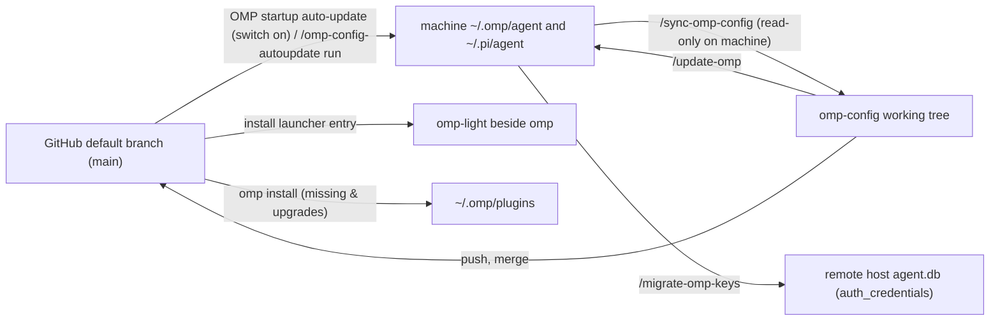

# Ownership Boundaries, Two One-Way Syncs and Engineering

[Home](../README.md) · English | [简体中文](operations.zh-CN.md)



## Repository and Machine Ownership Matrix

There is no bidirectional "sync" command; state moves through two symmetric one-way channels defined by `agent/extensions/omp-config-autoupdate/omp-config-update.ts` (Repo → Machine) and `.omp/commands/sync-omp-config.md` (Machine → Repo):

| Asset path / category | Owner | Repo → Machine (updater) behavior | Machine → Repo (`/sync-omp-config`) behavior | When changes apply |
|---|---|---|---|---|
| `agent/SYSTEM_TEMPLATE.md`, `APPEND_SYSTEM.md`, `PERSONALITY.md`, `config-light.yml`, `APPEND_SYSTEM_LIGHT.md`, `omp-light.ts`, `agents/*` | Repo-owned whole files | Atomic temp-file + `rename` overwrite (writing through symlinks) | Read-only `cmp` against machine; copies differing files into repo | `agents/*` on next dispatch; others on next OMP start |
| `agent/extensions/<name>/*.ts`, `extensions/_shared/*.ts`, `extensions-last/<name>/*.ts` | Repo-owned whole files | Overwrites whole files; `auto` mode deletes `.ts` files removed in git diff (`extensions-last/README*.md` stay repo-only) | Compares each `.ts` and writes diffs into repo | Next OMP start |
| `PROMPT-INJECT-*.md`, `TURN-JUDGE-*.md`, `INTENT-*.md` | Repo-owned when shipped by repo; machine-owned when created on machine | Overwrites shipped templates; never touches or deletes machine-authored templates in the same directories | Syncs back only templates already tracked in the repo | Next dispatch / next turn / next call |
| `APPEND_SYSTEM_MODEL.md`, `WATCHDOG-*.md` | Machine-owned | Never written or deleted (only moved from agent root into extension dir during flat-layout relocation) | Never synced back into repo | Next prompt / re-read on write |
| `agent/config.yml` (structured file 1 of 4) | Repo + machine field-merged | Overlays repo keys; leaves **machine-local `LOCAL_CONFIG_FIELDS`** (`providers.webSearchOrder`, `modelRoles`, `defaultThinkingLevel`, `skills`, `symbolPreset`, `theme`, `colorBlindMode`, `hideThinkingBlock`, `statusLine`, `terminal`, `tui`, `display`, `worktree`, `compaction.thresholdTokens`, `compaction.thresholdPercent`, `compaction.idleThresholdTokens`) and host-only keys untouched; keeps machine-only entries of **`MACHINE_LIST_FIELDS` (`extensions`)** (such as `~/.claude`) **ahead** of repo entries | Reads both sides and uses `edit` on differing non-local lines only, never re-serializing the whole file; skips `LOCAL_CONFIG_FIELDS` and machine `extensions` entries | Hot-reloaded live by OMP |
| `agent/omomp.yml` (structured file 2 of 4) | 9 repo sections + 3 machine sections | Overwrites the 9 repo-owned sections (`omomp-lang`, `judge`, `lang-nag`, `input-polish`, `tool-policy-nag`, `task-completion-judge`, `task-split-check`, `child-memory-warning`, `system-prompt-replace`); leaves the 3 machine-owned sections `LOCAL_OMOMP_SECTIONS` (`doc-polish`, `model-compaction`, `omp-config-autoupdate`) untouched | Edits only differing lines in the 9 repo-owned sections; never syncs back the 3 machine-owned sections | Per extension's read timing |
| `agent/thinking-translator.json` (structured file 3 of 4) | Repo + machine field-merged | Overlays repo keys, preserving extra host keys | Edits differing fields only | Start of the next message |
| `pi/agent/pi-bansos-relay-state.json` (structured file 4 of 4) | Repo + machine field-merged | Writes `~/.pi/agent/pi-bansos-relay-state.json` | Compares fields from `~/.pi/agent/` (if absent on machine, leaves repo file unchanged) | Next session start or `/bansos` |
| App-managed files (first line `// @orca-managed-pi-extension` or containing `marker: _otty`) | External app (Orca / Otty) | Checked before every overwrite and delete and skipped (recorded in `skipped`) | Skipped | — |
| Runtime state (`*.db*`, WAL, `*.lock`, `models.yml`, `commandcode-models.json`, `sessions/`, `blobs/`, `cache/`, `logs/`, `.omp-config-applied`, `settings.json`, installed `omp-light` entry) | Machine runtime state | Never touched (`.omp-config-applied` and the `omp-light` entry are maintained by the updater) | Never enters repo (verified via `git status --short` and credential scans) | — |

## Operational Workflows

Run all maintenance slash commands after starting `omp` at the repository root:

1. **Setting up a new machine**:
   - Start `omp` at the repository root and run `/update-omp` (writes all managed configs, extensions and the updater, installs `omp-light`, and runs `omp install` for every declared plugin).
   - If the machine uses `~/.claude`, add `~/.claude` at the start of `extensions` in `~/.omp/agent/config.yml`; then restart `omp`.
   - To enable startup auto-update, run `/omp-config-autoupdate on` (effective from the next start).
   - Run `omp config list --json`, `omp plugin list --json` and `git status --short` to verify.
2. **Capturing machine changes back to the repository (`/sync-omp-config [check]`)**:
   - Run `/sync-omp-config check` to inspect differences, then `/sync-omp-config` to edit them into the repository, validate with `Bun.YAML.parse` / `JSON.parse` and `bun run check`, and commit and push (`chore: sync snapshot with local omp config`).
   - Stops immediately if the machine still has flat `extensions/<name>.ts` files (outside the 13 excluded retired Todo/`ctx` paths) and requires `/update-omp` first.
   - Rewrites `install-plugins.sh` when `~/.omp/plugins/package.json` dependencies differ (keeping Git/URL specs verbatim, stripping npm version ranges, and leaving commented optional plugins commented).
3. **Applying the working tree manually (`/update-omp [check]`)**:
   - Runs `bun agent/extensions/omp-config-autoupdate/omp-config-update.ts apply --source .` (`--check` reports read-only).
   - Differences from automatic update: ① no git baseline exists, so outside flat-layout `RELOCATIONS` and the 13 retired Todo/`ctx` paths no files or structured keys are deleted; ② `.omp-config-applied` is never modified; ③ runs `./plugin-audit.sh` to prompt before uninstalling `[卸载候选]` (uninstall candidates); ④ checks machine-local initialization items (`omomp.yml`'s `doc-polish` section and `commandcode-models.json`) and asks before creating missing ones.
4. **Migrating provider credentials over SSH (`/migrate-omp-keys <target>`)**:
   - Copies the `auth_credentials` table from `~/.omp/agent/agent.db` over SSH into the remote host's `~/.omp/agent/agent.db` (outside the git snapshot). Confirms the remote OMP is stopped, creates a timestamped SQLite `.backup` on the remote host, clears remote `auth_credential_blocks` and `auth_credential_refresh_leases`, and replaces `auth_credentials` in one transaction without ever printing credential data.
5. **Manual file copy (brand-new empty machine only)**:
   Machines with existing config must use `/update-omp` (plain `cp -a` leaves old local Todo modules in place and overwrites machine-local fields); on a completely empty target:
   ```bash
   mkdir -p "$HOME/.omp/agent"
   cp agent/config.yml agent/SYSTEM_TEMPLATE.md agent/APPEND_SYSTEM.md \
     agent/PERSONALITY.md agent/omomp.yml agent/thinking-translator.json agent/config-light.yml \
     agent/APPEND_SYSTEM_LIGHT.md agent/omp-light.ts \
     "$HOME/.omp/agent/"
   cp -a agent/agents agent/extensions agent/extensions-last "$HOME/.omp/agent/"
   mkdir -p "$HOME/.pi/agent"
   cp pi/agent/pi-bansos-relay-state.json "$HOME/.pi/agent/"
   ./install-plugins.sh
   ```
   Run `/update-omp` (or `/omp-config-autoupdate on` and restart) afterwards to install `omp-light` on PATH.

### omp-config-autoupdate

Manages the machine-local startup auto-update switch (`omp-config-autoupdate: { enabled: true|false }` in the agent directory's `omomp.*`, off by default, read once at startup) and on-demand GitHub updates:

| Command | Action |
|---|---|
| `/omp-config-autoupdate` or `… status` | Shows current switch state and config file path |
| `/omp-config-autoupdate on\|off` | Turns the machine's startup auto-update switch on or off (effective from next OMP start) |
| `/omp-config-autoupdate run` | Ignores the switch, fetches and runs `auto` update from the GitHub default branch immediately, and posts the itemized report as a display-only transcript message once idle |

**Safety and cutover protocol of `omp-config-update.ts auto`**:
- Spawned asynchronously via `ctx.setTimeout` in the root main session's `session_start`, serialized by `~/.omp/omp-config-update.lock` (with dead-PID lock takeover).
- Fetches `main` from `https://github.com/oh-my-omp/omp-config.git` into `~/.omp/omp-config-src` (repointing legacy `mouriya-s-lab/omp-config.git` origins automatically; if the fetch fails offline, exits immediately without applying stale local clone state).
- When the fetched commit differs from `<agentDir>/.omp-config-applied`, dynamically imports `applySnapshot` from the fetched clone and runs: **full preflight parse & plan → `omp install` for every declared plugin → OMP catalog readiness check for `omp-todo-more` (`enabled: true` and `./index.ts` present) → flat-layout `RELOCATIONS` → atomic writes of plain and structured files → git-diff deletions and Todo/`ctx` leaf retirement**.
- When the fetched commit equals the marker, nothing is applied, but `omp install` still runs on every unpinned GitHub entry of `install-plugins.sh`: the required ones and the optional ones already installed. A plugin whose default branch moved is upgraded (judged by `~/.omp/plugins/bun.lock` or `omp-plugins.lock.json` changing) and a missing required one is installed; npm entries and `#ref`-pinned URLs wait for the next config commit. A failed install warns and is retried at the next start; the marker is left as it was.
- Any move or write error skips the entire deletion phase and reports `Cutover incomplete; do not restart OMP`; `.omp-config-applied` is written only after a zero-error run.
- Only a run that changed something shows anything: a widget above the editor, headed `omp-config updated` (plus `· restart OMP to load` when needed), lists each update on one aligned row with its old and new version (`omp-config 93d519e → e5a34bc (3 files)`, `omp-todo-more 0.1.10 → 0.1.12`, `omp-playbooks new 0.1.9`; plugin versions come from `~/.omp/plugins/omp-plugins.lock.json`) and disappears after 5 s. Up to date, a busy lock and an offline fetch only write the OMP log; failures raise a warning.

---

## Extension Engineering, CI Verification and Upgrade Checklist

### Extension Directory Layout and `_shared` Infrastructure

OMP discovers extensions one level deep under `~/.omp/agent/extensions/`: every extension in this repository uses `<dir>/index.ts` (the directory name is the extension id `extension-module:<name>`), while sibling `.ts` files are private modules (one level only); no `.ts` file sits directly under `extensions/` or `extensions-last/`. Extensions never import each other; code shared by two or more extensions lives in `agent/extensions/_shared/` (no `index.ts`, so never loaded as an extension):

| `_shared` module | Exported symbols and responsibility boundary |
|---|---|
| `errors.ts` | `errorText(error)`: safely formats any unknown exception as text |
| `messages.ts` | `textOf`, `lastAssistantText`: extracts plain-text blocks from messages |
| `i18n.ts` | `tr`, `language`, `resolveLanguage`, `parseLanguage`, `configuredLanguage`, `omompLangSection`, `LANGUAGE_ENV`: the UI language of person-facing text (`OMOMP_LANG` → agent-dir `omomp-lang` section → locale → English), resolved at every call; never call `tr` at module top level |
| `omomp.ts` | `defineOmompSection`, `defineSharedOmompSection`, `loadOmompSection`, `writeOmompSection`: binds an extension directory name (`import.meta.dir`), or a `_shared` module's file name (`import.meta.path`, e.g. `judge`), to its section in `omomp.{yml,yaml,json,toml}` (project `<cwd>/.omp/omomp.*` wins over `<agentDir>/omomp.*`) |
| `models.ts` | `Model`, `ThinkingLevel`: the host model and helper-session thinking-level types |
| `roles.ts` | `roleModels`, `roleName`, `modelLabel`: the chat models of OMP model roles in chain order (`modelRoles.<role>`, then `retry.fallbackChains.<role>`, then OMP's defaults for built-in roles; an unassigned custom role contributes nothing), resolved from the calling session's live settings on every call so `/model` changes apply at once. Extension roles are named `<extension>` or `<extension>.<part>` (`.` because `/` would make a `retry.fallbackChains` key a model selector and `:` is the thinking suffix); `agent/config.yml` `modelTags` lists them so `/model` shows them before they are assigned |
| `helper-session.ts` | `runHelperPrompt`: executes a one-shot prompt in a tool-less, extension-less in-memory helper session with **`taskDepth: 1` always set** and never throws |
| `judge.ts` | `openJudge`: builds OMP's judge-role chain (`resolveJudge` from `@oh-my-pi/pi-coding-agent/judgment`) for the calling session, with its usage ledger and answer cache and without the session model; when the chain fails or resolves nothing, asks the chat models of the `judge` section's `fallbackRole` as prompted judges (`TextJudge`); inactive only when neither resolves a model |
| `spec-files.ts` | `discoverSpecFiles`, `parseFrontmatter`, `unquote`: discovers and parses `*-<label>.md` files in the extension directory and from `cwd` up to the git root (`.omp/` included) |

**Mandatory engineering rules (enforced by `bun run check`, i.e. Biome + `tsc --noEmit`):**
1. **Formatting and strict types**: Biome only (tabs, double quotes, semicolons, trailing commas, width 140 via `bun run format`); `tsc` with `strict` and `noUncheckedIndexedAccess`, no `any`. Parse external input (config files, tool parameters, session entries, unknown event payloads, child-process output) once at the boundary with `z` from `@oh-my-pi/pi-coding-agent` or a type guard; use `as` only on host types that cannot be checked at runtime, with a one-line comment.
2. **ADTs and non-throwing hook boundaries**: model multi-state branches as discriminated unions on `kind` with an exhaustive `switch` and `never` arm, never boolean combinations. Catch all exceptions at hook and tool boundaries and log `pi.logger.warn(…, { error: errorText(error) })` without throwing into OMP.
3. **Helper sessions must set `taskDepth: 1`**: besides `runHelperPrompt`, any extension calling `createAgentSession` directly (such as `fork-task`'s shake) must pass `taskDepth: 1`. Omitting it causes the SDK to classify the helper as a main session and tear down the global `AgentLifecycleManager` on `dispose()`, turning every idle or parked subagent into `Unknown agent`.
4. **Host package imports and `node_modules`-free load verification**: import only OMP host package roots (`pi-agent-core`, `pi-ai`, `pi-catalog`, `pi-coding-agent`, `pi-natives`, `pi-tui`, `pi-utils`), Node/Bun built-ins and `.ts` relative paths (guard platform-specific native bindings behind a platform check). Because `bun run check` resolves types from `node_modules/`, it cannot prove a subpath is mapped inside the OMP binary (`@oh-my-pi/pi-tui/thinking` fails at runtime); always apply extension changes to `~/.omp/agent` (which has no `node_modules` above it), restart `omp`, and exercise the live hook/tool/command.

### Keyless Real-Session Configuration Check (CI, `bun ci/check.ts`)

`.github/workflows/config-check.yml` runs two jobs on pushes to `main`, PRs, daily schedule and manual dispatch: `code` (`bun install && bun run check`) and `omp-session` (`bun ci/check.ts`; see [ci/README.md](../ci/README.md)):

- **Execution pipeline**: creates an isolated temporary `HOME` and `PI_CODING_AGENT_DIR` → installs the latest `@oh-my-pi/pi-coding-agent` → runs the repository updater's `apply` (installing all declared plugins) → writes `models.yml` (binding the main model and all `modelRoles` to Kilo's anonymous free model `nvidia/nemotron-3-ultra-550b-a55b:free`, and registering same-named Shadow Models for every referenced paid model pointing at a loopback proxy that forwards to Kilo) → runs one real RPC session each in full mode (`omp`) and light mode (`omp-light`).
- **Zero-tolerance criteria and deduplication**: outside the 3 known host-environment noise rules in `HOST_LOG_WARNINGS`, any non-empty stderr line, any `extension_error` event or any `warn`/`error` OMP log record fails the check, grouped into deduplicated findings keyed by the first 12 hex characters of `SHA-256(category + normalized text)` (exit `0` clean, `1` config/environment fault, `2` free-model provider failure only).

### Maintenance and Post-Upgrade Checklist

- **Adding or removing a managed item requires updating three places together**: ① `managedPlain` / `STRUCTURED` in `agent/extensions/omp-config-autoupdate/omp-config-update.ts`; ② the sync range in `.omp/commands/sync-omp-config.md`; ③ `README.md`, `README.zh-CN.md`, and the matching `docs/` pages. Keep `applySnapshot(options)` and the relative updater path `extensions/omp-config-autoupdate/omp-config-update.ts` backward-compatible.
- **Never write the Otty marker literal inside `omp-config-update.ts`**: app-managed detection checks whether a file contains `marker:` + `_otty` anywhere; writing the literal in the updater source marks the updater itself as app-managed and skips all future updates to it.
- **Post-OMP-upgrade verification checklist**:
  1. Re-verify in a real TUI session the features that couple to OMP internals (`AgentRegistry`, child session file paths, hook ordering, runtime settings layers, `InteractiveMode` prototype and built-in slash-command dispatchers): [fork-task](prompts-and-context.md#fork-task), the [todo-more](plugins-and-modes.md#todo-more) plugin (`ctx`, task log and post-compact injection included), [user-prompt-inject](agents.md#user-prompt-inject), [turn-judge](extensions.md#turn-judge), [task-completion-judge](extensions.md#task-completion-judge), [model-compaction](prompts-and-context.md#model-compaction), [wt-tool](extensions.md#wt-tool) and [harness-restart](extensions.md#harness-restart).
  2. Diff `agent/SYSTEM_TEMPLATE.md` against OMP's bundled `packages/coding-agent/src/prompts/system/system-prompt.md` and the preset half of `agent/PERSONALITY.md` against OMP's `personality: default` preset, merging relevant upstream changes deliberately.
  3. If `system-prompt-replace: … found no target` warns at main-session `before_agent_start`, update the `system-prompt-replace` section of `agent/omomp.yml` to match the new upstream wording and confirm extension load order has not changed.
- **Bilingual parity contract**: `README.md` / `README.zh-CN.md` and every `docs/<topic>.md` / `docs/<topic>.zh-CN.md` pair must keep identical section structure, table rows and heading anchors; update both languages together.
