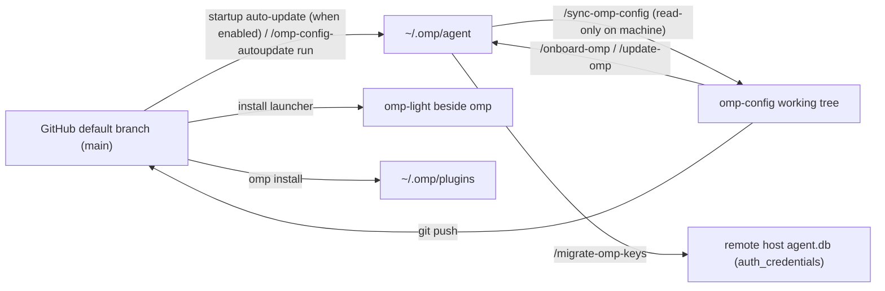

# Setup, Sync and Maintenance

[Home](../README.md) · English | [简体中文](operations.zh-CN.md)



## File Ownership and Sync Rules

State moves from repo → machine through `agent/extensions/omp-config-autoupdate/omp-config-update.ts` and from machine → repo through `.omp/commands/sync-omp-config.md`. The updater merges every managed item three-way — except machine-owned agent definitions (`agents/*.md`), which are seeded once and then kept under their own rule below — against the machine's copy, the repo version this machine last accepted (the base, recorded in `<agentDir>/.omp-config-base/`) and the incoming repo version. An unmodified item takes the incoming version; a customized one keeps the machine's edit; when both sides changed, text files are merged with `git merge-file` and anything that still overlaps is kept as it is and reported as a conflict (see [omp-config-autoupdate](#omp-config-autoupdate)). The owner lists named below are constants in the updater.

| Path / category | Owner | Repo → Machine (updater) | Machine → Repo (`/sync-omp-config`) | Takes effect |
|---|---|---|---|---|
| `agent/SYSTEM_TEMPLATE.md`, `APPEND_SYSTEM.md`, `PERSONALITY.md`, `APPEND_SYSTEM_LIGHT.md`, `agents/*.txt` (non-agent notes) | Repo; machine edits kept | Three-way: unmodified files are overwritten via temp file + `rename` (writes through symlinks), customized ones keep the edit and merge separate upstream changes, overlapping changes conflict; a file the source dropped is deleted when unmodified, else it conflicts | `cmp` against machine; copies changed files into repo | Next OMP start |
| `agent/agents/*.md` | Machine (repo seeds defaults once) | Machine-owned seeded: seeded from the repo only while the rel has no record; after that an unmodified copy still follows the repo (upstream edits and drops apply, so repo renames propagate), a machine-modified copy always wins without merge or conflict, and a file the machine removed or renamed is never re-created; machine-authored `.md` files are left alone and only their presence is recorded | Never copied into repo (edit `agent/agents/*.md` in the repo directly) | Next spawn |
| `agent/config-light.yml` | Repo; machine edits kept | Three-way like the text files above | `cmp` against machine; copies changed files into repo | Live-reloaded settings overlay (`omp-light` passes `--config`); startup-only work is not rerun, and extension sources never imported in this process need a restart ([settings](omp://settings.md#live-file-changes), [extension loading](omp://extension-loading.md#live-source-changes)) |
| `agent/extensions/<name>/*.ts`, `extensions/_shared/*.ts`, `extensions-last/<name>/*.ts`, `omp-light.ts` | Repo (code is repo-wins) | Overwritten even when customized; customized files are listed in `overwritten`. Deleted when the base (or, before one exists, the previous `auto` commit) had them and the source dropped them (`extensions-last/README*.md` stay in repo only) | Compares each `.ts` and copies changes into repo | Next OMP start |
| `PROMPT-INJECT-*.md`, `TURN-JUDGE-*.md`, `INTENT-*.md`, `extensions/append-system-model/APPEND-SYSTEM-*.md`, `extensions-last/system-prompt-replace/REPLACE-SYSTEM-*.yml` / `REPLACE-SYSTEM-*.yaml` | Repo if shipped here; machine if created locally | Shipped files: three-way like the text files above; machine-created files in the same directories are left alone | Copies back only files already tracked in repo | Next spawn / next turn / next call / next prompt (`APPEND-SYSTEM-*.md` and `REPLACE-SYSTEM-*` also after the next tool call) |
| `extensions/tool-topics/TOPIC-*.md`, `SURFACE-*.md` | Repo if shipped here; machine if created locally | Shipped files: three-way like the text files above | Copies back only files already tracked in repo | Next OMP start |
| `extensions/argon-long-output/ARGON_PROMPT.md` | Repo; machine edits kept | Three-way like the text files above | `cmp` against machine; copies changes into repo | Next prompt or tool call |
| `WATCHDOG-*.md` | Machine | Never written or deleted (only moved from agent root into extension dir during flat-layout migration) | Never copied into repo | Re-read on write |
| `APPEND_SYSTEM_MODEL.md` (old `append-system-model` format) | Machine | Split once into `extensions/append-system-model/APPEND-SYSTEM-model-NN.md`, one machine-owned file per block with `target: *`, then deleted; left in place with a note when a target name exists or the file does not parse | Never copied into repo | — |
| `agent/config.yml` | Repo + machine per key | Three-way per key. `LOCAL_CONFIG_FIELDS` (the machine's, OMP's or the user's consent, such as `modelRoles`, `theme`, `setupVersion`, `dev.autoqaConsent`, `codexResets`) are never written; `SEED_CONFIG_FIELDS` (defaults such as `task.agentModelOverrides`, `retry.fallbackChains`, `browser`, `task.maxConcurrency`) are written only while the machine lacks them; host-only keys stay; in `extensions` and `disabledProviders` (`MACHINE_LIST_FIELDS`) machine entries such as `~/.claude` stay ahead and the repo's entries merge three-way as one value; when the base has no such list (the repo never delivered it to this machine), every host entry is the machine's and the repo's entries are added after them | Edits differing lines in place without re-serializing the file; skips `LOCAL_CONFIG_FIELDS`, `SEED_CONFIG_FIELDS` and machine entries of `extensions` and `disabledProviders` | Hot-reloaded by OMP |
| `agent/extensions/_shared/package.json` (the `omp-config` plugin manifest) | Repo; machine edits kept | Three-way like the text files above; `omp.settings` is the only list of setting keys, types and defaults | `cmp` against machine; copies changes into repo | Next OMP start |
| `omp-config` plugin settings (`/settings → Plugins → omp-config`, `omp plugin config`; the project's `.omp/plugin-overrides.json` overrides machine values) | Machine | Never written; the apply links the plugin (`omp plugin link` on `extensions/_shared`) and then moves the machine's omp-config `omomp.*` sections into the settings once (see relocations) | Never copied into repo (the repo's defaults live in the manifest) | Per extension's read timing |
| `<agentDir>/omomp.*` | Each section's owner | Only omp-config's sections move out (see relocations); sections of other owners (such as `omp-unified-exec`) are never written, and the file is deleted once nothing is left in it | Never copied into repo | — |
| `<agentDir>/subagent-usage/calibration.json` | Machine (the `subagent-usage` extension, after `/subagent-usage on`) | Never written or deleted; `/subagent-usage reset` deletes it | Never copied into repo | Next `subagent_usage` call |
| `<agentDir>/thinking-translator.json` | Plugin / machine | Never created, rewritten or deleted; old structured base records are inert | Never copied into repo; setup is in the [plugin README](https://github.com/oh-my-omp/omp-thinking-translator#readme) | Plugin-defined |
| `<agentDir>/.omp-config-base/` | Updater (machine) | The base of each managed item: written after its host write succeeded, and by `resolve`; `--check` never writes it | Excluded from repo | — |
| App-managed files (first line `// @orca-managed-pi-extension` or containing `marker: _otty`) | External app (Orca / Otty) | Never overwritten, imported or deleted; legacy sources stay in place and are skipped or block migration, and superseded modules or retirement leaves block cutover; their base is not touched | Skipped | — |
| Runtime files (`*.db*`, WAL, `*.lock`, `models.yml`, `sessions/`, `blobs/`, `cache/`, `logs/`, `.omp-config-applied`, `settings.json`, installed `omp-light`) and plugin state (`~/.pi/agent/pi-bansos-relay-state.json`) | Machine runtime | Left untouched (`.omp-config-applied` and `omp-light` are written by the updater) | Excluded from repo | — |

Relocations run in both update modes:
- After the file operations, apply registers `extensions/_shared` as the local plugin `omp-config` with `omp plugin link` (left alone with a note when OMP already lists the plugin at another path), then moves the machine's omp-config sections of `omomp.*` and of the standalone JSON files that held them into plugin settings and into their new md homes: a value becomes a plugin setting only when the machine has not set that key and it differs from the manifest default; `task-split-check` agents become `splitCheck: true` frontmatter in `agents/*.md`, `model-compaction` rules become `extensions/model-compaction/COMPACTION-rule-NN.md`, `tool-topic-injection` rules are dropped only when equal to what the repo shipped (the `TOPIC` files now carry them), `judge.fallbackRole` is dropped (an unassigned `@<purpose>` uses OMP's judge role chain), and every other `fallbackRole` becomes the reference `@<role>` in the machine's `config.yml` `modelRoles` for the role it backed (`@<extension>`) when that role is unassigned. The section of a retired extension (`doc-polish`) is dropped whole with a note. Plugin settings are read and written from cwd `/`, so a project's `.omp/plugin-overrides.json` never hides the machine's values. A section leaves the file only after OMP lists each of its values and `config.yml` reads back each binding it wrote with the written `@<role>`; sections of other owners stay, and the file is deleted once empty. Invalid, ambiguous or blocked sections stay in place with a note; `--check` and `--no-plugins` only report the move.
- A project's `.omp/omomp.*` (which OMP once read before the machine's) moves into that project when a main session starts there: its scalar values become entries of the project's `.omp/plugin-overrides.json` under `settings["omp-config"]`, its `model-compaction` rules become `.omp/COMPACTION-rule-NN.md`, and `judge.fallbackRole` is dropped. Data with no project-level place (other `fallbackRole` keys, `task-split-check` agents, `tool-topic-injection` rules, and the machine-only `omomp-lang`, `omp-config-autoupdate` and `subagent-usage` sections) stays with a warning. A section also stays, with the reason in that warning, when the overrides file sets one of its keys to another value (the warning names the key and both values; the user keeps one), when the overrides file cannot be read, or when its rule file already exists with other content; a key the overrides file already sets to the same value needs no write. Only the moved sections leave the file, which is deleted once empty. When the move writes, a notice names the files before and after it and asks the user to commit them; nothing is committed. When nothing can move, only the warning appears, once per OMP process and project.
- The legacy `system-prompt-replace` section or JSON is removed when it matches the machine's accepted structured base, or a committed repo version if no base exists; the shipped default rule file then installs normally. Only customized rules are converted into the destination's managed-template merge. An occupied destination, invalid custom data, an ambiguous layout, another `omomp` format or an app-managed source leaves the migration in place with a note and blocks default-template installation.
- Agent-root data moves to a free extension-directory path. A repo `PROMPT-INJECT-*` or `TURN-JUDGE-*` template at the agent root is deleted only when it equals a shipped or accepted version at its old or new path; a customized one stays with a note to port it. Symlinks are noted, not moved.

## Maintenance Workflows

Run slash commands inside `omp` started at the repository root:

1. **First-time setup on a machine (`/onboard-omp [check|<plane>]` or `/update-omp`)**:
   - Run `/onboard-omp` at the repository root. The opening explains why full omomp customization burdens a lower-capability main agent but strengthens a high-capability main agent's execution and task quality. The model first investigates existing global rules and skills outside omomp, then tells concrete stories about which semantic constraints mechanisms can take over, which they cover only partly, what user-owned requirements remain, and what new capabilities they add. It distinguishes actual loading from available files and post-install behavior; personal and domain knowledge stays with the user. The settings, prompts, agents, local extensions and declared plugins, including optional ones, form a supplementary walkthrough rather than the opening structure. Current sources supply evidence, and shipped configuration supplies adaptable working examples, not a script. The model uses your language. For a non-Chinese user, its first reply recommends a fork and configuration/prompt localization, asks in ordinary text whether to do that first, and waits; skipping this keeps the walkthrough read-only in the same language. Accepted localization respects schemas and machine-readable text; UI support remains `en`/`zh`. Fork-maintained translations use upstream synchronization followed by `/update-omp` from the fork working tree, with official startup auto-update kept off. The command never uses the `ask` tool or chapter confirmations. An explicit setup request enters machine adaptation and `/update-omp`; missing personal decisions use plain text, and translator setup follows the [plugin README](https://github.com/oh-my-omp/omp-thinking-translator#readme). Pass `check` for read-only machine diagnosis, or `<plane>` for a topic, component name, or existing topic number.
   - For a direct wholesale install without the walkthrough, run `/update-omp` (writes configs, extensions, and the updater, installs `omp-light`, and runs `omp install` for every required plugin).
   - If the machine uses `~/.claude`, add `~/.claude` at the start of `extensions` in `~/.omp/agent/config.yml`, then restart `omp`.
   - For an installation following the official repository rather than fork-maintained translations, enable startup auto-update with `/omp-config-autoupdate on` (applies from the next start).
   - Verify with `omp config list --json`, `omp plugin list --json`, and `git status --short`.
2. **Syncing machine edits back to the repository (`/sync-omp-config [check]`)**:
   - Run `/sync-omp-config check` to inspect diffs, then `/sync-omp-config` to edit them into the repository, validate with `Bun.YAML.parse` / `JSON.parse` and `bun run check`, and commit and push (`chore: sync snapshot with local omp config`). Machine-owned and seed paths and the base record never enter the repository.
   - Stops if the machine still has flat `extensions/<name>.ts` files (outside the retired Todo/`ctx` paths) and asks you to run `/update-omp` first.
   - Updates `install-plugins.sh` when `~/.omp/plugins/package.json` dependencies change (preserving Git/URL entries, stripping npm version ranges, and leaving commented optional entries commented).
3. **Applying the working tree (`/update-omp [check]`)**:
   - Runs `bun agent/extensions/omp-config-autoupdate/omp-config-update.ts apply --source .` (`--check` is read-only).
   - Merges three-way against the recorded base exactly like `auto` (the base it records is the working tree's version), with these differences: it has no previous commit, so files the source dropped before this machine recorded a base stay; it does not touch `.omp-config-applied`; it reports conflicts and adapts them with the user right away (`conflicts --source .`, then `resolve --source .`); it runs `./plugin-audit.sh` and asks before uninstalling `[卸载候选]` plugins.
4. **Copying credentials to a remote machine (`/migrate-omp-keys <target>`)**:
   - Copies the `auth_credentials` table from `~/.omp/agent/agent.db` over SSH to the remote host's `~/.omp/agent/agent.db`. Verifies the remote `omp` process is stopped, creates a timestamped SQLite `.backup` on the remote host, clears remote `auth_credential_blocks` and `auth_credential_refresh_leases`, and replaces `auth_credentials` in one transaction without printing credentials.
5. **Manual copy on an empty machine**:
   Use `/update-omp` on any machine with existing config (plain `cp -a` overwrites machine-local keys and leaves retired local Todo/`ctx` files in place). On an empty `~/.omp/agent`:
   ```bash
   mkdir -p "$HOME/.omp/agent"
   cp agent/config.yml agent/SYSTEM_TEMPLATE.md agent/APPEND_SYSTEM.md \
     agent/PERSONALITY.md agent/config-light.yml \
     agent/APPEND_SYSTEM_LIGHT.md agent/omp-light.ts \
     "$HOME/.omp/agent/"
   cp -a agent/agents agent/extensions agent/extensions-last "$HOME/.omp/agent/"
   ./install-plugins.sh
   ```
   Run `/update-omp` (or `/omp-config-autoupdate on` and restart) afterwards to install `omp-light` on `PATH`.

### omp-config-autoupdate

Source: `agent/extensions/omp-config-autoupdate/`.

Reads the `omp-config-autoupdate.enabled` and `omp-config-autoupdate.conflicts` settings of `omp-config` once at startup (`enabled` off by default; `conflicts` `notify`, the default, or `agent`). They are machine-wide: the updater does not manage them and `/sync-omp-config` does not carry them. A third setting, `omp-config-autoupdate.exclude`, is read by the updater on every run (startup auto-update and `/update-omp` apply alike), not by this extension — whitespace-separated entries, the machine's own list (the repo ships no value):

```text
agents/task-high.md              # a managed file: kept exactly as the machine has it
extensions/my-tool/**            # globs work; a literal name covers its subtree
config.yml                       # a bare name excludes a whole structured file
config.yml:task.eager            # one field path inside a structured file
omomp.yml:lang-nag               # keeps that omomp section out of the settings move
```

Excluded items are never written, created or deleted and keep their recorded base, so removing an entry later resumes updates from where it left off; every kept item is listed in the report's skipped section. An invalid entry (a malformed path, `file:field` naming a file other than `config.yml`/`omomp.yml`, or an `omp-config-autoupdate` section in two omomp files) stops the whole apply like any other preflight error.

| Command | Behavior |
|---|---|
| `/omp-config-autoupdate` or `… status` | Shows whether startup auto-update is on, how conflicts are handled, and the config path |
| `/omp-config-autoupdate on\|off` | Writes `enabled` (takes effect on the next OMP start) |
| `/omp-config-autoupdate conflicts notify\|agent` | Writes `conflicts` (takes effect on the next OMP start) |
| `/omp-config-autoupdate run` | Runs `omp-config-update.ts auto` from the GitHub default branch immediately regardless of the switch, and posts the full report, conflicts included, as a display-only transcript message once idle |
| `/omp-config-autoupdate adapt` | Lists the pending conflicts against the updater clone; when there are any, sends the adaptation request into the main session |

How `omp-config-update.ts auto` runs:
1. Spawned from a `ctx.setTimeout` callback on root `session_start`, holding the lock directory `~/.omp/omp-config-update.lock` (reclaiming stale locks whose PID is gone).
2. Fetches `main` from `https://github.com/oh-my-omp/omp-config.git` into `~/.omp/omp-config-src` (updating old `mouriya-s-lab/omp-config.git` remotes; if offline, exits without applying the local clone).
3. When the fetched commit differs from `<agentDir>/.omp-config-applied`, imports `applySnapshot` from the fetched clone and runs: preflight parse and ownership checks for `TODO_RETIREMENTS` and `CTX_RETIREMENTS` → `omp install` on required plugins → fresh OMP catalog confirmation that `omp-todo-more` is enabled with its declared entry present → relocations → three-way file and structured-config merges → deletions of unmodified files the source dropped and exact Todo retirement leaves → base record → `omp plugin link` on `extensions/_shared` and the one-time `omomp.*` section move into plugin settings. The ctx retirement leaves are deleted only when the ready plugin carries `src/ctx`; otherwise they stay.
4. When the fetched commit matches `.omp-config-applied`, skips file writes, runs `omp install` on every unpinned GitHub entry in `install-plugins.sh` (required plugins and already-installed optional plugins), and re-scans conflicts read-only. Installed GitHub sources match by owner/repo across `github:`, HTTPS and Git URL forms; npm entries and pinned URLs wait for the next config commit.
5. Any move or write error skips all deletions, leaves `.omp-config-applied` unchanged, and reports `Cutover incomplete; do not restart OMP`. Conflicts are not errors: the commit is recorded and they stay pending.
6. Shows a 5 s widget above the editor only when config files or plugins changed (`omp-config 93d519e → e5a34bc (3 files)`, `omp-todo-more 0.1.10 → 0.1.12`); up-to-date, busy, and offline runs only log, and errors show a warning.

Conflicts and adaptation:
- A machine without a base (installed before the record existed, or by plain copy) matches each copy against the repo's history: a copy equal to any committed version counts as unmodified; one equal to none gets an unknown base and stays a conflict until resolved. The updater clone is deepened once for this.
- A machine the updater never ran on (no base record and no installed `omp-config-update.ts`, such as one where omp's first-run setup has only written its own `config.yml`) has received no repo content, so its structured files are not matched against history: every managed key the copy lacks is written, and a key the user already set to a different value is a conflict.
- With pending conflicts, `conflicts: notify` shows a warning pointing at `/omp-config-autoupdate adapt`. `conflicts: agent` sends the adaptation request into the main session by itself, but only after a run that applied a new commit, in a UI session that is idle and has no user message yet; otherwise it notifies.
- The adaptation request asks the agent to run `omp-config-update.ts conflicts`, which prints the procedure and, per conflict, the local copy, the base and the incoming version. For each one the agent explains both changes, asks the user to keep the local copy, take the incoming version or accept a merge it proposes, edits the local file, and records the result with `omp-config-update.ts resolve <id>`. `resolve` refuses an id whose upstream value changed since it was listed.

---

## Writing Extensions, CI and Upgrades

### Extension Layout and `_shared` Modules

OMP discovers extensions one level deep under `~/.omp/agent/extensions/`: each extension is a directory `<name>/index.ts` (extension id `extension-module:<name>`), with private modules in the same directory; no `.ts` file sits directly under `extensions/` or `extensions-last/`. Extensions do not import from one another; shared helpers live in `agent/extensions/_shared/` (no `index.ts`):

| Module | Exports and purpose |
|---|---|
| `errors.ts` | `errorText(error)`: formats an `unknown` error as a string |
| `messages.ts` | `textOf`, `lastAssistantText`: extracts plain text from messages |
| `ask-answers.ts` | `askAnswers`, `formatAskAnswers`, `AskAnswer`: reads what the user answered in one `ask` tool result (native or omp-ask-more `details`), null for a cancelled, refused or unanswered ask; used by `turn-judge` and `user-prompt-inject` |
| `i18n.ts` | `tr`, `parseLanguage`, `omompLangSetting`, `LANGUAGE_ENV`: resolves `OMOMP_LANG` → the `omomp-lang.language` setting (read once per process, machine scope) → locale → English at each call site (do not call `tr` at module load) |
| `plugin-settings.ts` | `PLUGIN`, `SettingsScope`, `SettingsSection`, `defineSettings`, `readSettings`, `writeSetting`: the omp-config plugin settings reader — `defineSettings(import.meta.dir, schema)` binds an extension's `z` schema to its `<extension>.` key prefix; `readSettings` returns stored values over manifest defaults rebuilt into the schema's shape (project scope: the project's `.omp/plugin-overrides.json` over machine values; machine scope: machine values only); `writeSetting` stores one `<extension>.<key>` value |
| `models.ts` | `Model`, `ThinkingLevel`: host model and helper-session thinking types |
| `roles.ts` | `roleModels`, `roleName`, `modelLabel`: resolves the chat models of OMP model roles (`modelRoles.<role>`, then `retry.fallbackChains.<role>`, then built-in defaults) from live session settings on every call. Extension role tags are listed in `agent/config.yml` `modelTags` |
| `helper-session.ts` | `runHelperPrompt`: runs a one-shot prompt in a tool-less, extension-less in-memory session with `taskDepth: 1` and returns a result union without throwing |
| `caller-session.ts` | `callerSession(ctx)`: the live `AgentSession` an `ExtensionContext` serves, found in `AgentRegistry` by session manager or session file among the sessions homed on this thread (`isLocalAgentSession`; registry entries of other threads are `AgentSessionHandle`s); used by `fork-task`, `subagent-usage`, `model-compaction`, `judge.ts` and `settings.ts` |
| `judge.ts` | `openJudge`: answers with the chat models of `@<purpose>` when that role is assigned; otherwise runs OMP's judge-role chain (`resolveJudge`), with no chat fallback — inactive only when neither resolves a model |
| `spec-files.ts` | `discoverSpecFiles`, `parseFrontmatter`, `unquote`: discovers files matching a name pattern (such as `*-<label>.md`) in the extension directory and from `cwd` up to the git root, and parses `---` frontmatter |
| `session-filter.ts` | `parseSessionFilter`, `parseInjectMode`, `targetsSession`, `producerMatches`, `describeFilter`, `SessionFilter`, `InjectMode`, `FilterProblem`: parses a spec file's `target` list, `cwd` glob list, producer regexes and `inject` form, returning parse problems as data for the caller to word; used by `watchdog-agent`, `turn-judge` and `prompt-conditions.ts` |
| `prompt-conditions.ts` | `parseSessionConditions`, `conditionsApply`, `CONDITION_KEYS`, `SessionConditions`, `ConditionProblem`: the inclusion and `exclude.*` conditions (`target`, `cwd`, `model`, `provider`, `mode`, `delegation`) of `append-system-model` fragments and `system-prompt-replace` rules, matched against the session, its current model and that model's delegation bias, and `OMOMP_MODE`; each caller passes its own default target and words the problems |
| `context-delivery.ts` | `createContextDelivery(pi)`: once-per-actual-context marker guard shared by `repo-rules` and topic injection; only same-turn pending delivery is kept in memory |
| `context-delta.ts` | `createDeltaStream(pi, id)`, `Delta`: an extension's delta stream — renders its customization as a `<system-reminder source="omp-config/<id>">` message and delivers it at prompt start (`atPrompt`, the `before_agent_start` `message`) or after a tool batch (`afterTools`, the `tool_result` `additionalContext`) only when it differs from the source's latest delta in the active-leaf context, superseding earlier ones; only same-turn tool-batch delivery is kept in memory; used by `append-system-model`, `system-prompt-replace`, `tool-topics` and `repo-rules` |
| `agent-definition.ts` | `declaresFlag(session, cwd, agentName, key)`: whether the named agent definition's frontmatter sets a flag to `true` (the `task` tool's own discovery order); used for `completionJudge` and `splitCheck` |
| `tool-calls.ts` | `watchedCallOf`, `WatchedCall`: reads a host `tool_call` event's shell command (`bash`, `bash_bg`, and their `xd://` device writes) or eval code; plugin calls are ignored; used by `tool-policy-nag` and `delete-guard` |
| `eval-py-launches.ts` | `scanPy`, `pyLaunchAt`, `isOp`, `PyLaunch`, `LaunchWord`, `LaunchVia`: tokenizes a Python eval cell (strings, f-strings, `!cmd`, `%%bash`, magics), its import bindings, and the process launch a call starts, tagged `direct`/`alias`/`distinctive`; used by `delete-guard` (fail closed) and the `tool-policy-nag` pty lane (fail open) |
| `eval-js-launches.ts` | `parseJs`, `jsLaunchOf`, `walk`, `propertyName`, `receiverModule`, `isBunFile`, `JsLaunch`: parses a JS eval cell with omp's Babel options, its module bindings, and the child_process/Bun/bridge launch a node starts; used by `delete-guard` and the `tool-policy-nag` pty lane |

Code rules checked by `bun run check` (`biome check . && tsc --noEmit`):
1. **Formatting and types**: format with `bun run format` (Biome: tabs, double quotes, semicolons, trailing commas, line width 140). `tsc` runs with `strict` and `noUncheckedIndexedAccess`; do not use `any`. Parse external input (files, tool args, session entries, event payloads, child-process stdout) at the boundary with `z` from `@oh-my-pi/pi-coding-agent` or a type guard; use `as` only for host types that cannot be checked at runtime, with a comment explaining why.
2. **State and error handling**: represent state variants as discriminated unions on `kind` with an exhaustive `switch` (`never` default arm). Catch errors at hook and tool boundaries and log `pi.logger.warn(…, { error: errorText(error) })` rather than throwing into OMP.
3. **`taskDepth: 1` on helper sessions**: any extension calling `createAgentSession` directly (such as `fork-task` during `shake`) must pass `taskDepth: 1`. Without it, `dispose()` treats the helper as a main session and tears down `AgentLifecycleManager`, disconnecting all idle and parked subagents (`Unknown agent`).
4. **Imports and runtime load testing**: import only OMP host package roots (`pi-agent-core`, `pi-ai`, `pi-catalog`, `pi-coding-agent`, `pi-natives`, `pi-tui`, `pi-utils`), Node/Bun built-ins, and `.ts` relative paths (guard platform-specific native bindings by platform). Because `tsc` resolves packages from `node_modules/`, it does not catch unmapped host subpaths such as `@oh-my-pi/pi-tui/thinking`; trigger the modified extension in a real session inside the [test sandbox](../sandbox/README.md), which applies the working tree with this machine's config and credentials.

`bun run test` (`bun test ci`) runs the unit tests in `ci/`: the `delete-guard` tests (the `delete` tool's refusal set, Linux trash layout and permanent deletion; the posix classifier's, the nested PowerShell/cmd dialects' and the py/js eval analyzers' block/allow tables; the `tool_call` reason and fail-closed paths), and the updater's three-way apply tests (`ci/omp-config-update.test.ts`: unmodified items update, customizations merge or conflict until resolved, seed and machine-owned paths stay, code stays repo-wins, deletions, matching a machine without a base against history, a first install over omp's own first-run `config.yml`, machine `exclude` entries keeping excluded files and fields while siblings update, read-only `--check`); CI runs it in the `code` job after `bun run check`. The Windows behavior of `delete-guard` in real sessions is checked separately by the [delete-guard Windows acceptance](../ci/README.md#delete-guard-windows-acceptance).

### Tool Topics

`tool://<tool>/<topic>` holds only the topics this repository writes for tools it does not own (OMP's built-in tools): [tool-topics](extensions.md#tool-topics) loads its `TOPIC-*.md` files and puts the scheme on OMP's URL router, and nothing else registers there.

A tool registered by an extension of this repository or by a plugin serves its own topics. `docTopics()` on its `pi.registerTool` definition returns topic name → Markdown body; OMP reads it as `xd://<tool>/<topic>` (and calls it on every read, so a topic may be built per read). The last lines of the tool's description point to each topic by its full URL, under `Topics — read the one a call needs before making it:`; for a device, OMP shows the first 200 characters of the description in the prompt and the full text at `xd://<tool>`. `ToolDefinition` does not declare `docTopics`, so the definition is typed `ToolDefinition<…> & { docTopics(): Readonly<Record<string, string>> }`; `agent/extensions/fork-task/topics.ts` is the example here.

### Progressive Topic Injection API

`extensions/tool-topics/injection.ts` is the injection engine of [tool-topics](extensions.md#tool-topics). `installToolTopicInjection(pi, { owner, rules })` installs one provider per extension/session. `owner` must be non-empty and stable (`omp-config/tool-topic-injection`); `rules` are the catalog's validated `inject` entries, fixed at load. The engine contains no read/SSH/bash/eval special cases and does not register topics. Stateful regexes are reset before matching.

The live rules and shipped triggers are documented in [tool-topics](extensions.md#tool-topics). Delivery identity is owner + rule id, not topic URL. Keep ids when a rule remains the same logical rule; change its id if it must be eligible again while the old marker is still present. The shared context guard checks developer messages in the active-leaf model projection, so compressed summaries and sibling branches are not mistaken for delivered content.

### CI Configuration Check (`bun ci/check.ts`)

`.github/workflows/config-check.yml` runs `code` (`bun install && bun run check && bun run test`) and `omp-session` (`bun ci/check.ts`). `ci/check.ts` creates an isolated temporary `HOME`, installs the latest `@oh-my-pi/pi-coding-agent`, applies this repository with the updater (plugins included), wires Kilo's anonymous free model `nvidia/nemotron-3-ultra-550b-a55b:free` and a local loopback shadow proxy for referenced paid models, and runs one RPC session each in `omp` and `omp-light`. Any stderr line, `extension_error` event, or OMP log `warn`/`error` outside `HOST_LOG_WARNINGS` fails the check (exit `0` clean, `1` config/environment error, `2` free-model provider failure). Full details: [`ci/README.md`](../ci/README.md).

### Upgrade and Maintenance Notes

- **Adding or removing a managed file or a plugin setting, or moving a path between owners**: a managed-file change updates `managedPlain` / `STRUCTURED` (and `LOCAL_*` / `SEED_*`) in `agent/extensions/omp-config-autoupdate/omp-config-update.ts`; a setting change updates the `omp.settings` manifest in `agent/extensions/_shared/package.json`; `.omp/commands/sync-omp-config.md`, `README.md` / `README.zh-CN.md` and the matching `docs/` pages change together. Keep `applySnapshot(options)` and the path `extensions/omp-config-autoupdate/omp-config-update.ts` compatible with existing clones: older machines run their installed `runAuto`, import the fetched `applySnapshot` and ignore report fields they do not know.
- **Do not write the literal Otty marker in `omp-config-update.ts`**: the app-managed check looks for `marker:` + `_otty` anywhere in a file; putting the contiguous literal in the updater source would cause the updater to skip updating itself.
- **After upgrading OMP**:
  1. Test extensions that rely on OMP internals (`AgentRegistry`, child session paths, hook order, runtime settings layers, `InteractiveMode` prototype, slash-command dispatchers, the nested `tool_call` emitted for `xd://` writes): [`fork-task`](prompts-and-context.md#fork-task), [`user-prompt-inject`](agents.md#user-prompt-inject), [`turn-judge`](extensions.md#turn-judge), [`task-completion-judge`](extensions.md#task-completion-judge), [`model-compaction`](prompts-and-context.md#model-compaction), [`wt-tool`](extensions.md#wt-tool), [`harness-restart`](extensions.md#harness-restart), [`subagent-usage`](extensions.md#subagent-usage) (subagent transcript fields `session_init.agent`/`resolvedModel`, worktree session directories, provider usage strategies, `authStorage.usage.history`, `ModelsConfigFile`, its Worker; on a machine where it is enabled, run `/subagent-usage recalibrate` and call the tool), [`argon-long-output`](extensions.md#argon-long-output) (the watchdog timeout precedence in `pi-ai`'s `register-builtins.ts` and `google-gemini-cli.ts`, and OMP's Google compat resolution dropping `models.yml` stream timeouts), [`ast-top-level`](extensions.md#ast-top-level) (`XDEV_KEEP_TOP_LEVEL` and `isMountableUnderXdev` in `src/tools/xdev.ts`; the system prompt lists `ast_grep` and `ast_edit` as functions, not under `# xd:// Tool Devices`), [`system-prompt-replace`](prompts-and-context.md#system-prompt-replace) (the `delegation` condition: `resolveDelegationBias` in `@oh-my-pi/pi-catalog/compat/delegation` still loads, and `eagerDelegation` still gates the eval sentence of the `delegation: eager` rule; open one session on an `eager` model and one on a non-`eager` model such as `openai-codex/gpt-6.1-sol`, neither may warn `found no target`), and [`delete-guard`](extensions.md#delete-guard) (a `bash` `rm` and a `write xd://bash` `rm` are both blocked). Plugin-specific validation belongs in the [omp-todo-more README](https://github.com/oh-my-omp/omp-todo-more#readme).
  2. Diff `agent/SYSTEM_TEMPLATE.md` against OMP's `packages/coding-agent/src/prompts/system/system-prompt.md`, and the first half of `agent/PERSONALITY.md` against OMP's `personality: default` preset.
  3. If `system-prompt-replace: … found no target` warns at startup, update `agent/extensions-last/system-prompt-replace/REPLACE-SYSTEM-default.yml` to match the new upstream tool text; when OMP renders the target text only for some models, limit the rule with a condition such as `delegation` instead.
  4. Re-check `agent/extensions/tool-topics/`: a `tool-topics: <tool> keeps its native description` warning means OMP changed the rendered tool layout or a `{{native:…}}` heading. Then, per tool, compare its `SURFACE-*` / `TOPIC-*` files with the sources named in their `upstream` header (the tool's prompt under `src/prompts/tools/`, its schema and `omp://tools/<tool>.md`), fix changed parameters, values and behaviors, and bump the version in `upstream`.
- **Bilingual docs**: keep `README.md` / `README.zh-CN.md` and each `docs/<topic>.md` / `docs/<topic>.zh-CN.md` pair aligned in sections, tables, and anchors.
