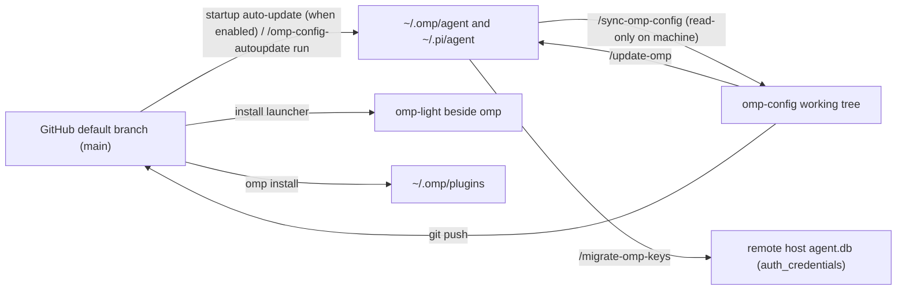

# Setup, Sync and Maintenance

[Home](../README.md) · English | [简体中文](operations.zh-CN.md)



## File Ownership and Sync Rules

State moves between this repository and a machine through two separate commands: `agent/extensions/omp-config-autoupdate/omp-config-update.ts` (repo → machine) and `.omp/commands/sync-omp-config.md` (machine → repo):

| Path / category | Owner | Repo → Machine (updater) | Machine → Repo (`/sync-omp-config`) | Takes effect |
|---|---|---|---|---|
| `agent/SYSTEM_TEMPLATE.md`, `APPEND_SYSTEM.md`, `PERSONALITY.md`, `config-light.yml`, `APPEND_SYSTEM_LIGHT.md`, `omp-light.ts`, `agents/*` | Repo (whole file) | Overwrites via temp file + `rename` (writes through symlinks) | `cmp` against machine; copies changed files into repo | `agents/*` on next spawn; others on next OMP start |
| `agent/extensions/<name>/*.ts`, `extensions/_shared/*.ts`, `extensions-last/<name>/*.ts` | Repo (whole file) | Overwrites `.ts` files; `auto` mode deletes `.ts` files removed in git diff (`extensions-last/README*.md` stay in repo only) | Compares each `.ts` and copies changes into repo | Next OMP start |
| `PROMPT-INJECT-*.md`, `TURN-JUDGE-*.md`, `INTENT-*.md` | Repo if shipped here; machine if created locally | Overwrites shipped files; leaves machine-created files in the same directories alone | Copies back only files already tracked in repo | Next spawn / next turn / next call |
| `APPEND_SYSTEM_MODEL.md`, `WATCHDOG-*.md` | Machine | Never written or deleted (only moved from agent root into extension dir during flat-layout migration) | Never copied into repo | Next prompt / re-read on write |
| `agent/config.yml` | Repo + machine per key | Overlays repo keys; preserves machine-local `LOCAL_CONFIG_FIELDS` (`providers.webSearchOrder`, `modelRoles`, `defaultThinkingLevel`, `skills`, `symbolPreset`, `theme`, `colorBlindMode`, `hideThinkingBlock`, `statusLine`, `terminal`, `tui`, `display`, `worktree`, `compaction.thresholdTokens`, `compaction.thresholdPercent`, `compaction.idleThresholdTokens`) and host-only keys; keeps machine-only `extensions` entries (`MACHINE_LIST_FIELDS`, e.g. `~/.claude`) ahead of repo entries | Edits differing non-local lines in place without re-serializing the file; skips `LOCAL_CONFIG_FIELDS` and machine `extensions` entries | Hot-reloaded by OMP |
| `agent/omomp.yml` | Repo sections + machine sections | Overwrites repo sections (`omomp-lang`, `judge`, `lang-nag`, `input-polish`, `tool-policy-nag`, `task-completion-judge`, `task-split-check`, `child-memory-warning`, `fork-task`, `tool-topic-injection`, `system-prompt-replace`); preserves machine sections (`doc-polish`, `model-compaction`, `omp-config-autoupdate`) | Edits differing lines in repo sections; ignores machine sections | Per extension's read timing |
| `agent/thinking-translator.json` | Repo + machine per key | Overlays repo keys, keeping extra machine keys | Edits differing fields | Next message start |
| `pi/agent/pi-bansos-relay-state.json` | Repo + machine per key | Writes `~/.pi/agent/pi-bansos-relay-state.json` | Edits differing fields from `~/.pi/agent/` (if missing on machine, leaves repo file unchanged) | Next session start or `/bansos` |
| App-managed files (first line `// @orca-managed-pi-extension` or containing `marker: _otty`) | External app (Orca / Otty) | Skipped before overwrite or delete (listed in `skipped`) | Skipped | — |
| Runtime files (`*.db*`, WAL, `*.lock`, `models.yml`, `commandcode-models.json`, `sessions/`, `blobs/`, `cache/`, `logs/`, `.omp-config-applied`, `settings.json`, installed `omp-light`) | Machine runtime | Left untouched (`.omp-config-applied` and `omp-light` are written by the updater) | Excluded from repo | — |

## Maintenance Workflows

Run slash commands inside `omp` started at the repository root:

1. **First-time setup on a machine**:
   - Start `omp` at the repository root and run `/update-omp` (writes configs, extensions, and the updater, installs `omp-light`, and runs `omp install` for every required plugin).
   - If the machine uses `~/.claude`, add `~/.claude` at the start of `extensions` in `~/.omp/agent/config.yml`, then restart `omp`.
   - To enable startup auto-update, run `/omp-config-autoupdate on` (applies from the next start).
   - Verify with `omp config list --json`, `omp plugin list --json`, and `git status --short`.
2. **Syncing machine edits back to the repository (`/sync-omp-config [check]`)**:
   - Run `/sync-omp-config check` to inspect diffs, then `/sync-omp-config` to edit them into the repository, validate with `Bun.YAML.parse` / `JSON.parse` and `bun run check`, and commit and push (`chore: sync snapshot with local omp config`).
   - Stops if the machine still has flat `extensions/<name>.ts` files (outside the 13 retired Todo/`ctx` paths) and asks you to run `/update-omp` first.
   - Updates `install-plugins.sh` when `~/.omp/plugins/package.json` dependencies change (preserving Git/URL entries, stripping npm version ranges, and leaving commented optional entries commented).
3. **Applying the working tree (`/update-omp [check]`)**:
   - Runs `bun agent/extensions/omp-config-autoupdate/omp-config-update.ts apply --source .` (`--check` is read-only).
   - Unlike `auto` mode: has no git diff baseline, so outside flat-layout relocations and the 13 retired Todo/`ctx` files it does not delete files or keys; does not touch `.omp-config-applied`; runs `./plugin-audit.sh` and asks before uninstalling `[卸载候选]` plugins; and asks before creating a missing `doc-polish` section in `omomp.yml` or `commandcode-models.json`.
4. **Copying credentials to a remote machine (`/migrate-omp-keys <target>`)**:
   - Copies the `auth_credentials` table from `~/.omp/agent/agent.db` over SSH to the remote host's `~/.omp/agent/agent.db`. Verifies the remote `omp` process is stopped, creates a timestamped SQLite `.backup` on the remote host, clears remote `auth_credential_blocks` and `auth_credential_refresh_leases`, and replaces `auth_credentials` in one transaction without printing credentials.
5. **Manual copy on an empty machine**:
   Use `/update-omp` on any machine with existing config (plain `cp -a` overwrites machine-local keys and leaves retired local Todo files in place). On an empty `~/.omp/agent`:
   ```bash
   mkdir -p "$HOME/.omp/agent"
   cp agent/config.yml agent/SYSTEM_TEMPLATE.md agent/APPEND_SYSTEM.md \
     agent/PERSONALITY.md agent/omomp.yml agent/thinking-translator.json agent/config-light.yml \
     agent/APPEND_SYSTEM_LIGHT.md agent/omp-light.ts \
     "$HOME/.omp/agent/"
   cp -a agent/agents agent/extensions agent/extensions-last "$HOME/.omp/agent/"
   mkdir -p "$HOME/.pi/agent"
   cp pi/agent/pi-bansos-relay-state.json "$HOME/.pi/agent/"
   ./install-plugins.sh
   ```
   Run `/update-omp` (or `/omp-config-autoupdate on` and restart) afterwards to install `omp-light` on `PATH`.

### omp-config-autoupdate

Source: `agent/extensions/omp-config-autoupdate/`.

Reads `omomp.yml#omp-config-autoupdate.enabled` (`true` or `false`, off by default) from the agent-dir `omomp.*` once at startup:

| Command | Behavior |
|---|---|
| `/omp-config-autoupdate` or `… status` | Shows whether startup auto-update is on and the config path |
| `/omp-config-autoupdate on\|off` | Writes `enabled` in the agent-dir `omomp.*` (takes effect on the next OMP start) |
| `/omp-config-autoupdate run` | Runs `omp-config-update.ts auto` from the GitHub default branch immediately regardless of the switch, and posts the full report as a display-only transcript message once idle |

How `omp-config-update.ts auto` runs:
1. Spawned from a `ctx.setTimeout` callback on root `session_start`, holding the lock directory `~/.omp/omp-config-update.lock` (reclaiming stale locks whose PID is gone).
2. Fetches `main` from `https://github.com/oh-my-omp/omp-config.git` into `~/.omp/omp-config-src` (updating old `mouriya-s-lab/omp-config.git` remotes; if offline, exits without applying the local clone).
3. When the fetched commit differs from `<agentDir>/.omp-config-applied`, imports `applySnapshot` from the fetched clone and runs: preflight parse → `omp install` on required plugins → catalog check that `omp-todo-more` is enabled with `./index.ts` present → flat-layout relocations → file and structured-config writes → git-diff deletions and Todo/`ctx` leaf cleanup.
4. When the fetched commit matches `.omp-config-applied`, skips file writes and runs `omp install` on every unpinned GitHub entry in `install-plugins.sh` (required plugins and already-installed optional plugins).
5. Any move or write error skips all deletions, leaves `.omp-config-applied` unchanged, and reports `Cutover incomplete; do not restart OMP`.
6. Shows a 5 s widget above the editor only when config files or plugins changed (`omp-config 93d519e → e5a34bc (3 files)`, `omp-todo-more 0.1.10 → 0.1.12`); up-to-date, busy, and offline runs only log, and errors show a warning.

---

## Writing Extensions, CI and Upgrades

### Extension Layout and `_shared` Modules

OMP discovers extensions one level deep under `~/.omp/agent/extensions/`: each extension is a directory `<name>/index.ts` (extension id `extension-module:<name>`), with private modules in the same directory; no `.ts` file sits directly under `extensions/` or `extensions-last/`. Extensions do not import from one another; shared helpers live in `agent/extensions/_shared/` (no `index.ts`):

| Module | Exports and purpose |
|---|---|
| `errors.ts` | `errorText(error)`: formats an `unknown` error as a string |
| `messages.ts` | `textOf`, `lastAssistantText`: extracts plain text from messages |
| `i18n.ts` | `tr`, `language`, `resolveLanguage`, `parseLanguage`, `configuredLanguage`, `omompLangSection`, `LANGUAGE_ENV`: resolves `OMOMP_LANG` → agent-dir `omomp-lang` section → locale → English at each call site (do not call `tr` at module load) |
| `omomp.ts` | `defineOmompSection`, `defineSharedOmompSection`, `loadOmompSection`, `writeOmompSection`: reads and writes an extension's (or shared module's) section in `omomp.{yml,yaml,json,toml}` (project `<cwd>/.omp/omomp.*` before `<agentDir>/omomp.*`) |
| `models.ts` | `Model`, `ThinkingLevel`: host model and helper-session thinking types |
| `roles.ts` | `roleModels`, `roleName`, `modelLabel`: resolves the chat models of OMP model roles (`modelRoles.<role>`, then `retry.fallbackChains.<role>`, then built-in defaults) from live session settings on every call. Extension role tags are listed in `agent/config.yml` `modelTags` |
| `helper-session.ts` | `runHelperPrompt`: runs a one-shot prompt in a tool-less, extension-less in-memory session with `taskDepth: 1` and returns a result union without throwing |
| `judge.ts` | `openJudge`: runs OMP's judge-role chain (`resolveJudge`), falling back to `omomp.yml#judge.fallbackRole` as `TextJudge` |
| `spec-files.ts` | `discoverSpecFiles`, `parseFrontmatter`, `unquote`: discovers and parses `*-<label>.md` files in the extension directory and from `cwd` up to the git root |
| `tool-topics.ts` | `registerToolTopics`, `ToolTopic`, `ToolTopicsRegistration`, `ToolTopicsRegistrationResult`: shared `tool://` registry, indexes, readers, search enumeration and completion; usable by external plugins |
| `context-delivery.ts` | `createContextDelivery(pi)`: once-per-actual-context marker guard shared by `repo-rules` and topic injection; only same-turn pending delivery is kept in memory |
| `tool-topic-injection.ts` | `installToolTopicInjection`, `ToolTopicInjectionRule`, `toolTopicInjectionRulesSchema`: reusable tool-argument regex matching and trusted topic delivery |

Code rules checked by `bun run check` (`biome check . && tsc --noEmit`):
1. **Formatting and types**: format with `bun run format` (Biome: tabs, double quotes, semicolons, trailing commas, line width 140). `tsc` runs with `strict` and `noUncheckedIndexedAccess`; do not use `any`. Parse external input (files, tool args, session entries, event payloads, child-process stdout) at the boundary with `z` from `@oh-my-pi/pi-coding-agent` or a type guard; use `as` only for host types that cannot be checked at runtime, with a comment explaining why.
2. **State and error handling**: represent state variants as discriminated unions on `kind` with an exhaustive `switch` (`never` default arm). Catch errors at hook and tool boundaries and log `pi.logger.warn(…, { error: errorText(error) })` rather than throwing into OMP.
3. **`taskDepth: 1` on helper sessions**: any extension calling `createAgentSession` directly (such as `fork-task` during `shake`) must pass `taskDepth: 1`. Without it, `dispose()` treats the helper as a main session and tears down `AgentLifecycleManager`, disconnecting all idle and parked subagents (`Unknown agent`).
4. **Imports and runtime load testing**: import only OMP host package roots (`pi-agent-core`, `pi-ai`, `pi-catalog`, `pi-coding-agent`, `pi-natives`, `pi-tui`, `pi-utils`), Node/Bun built-ins, and `.ts` relative paths (guard platform-specific native bindings by platform). Because `tsc` resolves packages from `node_modules/`, it does not catch unmapped host subpaths such as `@oh-my-pi/pi-tui/thinking`; apply changes to `~/.omp/agent`, restart `omp`, and trigger the modified extension in a real session.

### Registering Tool Topics from Plugins

Local extensions statically import `registerToolTopics` and its types from `../_shared/tool-topics.ts`. External plugins use a static relative import to the installed helper, with no copy of the implementation. For an external plugin at `~/.omp/plugins/example/index.ts` and the default `~/.omp/agent`, the import is:

```ts
import type { ExtensionAPI } from "@oh-my-pi/pi-coding-agent";
import { registerToolTopics } from "../../agent/extensions/_shared/tool-topics.ts";

export default function exampleTopics(pi: ExtensionAPI): void {
  try {
    const result = registerToolTopics({
      tool: "example",
      owner: "my-plugin",
      topics: [{
        name: "usage",
        title: "Usage",
        read: () => "# Usage\nRun the example tool with its input path.\n",
      }],
    });
    switch (result.kind) {
      case "registered": return;
      case "invalid":
      case "conflict":
        pi.logger.warn("example topics registration failed", { reason: result.reason });
        return;
      default: {
        const unreachable: never = result;
        throw new Error(`Unhandled registration result: ${unreachable}`);
      }
    }
  } catch (error) {
    pi.logger.warn("example topics initialization failed", { error: String(error) });
  }
}
```

Install the helper through `/update-omp` first. For another plugin location or custom agent directory, calculate the relative path from the plugin's real source directory to `<getAgentDir()>/extensions/_shared/tool-topics.ts` at deployment time. Keep it a static relative import: OMP's extension graph follows relative source dependencies, whereas absolute imports and standalone native dynamic imports can bypass host-package rewriting and fail with `Cannot find package '@oh-my-pi/pi-coding-agent'`. Report import/initialization failures rather than creating a separate registry.

- `ToolTopic` contains `name`, `title` and `read(): string | Promise<string>`; `ToolTopicsRegistration` contains `tool`, stable `owner` and `topics`. Tool/topic names are case-sensitive `[A-Za-z0-9_.-]+`; owner/title must be non-blank, the topic list non-empty and topic names unique. The boundary validates registration metadata and reader return values.
- `registerToolTopics` returns `registered`, `invalid` or `conflict`; the latter two include `reason`. A tool belongs to one owner. The same owner atomically replaces the entire topic snapshot, removing omitted topics; invalid/conflicting registrations preserve existing content. Owner names coordinate registrations; they are not authentication.
- The router-held handler owns the registry. A versioned capability joins independent imports without replacing the handler; an OMP-owned, foreign or incompatible `tool` handler is never overwritten. Registration copies descriptors so later caller mutations do not alter the published snapshot.
- `read tool://` lists tools; `read tool://example` lists topics; `read tool://example/usage` reads one body, including line/raw selectors. `grep`/`find` over a tool or the scheme root enumerate its leaves. Unknown tools/topics report the available names. Completion uses descriptors only; leaf reads and search call readers each time, and reader failures propagate rather than silently dropping leaves.
- Registrations live for the OMP process, across sessions and extension disabling. Readers must not capture session UI, context, abort signals or temporary resources; no `pi` is retained by the helper. Each plugin owns any body caching and invalidation. Restart to remove registrations or load changed helper code; session shutdown does not unregister shared process state.

### Progressive Topic Injection API

External plugins use the same static-relative import convention for `_shared/tool-topic-injection.ts`. `toolTopicInjectionRulesSchema.safeParse(rawRules)` validates raw rule arrays and compiles each pattern into a `RegExp`. The output type `ToolTopicInjectionRule` has `id`, `tool`, `parameter`, compiled `pattern` and `topic`. Parsing rejects duplicate ids, invalid regexes and non-leaf topic URLs.

`installToolTopicInjection(pi, { owner, rules })` installs one provider per extension/session. `owner` must be non-empty and stable; `rules(ctx)` returns the validated rules for that session. This shared helper contains no read/SSH/bash/eval special cases and does not register topics. Use the registry API separately for plugin-owned content. Stateful regexes supplied by a plugin are reset before matching.

The built-in adapter's live configuration and default SSH triggers are documented in [tool-topic-injection](extensions.md#tool-topic-injection). Delivery identity is owner + rule id, not topic URL. Keep ids when a rule remains the same logical rule; change its id if it must be eligible again while the old marker is still present. The shared context guard checks developer messages in the active-leaf model projection, so compressed summaries and sibling branches are not mistaken for delivered content.

### CI Configuration Check (`bun ci/check.ts`)

`.github/workflows/config-check.yml` runs `code` (`bun install && bun run check`) and `omp-session` (`bun ci/check.ts`). `ci/check.ts` creates an isolated temporary `HOME`, installs the latest `@oh-my-pi/pi-coding-agent`, applies this repository with the updater (plugins included), wires Kilo's anonymous free model `nvidia/nemotron-3-ultra-550b-a55b:free` and a local loopback shadow proxy for referenced paid models, and runs one RPC session each in `omp` and `omp-light`. Any stderr line, `extension_error` event, or OMP log `warn`/`error` outside `HOST_LOG_WARNINGS` fails the check (exit `0` clean, `1` config/environment error, `2` free-model provider failure). Full details: [`ci/README.md`](../ci/README.md).

### Upgrade and Maintenance Notes

- **Adding or removing a managed file or config section**: update `managedPlain` / `STRUCTURED` in `agent/extensions/omp-config-autoupdate/omp-config-update.ts`, `.omp/commands/sync-omp-config.md`, `README.md` / `README.zh-CN.md`, and the matching `docs/` pages together. Keep `applySnapshot(options)` and the path `extensions/omp-config-autoupdate/omp-config-update.ts` compatible with existing clones.
- **Do not write the literal Otty marker in `omp-config-update.ts`**: the app-managed check looks for `marker:` + `_otty` anywhere in a file; putting the contiguous literal in the updater source would cause the updater to skip updating itself.
- **After upgrading OMP**:
  1. Test extensions that rely on OMP internals (`AgentRegistry`, child session paths, hook order, runtime settings layers, `InteractiveMode` prototype, slash-command dispatchers): [`fork-task`](prompts-and-context.md#fork-task), [`omp-todo-more`](plugins-and-modes.md#todo-more) (`todo`, `ctx`, task log, after-compact injection), [`user-prompt-inject`](agents.md#user-prompt-inject), [`turn-judge`](extensions.md#turn-judge), [`task-completion-judge`](extensions.md#task-completion-judge), [`model-compaction`](prompts-and-context.md#model-compaction), [`wt-tool`](extensions.md#wt-tool), and [`harness-restart`](extensions.md#harness-restart).
  2. Diff `agent/SYSTEM_TEMPLATE.md` against OMP's `packages/coding-agent/src/prompts/system/system-prompt.md`, and the first half of `agent/PERSONALITY.md` against OMP's `personality: default` preset.
  3. If `system-prompt-replace: … found no target` warns at startup, update `omomp.yml#system-prompt-replace` to match the new upstream tool text.
- **Bilingual docs**: keep `README.md` / `README.zh-CN.md` and each `docs/<topic>.md` / `docs/<topic>.zh-CN.md` pair aligned in sections, tables, and anchors.
