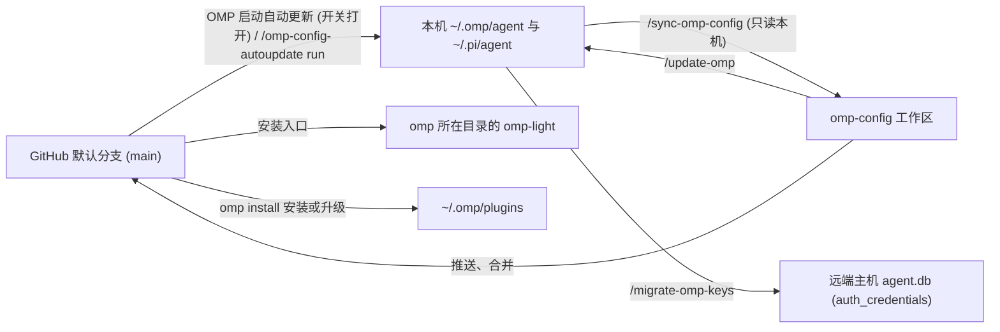

# 归属边界、双单向同步与工程维护

[返回首页](../README.zh-CN.md) · [English](operations.md) | 简体中文



## 仓库与本机的所有权及合并矩阵

系统不使用笼统的双向 `sync`，而是通过 `agent/extensions/omp-config-autoupdate/omp-config-update.ts`（Repo → 本机）与 `.omp/commands/sync-omp-config.md`（本机 → Repo）两条对称的单向通道维护：

| 资产路径 / 类别 | 归属方 | Repo → 本机（更新器）行为 | 本机 → Repo（`/sync-omp-config`）行为 | 生效时机 |
|---|---|---|---|---|
| `agent/SYSTEM_TEMPLATE.md`、`APPEND_SYSTEM.md`、`PERSONALITY.md`、`config-light.yml`、`APPEND_SYSTEM_LIGHT.md`、`omp-light.ts`、`agents/*` | 仓库全量托管 | 原子临时文件 + `rename` 整文件覆盖（保留 symlink） | 只读本机并 `cmp` 比对，有差异则整文件写回仓库 | `agents/*` 下次派发生效；其余下次启动生效 |
| `agent/extensions/<name>/*.ts`、`extensions/_shared/*.ts`、`extensions-last/<name>/*.ts` | 仓库全量托管 | 整文件覆盖；自动模式按 git diff 删除仓库已移除的 `.ts`（`extensions-last/README*.md` 仅留仓库，不写本机） | 逐个 `.ts` 比对并写回仓库 | 下次启动 OMP |
| `PROMPT-INJECT-*.md`、`TURN-JUDGE-*.md`、`INTENT-*.md` | 仓库带则归仓库；本机自建归本机 | 覆盖仓库自带模板；本机在同目录自建的模板文件绝不触碰或删除 | 仅收回仓库已有的同名模板 | 下次派发 / 下一轮 / 下次调用 |
| `APPEND_SYSTEM_MODEL.md`、`WATCHDOG-*.md` | 本机独占 | 绝不写入或删除（仅在旧平铺迁移时从根目录移入扩展目录） | 绝不收回仓库 | 下一条 prompt / 写入即刻重读 |
| `agent/config.yml`（4 个结构化文件之一） | 仓库 + 本机按字段合并 | 仓库键覆盖本机同名键；**本机字段 `LOCAL_CONFIG_FIELDS`**（`providers.webSearchOrder`、`modelRoles`、`defaultThinkingLevel`、`skills`、`symbolPreset`、`theme`、`colorBlindMode`、`hideThinkingBlock`、`statusLine`、`terminal`、`tui`、`display`、`worktree`、`compaction.thresholdTokens`、`compaction.thresholdPercent`、`compaction.idleThresholdTokens`）及本机独有键保留不动；**共享列表 `MACHINE_LIST_FIELDS`（`extensions`）** 将本机独有条目（如 `~/.claude`）保留在仓库条目**之前** | 先 `read` 两边，仅用 `edit` 修改非本机字段的差异行，绝不整文件重序列化；本机字段与 `extensions` 本机条目不写回仓库 | OMP 实时热重载 |
| `agent/omomp.yml`（4 个结构化文件之二） | 仓库 9 段 + 本机 3 段按段合并 | 覆盖仓库托管的 9 个段（`omomp-lang`、`judge`、`lang-nag`、`input-polish`、`tool-policy-nag`、`task-completion-judge`、`task-split-check`、`child-memory-warning`、`system-prompt-replace`）；保留本机独占的 3 个段 `LOCAL_OMOMP_SECTIONS`（`doc-polish`、`model-compaction`、`omp-config-autoupdate`） | 仅用 `edit` 修改仓库托管 9 个段的差异行；本机 3 个段不写回仓库 | 随各扩展读取时机生效 |
| `agent/thinking-translator.json`（4 个结构化文件之三） | 仓库 + 本机按字段合并 | 按字段合并覆盖仓库键，保留本机额外键 | 仅用 `edit` 修改差异字段 | 下一条消息开始时 |
| `pi/agent/pi-bansos-relay-state.json`（4 个结构化文件之四） | 仓库 + 本机按字段合并 | 写入 `~/.pi/agent/pi-bansos-relay-state.json` | 从 `~/.pi/agent/` 按字段比对写回（本机文件不存在时不视为删除，保持仓库原样） | 下次会话启动或 `/bansos` |
| 应用托管文件（首行 `// @orca-managed-pi-extension` 或含 `marker: _otty`） | 外部应用（Orca / Otty）独占 | 每次覆盖与删除前检查标记并跳过（记入 `skipped`） | 跳过不收回 | — |
| 运行时状态（`*.db*`、WAL、`*.lock`、`models.yml`、`commandcode-models.json`、`sessions/`、`blobs/`、`cache/`、`logs/`、`.omp-config-applied`、`settings.json`、已安装 `omp-light` 入口） | 本机运行时独占 | 绝不触碰（`.omp-config-applied` 与 `omp-light` 入口由更新器维护） | 严禁入库（同步后校验 `git status --short` 与明文凭据扫描） | — |

## 日常维护工作流

所有斜杠维护命令均在仓库根目录启动 `omp` 后执行：

1. **新机器首次部署**：
   - 在仓库根目录启动 `omp` 执行 `/update-omp`（写入全部配置、扩展与更新器，安装 `omp-light` 入口，并对 `install-plugins.sh` 声明的插件逐项执行 `omp install`）。
   - 如本机装有 `~/.claude`，在 `~/.omp/agent/config.yml` 的 `extensions` 首项加上 `~/.claude`；随后重启 `omp`。
   - 如需开启启动时自动更新，执行 `/omp-config-autoupdate on`（从下次启动起生效）。
   - 运行 `omp config list --json`、`omp plugin list --json`、`git status --short` 核对状态。
2. **本机修改收回仓库（`/sync-omp-config [check]`）**：
   - 先跑 `/sync-omp-config check` 预览差异，再跑 `/sync-omp-config` 写回仓库、通过 `Bun.YAML.parse` / `JSON.parse` 与 `bun run check` 校验并自动提交推送（commit message：`chore: sync snapshot with local omp config`）。
   - 若本机仍处于旧平铺布局（`extensions/` 下直接有同名 `.ts`，已排除的 13 个退休 Todo/`ctx` 路径除外），命令会立即中止并要求先跑 `/update-omp`。
   - 当 `~/.omp/plugins/package.json` 的依赖与 `install-plugins.sh` 不一致时，自动重写脚本中的插件列表（Git/URL 原样保留，npm 去掉版本号，注释掉的可选插件保持注释）。
3. **手动应用当前工作区（`/update-omp [check]`）**：
   - 运行 `bun agent/extensions/omp-config-autoupdate/omp-config-update.ts apply --source .`（加 `check` 时只读不写）。
   - 与自动更新的差别：① 无 git 基准，因此除平铺迁移（`RELOCATIONS`）与 13 个 Todo/`ctx` 退休路径外不删文件或结构化键；② 不改写 `.omp-config-applied`；③ 运行 `./plugin-audit.sh` 找出 `[卸载候选]` 并在询问确认后卸载；④ 检查本机初始化项（`omomp.yml` 的 `doc-polish` 段与 `commandcode-models.json`），缺失时询问用户是否创建。
4. **跨主机迁移供应商凭据（`/migrate-omp-keys <target>`）**：
   - 将本机 `~/.omp/agent/agent.db` 的 `auth_credentials` 表经 SSH 覆盖到远端主机同路径 `agent.db`（与仓库快照无关）。写前确认远端 OMP 已关闭，先用 `sqlite3` `.backup` 做带时间戳的远端备份，再于单事务内清空远端 `auth_credential_blocks` 与 `auth_credential_refresh_leases` 并整表替换 `auth_credentials`，全程绝不打印凭据原文。
5. **无配置全新机器的纯手动复制（仅限空环境）**：
   已有配置的机器必须用 `/update-omp`（直接 `cp -a` 不会清理旧本地 Todo 模块，且会覆盖本机字段）；仅在完全空白的新机器上可执行：
   ```bash
   mkdir -p "$HOME/.omp/agent"
   cp agent/config.yml agent/SYSTEM_TEMPLATE.md agent/APPEND_SYSTEM.md \
     agent/PERSONALITY.md agent/omomp.yml agent/thinking-translator.json agent/config-light.yml \
     agent/APPEND_SYSTEM_LIGHT.md agent/omp-light.ts \
     "$HOME/.omp/agent/"
   cp -a agent/agents agent/extensions agent/extensions-last "$HOME/.omp/agent/"
   mkdir -p "$HOME/.pi/agent"
   cp pi/agent/pi-bansos-relay-state.json "$HOME/.pi/agent/"
   ./install-plugins.sh
   ```
   复制后仍需执行一次 `/update-omp`（或打开 `/omp-config-autoupdate on` 重启）以在 PATH 上安装 `omp-light`。

### omp-config-autoupdate

管理启动时自动更新开关（本机 `~/.omp/agent/omomp.*` 的 `omp-config-autoupdate: { enabled: true|false }` 段，默认关闭，下次启动生效）与手动立即拉取更新：

| 命令 | 行为 |
|---|---|
| `/omp-config-autoupdate` 或 `… status` | 显示当前开关状态与配置文件路径 |
| `/omp-config-autoupdate on\|off` | 打开或关闭本机自动更新开关（下次启动 OMP 起生效） |
| `/omp-config-autoupdate run` | 无视开关状态，当场从 GitHub 默认分支拉取并执行一次 `auto` 更新，在会话空闲时将逐项明细报告作为只显示、不触发模型回合的消息写入对话 |

**`omp-config-update.ts auto` 的安全切换协议**：
- 在根主会话 `session_start` 通过 `ctx.setTimeout` 异步派生子进程运行，由锁目录 `~/.omp/omp-config-update.lock`（带死进程 PID 抢占）串行化。
- 拉取 `https://github.com/oh-my-omp/omp-config.git` 的 `main` 分支到 `~/.omp/omp-config-src`（自动修正旧 `mouriya-s-lab/omp-config.git` 地址；断网拉取失败时绝不用本地旧克隆代替，直接退出）。
- 当远端提交与 `<agentDir>/.omp-config-applied` 不同时，从新拉取的克隆中动态导入 `applySnapshot`，按 **全量解析预检（Preflight）→ `omp install` 安装/升级全部声明插件 → 向 OMP 宿主 catalog 校验 `omp-todo-more` 已启用且 `./index.ts` 存在 → 执行旧平铺布局迁移（`RELOCATIONS`）→ 写入普通文件与结构化配置 → 执行 git diff 删除与 Todo/`ctx` 旧模块退休** 顺序落地。
- 远端提交与 `.omp-config-applied` 相同时不应用任何文件，但仍对 `install-plugins.sh` 中每个不带 `#ref` 的 GitHub 条目执行 `omp install`：必装项，以及已经装上的可选项。默认分支有新提交的插件被升级（以 `~/.omp/plugins/bun.lock` 或 `omp-plugins.lock.json` 是否变化判定），缺失的必装项被装上；npm 条目和带 `#ref` 固定的 URL 等下一次配置提交。安装失败发警告，下次启动重试，不改动 `.omp-config-applied`。
- 移动或写入阶段只要出现任何错误，立即跳过整个删除阶段并报告 `Cutover incomplete; do not restart OMP`；仅当全程零错误时才更新 `.omp-config-applied`。
- 只有真的更新了才显示：编辑框上方出现一个小部件，标题 `omp-config updated`（需要重启时加 `· restart OMP to load`），每项更新对齐占一行，列出新旧版本（`omp-config 93d519e → e5a34bc (3 files)`、`omp-todo-more 0.1.10 → 0.1.12`、`omp-playbooks new 0.1.9`；插件版本取自 `~/.omp/plugins/omp-plugins.lock.json`），5 秒后自动消失。已是最新、锁被占用和离线拉取失败只写 OMP 日志；失败弹 warning。

---

## 扩展工程规范、CI 验证与升级维护

### 扩展目录结构与 `_shared` 基础设施

OMP 从 `~/.omp/agent/extensions/` 只向下找一层：本仓库所有扩展均采用 `<目录>/index.ts` 结构（目录名即扩展 ID `extension-module:<name>`），同目录其他 `.ts` 为该扩展私有模块（仅一层）；`extensions/` 与 `extensions-last/` 下严禁直接散放 `.ts` 文件。扩展之间严禁互相 import，两个及以上扩展共用的机制统一放在 `agent/extensions/_shared/`（无 `index.ts`，不会被当作扩展加载）：

| `_shared` 模块 | 导出符号与职责边界 |
|---|---|
| `errors.ts` | `errorText(error)`：将任意异常安全格式化为字符串 |
| `messages.ts` | `textOf`、`lastAssistantText`：提取消息中的纯文本内容块 |
| `i18n.ts` | `tr`、`language`、`resolveLanguage`、`parseLanguage`、`configuredLanguage`、`omompLangSection`、`LANGUAGE_ENV`：面向人的文字使用的界面语言（`OMOMP_LANG` → agent 目录 `omomp-lang` 段 → locale → 英文），每次调用时解析；不得在模块顶层调用 `tr` |
| `omomp.ts` | `defineOmompSection`、`defineSharedOmompSection`、`loadOmompSection`、`writeOmompSection`：按 `import.meta.dir` 目录名，或 `_shared` 模块的文件名（`import.meta.path`，如 `judge`），读写 `omomp.{yml,yaml,json,toml}` 对应段（项目 `<cwd>/.omp/omomp.*` 优先于 `<agentDir>/omomp.*`） |
| `models.ts` | `Model`、`ThinkingLevel`：宿主模型类型与辅助会话思考强度类型 |
| `roles.ts` | `roleModels`、`roleName`、`modelLabel`：按角色链顺序取 OMP 模型角色的聊天模型（先 `modelRoles.<role>`，再 `retry.fallbackChains.<role>`，内置角色再用 OMP 默认链；未指定模型的自定义角色不贡献任何模型），每次调用都从当前会话的实时设置解析，`/model` 改动立即生效。扩展角色命名为 `<扩展名>` 或 `<扩展名>.<部分>`（用 `.` 是因为 `/` 会让 `retry.fallbackChains` 的键变成模型选择器，`:` 是思考强度后缀）；`agent/config.yml` 的 `modelTags` 列出这些角色，未指定模型前 `/model` 也能看到 |
| `helper-session.ts` | `runHelperPrompt`：在无工具、无扩展、空系统提示词的内存辅助会话中执行单次模型调用，**固定传 `taskDepth: 1`** 且永不抛异常 |
| `judge.ts` | `openJudge`：为当前会话构建 OMP 的 judge 角色链（`@oh-my-pi/pi-coding-agent/judgment` 的 `resolveJudge`），带用量账本与判定缓存，不加会话模型；链失败或解析不出候选时，以提示式判定（`TextJudge`）询问 `judge` 段 `fallbackRole` 角色的聊天模型；只有两者都解析不出模型时才不启用 |
| `spec-files.ts` | `discoverSpecFiles`、`parseFrontmatter`、`unquote`：扫描扩展目录及 `cwd` 至 git 根各层（含 `.omp/`）的 `*-<label>.md` 文件 |

**硬性代码规范（由 `bun run check` 即 Biome + `tsc --noEmit` 强制执行）：**
1. **格式与严格类型**：仅用 Biome（tab、双引号、分号、尾逗号、行宽 140，`bun run format`）；`tsc` 开启 `strict` 与 `noUncheckedIndexedAccess`，严禁 `any`。外部输入（配置文件、工具参数、会话条目、未知事件载荷、子进程输出）必须在边界用 `@oh-my-pi/pi-coding-agent` 导出的 `z` 或类型守卫解析一次；`as` 仅限运行时无法检查的宿主类型并附单行原因注释。
2. **代数数据类型（ADT）与不抛异常边界**：多状态分支一律用以 `kind` 区分的联合类型加带 `never` 分支的穷尽 `switch` 建模，严禁用多个布尔值拼凑互斥状态。钩子与工具入口必须捕获所有异常并记 `pi.logger.warn(…, { error: errorText(error) })`，绝不把异常抛入 OMP 宿主。
3. **辅助会话必须传 `taskDepth: 1`**：除 `runHelperPrompt` 外，任何自建 `createAgentSession` 的扩展（如 `fork-task` 的 shake）都必须传 `taskDepth: 1`。不传会导致 SDK 将辅助会话误判为主会话，在其 `dispose()` 时销毁全局 `AgentLifecycleManager`，导致所有空闲或 parked 的 subagent 变成 `Unknown agent` 而永久失联。
4. **宿主包导入与无 `node_modules` 真机验证**：只导入 OMP 宿主根包（`pi-agent-core`、`pi-ai`、`pi-catalog`、`pi-coding-agent`、`pi-natives`、`pi-tui`、`pi-utils`）、Node/Bun 内置模块与带 `.ts` 后缀的相对路径（平台专属 native binding 必须放在平台判断之后按需加载）。`bun run check` 读的是开发目录的 `node_modules`，不能证明某个子路径被 OMP 二进制映射（例如 `@oh-my-pi/pi-tui/thinking` 在真机加载即失败），因此任何扩展改动都必须经 `/update-omp` 安装到无 `node_modules` 祖先的 `~/.omp/agent` 中重启并实际触发验证。

### 零凭据真实会话配置检查（CI，`bun ci/check.ts`）

`.github/workflows/config-check.yml` 在每次推送到 `main`、PR、每日定时与手动触发时运行两个 Job：`code`（`bun install && bun run check`）与 `omp-session`（`bun ci/check.ts`，设计见 [ci/README.zh-CN.md](../ci/README.zh-CN.md)）：

- **执行流程**：在新建的临时根目录中隔离 `HOME` 与 `PI_CODING_AGENT_DIR` → 安装最新发布的 `@oh-my-pi/pi-coding-agent` → 运行本仓库更新器 `apply`（含安装全部声明插件）→ 写入 `models.yml`（将主模型与 `modelRoles` 绑到 Kilo 匿名免费模型 `nvidia/nemotron-3-ultra-550b-a55b:free`，并为配置引用的所有付费模型注册指向本地回环影子代理的同名 Shadow Model）→ 分别以 RPC 模式启动一轮完整模式（`omp`）与轻量模式（`omp-light`）真实会话并发送测试 prompt。
- **零容忍判据与去重**：除 `HOST_LOG_WARNINGS` 中明确列出的 3 类主机环境噪声外，任何一行非空 stderr、任何 `extension_error` 事件或任何 `warn`/`error` 级 OMP 日志均视为故障，按 `SHA-256(类别 + 归一化文本)` 前 12 位合并去重后输出报告（退出码 `0` 无故障，`1` 配置或环境故障，`2` 仅免费模型上游不可用）。

### 维护与宿主升级必查清单

- **增删受管项时必须三处同步修改**：① `agent/extensions/omp-config-autoupdate/omp-config-update.ts` 的 `managedPlain` / `STRUCTURED`；② `.omp/commands/sync-omp-config.md` 的同步范围；③ `README.md`、`README.zh-CN.md` 及对应的 `docs/` 页面。更新器的 `applySnapshot(options)` 签名与相对路径 `extensions/omp-config-autoupdate/omp-config-update.ts` 必须保持向后兼容。
- **严禁在 `omp-config-update.ts` 中写出 Otty 标记的完整字面量**：应用托管检查匹配文件任意位置的 `marker:` + `_otty`，一旦在更新器源码中写出完整字面量，更新器自身会被识别为应用托管文件而永久跳过后续更新。
- **升级 OMP 宿主版本后的回归核对**：
  1. 在真实 TUI 中验证依赖 OMP 内部实现（`AgentRegistry`、子会话文件路径、钩子顺序、运行时设置层、`InteractiveMode` 原型与内置斜杠命令分发器）的功能：[fork-task](prompts-and-context.zh-CN.md#fork-task)、[todo-more](plugins-and-modes.zh-CN.md#todo-more) 插件（含 `ctx`、task log 与 compact 后注入）、[user-prompt-inject](agents.zh-CN.md#user-prompt-inject)、[turn-judge](extensions.zh-CN.md#turn-judge)、[task-completion-judge](extensions.zh-CN.md#task-completion-judge)、[model-compaction](prompts-and-context.zh-CN.md#model-compaction)、[wt-tool](extensions.zh-CN.md#wt-tool) 与 [harness-restart](extensions.zh-CN.md#harness-restart)。
  2. 将 `agent/SYSTEM_TEMPLATE.md` 与 OMP 内置的 `packages/coding-agent/src/prompts/system/system-prompt.md` 对比，将 `agent/PERSONALITY.md` 前半部分与 OMP `personality: default` 预设对比，按需合并上游改动。
  3. 若主会话启动时弹出 `system-prompt-replace: … found no target` 警告，按上游最新模板文字更新 `agent/omomp.yml` 的 `system-prompt-replace` 段，并确认扩展加载顺序未变。
- **双语同步契约**：`README.md` / `README.zh-CN.md` 及每一对 `docs/<topic>.md` / `docs/<topic>.zh-CN.md` 必须逐章、逐表、逐锚点保持一致，修改时同步更新。
