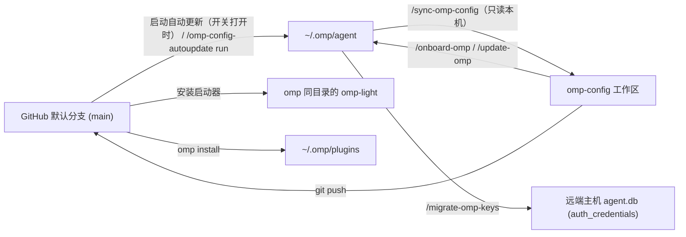

# 安装、同步与维护

[返回首页](../README.zh-CN.md) · [English](operations.md) | 简体中文



## 文件归属与同步规则

仓库 → 本机通过 `agent/extensions/omp-config-autoupdate/omp-config-update.ts`，本机 → 仓库通过 `.omp/commands/sync-omp-config.md`。更新器对每个受管项做三方合并——本机所有的子代理定义（`agents/*.md`）除外，它们只播种一次后按下表自己的规则保留——比对的三个版本是：本机副本、本机上次接受的仓库版本（基准，记录在 `<agentDir>/.omp-config-base/`）和新到的仓库版本。本机没改过的项直接取新版本；改过的保留本机修改；两边都改了时，文本文件用 `git merge-file` 合并，仍然重叠的部分保持本机原样并报告为冲突（见 [omp-config-autoupdate](#omp-config-autoupdate)）。下文提到的归属清单都是更新器里的常量。

| 路径 / 类别 | 归属 | 仓库 → 本机（更新器） | 本机 → 仓库（`/sync-omp-config`） | 生效时间 |
|---|---|---|---|---|
| `agent/SYSTEM_TEMPLATE.md`、`APPEND_SYSTEM.md`、`PERSONALITY.md`、`APPEND_SYSTEM_LIGHT.md`、`agents/*.txt`（非 agent 笔记） | 仓库；保留本机修改 | 三方合并：本机未改的文件用临时文件 + `rename` 覆盖（保留 symlink），改过的保留修改并合并上游的其他改动，重叠的改动报告冲突；源中已删除的文件，本机未改则删除，改过则报告冲突 | 只读 `cmp` 比对，有差异则复制回仓库 | 下次启动生效 |
| `agent/agents/*.md` | 本机（仓库仅首次播种默认值） | 本机所有的播种文件：仅在该文件无任何基准记录时从仓库播种；此后本机未改的副本仍跟随仓库（上游修改和删除生效，仓库侧的重命名因此传播），本机改过的一律保留、不合并也不报冲突，本机删除或改名的不再重建；本机自建的 `.md` 不动，只登记其存在 | 不收回仓库（要改默认直接改仓库里的 `agent/agents/*.md`） | 下次派发生效 |
| `agent/config-light.yml` | 仓库；保留本机修改 | 按上面文本文件的规则三方合并 | 与本机 `cmp` 比对，有改动时写回仓库 | 实时重载的设置覆盖层（`omp-light` 通过 `--config` 传入）；不会重跑仅在启动时执行的工作，当前进程从未导入的扩展源仍需重启（[设置](omp://settings.md#live-file-changes)、[扩展加载](omp://extension-loading.md#live-source-changes)） |
| `agent/extensions/<name>/*.ts`、`extensions/_shared/*.ts`、`extensions-last/<name>/*.ts`、`omp-light.ts` | 仓库（代码以仓库为准） | 即使本机改过也覆盖，改过的文件列入 `overwritten`；基准（尚无基准时为 `auto` 的上一个提交）有而源中已删除的文件会被删除（`extensions-last/README*.md` 只留仓库） | 逐个 `.ts` 比对并写回仓库 | 下次启动 OMP |
| `PROMPT-INJECT-*.md`、`TURN-JUDGE-*.md`、`INTENT-*.md`、`extensions/append-system-model/APPEND-SYSTEM-*.md`、`extensions-last/system-prompt-replace/REPLACE-SYSTEM-*.yml` / `REPLACE-SYSTEM-*.yaml` | 仓库自带归仓库；本机自建归本机 | 仓库自带文件按上面文本文件的规则三方合并；不改动或删除同目录下本机自建的文件 | 只收回仓库已跟踪的同名文件 | 下次派发 / 下一轮 / 下次调用 / 下一条 prompt |
| `extensions/tool-topics/TOPIC-*.md`、`SURFACE-*.md` | 仓库自带归仓库；本机自建归本机 | 仓库自带文件按上面文本文件的规则三方合并 | 只收回仓库已跟踪的同名文件 | 下次启动 OMP |
| `extensions/argon-long-output/ARGON_PROMPT.md` | 仓库；保留本机修改 | 按上面文本文件的规则三方合并 | 与本机 `cmp` 比对，有改动时写回仓库 | 下一条 prompt |
| `WATCHDOG-*.md` | 本机 | 不写入也不删除（仅在旧平铺目录迁移时从根目录移入扩展目录） | 不收回仓库 | 写入即重读 |
| `APPEND_SYSTEM_MODEL.md`（`append-system-model` 旧格式） | 本机 | 一次性按块拆成 `extensions/append-system-model/APPEND-SYSTEM-model-NN.md`，每块一个本机文件并带 `target: *`，随后删除原文件；目标文件名已存在或原文件无法解析时保留原文件并记 note | 不收回仓库 | — |
| `agent/config.yml` | 仓库 + 本机按字段合并 | 按字段三方合并。`LOCAL_CONFIG_FIELDS`（本机、OMP 或用户本人同意所有，如 `modelRoles`、`theme`、`setupVersion`、`dev.autoqaConsent`、`codexResets`）从不写入；`SEED_CONFIG_FIELDS`（默认值，如 `task.agentModelOverrides`、`retry.fallbackChains`、`browser`、`task.maxConcurrency`）只在本机缺少时写入；本机独有键保留；`extensions`（`MACHINE_LIST_FIELDS`）中的本机条目（如 `~/.claude`）保留在前，仓库条目作为一个整体三方合并 | 只用 `edit` 修改差异行，不整文件重序列化；跳过 `LOCAL_CONFIG_FIELDS`、`SEED_CONFIG_FIELDS` 与本机 `extensions` 条目 | OMP 热重载 |
| `agent/extensions/_shared/package.json`（`omp-config` 插件 manifest） | 仓库；保留本机修改 | 按上面文本文件的规则三方合并；`omp.settings` 是设置键、类型与默认值的唯一清单 | 与本机 `cmp` 比对，有改动时写回仓库 | 下次启动 OMP |
| `omp-config` 插件设置（`/settings → Plugins → omp-config`、`omp plugin config`；项目 `.omp/plugin-overrides.json` 覆盖机器值） | 本机 | 从不写入；apply 先 link 插件（`omp plugin link` 指向 `extensions/_shared`），再把本机 `omomp.*` 中 omp-config 拥有的段一次性迁入设置（见下方迁移） | 不收回仓库（仓库默认值在 manifest 里） | 按各扩展读取时机生效 |
| `<agentDir>/omomp.*` | 各段各自的归属方 | 只有 omp-config 拥有的段迁出（见下方迁移）；其他归属方的段（如 `omp-unified-exec`）从不写入；内容清空后删除该文件 | 不收回仓库 | — |
| `<agentDir>/subagent-usage/calibration.json` | 本机（`subagent-usage` 扩展在 `/subagent-usage on` 之后写入） | 不写入也不删除；`/subagent-usage reset` 删除 | 不收回仓库 | 下次调用 `subagent_usage` |
| `<agentDir>/thinking-translator.json` | 插件 / 本机 | 从不创建、重写或删除；旧结构化基准记录不再参与操作 | 不收回仓库；设置见 [插件 README](https://github.com/oh-my-omp/omp-thinking-translator#readme) | 由插件定义 |
| `<agentDir>/.omp-config-base/` | 更新器（本机） | 每个受管项的基准：本机写入成功后写入，`resolve` 也会写；`--check` 从不写 | 不进仓库 | — |
| 外部应用管理的文件（首行 `// @orca-managed-pi-extension` 或含 `marker: _otty`） | 外部应用（Orca / Otty） | 从不覆盖、导入或删除；旧迁移源保留并跳过或阻止迁移，被取代的模块或退休叶文件会阻止切换；不改它们的基准 | 跳过 | — |
| 运行时文件（`*.db*`、WAL、`*.lock`、`models.yml`、`sessions/`、`blobs/`、`cache/`、`logs/`、`.omp-config-applied`、`settings.json`、已安装的 `omp-light`）与插件状态（`~/.pi/agent/pi-bansos-relay-state.json`） | 本机运行时 | 不改动（`.omp-config-applied` 与 `omp-light` 由更新器写入） | 不进仓库 | — |

手动与自动更新都会处理位置迁移：
- 文件操作完成后，apply 用 `omp plugin link` 把 `extensions/_shared` 注册为本机插件 `omp-config`（OMP 已把插件注册在别的路径时保留并记 note），再把本机 `omomp.*` 中 omp-config 拥有的段以及更早放这些段的独立 JSON 迁入插件设置和它们的新 md 载体：值只在本机尚未设置该键且与 manifest 默认值不同时写成设置；`task-split-check` 的 agents 写进 `agents/*.md` 的 `splitCheck: true` frontmatter，`model-compaction` 规则写成 `extensions/model-compaction/COMPACTION-rule-NN.md`，`tool-topic-injection` 规则只在与仓库自带内容相同时删除（现在由 TOPIC 文件携带），`judge.fallbackRole` 丢弃（`@<purpose>` 未绑定时走 OMP 的 judge 角色链），其余 `fallbackRole` 在它所接的角色（`@<extension>`；doc-polish 为 `@doc-polish.split` 与 `@doc-polish.polish`）尚未绑定时，写成本机 `config.yml` `modelRoles` 里的引用 `@<role>`。插件设置以 cwd `/` 读写，项目的 `.omp/plugin-overrides.json` 不会遮住本机值；一段只在 OMP 列出它的每个值、`config.yml` 有它的每个绑定之后才从文件删除。无效、歧义或受阻的段保留并记 note；应用托管的源从不导入或删除。
- 项目的 `.omp/omomp.*`（OMP 曾先于本机读取它）在该项目启动 main 会话时迁入该项目：标量写进该项目 `.omp/plugin-overrides.json` 的 `settings["omp-config"]`（项目已有的条目保留），`model-compaction` 规则写成 `.omp/COMPACTION-rule-NN.md`，`judge.fallbackRole` 丢弃。项目级没有去处的数据（其余 `fallbackRole`、`task-split-check` 的 agents、`tool-topic-injection` 规则，以及只在本机生效的 `omomp-lang`、`omp-config-autoupdate`、`subagent-usage` 段）保留并发出警告。只删除已迁移的段，文件空了才删除。迁移前后各有一条通知列出改动的文件并提醒提交，不代为提交。
- 旧 `system-prompt-replace` 段或 JSON 与本机已接受的结构化基准一致（无基准时与仓库某个已提交版本一致）时删除，再按普通规则安装仓库默认规则文件；只有定制规则才转换并进入目标文件的受管模板合并。目标已占用、定制数据无效、布局有歧义、其他 `omomp` 格式或应用托管源都会保留迁移源并记 note，同时阻止安装默认模板。
- agent 根目录的数据只移到扩展目录中空闲的目标路径。根目录中的仓库 `PROMPT-INJECT-*` 或 `TURN-JUDGE-*` 模板，只有内容等于旧路径或新路径的仓库自带版本或本机已接受版本时才删除；定制模板保留并记 note 提醒移植。符号链接只记 note，不移动。

## 常用维护操作

在仓库根目录启动 `omp` 后执行斜杠命令：

1. **新机器首次配置（`/onboard-omp [check|<plane>]` 或 `/update-omp`）**：
   - 在仓库根目录运行 `/onboard-omp`。开场先说明完整定制为什么对低能力主 agent 是负担、对高能力主 agent 则能增强执行并保障任务质量。模型先调查 omomp 之外本机已有的全局规则和 skills，用真实故事讲清哪些语义约束可以由机制承担、哪些只覆盖一部分、哪些用户要求继续保留，以及还能增加什么能力。实际加载、文件存在和安装后才有的行为分别说明，个人与领域知识留给用户。配置、提示词、子代理、本地扩展和全部声明插件（含可选项）的介绍作为补充，不再主导开场。当前来源提供依据，仓库配置提供可调整的可运行示例，而不是讲稿。模型使用用户语言；非中文用户的第一条回复会建议 fork 并本地化配置和 prompt，用普通文字询问是否先做，等待回复；跳过则以同一语言只读继续。接受本地化时保留 schema 和机器可读文字，UI 仍只支持 `en`/`zh`。fork 维护的译文先同步上游，再从 fork 工作树运行 `/update-omp`，保持官方启动自动更新关闭。命令不调用 `ask` 工具，不逐章确认。明确的安装要求进入本机适配与 `/update-omp`；缺少的个人决定用普通文字沟通，思考翻译按 [插件 README](https://github.com/oh-my-omp/omp-thinking-translator#readme) 设置。传 `check` 做本机只读诊断；传 `<plane>` 可指定主题、组件名或原有主题编号。
   - 若已熟悉配置、只需直接安装，运行 `/update-omp`（写入配置文件、扩展与更新器，安装 `omp-light`，并对必装插件执行 `omp install`）。
   - 若本机使用 `~/.claude`，在 `~/.omp/agent/config.yml` 的 `extensions` 第一项加上 `~/.claude`，然后重启 `omp`。
   - 跟随官方仓库、而非维护 fork 译文的安装，需要开启启动自动更新时运行 `/omp-config-autoupdate on`（下次启动起生效）。
   - 用 `omp config list --json`、`omp plugin list --json`、`git status --short` 检查结果。
2. **把本机修改收回仓库（`/sync-omp-config [check]`）**：
   - 先运行 `/sync-omp-config check` 查看差异，再运行 `/sync-omp-config` 写回仓库、执行 `Bun.YAML.parse` / `JSON.parse` 与 `bun run check` 校验，并提交推送（`chore: sync snapshot with local omp config`）。本机所有路径、播种路径和基准记录都不进仓库。
   - 若本机 `extensions/` 下仍有旧平铺 `.ts` 文件（已排除的旧 Todo/`ctx` 路径除外），命令会停止并提示先运行 `/update-omp`。
   - 当 `~/.omp/plugins/package.json` 的依赖与 `install-plugins.sh` 不一致时，同步更新脚本中的插件列表（保留 Git/URL 原文、去掉 npm 版本范围、保持注释掉的可选插件不变）。
3. **把当前工作区应用到本机（`/update-omp [check]`）**：
   - 执行 `bun agent/extensions/omp-config-autoupdate/omp-config-update.ts apply --source .`（加 `check` 时只读不写）。
   - 与 `auto` 一样按记录的基准三方合并（记录的基准是工作区版本），区别在于：没有上一个提交，因此本机记录基准之前源中已删除的文件保留不删；不修改 `.omp-config-applied`；当场报告冲突并与用户逐项适配（`conflicts --source .`，再 `resolve --source .`）；运行 `./plugin-audit.sh` 并在有 `[卸载候选]` 时询问是否卸载；链接 `omp-config` 插件并迁移本机 `omomp.*` 段。
4. **跨机器复制供应商凭据（`/migrate-omp-keys <target>`）**：
   - 通过 SSH 把本机 `~/.omp/agent/agent.db` 中的 `auth_credentials` 表复制到远端同路径 `agent.db`。写前确认远端 `omp` 已退出，先用 `sqlite3` `.backup` 备份远端数据库，再在单个事务中清空远端 `auth_credential_blocks` 与 `auth_credential_refresh_leases` 并替换 `auth_credentials`，不打印凭据内容。
5. **在空白新机器上手动复制**：
   已有配置的机器请用 `/update-omp`（直接 `cp -a` 会覆盖本机字段并残留旧本地 Todo/`ctx` 文件）。仅在 `~/.omp/agent` 为空时可手动复制：
   ```bash
   mkdir -p "$HOME/.omp/agent"
   cp agent/config.yml agent/SYSTEM_TEMPLATE.md agent/APPEND_SYSTEM.md \
    agent/PERSONALITY.md agent/config-light.yml \
     agent/APPEND_SYSTEM_LIGHT.md agent/omp-light.ts \
     "$HOME/.omp/agent/"
   cp -a agent/agents agent/extensions agent/extensions-last "$HOME/.omp/agent/"
   ./install-plugins.sh
   ```
   复制后运行一次 `/update-omp`（或开启 `/omp-config-autoupdate on` 后重启）以在 `PATH` 上安装 `omp-light`。

### omp-config-autoupdate

源码：`agent/extensions/omp-config-autoupdate/`。

启动时读取一次 `omp-config` 插件的机器级设置：`enabled`（`true` 或 `false`，默认关闭）与 `conflicts`（默认 `notify`，或 `agent`）。第三个设置 `exclude` 由更新器在每次运行时读取（启动自动更新与 `/update-omp` 手动更新同样生效），不经过本扩展；三个设置都在 `/settings → Plugins → omp-config` 或 `omp plugin config` 中读写，`exclude` 是空白分隔的条目字符串：

```
omp-config-autoupdate.exclude:
  agents/task-high.md              # 受管文件：完全保留本机副本
  extensions/my-tool/**            # 支持 glob；字面量目录名覆盖其下全部文件
  config.yml                       # 文件名本身即排除整个结构化文件
  config.yml:task.eager            # 结构化文件里的单个字段路径
  omomp.yml:lang-nag               # 让 omomp.yml 的该段不参与插件设置迁移
```

被排除的项从不被写入、创建或删除，已记录的基准也保持原样，因此之后移除条目会从原位继续更新；每个被保留的项都列在报告的 skipped 部分。无效条目（路径写法错误、`file:field` 指定的文件不是 `config.yml`/`omomp.yml`、两个 omomp 文件里都有 `omp-config-autoupdate` 段）与其他预检错误一样让整个更新中止。

| 命令 | 行为 |
|---|---|
| `/omp-config-autoupdate` 或 `… status` | 显示自动更新开关、冲突处理方式与设置位置 |
| `/omp-config-autoupdate on\|off` | 修改 `omp-config-autoupdate.enabled` 设置（下次启动 OMP 生效） |
| `/omp-config-autoupdate conflicts notify\|agent` | 修改 `omp-config-autoupdate.conflicts` 设置（下次启动 OMP 生效） |
| `/omp-config-autoupdate run` | 不看开关状态，立即从 GitHub 默认分支拉取并执行一次 `auto` 更新，在会话空闲时把含冲突的明细报告作为只展示、不触发模型回合的消息写入对话 |
| `/omp-config-autoupdate adapt` | 列出相对更新器克隆的待处理冲突；有冲突时向主会话发出适配请求 |

`omp-config-update.ts auto` 的执行顺序：
1. 在根主会话 `session_start` 中由 `ctx.setTimeout` 异步启动子进程，获取锁目录 `~/.omp/omp-config-update.lock`（锁中 PID 已不存在时自动接管）。
2. 拉取 `https://github.com/oh-my-omp/omp-config.git` 的 `main` 分支到 `~/.omp/omp-config-src`（自动修正旧的 `mouriya-s-lab/omp-config.git` 远程地址；离线拉取失败时直接退出，不使用本地旧克隆）。
3. 当远端提交与 `<agentDir>/.omp-config-applied` 不同时，从新拉取的克隆导入 `applySnapshot`，依次执行：配置解析及 `TODO_RETIREMENTS`、`CTX_RETIREMENTS` 归属预检 → `omp install` 安装/升级必装插件 → 重新向 OMP 插件目录确认 `omp-todo-more` 已启用且声明的入口存在 → 位置迁移 → 普通文件与结构化配置三方合并 → 删除源中已删除且本机未改的文件及精确列出的 Todo 退休叶文件 → 记录基准 → `omp plugin link` 注册 `extensions/_shared`，并把 `omomp.*` 段一次性迁入插件设置。ctx 退休叶文件只有在就绪插件携带 `src/ctx` 时才删除，否则保留。
4. 当远端提交与 `.omp-config-applied` 相同时，不写配置文件，仍对 `install-plugins.sh` 中每个不带 `#ref` 的 GitHub 条目（必装项及已安装的可选项）执行 `omp install`，并只读重新扫描冲突。已安装的 GitHub 源按 owner/repo 匹配，兼容 `github:`、HTTPS 与 Git URL 形式；npm 条目与带固定引用的 URL 等到下次配置提交变化时才更新。
5. 移动或写入阶段只要报错，就跳过全部删除步骤、保留原 `.omp-config-applied` 不变，并报告 `Cutover incomplete; do not restart OMP`。冲突不算错误：提交照常记录，冲突保持待处理。
6. 只有配置文件或插件实际发生变化时，才在编辑框上方显示 5 秒提示框（如 `omp-config 93d519e → e5a34bc (3 files)`、`omp-todo-more 0.1.10 → 0.1.12`）；无变化、锁占用与离线只写日志，失败弹 warning。

冲突与适配：
- 没有基准的机器（基准记录出现之前安装，或手动复制安装）会把每个本机副本与仓库历史比对：等于任一已提交版本的视为未改；都不等的记为基准未知，在解决前一直是冲突。为此更新器克隆会加深一次历史。
- 更新器从未运行过的机器（没有基准记录，也没有已安装的 `omp-config-update.ts`，例如 omp 首次启动设置只写了它自己的 `config.yml`）没有收到过仓库内容，结构化文件不与历史比对：本机缺少的受管键直接写入，用户已设成不同值的键报告为冲突。
- 有待处理冲突时，`conflicts: notify` 弹出警告并指向 `/omp-config-autoupdate adapt`。`conflicts: agent` 会自动向主会话发出适配请求，但只在刚应用了新提交、有 UI、会话空闲且还没有用户消息时这样做；否则只通知。
- 适配请求让 agent 运行 `omp-config-update.ts conflicts`，它打印处理步骤，并给出每个冲突的本机副本、基准与新版本。agent 逐项说明两边的改动，用 `ask` 让用户选择保留本机、采用新版本或接受它提出的合并，修改本机文件，再用 `omp-config-update.ts resolve <id>` 记录结果。上游值在列出之后又变化的 id 会被 `resolve` 拒绝。

---

## 扩展开发、CI 与升级检查

### 扩展目录结构与 `_shared` 模块

OMP 只在 `~/.omp/agent/extensions/` 下向下一层发现扩展：每个扩展采用 `<name>/index.ts` 目录结构（扩展 ID 为 `extension-module:<name>`），同目录其他 `.ts` 为私有模块；`extensions/` 与 `extensions-last/` 下不直接放 `.ts` 文件。扩展之间不互相 import，共用代码放在 `agent/extensions/_shared/`（无 `index.ts`）：

| 模块 | 导出符号与用途 |
|---|---|
| `errors.ts` | `errorText(error)`：将 `unknown` 异常转为字符串 |
| `messages.ts` | `textOf`、`lastAssistantText`：提取消息中的纯文本块 |
| `ask-answers.ts` | `askAnswers`、`formatAskAnswers`、`AskAnswer`：从一次 `ask` 工具结果（原生或 omp-ask-more 的 `details`）读出用户的回答，取消、被拒或未作答时返回 null；`turn-judge` 与 `user-prompt-inject` 使用 |
| `i18n.ts` | `tr`、`parseLanguage`、`omompLangSetting`、`LANGUAGE_ENV`：在每次调用处按 `OMOMP_LANG` → `omomp-lang.language` 设置（`plugin-settings` 读取一次）→ locale → 英文 解析界面语言（不在模块顶层调 `tr`） |
| `plugin-settings.ts` | `defineSettings`、`readSettings`、`writeSetting`、`PLUGIN`：扩展设置是 `omp-config` 插件设置（manifest 在 `_shared/package.json` 的 `omp.settings`）；`readSettings` 在项目级时把 `<cwd>/.omp/plugin-overrides.json` 合并到机器值上，机器级从 OMP 设置存储读 |
| `models.ts` | `Model`、`ThinkingLevel`：宿主模型与辅助会话思考强度类型 |
| `roles.ts` | `roleModels`、`roleName`、`modelLabel`：每次调用从当前会话实时设置解析 OMP 模型角色的聊天模型链（`modelRoles.<role>` → `retry.fallbackChains.<role>` → 内置默认链）。扩展使用的角色名登记在 `agent/config.yml` 的 `modelTags` 中 |
| `helper-session.ts` | `runHelperPrompt`：在无工具、无扩展、`taskDepth: 1` 的内存辅助会话中执行单次请求，返回结果联合类型而不抛异常 |
| `caller-session.ts` | `callerSession(ctx)`：按 session manager 或会话文件在 `AgentRegistry` 中找到 `ExtensionContext` 所服务的实时 `AgentSession`；`fork-task` 与 `subagent-usage` 使用 |
| `judge.ts` | `openJudge`：`@<purpose>` 角色已绑定时由其聊天模型作答，否则构建 OMP 的 judge 角色链（`resolveJudge`）；链解析不出模型时报 `inactive`，候选失败时判定失败，不再回退聊天模型 |
| `spec-files.ts` | `discoverSpecFiles`、`parseFrontmatter`、`unquote`：按文件名模式（如 `*-<label>.md`）扫描扩展目录及 `cwd` 至 git 根各层（含 `.omp/`）的文件，并解析 `---` frontmatter |
| `session-filter.ts` | `parseSessionFilter`、`parseInjectMode`、`targetsSession`、`producerMatches`、`describeFilter`、`SessionFilter`、`InjectMode`、`FilterProblem`：解析规格文件的 `target` 列表、`cwd` glob 列表、产出模型正则与 `inject` 形式，解析问题以数据返回、由调用方措辞；`watchdog-agent`、`turn-judge` 与 `prompt-conditions.ts` 使用 |
| `prompt-conditions.ts` | `parseSessionConditions`、`conditionsApply`、`CONDITION_KEYS`、`SessionConditions`、`ConditionProblem`：`append-system-model` 片段与 `system-prompt-replace` 规则共用的注入与 `exclude.*` 条件（`target`、`cwd`、`model`、`provider`、`mode`、`delegation`），按会话、当前模型及其委派倾向与 `OMOMP_MODE` 匹配；默认 target 与问题措辞由各调用方决定 |
| `context-delivery.ts` | `createContextDelivery(pi)`：`repo-rules` 和专题注入共用的真实上下文标记判重；内存只保存同 turn 待交付标记 |
| `agent-definition.ts` | `declaresFlag(session, cwd, agentName, key)`：指定的 agent 定义 frontmatter 是否把某 flag 声明为 `true`（与 task 工具相同的发现顺序）；`completionJudge` 与 `splitCheck` 使用 |

| `tool-calls.ts` | `watchedCallOf`、`WatchedCall`：从宿主 `tool_call` 事件读出 shell 命令（`bash`、`bash_bg` 及其 `xd://` 设备写入）或 eval 代码；忽略插件调用；`tool-policy-nag` 与 `delete-guard` 使用 |
| `eval-py-launches.ts` | `scanPy`、`pyLaunchAt`、`isOp`、`PyLaunch`、`LaunchWord`、`LaunchVia`：对 Python eval cell 做词法分析（字符串、f-string、`!cmd`、`%%bash`、magic），读出 import 绑定，以及某个调用启动的进程，并标明识别来源 `direct`/`alias`/`distinctive`；`delete-guard`（失败即阻断）与 `tool-policy-nag` 的 pty 通道（失败即放行）使用 |
| `eval-js-launches.ts` | `parseJs`、`jsLaunchOf`、`walk`、`propertyName`、`receiverModule`、`isBunFile`、`JsLaunch`：用 omp 的 Babel 选项解析 JS eval cell，读出模块绑定，以及某个节点启动的 child_process/Bun/桥接进程；`delete-guard` 与 `tool-policy-nag` 的 pty 通道使用 |

由 `bun run check`（`biome check . && tsc --noEmit`）检查的代码规则：
1. **格式与类型**：用 `bun run format` 格式化（Biome：tab 缩进、双引号、分号、尾逗号、行宽 140）。`tsc` 开启 `strict` 与 `noUncheckedIndexedAccess`，不用 `any`。外部输入（文件、工具参数、会话条目、事件载荷、子进程输出）在边界用 `@oh-my-pi/pi-coding-agent` 的 `z` 或类型守卫解析一次；`as` 仅用于运行时无法检查的宿主类型，并附一行注释说明原因。
2. **状态建模与异常边界**：多状态分支用以 `kind` 区分的联合类型加带 `never` 分支的穷尽 `switch` 表达。钩子与工具入口捕获所有异常并记 `pi.logger.warn(…, { error: errorText(error) })`，不把异常抛给 OMP。
3. **辅助会话传入 `taskDepth: 1`**：除 `runHelperPrompt` 外，直接调用 `createAgentSession` 的扩展（如 `fork-task` 的 `shake`）必须传 `taskDepth: 1`。不传会让 SDK 把辅助会话当成主会话，在 `dispose()` 时销毁全局 `AgentLifecycleManager`，导致所有空闲或 parked 子代理变成 `Unknown agent`。
4. **宿主包导入与真机加载验证**：只导入 OMP 宿主根包（`pi-agent-core`、`pi-ai`、`pi-catalog`、`pi-coding-agent`、`pi-natives`、`pi-tui`、`pi-utils`）、Node/Bun 内置模块和带 `.ts` 后缀的相对路径（平台相关的 native binding 先做平台判断再加载）。`tsc` 从开发目录的 `node_modules/` 解析类型，测不出未映射的宿主子路径（如 `@oh-my-pi/pi-tui/thinking` 在运行期会报错），改完扩展后需经 `/update-omp` 应用到 `~/.omp/agent`、重启 `omp` 并实际触发验证。

`bun run test`（`bun test ci`）运行 `ci/` 下的单元测试：`delete-guard` 的测试（`delete` 工具的拒绝集、Linux 回收站布局与永久删除；posix 分类器、嵌套 PowerShell/cmd 方言与 py/js eval 分析器的拦截/放行表；`tool_call` 的 reason 与出错即拦截路径），以及更新器三方应用的测试（`ci/omp-config-update.test.ts`：未改的项随上游更新、本机定制被合并或在解决前一直是冲突、播种与本机路径保持不动、代码以仓库为准、删除、无基准机器按历史匹配、在 omp 首次启动写下的 `config.yml` 上首次安装、本机 `exclude` 条目保留被排除的文件与字段而兄弟项照常更新、只读的 `--check`）；CI 在 `code` job 中于 `bun run check` 之后运行它。`delete-guard` 在真实会话中的 Windows 行为由 [delete-guard Windows 验收](../ci/README.zh-CN.md#delete-guard-windows-验收) 单独检查。

### 工具专题

`tool://<tool>/<topic>` 只承载本仓库为不归它所有的工具（OMP 内置工具）编写的专题：[tool-topics](extensions.zh-CN.md#tool-topics) 加载自己的 `TOPIC-*.md` 文件，并把这个 scheme 挂到 OMP 的 URL router 上，其他扩展或插件都不往这里注册。

本仓库扩展或插件注册的工具，自己提供专题：在 `pi.registerTool` 的定义对象上提供 `docTopics()`，返回 专题名 → Markdown 正文；OMP 按 `xd://<tool>/<topic>` 读取（每次读取都会调用它，因此专题可以在读取时生成）。工具说明的最后几行，在 `Topics — read the one a call needs before making it:` 之下逐行写出每个专题的完整 URL；对于设备，OMP 在提示词里只显示说明的前 200 个字符，完整文本在 `xd://<tool>`。`ToolDefinition` 没有声明 `docTopics`，所以定义对象的类型写成 `ToolDefinition<…> & { docTopics(): Readonly<Record<string, string>> }`；本仓库的例子是 `agent/extensions/fork-task/topics.ts`。

### 渐进式专题注入 API

`extensions/tool-topics/injection.ts` 是 [tool-topics](extensions.zh-CN.md#tool-topics) 的注入引擎。`installToolTopicInjection(pi, { owner, rules })` 每个扩展/会话安装一次。`owner` 必须非空且稳定（`omp-config/tool-topic-injection`）；`rules` 是目录中已验证的 `inject` 条目，加载时固定。引擎不含 read、SSH、bash 或 eval 特例，也不注册专题。带状态的正则会在匹配前重置。

生效规则与仓库自带触发条件见 [tool-topics](extensions.zh-CN.md#tool-topics)。投递身份是 owner + 规则 id，不是专题 URL。同一逻辑规则应保留 id；如果旧标记仍在上下文中但需要再次具备注入资格，则使用新的 id。共享上下文守卫只检查活动叶节点模型投影中的 developer 消息，不把压缩摘要或兄弟分支当成已投递内容。

### CI 配置检查（`bun ci/check.ts`）

`.github/workflows/config-check.yml` 运行 `code`（`bun install && bun run check && bun run test`）和 `omp-session`（`bun ci/check.ts`）。`ci/check.ts` 在新建的临时 `HOME` 中安装最新 `@oh-my-pi/pi-coding-agent`，运行仓库更新器 `apply`（含安装插件），把主模型与 `modelRoles` 绑到 Kilo 匿名免费模型 `nvidia/nemotron-3-ultra-550b-a55b:free` 并为配置引用的付费模型启动本地回环影子代理，然后分别在 `omp` 与 `omp-light` 下跑一轮真实 RPC 会话。除 `HOST_LOG_WARNINGS` 列出的主机噪声外，任何非空 stderr、`extension_error` 事件或 `warn`/`error` 日志都会让检查失败（退出码 `0` 通过，`1` 配置或环境故障，`2` 免费模型服务故障）。完整说明见 [`ci/README.zh-CN.md`](../ci/README.zh-CN.md)。

### 升级与维护注意事项

- **增删受管文件或插件设置，或调整路径的归属**：受管文件改动同步修改 `agent/extensions/omp-config-autoupdate/omp-config-update.ts` 的 `managedPlain` / `STRUCTURED`（以及 `LOCAL_*` / `SEED_*`）；设置改动同步修改 `agent/extensions/_shared/package.json` 的 `omp.settings` manifest；`.omp/commands/sync-omp-config.md`、`README.md` / `README.zh-CN.md` 以及对应的 `docs/` 页面一起改。保持 `applySnapshot(options)` 签名与相对路径 `extensions/omp-config-autoupdate/omp-config-update.ts` 兼容：旧机器运行已安装的 `runAuto`，导入拉取到的 `applySnapshot`，并忽略不认识的报告字段。
- **不在 `omp-config-update.ts` 中写出连续的 Otty 标记字面量**：外部应用托管检查会匹配文件任意位置的 `marker:` + `_otty`，若在更新器源码里直接写出完整字面量，更新器会把自身当成外部应用托管文件而跳过更新。
- **升级 OMP 之后**：
  1. 在真实 TUI 会话中验证依赖 OMP 内部实现（`AgentRegistry`、子会话文件路径、钩子顺序、运行时设置层、`InteractiveMode` 原型、内置斜杠命令分发器、为 `xd://` 写入补发的嵌套 `tool_call`）的功能：[`fork-task`](prompts-and-context.zh-CN.md#fork-task)、[`user-prompt-inject`](agents.zh-CN.md#user-prompt-inject)、[`turn-judge`](extensions.zh-CN.md#turn-judge)、[`task-completion-judge`](extensions.zh-CN.md#task-completion-judge)、[`model-compaction`](prompts-and-context.zh-CN.md#model-compaction)、[`wt-tool`](extensions.zh-CN.md#wt-tool)、[`harness-restart`](extensions.zh-CN.md#harness-restart)、[`subagent-usage`](extensions.zh-CN.md#subagent-usage)（子代理会话的 `session_init.agent`/`resolvedModel` 字段、worktree 会话目录、供应商用量策略、`authStorage.usage.history`、`ModelsConfigFile` 与它的 Worker；在已开启的机器上执行 `/subagent-usage recalibrate` 并调用一次工具）、[`argon-long-output`](extensions.zh-CN.md#argon-long-output)（`pi-ai` 中 `register-builtins.ts` 与 `google-gemini-cli.ts` 的看门狗超时优先级，以及 OMP 的 Google compat 解析丢弃 `models.yml` 流超时的行为）、[`ast-top-level`](extensions.zh-CN.md#ast-top-level)（`src/tools/xdev.ts` 的 `XDEV_KEEP_TOP_LEVEL` 与 `isMountableUnderXdev`；system prompt 把 `ast_grep`、`ast_edit` 列为函数，不在 `# xd:// Tool Devices` 下）、[`system-prompt-replace`](prompts-and-context.zh-CN.md#system-prompt-replace)（`delegation` 条件：`@oh-my-pi/pi-catalog/compat/delegation` 的 `resolveDelegationBias` 仍能加载，`eagerDelegation` 仍控制 `delegation: eager` 规则所改的 eval 原句；在一个 `eager` 模型和一个非 `eager` 模型（如 `openai-codex/gpt-6.1-sol`）上各开一次会话，都不得出现 `found no target` 警告）与 [`delete-guard`](extensions.zh-CN.md#delete-guard)（`bash` 里的 `rm` 与 `write xd://bash` 里的 `rm` 都被拦截）。插件自身的验证按 [omp-todo-more README](https://github.com/oh-my-omp/omp-todo-more#readme) 操作。
  2. 对比 `agent/SYSTEM_TEMPLATE.md` 与 OMP 内置的 `packages/coding-agent/src/prompts/system/system-prompt.md`，以及 `agent/PERSONALITY.md` 前半部分与 OMP `personality: default` 预设。
  3. 若启动时弹出 `system-prompt-replace: … found no target` 警告，按上游最新工具说明更新 `agent/extensions-last/system-prompt-replace/REPLACE-SYSTEM-default.yml`；若 OMP 只为部分模型渲染该原文，则改为给规则加 `delegation` 等条件来限定范围。
  4. 复查 `agent/extensions/tool-topics/`：出现 `tool-topics: <tool> keeps its native description` 警告，说明 OMP 改了工具说明的渲染格式或 `{{native:…}}` 引用的标题。随后逐个工具，把它的 `SURFACE-*` / `TOPIC-*` 文件与头部 `upstream` 列出的来源（`src/prompts/tools/` 下的工具提示词、工具 schema 与 `omp://tools/<tool>.md`）对照，修正有变化的参数、取值与行为，并更新 `upstream` 里的版本。
- **中英文同步**：`README.md` / `README.zh-CN.md` 及每对 `docs/<topic>.md` / `docs/<topic>.zh-CN.md` 保持相同的章节、表格行与标题锚点。
