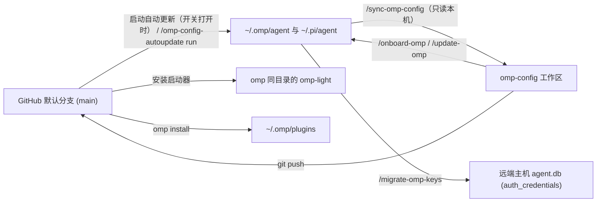

# 安装、同步与维护

[返回首页](../README.zh-CN.md) · [English](operations.md) | 简体中文



## 文件归属与同步规则

仓库与本机之间通过两个单向入口同步：`agent/extensions/omp-config-autoupdate/omp-config-update.ts`（仓库 → 本机）和 `.omp/commands/sync-omp-config.md`（本机 → 仓库）：

| 路径 / 类别 | 归属 | 仓库 → 本机（更新器） | 本机 → 仓库（`/sync-omp-config`） | 生效时间 |
|---|---|---|---|---|
| `agent/SYSTEM_TEMPLATE.md`、`APPEND_SYSTEM.md`、`PERSONALITY.md`、`config-light.yml`、`APPEND_SYSTEM_LIGHT.md`、`omp-light.ts`、`agents/*` | 仓库（整文件） | 临时文件 + `rename` 覆盖（保留 symlink） | 只读 `cmp` 比对，有差异则复制回仓库 | `agents/*` 下次派发生效；其余下次启动生效 |
| `agent/extensions/<name>/*.ts`、`extensions/_shared/*.ts`、`extensions-last/<name>/*.ts` | 仓库（整文件） | 覆盖 `.ts` 文件；`auto` 模式按 git diff 删除仓库已移除的 `.ts`（`extensions-last/README*.md` 只留仓库） | 逐个 `.ts` 比对并写回仓库 | 下次启动 OMP |
| `PROMPT-INJECT-*.md`、`TURN-JUDGE-*.md`、`INTENT-*.md` | 仓库自带归仓库；本机自建归本机 | 覆盖仓库自带文件，不改动或删除同目录下本机自建的文件 | 只收回仓库已跟踪的同名文件 | 下次派发 / 下一轮 / 下次调用 |
| `extensions/tool-topics/TOPIC-*.md`、`SURFACE-*.md` | 仓库自带归仓库；本机自建归本机 | 覆盖仓库自带文件；`auto` 模式按 git diff 删除仓库已移除的文件 | 只收回仓库已跟踪的同名文件 | 下次启动 OMP |
| `APPEND_SYSTEM_MODEL.md`、`WATCHDOG-*.md` | 本机 | 不写入也不删除（仅在旧平铺目录迁移时从根目录移入扩展目录） | 不收回仓库 | 下一条 prompt / 写入即重读 |
| `agent/config.yml` | 仓库 + 本机按字段合并 | 写入仓库键；保留本机字段 `LOCAL_CONFIG_FIELDS`（`providers.webSearchOrder`、`modelRoles`、`defaultThinkingLevel`、`skills`、`symbolPreset`、`theme`、`colorBlindMode`、`hideThinkingBlock`、`statusLine`、`terminal`、`tui`、`display`、`worktree`、`compaction.thresholdTokens`、`compaction.thresholdPercent`、`compaction.idleThresholdTokens`）和本机独有键；将 `extensions`（`MACHINE_LIST_FIELDS`）中的本机条目（如 `~/.claude`）保留在仓库条目之前 | 只用 `edit` 修改非本机字段的差异行，不整文件重序列化；跳过 `LOCAL_CONFIG_FIELDS` 与本机 `extensions` 条目 | OMP 热重载 |
| `agent/omomp.yml` | 仓库段 + 本机段 | 覆盖仓库段（`omomp-lang`、`judge`、`lang-nag`、`input-polish`、`tool-policy-nag`、`task-completion-judge`、`task-split-check`、`child-memory-warning`、`tool-topic-injection`、`system-prompt-replace`）；保留本机段（`doc-polish`、`model-compaction`、`omp-config-autoupdate`） | 只修改仓库段的差异行，忽略本机段 | 按各扩展读取时机生效 |
| `agent/thinking-translator.json` | 仓库 + 本机按字段合并 | 覆盖仓库键，保留本机额外键 | 只修改差异字段 | 下一条消息开始时 |
| `pi/agent/pi-bansos-relay-state.json` | 仓库 + 本机按字段合并 | 写入 `~/.pi/agent/pi-bansos-relay-state.json` | 从 `~/.pi/agent/` 比对并修改差异字段（本机不存在该文件时保持仓库原样） | 下次会话启动或 `/bansos` |
| 外部应用管理的文件（首行 `// @orca-managed-pi-extension` 或含 `marker: _otty`） | 外部应用（Orca / Otty） | 覆盖或删除前检查标记并跳过（记入 `skipped`） | 跳过 | — |
| 运行时文件（`*.db*`、WAL、`*.lock`、`models.yml`、`commandcode-models.json`、`sessions/`、`blobs/`、`cache/`、`logs/`、`.omp-config-applied`、`settings.json`、已安装的 `omp-light`） | 本机运行时 | 不改动（`.omp-config-applied` 与 `omp-light` 由更新器写入） | 不进仓库 | — |

## 常用维护操作

在仓库根目录启动 `omp` 后执行斜杠命令：

1. **新机器首次配置（`/onboard-omp [check|<plane>]` 或 `/update-omp`）**：
   - 首次引导安装可在仓库根目录启动 `omp` 运行 `/onboard-omp`：完成只读基线盘点后，先询问是否扩充 AI 提供商（当场对照 `omp://providers.md` 梳理 `/login` 与环境变量支持的内置渠道、检索补充的 `pi-package` 提供商扩展包、协助将第三方中转站/聚合网关写入本机 `~/.omp/agent/models.yml`），再按八个运行时控制面当场读取 `omp://` 内置文档与工作区配置讲解运行时控制机制，在不修改仓库工作树的前提下诊断订阅/模型/语言匹配度（`task.agentModelOverrides`、`omomp.yml`、`thinking-translator.json`），调用 `/update-omp` 完成全量安装，并只把当场定制写入本机所有项（`LOCAL_CONFIG_FIELDS` 中的 `modelRoles` 等、`LOCAL_OMOMP_SECTIONS` 中的 `model-compaction` 与 `doc-polish`，以及本机 `models.yml`）。传 `check` 只做只读诊断，传 `<plane>`（`1`–`8`）直接调查指定控制面。
   - 若已熟悉配置、只需直接安装，运行 `/update-omp`（写入配置文件、扩展与更新器，安装 `omp-light`，并对必装插件执行 `omp install`）。
   - 若本机使用 `~/.claude`，在 `~/.omp/agent/config.yml` 的 `extensions` 第一项加上 `~/.claude`，然后重启 `omp`。
   - 需要开启启动自动更新时，运行 `/omp-config-autoupdate on`（下次启动起生效）。
   - 用 `omp config list --json`、`omp plugin list --json`、`git status --short` 检查结果。
2. **把本机修改收回仓库（`/sync-omp-config [check]`）**：
   - 先运行 `/sync-omp-config check` 查看差异，再运行 `/sync-omp-config` 写回仓库、执行 `Bun.YAML.parse` / `JSON.parse` 与 `bun run check` 校验，并提交推送（`chore: sync snapshot with local omp config`）。
   - 若本机 `extensions/` 下仍有旧平铺 `.ts` 文件（13 个已排除的旧 Todo/`ctx` 路径除外），命令会停止并提示先运行 `/update-omp`。
   - 当 `~/.omp/plugins/package.json` 的依赖与 `install-plugins.sh` 不一致时，同步更新脚本中的插件列表（保留 Git/URL 原文、去掉 npm 版本范围、保持注释掉的可选插件不变）。
3. **把当前工作区应用到本机（`/update-omp [check]`）**：
   - 执行 `bun agent/extensions/omp-config-autoupdate/omp-config-update.ts apply --source .`（加 `check` 时只读不写）。
   - 与 `auto` 模式的区别：无 git diff 基准，因此除平铺目录迁移和 13 个旧 Todo/`ctx` 文件外不删除文件或配置键；不修改 `.omp-config-applied`；运行 `./plugin-audit.sh` 并在有 `[卸载候选]` 时询问是否卸载；在本机缺少 `omomp.yml#doc-polish` 或 `commandcode-models.json` 时询问是否创建。
4. **跨机器复制供应商凭据（`/migrate-omp-keys <target>`）**：
   - 通过 SSH 把本机 `~/.omp/agent/agent.db` 中的 `auth_credentials` 表复制到远端同路径 `agent.db`。写前确认远端 `omp` 已退出，先用 `sqlite3` `.backup` 备份远端数据库，再在单个事务中清空远端 `auth_credential_blocks` 与 `auth_credential_refresh_leases` 并替换 `auth_credentials`，不打印凭据内容。
5. **在空白新机器上手动复制**：
   已有配置的机器请用 `/update-omp`（直接 `cp -a` 会覆盖本机字段并残留旧本地 Todo 文件）。仅在 `~/.omp/agent` 为空时可手动复制：
   ```bash
   mkdir -p "$HOME/.omp/agent"
   cp agent/config.yml agent/SYSTEM_TEMPLATE.md agent/APPEND_SYSTEM.md \
     agent/PERSONALITY.md agent/omomp.yml agent/thinking-translator.json agent/config-light.yml \
     agent/APPEND_SYSTEM_LIGHT.md agent/omp-light.ts \
     "$HOME/.omp/agent/"
   cp -a agent/agents agent/extensions agent/extensions-last "$HOME/.omp/agent/"
   mkdir -p "$HOME/.pi/agent"
   cp pi/agent/pi-bansos-relay-state.json "$HOME/.pi/agent/"
   ./install-plugins.sh
   ```
   复制后运行一次 `/update-omp`（或开启 `/omp-config-autoupdate on` 后重启）以在 `PATH` 上安装 `omp-light`。

### omp-config-autoupdate

源码：`agent/extensions/omp-config-autoupdate/`。

启动时从 agent 目录的 `omomp.*` 读取一次 `omomp.yml#omp-config-autoupdate.enabled`（`true` 或 `false`，默认关闭）：

| 命令 | 行为 |
|---|---|
| `/omp-config-autoupdate` 或 `… status` | 显示当前自动更新开关状态与配置文件路径 |
| `/omp-config-autoupdate on\|off` | 修改 agent 目录 `omomp.*` 中的 `enabled`（下次启动 OMP 生效） |
| `/omp-config-autoupdate run` | 不看开关状态，立即从 GitHub 默认分支拉取并执行一次 `auto` 更新，在会话空闲时把明细报告作为只展示、不触发模型回合的消息写入对话 |

`omp-config-update.ts auto` 的执行顺序：
1. 在根主会话 `session_start` 中由 `ctx.setTimeout` 异步启动子进程，获取锁目录 `~/.omp/omp-config-update.lock`（锁中 PID 已不存在时自动接管）。
2. 拉取 `https://github.com/oh-my-omp/omp-config.git` 的 `main` 分支到 `~/.omp/omp-config-src`（自动修正旧的 `mouriya-s-lab/omp-config.git` 远程地址；离线拉取失败时直接退出，不使用本地旧克隆）。
3. 当远端提交与 `<agentDir>/.omp-config-applied` 不同时，从新拉取的克隆导入 `applySnapshot`，依次执行：配置解析预检 → `omp install` 安装/升级必装插件 → 检查 OMP 插件目录中 `omp-todo-more` 已启用且 `./index.ts` 存在 → 旧平铺文件迁移 → 写入普通文件与结构化配置 → 按 git diff 删除移除项并清理旧 Todo/`ctx` 文件。
4. 当远端提交与 `.omp-config-applied` 相同时，不写配置文件，仍对 `install-plugins.sh` 中每个不带 `#ref` 的 GitHub 条目（必装项及已安装的可选项）执行 `omp install`。
5. 移动或写入阶段只要报错，就跳过全部删除步骤、保留原 `.omp-config-applied` 不变，并报告 `Cutover incomplete; do not restart OMP`。
6. 只有配置文件或插件实际发生变化时，才在编辑框上方显示 5 秒提示框（如 `omp-config 93d519e → e5a34bc (3 files)`、`omp-todo-more 0.1.10 → 0.1.12`）；无变化、锁占用与离线只写日志，失败弹 warning。

---

## 扩展开发、CI 与升级检查

### 扩展目录结构与 `_shared` 模块

OMP 只在 `~/.omp/agent/extensions/` 下向下一层发现扩展：每个扩展采用 `<name>/index.ts` 目录结构（扩展 ID 为 `extension-module:<name>`），同目录其他 `.ts` 为私有模块；`extensions/` 与 `extensions-last/` 下不直接放 `.ts` 文件。扩展之间不互相 import，共用代码放在 `agent/extensions/_shared/`（无 `index.ts`）：

| 模块 | 导出符号与用途 |
|---|---|
| `errors.ts` | `errorText(error)`：将 `unknown` 异常转为字符串 |
| `messages.ts` | `textOf`、`lastAssistantText`：提取消息中的纯文本块 |
| `ask-answers.ts` | `askAnswers`、`formatAskAnswers`、`AskAnswer`：从一次 `ask` 工具结果（原生或 omp-ask-more 的 `details`）读出用户的回答，取消、被拒或未作答时返回 null；`turn-judge` 与 `user-prompt-inject` 使用 |
| `i18n.ts` | `tr`、`language`、`resolveLanguage`、`parseLanguage`、`configuredLanguage`、`omompLangSection`、`LANGUAGE_ENV`：在每次调用处按 `OMOMP_LANG` → agent 目录 `omomp-lang` 段 → locale → 英文 解析界面语言（不在模块顶层调 `tr`） |
| `omomp.ts` | `defineOmompSection`、`defineSharedOmompSection`、`loadOmompSection`、`writeOmompSection`：按扩展目录名或 `_shared` 文件名读写 `omomp.{yml,yaml,json,toml}` 中的配置段（项目 `<cwd>/.omp/omomp.*` 优先于 `<agentDir>/omomp.*`） |
| `models.ts` | `Model`、`ThinkingLevel`：宿主模型与辅助会话思考强度类型 |
| `roles.ts` | `roleModels`、`roleName`、`modelLabel`：每次调用从当前会话实时设置解析 OMP 模型角色的聊天模型链（`modelRoles.<role>` → `retry.fallbackChains.<role>` → 内置默认链）。扩展使用的角色名登记在 `agent/config.yml` 的 `modelTags` 中 |
| `helper-session.ts` | `runHelperPrompt`：在无工具、无扩展、`taskDepth: 1` 的内存辅助会话中执行单次请求，返回结果联合类型而不抛异常 |
| `judge.ts` | `openJudge`：构建 OMP 的 judge 角色链（`resolveJudge`），失败或未配时回退到 `omomp.yml#judge.fallbackRole` 的聊天模型（`TextJudge`） |
| `spec-files.ts` | `discoverSpecFiles`、`parseFrontmatter`、`unquote`：扫描并解析扩展目录及 `cwd` 至 git 根各层（含 `.omp/`）的 `*-<label>.md` 文件 |
| `tool-topics.ts` | `registerToolTopics`、`ToolTopic`、`ToolTopicsRegistration`、`ToolTopicsRegistrationResult`：共享的 `tool://` 注册表、索引、正文读取、搜索枚举与补全；外部插件也可调用 |
| `context-delivery.ts` | `createContextDelivery(pi)`：`repo-rules` 和专题注入共用的真实上下文标记判重；内存只保存同 turn 待交付标记 |
| `tool-topic-injection.ts` | `installToolTopicInjection`、`ToolTopicInjectionRule`、`toolTopicInjectionRulesSchema`：通用的工具参数正则匹配与可信专题投递 |
| `tool-calls.ts` | `watchedCallOf`、`WatchedCall`：从 `tool_call` 事件读出 shell 命令（`bash`、`bash_bg`、`exec_command` 及其 `xd://` 设备写入）或 eval 代码；`tool-policy-nag` 与 `delete-guard` 使用 |

由 `bun run check`（`biome check . && tsc --noEmit`）检查的代码规则：
1. **格式与类型**：用 `bun run format` 格式化（Biome：tab 缩进、双引号、分号、尾逗号、行宽 140）。`tsc` 开启 `strict` 与 `noUncheckedIndexedAccess`，不用 `any`。外部输入（文件、工具参数、会话条目、事件载荷、子进程输出）在边界用 `@oh-my-pi/pi-coding-agent` 的 `z` 或类型守卫解析一次；`as` 仅用于运行时无法检查的宿主类型，并附一行注释说明原因。
2. **状态建模与异常边界**：多状态分支用以 `kind` 区分的联合类型加带 `never` 分支的穷尽 `switch` 表达。钩子与工具入口捕获所有异常并记 `pi.logger.warn(…, { error: errorText(error) })`，不把异常抛给 OMP。
3. **辅助会话传入 `taskDepth: 1`**：除 `runHelperPrompt` 外，直接调用 `createAgentSession` 的扩展（如 `fork-task` 的 `shake`）必须传 `taskDepth: 1`。不传会让 SDK 把辅助会话当成主会话，在 `dispose()` 时销毁全局 `AgentLifecycleManager`，导致所有空闲或 parked 子代理变成 `Unknown agent`。
4. **宿主包导入与真机加载验证**：只导入 OMP 宿主根包（`pi-agent-core`、`pi-ai`、`pi-catalog`、`pi-coding-agent`、`pi-natives`、`pi-tui`、`pi-utils`）、Node/Bun 内置模块和带 `.ts` 后缀的相对路径（平台相关的 native binding 先做平台判断再加载）。`tsc` 从开发目录的 `node_modules/` 解析类型，测不出未映射的宿主子路径（如 `@oh-my-pi/pi-tui/thinking` 在运行期会报错），改完扩展后需经 `/update-omp` 应用到 `~/.omp/agent`、重启 `omp` 并实际触发验证。

`bun run test`（`bun test ci`）运行 `ci/` 下的单元测试：`session-urls` 的 JSONL 扫描器与 `JSON.parse` 的差分测试、它的 `type` 过滤测试，以及 `delete-guard` 的测试（`delete` 工具的拒绝集、Linux 回收站布局与永久删除；posix 分类器、嵌套 PowerShell/cmd 方言与 py/js eval 分析器的拦截/放行表；`tool_call` 的 reason 与出错即拦截路径）；CI 在 `code` job 中于 `bun run check` 之后运行它。`delete-guard` 在真实会话中的 Windows 行为由 [delete-guard Windows 验收](../ci/README.zh-CN.md#delete-guard-windows-验收) 单独检查。

### 插件注册工具专题

本地扩展从 `../_shared/tool-topics.ts` 静态导入 `registerToolTopics` 及其类型。外部插件使用指向已安装 helper 的静态相对导入，不复制实现。外部插件位于 `~/.omp/plugins/example/index.ts`、agent 使用默认 `~/.omp/agent` 时，导入方式如下：

```ts
import type { ExtensionAPI } from "@oh-my-pi/pi-coding-agent";
import { registerToolTopics } from "../../agent/extensions/_shared/tool-topics.ts";

export default function exampleTopics(pi: ExtensionAPI): void {
  try {
    const result = registerToolTopics({
      tool: "example",
      owner: "my-plugin",
      topics: [{
        name: "usage",
        title: "用法",
        read: () => "# 用法\n向 example 工具传入输入路径。\n",
      }],
    });
    switch (result.kind) {
      case "registered": return;
      case "invalid":
      case "conflict":
        pi.logger.warn("example topics registration failed", { reason: result.reason });
        return;
      default: {
        const unreachable: never = result;
        throw new Error(`Unhandled registration result: ${unreachable}`);
      }
    }
  } catch (error) {
    pi.logger.warn("example topics initialization failed", { error: String(error) });
  }
}
```

先通过 `/update-omp` 安装 helper。插件位于其他目录或使用自定义 agent 目录时，在部署阶段计算从插件真实源码目录到 `<getAgentDir()>/extensions/_shared/tool-topics.ts` 的相对路径。必须保留为静态相对导入：OMP 的扩展依赖图会遍历相对路径源码；绝对导入或独立的原生动态导入可能绕过宿主包重写，报 `Cannot find package '@oh-my-pi/pi-coding-agent'`。导入或初始化失败时明确报告，不另建注册表。

- `ToolTopic` 包含 `name`、`title`、可选的一行 `when`（何时读取；`tool://<tool>` 列表和补全优先显示它而非 `title`）以及 `read(): string | Promise<string>`；`ToolTopicsRegistration` 包含 `tool`、稳定的 `owner` 和 `topics`。工具名和专题名区分大小写，限 `[A-Za-z0-9_.-]+`；owner/title 不能全为空白，专题数组不能为空且名称不能重复。共享边界验证注册信息和正文读取函数的返回值。
- `registerToolTopics` 返回 `registered`、`invalid` 或 `conflict`，后两者携带 `reason`。每个工具归一个 owner；相同 owner 原子替换整份专题快照，未再提交的旧专题被移除；无效或冲突注册不会破坏现有内容。owner 用于协调注册，不是鉴权凭据。
- 注册表由 router 持有的 handler 保存；带版本的能力标识让不同导入实例加入同一个 handler，而不是覆盖它。OMP 内置、其他宿主或不兼容的 `tool` handler 不会被覆盖。注册会复制描述，调用方之后修改原对象不会改变已发布快照。
- `read tool://` 列工具，`read tool://example` 列专题，`read tool://example/usage` 读正文，支持行号和 raw 选择器。对工具或 scheme 根执行 `grep`/`find` 会枚举对应正文；未知工具或专题报错并列出可用名称。补全只读描述，正文读取和搜索每次调用 reader；reader 失败会使请求失败，不静默漏掉专题。
- 注册生命周期是整个 OMP 进程，跨会话保留，禁用扩展也不删除。reader 不得捕获会话 UI、context、abort signal 或临时资源；helper 不保留 `pi`。各插件自行决定正文缓存和失效方式。删除注册或加载新的 helper 代码需重启；会话关闭不会注销共享的进程状态。
- `tool-topics` 扩展在每个提示词里把其他 owner 注册的专题列成索引，接在该工具原生说明后面（显示 `when`，没有时显示 `title`）；工具不在本次提示词里时不加。插件因此只需让自己的工具说明保持简短（OMP 只显示插件设备说明的前 200 个字符），细节写成专题。`registeredToolTopics()` 返回当前全部注册的元数据（`tool`、`owner`、各专题的 `name`/`title`/`when`，不含正文），由 `Symbol.for("omp-config.tool-topics.index.v1")` 能力提供；没有注册表或注册表不支持该能力时返回空。
- 不便静态相对导入 helper 的插件（例如开发目录与安装目录布局不同、需要在开发目录做类型检查），可直接调用 router 上的注册表：`InternalUrlRouter.instance().getHandler("tool")` 带有 `Symbol.for("omp-config.tool-topics.registration.v1")` 为 `true` 的属性时，调用它的 `registerTopics(registration)`，参数与返回值同 `registerToolTopics`。没有这样的 handler 时（omp-config 未安装，或 `tool-topics` 尚未加载）只报告、不另建注册表；在 `session_start` 注册可保证 omp-config 的扩展已加载。`omp-playbooks` 用的就是这种方式。

### 渐进式专题注入 API

外部插件按相同的静态相对导入约定使用 `_shared/tool-topic-injection.ts`。`toolTopicInjectionRulesSchema.safeParse(rawRules)` 验证原始规则数组，将每个 pattern 编译为 `RegExp`；输出类型 `ToolTopicInjectionRule` 包含 `id`、`tool`、`parameter`、已编译的 `pattern` 和 `topic`。重复 id、无效正则、非专题正文 URL 都会被拒绝。

`installToolTopicInjection(pi, { owner, rules })` 每个扩展/会话安装一次规则读取函数。`owner` 必须非空且稳定，`rules(ctx)` 返回该会话的已验证规则。共享 helper 不含 read、SSH、bash 或 eval 特例，也不注册专题；插件自己的正文通过 registry API 单独注册。插件传入带状态的正则时，引擎会在匹配前重置它。

内置适配器的动态配置和默认 SSH 触发条件见 [tool-topic-injection](extensions.zh-CN.md#tool-topic-injection)。投递身份是 owner + 规则 id，不是专题 URL。同一逻辑规则应保留 id；如果旧标记仍在上下文中但需要再次具备注入资格，则使用新的 id。共享上下文守卫只检查活动叶节点模型投影中的 developer 消息，不把压缩摘要或兄弟分支当成已投递内容。

### CI 配置检查（`bun ci/check.ts`）

`.github/workflows/config-check.yml` 运行 `code`（`bun install && bun run check && bun run test`）和 `omp-session`（`bun ci/check.ts`）。`ci/check.ts` 在新建的临时 `HOME` 中安装最新 `@oh-my-pi/pi-coding-agent`，运行仓库更新器 `apply`（含安装插件），把主模型与 `modelRoles` 绑到 Kilo 匿名免费模型 `nvidia/nemotron-3-ultra-550b-a55b:free` 并为配置引用的付费模型启动本地回环影子代理，然后分别在 `omp` 与 `omp-light` 下跑一轮真实 RPC 会话。除 `HOST_LOG_WARNINGS` 列出的 3 类主机噪声外，任何非空 stderr、`extension_error` 事件或 `warn`/`error` 日志都会让检查失败（退出码 `0` 通过，`1` 配置或环境故障，`2` 免费模型服务故障）。完整说明见 [`ci/README.zh-CN.md`](../ci/README.zh-CN.md)。

### 升级与维护注意事项

- **增删受管文件或配置段**：同步修改 `agent/extensions/omp-config-autoupdate/omp-config-update.ts` 的 `managedPlain` / `STRUCTURED`、`.omp/commands/sync-omp-config.md`、`README.md` / `README.zh-CN.md` 以及对应的 `docs/` 页面。保持 `applySnapshot(options)` 签名与相对路径 `extensions/omp-config-autoupdate/omp-config-update.ts` 兼容。
- **不在 `omp-config-update.ts` 中写出连续的 Otty 标记字面量**：外部应用托管检查会匹配文件任意位置的 `marker:` + `_otty`，若在更新器源码里直接写出完整字面量，更新器会把自身当成外部应用托管文件而跳过更新。
- **升级 OMP 之后**：
  1. 在真实 TUI 会话中验证依赖 OMP 内部实现（`AgentRegistry`、子会话文件路径、钩子顺序、运行时设置层、`InteractiveMode` 原型、内置斜杠命令分发器、为 `xd://` 写入补发的嵌套 `tool_call`）的功能：[`fork-task`](prompts-and-context.zh-CN.md#fork-task)、[`omp-todo-more`](plugins-and-modes.zh-CN.md#todo-more)（含 `todo`、`ctx`、task log 与 compact 后注入）、[`user-prompt-inject`](agents.zh-CN.md#user-prompt-inject)、[`turn-judge`](extensions.zh-CN.md#turn-judge)、[`task-completion-judge`](extensions.zh-CN.md#task-completion-judge)、[`model-compaction`](prompts-and-context.zh-CN.md#model-compaction)、[`wt-tool`](extensions.zh-CN.md#wt-tool)、[`harness-restart`](extensions.zh-CN.md#harness-restart) 与 [`delete-guard`](extensions.zh-CN.md#delete-guard)（`bash` 里的 `rm` 与 `write xd://bash` 里的 `rm` 都被拦截）。
  2. 对比 `agent/SYSTEM_TEMPLATE.md` 与 OMP 内置的 `packages/coding-agent/src/prompts/system/system-prompt.md`，以及 `agent/PERSONALITY.md` 前半部分与 OMP `personality: default` 预设。
  3. 若启动时弹出 `system-prompt-replace: … found no target` 警告，按上游最新工具说明更新 `agent/omomp.yml` 的 `system-prompt-replace` 段。
  4. 复查 `agent/extensions/tool-topics/`：出现 `tool-topics: <tool> keeps its native description` 警告，说明 OMP 改了工具说明的渲染格式或 `{{native:…}}` 引用的标题。随后逐个工具，把它的 `SURFACE-*` / `TOPIC-*` 文件与头部 `upstream` 列出的来源（`src/prompts/tools/` 下的工具提示词、工具 schema 与 `omp://tools/<tool>.md`）对照，修正有变化的参数、取值与行为，并更新 `upstream` 里的版本。
- **中英文同步**：`README.md` / `README.zh-CN.md` 及每对 `docs/<topic>.md` / `docs/<topic>.zh-CN.md` 保持相同的章节、表格行与标题锚点。
